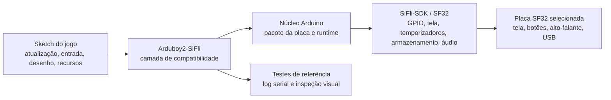

# Port do Arduboy2 para SF32LB52 { #arduboy2-on-sifli }

## O que é Arduboy2-SiFli? { #what-is-arduboy2-sifli }

[OpenSiFli/Arduboy2-SiFli](https://github.com/OpenSiFli/Arduboy2-SiFli) é um port da biblioteca [Arduboy2](https://github.com/MLXXXp/Arduboy2), mantido pela OpenSiFli para o ambiente de desenvolvimento SiFli. A Arduboy2 oferece um modelo de aplicação para dispositivos de jogos compactos: loop de quadros, buffer de tela, botões, sprites, texto e controle opcional de som. O port para SiFli serve, portanto, como teste de compatibilidade: permite avaliar quanto de um jogo no estilo Arduboy pode ser mantido ao migrar a placa, a tela, as entradas, o áudio e o processo de compilação para SF32.

O repositório é uma referência de software, não um console pronto nem um projeto de hardware para produção. Use o README, a árvore de código-fonte, os exemplos, o histórico de issues e os arquivos de licença como fontes oficiais para identificar a placa-alvo exata, as APIs compatíveis, as instruções de compilação e as condições de redistribuição. Esta página organiza as decisões de engenharia relacionadas à referência, mas não substitui as instruções executáveis do repositório.

## Qual é o valor deste port para SF32? { #why-the-sifli-implementation }

Uma aplicação no estilo Arduboy permite testar, de forma compacta, várias decisões de um produto embarcado: loop de renderização previsível, recursos monocromáticos ou de baixa resolução, entrada por botões, temporização de áudio e orçamento de memória rigorosamente limitado. Portar esse modelo para SF32 pode servir como referência inicial para jogos portáteis, demonstradores de interface, dispositivos educacionais e outros produtos com interação local e determinística.

O valor não está em executar qualquer sketch Arduboy sem alterações, mas em deixar claros os limites do port:

- O jogo pode manter a lógica de alto nível para atualização, entradas, desenho e recursos, desde que permaneça dentro da API Arduboy2 compatível.
- O port precisa adaptar as premissas de tela, botões, áudio, temporização e armazenamento que eram implícitas no hardware original.
- Qualquer sketch que controle diretamente registradores AVR, pinos específicos da Arduboy, transações de tela, temporizadores ou o layout da EEPROM exige adaptação deliberada e evidências próprias de regressão.

Essas são expectativas de engenharia, não alegações de compatibilidade medidas. Confirme-as no repositório atual da OpenSiFli e registre o resultado exato para a placa e o commit selecionados.

## Resultado, escopo e critérios de entrada { #outcome-scope-and-entry-criteria }
Esta página define etapas para transformar a referência da OpenSiFli em um jogo ou demonstração interativa reproduzível no SF32. Ela **não** afirma que o port oferece todos os recursos da Arduboy2, executa todos os jogos Arduboy, funciona em qualquer placa SF32 ou garante temporização de tela e áudio com qualidade de produção. Também não concede direitos de licenciamento para jogos, fontes, gráficos ou outros recursos copiados de repositórios de terceiros.

**Resultado esperado:** uma compilação controlada por versão do Arduboy2-SiFli que execute um exemplo do repositório ou um pequeno sketch de teste, demonstre o caminho selecionado de tela/entrada/áudio e registre evidências para decidir se vale a pena desenvolver um jogo maior ou adaptar o produto.

**Público-alvo:** engenheiros de firmware, hardware e produto que saibam usar as ferramentas Arduino, inspecionar código C/C++, gravar firmware em uma placa SF32, ler a saída serial e realizar medições básicas de tela, entrada e alimentação.

Antes de começar, tenha à disposição:

- Uma placa SF32LB52 que use a variante ArduinoCore-Zephyr `sf32lb52_devkit_lcd_sf32lb525uc6`, além dos periféricos externos descritos abaixo. O README informa que tela, botões, EEPROM externa e áudio foram testados em hardware SF32LB52; também documenta o caminho de um LED RGB, mas não relata um resultado de teste para ele. O README não fixa a revisão física da placa nem identifica o modelo exato do módulo OLED.
- Uma instalação Arduino funcional e o pacote de placas OpenSiFli correspondente. O nome da variante define a base de software e o mapa de pinos, mas não comprova que todas as unidades SF32LB52-DevKit-LCD correspondam à fiação externa do projeto; confira o esquemático da placa física antes de conectar periféricos.
- O commit exato do Arduboy2-SiFli, a versão do núcleo/pacote Arduino, o sistema operacional do host e a ferramenta de gravação.
- Uma conexão USB de dados e meios para capturar o log serial e observar tela, botões e saída de áudio.
- Permissão para usar e redistribuir todos os jogos, imagens, fontes e sons incluídos na adaptação derivada.

<em>Tabela: contrato do projeto</em>

| Área | Base do projeto | Evidência necessária antes da adaptação |
|:-----|:-----------------|:---------------------------|
| Código-fonte | Commit registrado do OpenSiFli/Arduboy2-SiFli e revisões das dependências. | Checkout limpo e registro de compilação reproduzível. |
| Placa | SF32LB52 e variante ArduinoCore-Zephyr `sf32lb52_devkit_lcd_sf32lb525uc6`, com os periféricos externos listados abaixo. | Registre a revisão física da placa, as conexões, a alimentação e a gravação bem-sucedida; o repositório não fixa a revisão da placa nem o modelo OLED. |
| Ferramentas | Arduino IDE ou CLI, pacote de placas OpenSiFli e fluxo de gravação documentado. | Versões dos pacotes, placa selecionada, saída do compilador, log de gravação e log serial. |
| Comportamento de referência | Um exemplo upstream ou sketch mínimo que exercite o port. | Atualização da tela, resposta às entradas e áudio compatível observados e reproduzíveis. |
| Alteração do produto | Uma adaptação delimitada de jogo ou interface. | O teste de referência continua passando, com registros dos recursos e das licenças preservados. |

## Especificações de hardware e software { #hardware-and-software-specifications }

### Especificação de hardware { #hardware-specification }

<em>Tabela: Especificações de hardware do Arduboy2-SiFli</em>

| Componente | Especificação necessária | Função | Situação | Onde obter | Compatibilidade e observações sobre substituição |
|:-----------|:-------------------------|:--------|:---------|:-----------|:-----------------------------------------------|
| Placa de desenvolvimento SF32LB52 | Variante ArduinoCore-Zephyr `sf32lb52_devkit_lcd_sf32lb525uc6`; o repositório não fixa uma revisão física da placa | Executa o port e fornece os pinos MCU mapeados | Obrigatório | [Código-fonte Arduboy2-SiFli](https://github.com/OpenSiFli/Arduboy2-SiFli); [variante ArduinoCore-zephyr](https://github.com/OpenSiFli/ArduinoCore-zephyr) | Identifica a variante de software e o mapa de pinos, não uma montagem física validada; compare a revisão real e o esquemático antes de conectar |
| OLED monocromático | 128 × 64 pixels, conectado por SPI1; o repositório não identifica o módulo nem o controlador exatos | Exibe o framebuffer do jogo | Obrigatório | [Código-fonte Arduboy2-SiFli](https://github.com/OpenSiFli/Arduboy2-SiFli) | Periférico externo; verifique controlador, tensão, conector, orientação e temporização conforme o módulo e a placa |
| Seis botões de jogo | Entradas compatíveis com Arduboy, ativas em nível baixo e com pull-up; mapa de pinos conforme o repositório | Lê os controles direcionais e A/B | Obrigatório | [Código-fonte Arduboy2-SiFli](https://github.com/OpenSiFli/Arduboy2-SiFli) | São externos; confira os IOs Arduino mapeados na placa física e registre a fiação e o debounce |
| EEPROM externa | AT24C02 ou AT24C32 por I2C1, no endereço `0x50` | Dá suporte às funções da biblioteca que usam EEPROM | Opcional; obrigatória somente para funções que usam EEPROM | [Código-fonte Arduboy2-SiFli](https://github.com/OpenSiFli/Arduboy2-SiFli) | Confirme o dispositivo, a tensão, os pull-ups e a fiação do barramento; o repositório não especifica uma montagem com EEPROM instalada |
| Saída de áudio e indicador RGB | Os backends de áudio compatíveis usam as saídas de alto-falante mapeadas; um LED RGB externo de cátodo comum é controlado por PWM de software | Som e indicação colorida opcionais | Opcional; escolha conforme o sketch testado | [Código-fonte Arduboy2-SiFli](https://github.com/OpenSiFli/Arduboy2-SiFli) | O código-fonte não define uma lista completa de componentes para alto-falante/LED; verifique o circuito externo, os pinos, a corrente e o áudio |
| Host e conexão USB de dados | Host compatível com a ferramenta Arduino escolhida, cabo com suporte a dados e acesso aos logs seriais | Compilar, gravar e observar a referência | Obrigatório | [ArduinoCore-zephyr](https://github.com/OpenSiFli/ArduinoCore-zephyr) | Registre o sistema operacional do host, cabo/porta, versões dos pacotes e método de recuperação; cabo somente para carga não serve |

### Especificação de software { #software-specification }

<em>Tabela: Especificações de software do Arduboy2-SiFli</em>

| Pacote ou serviço | Versão ou revisão necessária | Função | Situação | Onde obter | Compatibilidade e observações sobre atualização |
|:------------------|:---------------------------|:--------|:---------|:-----------|:-----------------------------------------------|
| OpenSiFli/Arduboy2-SiFli | Fixe e registre um commit; este artigo não define uma revisão específica | Camada de compatibilidade com SF32 e exemplos | Obrigatório | [Repositório](https://github.com/OpenSiFli/Arduboy2-SiFli) | Confira novamente o alvo da placa, as dependências e as APIs compatíveis no commit escolhido |
| OpenSiFli/ArduinoCore-zephyr e pacote da placa | Identifique e registre o commit/versão do pacote compatível com o port | Runtime Arduino, definição da placa, compilador e integração de gravação | Obrigatório | [Repositório](https://github.com/OpenSiFli/ArduinoCore-zephyr) | Não substitua por um core mais recente nem por outro pacote de placa sem compilação limpa e regressão dos periféricos |
| Sketch de teste e recursos do jogo | Um exemplo do repositório ou um sketch de teste licenciado separadamente; registre revisões e licenças dos recursos | Exercita a API e o caminho de produto escolhidos | Escolha um | [Exemplos do Arduboy2-SiFli](https://github.com/OpenSiFli/Arduboy2-SiFli) | Este artigo não concede direitos para redistribuir jogos, fontes, imagens ou sons de terceiros |

## Escolher uma configuração de referência suportada { #choose-a-supported-baseline }
Comece pela combinação de placa e software indicada no repositório da OpenSiFli, em vez de escolher uma placa do catálogo apenas por semelhança. O pacote da placa, as conexões da tela, o mapeamento das entradas, o método de gravação e as premissas da biblioteca fazem parte da base.

O repositório Arduboy2-SiFli não fornece o mapa de pinos da placa em um arquivo separado: a tabela detalhada está no README, em [SiFli IO mapping](https://github.com/OpenSiFli/Arduboy2-SiFli#sifli-io-mapping). As definições lógicas de pinos da biblioteca ficam em [`pins_sifli.h`](https://github.com/OpenSiFli/Arduboy2-SiFli/blob/master/src/platforms/sifli/pins_sifli.h), enquanto o roteamento específico da placa é definido no [overlay Devicetree](https://github.com/OpenSiFli/ArduinoCore-zephyr/blob/main/variants/sf32lb52_devkit_lcd_sf32lb525uc6/sf32lb52_devkit_lcd_sf32lb525uc6.overlay) do ArduinoCore-Zephyr. Essas fontes descrevem uma base de software, não uma montagem física validada; antes de conectar os periféricos, confira a revisão real da placa e seu esquemático.

<em>Tabela: seleção da base</em>

| Elemento da base | Fonte de seleção | Não presuma que |
|:-----------------|:---------------|:--------------|
| Placa-alvo | A variante ArduinoCore-Zephyr `sf32lb52_devkit_lcd_sf32lb525uc6` indicada pelo README do Arduboy2-SiFli e, em seguida, o esquemático da placa física. | A variante de software comprova a compatibilidade de todas as revisões físicas e conjuntos de periféricos. |
| Núcleo Arduino | Pacote OpenSiFli e revisão documentados para o alvo. | O pacote mais recente pode substituir a revisão usada pelo repositório. |
| Tela e entradas | Definições de pinos/configuração do repositório e esquemático da placa física. | A geometria de tela, polaridade dos botões ou nomes de pinos originais da Arduboy coincidem com os da placa SF32. |
| Áudio | Caminho de saída compatível documentado pelo repositório e configuração específica da placa. | Uma API de tons comprova temporização do alto-falante, volume e alimentação prontos para produção. |
| Gravação e recuperação | Fluxo Arduino ou `sftool` documentado para a placa selecionada. | Uma gravação bem-sucedida em um host comprova um caminho recuperável de atualização em campo. |

O repositório identifica uma variante de placa de software e o mapa de pinos dos periféricos, e informa que tela, botões, EEPROM externa e áudio foram testados em hardware SF32LB52. Também documenta o caminho de um LED RGB externo, mas não afirma que ele foi testado. A revisão física da placa, o modelo/controlador exato do OLED e um conjunto completo de acessórios não são identificados. Antes de conectar os componentes ou declarar a base de hardware reproduzível, compare o mapa de pinos da variante com o esquemático da placa física e registre os componentes e suas revisões. Não preencha as lacunas restantes com mapas de pinos ou endereços copiados de outro projeto SF32.

## Etapas do projeto { #delivery-map }
Use as etapas como pontos de decisão, não como uma lista de recursos.

<em>Tabela: etapas do projeto</em>

| Etapa | Decisão que ajuda a tomar | Resultado necessário |
|:------|:---------------------|:----------------|
| 1. Referência sem alterações | O port documentado compila, grava e executa na base selecionada? | Sketch funcional, registro do commit/pacote, log de gravação e comportamento observado. |
| 2. Validação dos periféricos | Tela, entradas, áudio, reset e temporização comportam-se de forma previsível na placa real? | Registro de testes dos periféricos, falhas e recuperação. |
| 3. Base reproduzível do código-fonte | Outro engenheiro consegue reconstruir a mesma imagem a partir de um checkout limpo? | Artefato de compilação limpa, registro do ambiente e resultado repetido. |
| 4. Adaptação controlada do jogo | É possível introduzir uma alteração delimitada no jogo ou na interface sem quebrar o port? | Alteração revisada, registro de recursos/licenças e resultado da regressão. |
| 5. Revisão de prontidão do produto | A referência é sólida o bastante para justificar hardware próprio ou maior investimento em software? | Registro de riscos com responsáveis, evidências, mitigação e decisão de prosseguir, adiar ou parar. |

## Arquitetura do sistema e dependências { #system-architecture-and-dependencies }

<em>Figura: fluxo da aplicação Arduboy2-SiFli</em>

Este é um modelo de decisão, não uma afirmação de que o repositório usa exatamente esses nomes de módulos internos. Confirme os limites reais no código-fonte antes de modificar o port. Os principais aspectos do produto a considerar são:

- **Quadros e temporização:** o loop do jogo deve atualizar e renderizar em intervalos reproduzíveis; qualquer comportamento de áudio ou entrada sensível à temporização precisa ser medido na placa-alvo.
- **Tela:** a camada de compatibilidade deve mapear o buffer e a geometria do jogo para o controlador de tela, formato de pixel, orientação e método de atualização selecionados.
- **Entradas:** nomes e polaridade dos botões, debounce, pressionamentos simultâneos e comportamento de despertar/reset devem ser conferidos com as conexões da placa.
- **Áudio:** geração de tons, uso do temporizador, conexão do alto-falante, volume e silenciamento devem ser considerados específicos da placa até serem verificados.
- **Recursos e armazenamento:** fontes, sprites, dados de som, layout da flash e uso de RAM devem ser medidos após a linkagem do jogo selecionado.
- **Recuperação:** mantenha um caminho de gravação e recuperação conhecido como funcional antes de experimentar alterações de temporização, memória ou baixo consumo.

As principais áreas de falha são compatibilidade da aplicação/API, configuração da tela, conexões das entradas, comportamento de áudio/temporizadores, memória e posicionamento de recursos, além de gravação/recuperação. Uma falha em uma dessas áreas não deve ser resumida a “o port não funciona”.

## Etapa 1 — Estabeleça a referência sem alterações { #stage-1-establish-the-untouched-reference }

**Objetivo:** comprovar que a base documentada pelo repositório funciona antes de alterar a biblioteca ou o jogo.

1. Leia as instruções do repositório, registre a branch padrão ou versão e examine os exemplos, a configuração da placa, as dependências e os arquivos de licença.
2. Instale exatamente o núcleo/pacote Arduino e as ferramentas exigidas pelo repositório. Registre o sistema operacional do host e as versões das ferramentas.
3. Compile e grave o menor exemplo documentado ou sketch de teste.
4. Capture a saída serial e registre o que aparece na tela, quais botões respondem e se o exemplo usa áudio.

**Evidências a preservar:** commit do repositório, versões de dependências/pacotes, revisão da placa, conexões ou referência ao esquemático, saída da compilação, logs de gravação e serial e um breve registro funcional.

**Critério de saída da etapa 1:** a referência sem alterações compila e é gravada na placa selecionada, e o comportamento documentado se repete após reset ou ciclo de alimentação.

## Etapa 2 — Valide os limites dos periféricos e da temporização { #stage-2-validate-peripheral-and-timing-boundaries }

**Objetivo:** distinguir uma compilação bem-sucedida de uma base realmente utilizável para o dispositivo de jogos.

1. Teste a limpeza da tela, a atualização de quadros completos, a renderização de sprites ou bitmaps, o texto e as premissas de geometria/orientação usadas pelo exemplo.
2. Teste todas as entradas usadas pelo projeto, incluindo soltar os botões, pressionamentos simultâneos e rápidos e, quando aplicável, o comportamento de reset ou despertar.
3. Se houver áudio, verifique início/parada dos tons, interação com temporizadores, silenciamento e efeito da atividade da tela e das entradas sobre o áudio.
4. Interrompa o fluxo normal com reset, desconexão/reconexão e uma sequência de entrada inválida ou incompleta. Registre se a placa retorna a um estado funcional de gravação e execução.

**Evidências a preservar:** resultados visuais ou capturas da tela, matriz de entradas, observações de temporização e áudio, log de reset/recuperação e medições de corrente ou latência que afetem a decisão sobre o produto.

**Critério de saída da etapa 2:** o caminho dos periféricos está suficientemente compreendido para distinguir bugs da aplicação de problemas de configuração da placa, temporização ou alimentação.

## Etapa 3 — Crie uma base reproduzível do código-fonte { #stage-3-build-a-reproducible-source-baseline }

**Objetivo:** tornar o port reproduzível, sem depender de uma única máquina de desenvolvimento ou de um binário fornecido.

1. Comece com um checkout limpo e inicialize todas as dependências exigidas pelo repositório.
2. Registre o pacote da placa, a versão do Arduino IDE/CLI, as versões do compilador e das ferramentas, os arquivos de configuração e os recursos gerados.
3. Compile em um diretório limpo, salve a imagem resultante e, quando disponíveis, as informações de mapa/tamanho; registre também o comando ou a saída da ferramenta de gravação.
4. Repita o processo em uma segunda máquina ou após remover o diretório de compilação.

**Evidências a preservar:** revisão do código-fonte e das dependências, manifesto do host/ferramentas, log da compilação, binário ou outro artefato, relatório de tamanho e logs de gravação e serial.

**Critério de saída da etapa 3:** um checkout limpo reproduz uma imagem que passa nas verificações de periféricos da etapa 2, sem arquivos locais não documentados nem edições manuais.

## Etapa 4 — Adapte um jogo de forma controlada { #stage-4-adapt-one-game-deliberately }

**Objetivo:** comprovar os limites de compatibilidade por meio de uma alteração controlada no produto.

Comece com um sketch ou jogo pequeno, cujos requisitos de tela, entradas, áudio e recursos sejam conhecidos. Mantenha disponível a imagem da referência sem alterações e mude uma classe de comportamento por vez:

<em>Tabela: ordem para adaptação controlada</em>

| Tipo de alteração | Comece por | Regressão necessária |
|:-------------|:-----------|:--------------------|
| Identidade e interface | Tela de título, fonte, sprite, paleta ou layout da tela. | Verificações de compilação, gravação, atualização dos quadros, entradas e integridade dos recursos. |
| Lógica do jogo | Uma regra, fase ou transição de estado delimitada. | Sequência de entradas reproduzível, reset, persistência de pontuação/estado quando aplicável e temporização dos quadros. |
| Áudio | Um tom ou efeito curto pelo caminho compatível. | Início/parada, silenciamento, interação com temporizadores e comportamento sob carga de tela/entradas. |
| Armazenamento | Uma pequena alteração para salvar dados ou carregar recursos. | Relatório de tamanho, comportamento em perda de alimentação, tratamento de corrupção e recuperação limpa. |
| Adaptação da placa | Uma alteração deliberada no mapeamento de tela, botões ou alto-falante. | Evidências do esquemático/pinos, regressão completa dos periféricos e retorno à imagem de referência. |

Não copie acesso a registradores AVR, premissas de pinos da Arduboy original ou endereços de armazenamento para o projeto SF32 sem uma decisão de projeto respaldada por fontes. Mantenha junto ao código adaptado as licenças de jogos e recursos de terceiros e remova qualquer item cujas condições de redistribuição não estejam claras.

**Evidências a preservar:** diff revisado, procedência dos recursos, imagens antes/depois, logs de compilação e gravação, resultados de regressão e uma imagem para reversão.

**Critério de saída da etapa 4:** o jogo adaptado passa nas verificações de periféricos da referência, e seus limites de memória, temporização, recuperação e licenciamento estão registrados.

## Etapa 5 — Revise a prontidão do produto { #stage-5-product-readiness-review }

Não avance de uma demonstração de port para hardware próprio ou teste de campo antes que a equipe consiga responder:

- Quais modelos exatos de placa SF32, tela, botões, alto-falante e fonte de alimentação são compatíveis, e quais ainda são apenas premissas?
- Que taxa de quadros, latência de entrada, comportamento de áudio, tempo de inicialização e perfil de corrente foram medidos na base prevista para o produto?
- Quanta flash e RAM o jogo, os recursos, as fontes e o runtime consomem, inclusive com o conteúdo de pior caso?
- O que acontece após reset, subtensão, perda de alimentação durante o salvamento, corrupção de recursos, falha na gravação ou atualização incompleta?
- Quais partes do port são mantidas pela equipe do produto, pela OpenSiFli, pela SiFli ou pela comunidade original Arduboy2?
- As licenças de todos os jogos, fontes, imagens, sons e bibliotecas são compatíveis com o modelo de distribuição previsto?

**Critério de saída da etapa 5:** os riscos restantes têm responsáveis e evidências; cada item conta com mitigação, adiamento explícito ou decisão de interromper.

## Transição para o projeto do produto { #handoff-to-product-design }
Leve para a seção [Hardware](../hardware/index.md) a seleção do dispositivo SF32, a arquitetura de tela e entrada, o plano de áudio e temporização, a organização da flash e dos recursos, as medições de consumo, o método de recuperação e as premissas dos testes de produção. Consulte o [Seletor de produtos SF32](../sf32-products/product-selector.md) quando os requisitos de tela, memória, encapsulamento, alimentação ou conectividade do jogo alterarem a lista de dispositivos candidatos. Para definir a base de software, comece pelo [guia de introdução ao Arduino](../getting-started/arduino/getting-started-arduino.md) e depois consulte a [visão geral da plataforma Arduino](../develop/platforms/arduino/overview.md).

A referência cumpriu seu objetivo de desenvolvimento de produto quando outro engenheiro consegue reconstruir o port, reproduzir os resultados dos periféricos, explicar cada adaptação específica da placa e revisar as evidências antes da aprovação de uma placa própria ou de uma biblioteca maior de jogos.

## Fontes de referência { #authoritative-sources }
- [OpenSiFli/Arduboy2-SiFli](https://github.com/OpenSiFli/Arduboy2-SiFli)
- [MLXXXp/Arduboy2](https://github.com/MLXXXp/Arduboy2)
- [OpenSiFli/ArduinoCore-zephyr](https://github.com/OpenSiFli/ArduinoCore-zephyr)
- [Primeiros passos com Arduino no SF32](../getting-started/arduino/getting-started-arduino.md)
- [Visão geral da plataforma Arduino](../develop/platforms/arduino/overview.md)
- [Seletor de produtos SF32](../sf32-products/product-selector.md)
