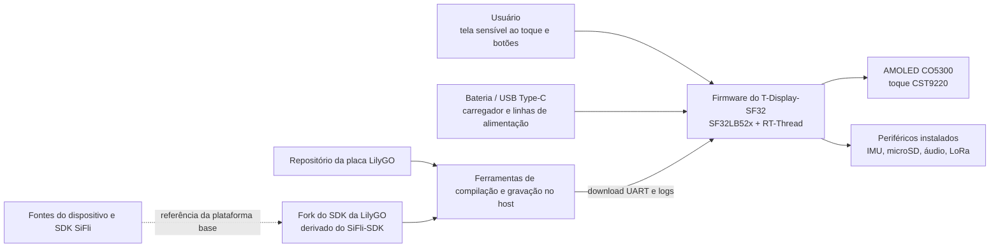

# LilyGO T-Display-SF32 { #lilygo-t-display-sf32 }

!!! warning "Projeto de terceiros — não é um projeto da SiFli"
    O T-Display-SF32 é publicado e mantido pela Xinyuan-LilyGO/LilyGO, não pela SiFli ou OpenSiFli. Use os repositórios da LilyGO para decisões sobre hardware, firmware e suporte específicos da placa. As fontes da SiFli continuam sendo a referência para o chip SF32 e o SiFli-SDK, mas isso não significa que a SiFli tenha validado ou ofereça suporte a esta placa da LilyGO.

## O que é o T-Display-SF32? { #what-is-t-display-sf32 }

[Xinyuan-LilyGO/T-Display-SF32](https://github.com/Xinyuan-LilyGO/T-Display-SF32) é uma plataforma de desenvolvimento baseada no MCU SF32LB52x, com tela AMOLED CO5300 de 2,16 polegadas e controlador de toque CST9220. O repositório documenta 16 MB de flash, 8 MB de PSRAM, IMU BHI260AP, rádio LoRa SX1262, interface microSD, áudio, USB Type-C, suporte a carregamento, pinagem da placa, aplicações de exemplo, arquivos de hardware, um diretório de firmware de fábrica e um relatório de consumo específico da placa.

Essa combinação torna a placa útil para avaliar dispositivos vestíveis com foco em tela, controles portáteis, terminais de sensores e interfaces homem-máquina conectadas. Ela é uma referência de plataforma, não um produto acabado: embora o repositório exponha diversos caminhos de hardware, a equipe ainda precisa selecionar os relevantes, reproduzir uma base conhecida e medir o comportamento dos caminhos escolhidos na revisão exata da placa, além de qualificar alimentação, RF, segurança, manutenção do software e recuperação.

A matriz de recursos do repositório distingue a placa T-SF32-Display independente da expansão opcional T-SF32-Keyboard. Wi-Fi (ESP32-C6), GPS (L76K), teclado matricial e LEDs (TCA8418, AW21009 e XL9555), BME280, transmissor infravermelho e motor de vibração (AW86224) exigem essa expansão; não os inclua na base da placa independente.

## Por que usar a implementação SF32? { #why-the-sf32-implementation }
O T-Display-SF32 reúne os recursos gráficos, Bluetooth, áudio e baixo consumo do SF32LB52x com dispositivos externos de tela, toque, movimento, armazenamento e LoRa em uma única placa. A LilyGO também fornece configuração da placa, drivers específicos, exemplos e um [fork do SDK da LilyGO](https://github.com/Xinyuan-LilyGO/SlFli-SDK-Lilygo), descrito como derivado do SiFli-SDK 2.4.0. Isso pode encurtar o bring-up inicial da placa em comparação com partir de um alvo genérico e não modificado do SDK.

O contraponto é a responsabilidade de manutenção. O suporte à placa, as alterações nos drivers, as revisões de hardware, o firmware incluído e a relação entre o fork do SDK da LilyGO e o SiFli-SDK upstream são controlados fora da SiFli. Para reproduzir o projeto, fixe os commits dos dois repositórios, preserve uma imagem de fábrica/recuperação funcional e trate qualquer migração para uma versão upstream mais recente do SDK como uma alteração explícita de engenharia.

## Resultado, escopo e critérios de entrada { #outcome-scope-and-entry-criteria }
**Resultado esperado:** estabelecer uma base do T-Display-SF32 com versões fixadas; validar tela/toque, periféricos selecionados, alimentação e recuperação; reproduzir a compilação a partir do código-fonte; e então fazer uma alteração delimitada na aplicação, com evidências de regressão adequadas à revisão do produto.

Esta página não comprova que todas as variantes da placa tenham todos os periféricos montados, que o firmware do fornecedor esteja pronto para produção, que o relatório de consumo se aplique a outra revisão ou carga de trabalho, nem que o uso de LoRa seja permitido em todas as regiões. Ela também não estende o suporte da SiFli ao hardware ou aos drivers específicos da LilyGO.

Antes de começar, tenha:

- A placa T-Display-SF32 exata e sua revisão de hardware, com o esquemático ou mapa de pinos;
- Uma fonte de bancada com limite de corrente ou bateria protegida cuja tensão e condição possam ser monitoradas;
- Um cabo USB de dados conhecido como funcional, a conexão Type-C documentada para gravação e uma imagem de recuperação preservada;
- Commits fixados dos repositórios T-Display-SF32 e do fork do SDK da LilyGO;
- O ambiente Windows/PowerShell documentado pelo fork do SDK da LilyGO para a primeira compilação reproduzível; outros ambientes de host devem ser qualificados separadamente;
- Acessórios de teste somente para as interfaces em escopo, como cartão microSD, fones ou carga de áudio e um dispositivo LoRa que opere em banda permitida;
- Registros de versões do firmware, logs de compilação e serial, fotografias, medições de corrente e resultados de falhas/recuperação.

<div align="center"><em>Tabela: contrato do projeto T-Display-SF32</em></div>

<div align="center" markdown>

| Área | Base inicial | Evidências necessárias antes da adaptação |
|:-----|:------------------|:------------------------------------|
| Responsabilidade | Placa, repositório e fork do SDK da LilyGO | Responsáveis pelos repositórios, commits, revisão da placa e limites de suporte |
| Hardware | SF32LB52x, AMOLED/toque de 2,16 polegadas, memória externa e periféricos instalados | Revisão do esquemático/mapa de pinos, registro de montagem e inventário dos componentes instalados |
| Firmware | Imagem de fábrica incluída ou exemplo do repositório sem alterações | Identificação da imagem, log de gravação e inicialização e registro funcional |
| Alimentação | Caminho USB/carregador/bateria documentado pela LilyGO | Limites da fonte, resultado de inicialização, comportamento ao desligar e corrente medida na carga escolhida |
| Adaptação | Uma alteração por vez em exemplo, interface, sensor, armazenamento, áudio ou rádio | Alteração revisada, imagem de reversão e regressão completa |

</div>

## Especificações de hardware e software { #hardware-and-software-specifications }

### Especificação de hardware { #hardware-specification }

<div align="center"><em>Tabela: Especificação de hardware do T-Display-SF32</em></div>

<div align="center" markdown>

| Componente | Especificação necessária | Função | Status | Onde obter | Compatibilidade e observações sobre substituições |
|:-----------|:-------------------------|:-------|:-------|:-----------|:--------------------------------------------------|
| Placa T-Display-SF32 | SF32LB52x; a configuração documentada inclui AMOLED CO5300 de 2,16 polegadas, touch CST9220, 16 MB Flash, 8 MB PSRAM, IMU BHI260AP, LoRa SX1262, microSD, microfone e amplificador de alto-falante integrados com conector de áudio de 3,5 mm, e três botões de usuário | Plataforma integrada de computação, tela, sensores, rádio, armazenamento e áudio | Obrigatório | [Repositório LilyGO](https://github.com/Xinyuan-LilyGO/T-Display-SF32); [arquivos de hardware](https://github.com/Xinyuan-LilyGO/T-Display-SF32/tree/master/hardware) | Registre a revisão exata da placa e os componentes instalados; não presuma que todas as variantes têm a mesma configuração |
| Expansão T-SF32-Keyboard | Expansão opcional com Wi-Fi ESP32-C6, GPS L76K, subsistema de teclado TCA8418/AW21009/XL9555, BME280, transmissor infravermelho e motor de vibração AW86224 | Adiciona os recursos indicados de conectividade, posicionamento, teclado, sensores ambientais, infravermelho e resposta tátil | Opcional; obrigatória somente para esses recursos | [Repositório LilyGO](https://github.com/Xinyuan-LilyGO/T-Display-SF32); [arquivos de hardware](https://github.com/Xinyuan-LilyGO/T-Display-SF32/tree/master/hardware) | Esses componentes não estão na T-SF32-Display independente. Wi-Fi e GPS compartilham UART2; valide a configuração conjunta da expansão |
| Conexão USB Type-C de dados e alimentação controlada | Cabo com dados; fonte limitada em corrente ou bateria protegida cuja tensão possa ser monitorada | Gravação do firmware, logs e validação segura da alimentação | Obrigatório | [Repositório LilyGO](https://github.com/Xinyuan-LilyGO/T-Display-SF32) | As linhas D+/D- do Type-C conectam-se à ponte USB-UART CH343P. Essa porta serve para gravação UART e logs, não para USB nativo de dispositivo/host do SF32. Siga também a condição de inicialização acima de 3,5 V específica da placa |
| Acessórios de teste por interface | Cartão microSD, carga de áudio/fones ou dispositivo LoRa de teste operando em uma faixa permitida, somente para as interfaces avaliadas | Testa interfaces opcionais da placa | Opcional; escolha conforme o teste | [Exemplos](https://github.com/Xinyuan-LilyGO/T-Display-SF32/tree/master/examples) | Antes de conectar, confirme nos arquivos de hardware o conector, a tensão, a região e a revisão |

</div>

### Especificação de software { #software-specification }

<div align="center"><em>Tabela: Especificação de software do T-Display-SF32</em></div>

<div align="center" markdown>

| Pacote ou serviço | Versão ou revisão necessária | Função | Status | Onde obter | Compatibilidade e observações sobre atualizações |
|:------------------|:-----------------------------|:-------|:-------|:-----------|:-------------------------------------------------|
| Firmware/código-fonte do T-Display-SF32 | Fixe e registre um commit; o upstream não define uma tag universal | Exemplos, configuração e firmware da placa | Obrigatório | [Repositório](https://github.com/Xinyuan-LilyGO/T-Display-SF32) | Preserve o firmware de fábrica e registre juntos a revisão da placa e o commit |
| Fork LilyGO do SiFli-SDK | Fixe um commit do fork, descrito como baseado no SiFli-SDK 2.4.0 | Suporte da placa, drivers e ambiente de compilação/gravação | Obrigatório | [Fork do SDK da LilyGO](https://github.com/Xinyuan-LilyGO/SlFli-SDK-Lilygo) | A referência à base 2.4.0 não fixa o commit do fork; não substitua silenciosamente pelo SDK upstream |
| SCons e ferramentas de gravação do host | Versões fornecidas pelo fork selecionado; registre o SO e as versões efetivamente resolvidas | Compila e grava o alvo `t-display-sf32_hcpu` | Obrigatório | [Fork do SDK da LilyGO](https://github.com/Xinyuan-LilyGO/SlFli-SDK-Lilygo) | O fluxo inicial documentado usa Windows/PowerShell; qualifique outros hosts separadamente |
| Firmware de fábrica V1.2 | Imagem correspondente à revisão da placa/repositório | Referência sem alterações e recuperação | Opcional, mas preserve antes de modificar | [Diretório do firmware de fábrica](https://github.com/Xinyuan-LilyGO/T-Display-SF32/tree/master/firmware/T-SF32-Factory-V1.2) | O nome do diretório não comprova compatibilidade entre imagem e placa; confirme antes de gravar |

</div>

## Escolher uma configuração de referência suportada { #choose-a-supported-baseline }
Atualmente, o repositório upstream usa a branch `master` e não apresenta uma versão identificada por tag como base universal de software. Registre o commit exato em vez de escrever “mais recente”. O repositório contém o diretório `firmware/T-SF32-Factory-V1.2`, mas esse nome não substitui o registro da revisão correspondente da placa, do commit do repositório e do procedimento de gravação.

<div align="center"><em>Tabela: seleção da base do T-Display-SF32</em></div>

<div align="center" markdown>

| Elemento da base | Ponto de partida recomendado | Limitação importante |
|:-----------------|:------------------|:--------------------|
| Placa | Uma unidade do T-Display-SF32 fotografada e identificada por revisão | Não presuma que pinagem ou periféricos instalados sejam iguais em outra revisão ou variante relacionada a teclado |
| Comportamento de fábrica | Diretório de fábrica V1.2 incluído ou compilação `menu_app` sem alterações, conforme a unidade | Verifique procedência e compatibilidade antes de gravar; preserve a imagem original |
| Código-fonte | Commit fixado do T-Display-SF32 | O repositório evolui independentemente do SiFli-SDK |
| SDK | Commit fixado do fork do SDK da LilyGO, documentado como derivado do SiFli-SDK 2.4.0 | Não o substitua silenciosamente por outra revisão do SDK; os drivers e a configuração da placa podem diferir |
| Alvo de compilação | `t-display-sf32_hcpu` | É um alvo de placa da LilyGO, não um alvo genérico do SF32LB52x |
| Alimentação | Siga a condição de inicialização acima de 3,5 V declarada pela LilyGO e implemente detecção de tensão/desligamento por bateria fraca no firmware personalizado | Trate-a como requisito da placa a verificar, não como substituto da folha de dados do chip, dos limites da bateria ou da medição do comportamento em subtensão |

</div>

Depois de configurar o ambiente necessário, o README do T-Display-SF32 documenta este fluxo de compilação e gravação no Windows:

```powershell
cd T-Display-SF32\examples\rt_os\rt_driver\project
scons --board=t-display-sf32_hcpu -j8
build_t-display-sf32_hcpu\uart_download.bat
```

Salve os commits usados do repositório e do SDK, o resultado da exportação do ambiente, o log completo da compilação, as imagens geradas e os logs de gravação e inicialização. A quantidade de tarefas paralelas pode mudar; o alvo e as revisões do código-fonte, não.

## Etapas do projeto { #delivery-map }
<div align="center"><em>Tabela: etapas do projeto T-Display-SF32</em></div>

<div align="center" markdown>

| Etapa | Decisão que ajuda a tomar | Resultado necessário |
|:------|:---------------------|:----------------|
| 1. Base do fornecedor | A combinação original de placa e firmware funciona conforme identificada? | Sessão funcional fotografada e com versões fixadas |
| 2. Validação de periféricos e recuperação | As interfaces, estados de alimentação e falhas selecionados podem ser observados e recuperados? | Registro de injeção de falhas, medições e recuperação |
| 3. Reprodução da compilação | A equipe consegue reconstruir e gravar o mesmo comportamento a partir de fontes limpas? | Ambiente, imagem, log de gravação e resultado repetido |
| 4. Adaptação controlada | É possível alterar um comportamento do produto sem quebrar a base? | Alteração delimitada, caminho de reversão e evidências de regressão |
| 5. Revisão do produto | A plataforma de terceiros é adequada para continuar o protótipo ou criar hardware próprio? | Riscos atribuídos a responsáveis e decisão de prosseguir, adiar ou parar |

</div>

## Arquitetura do sistema e dependências { #system-architecture-and-dependencies }
<div align="center"><em>Figura: limites do produto e do desenvolvimento do T-Display-SF32</em></div>



Trate as falhas como áreas distintas: alimentação/carregamento da placa, inicialização e gravação, tela/toque, cada periférico selecionado, suporte à placa da LilyGO e SDK subjacente. Por exemplo, uma falha em um exemplo de tela pode decorrer da alimentação, revisão da placa, configuração do painel/toque, aplicação ou incompatibilidade entre SDK e driver; dizer apenas “o SDK falhou” não é um diagnóstico suficiente.

## Etapa 1 — Estabeleça a base original do fornecedor { #stage-1-establish-the-untouched-vendor-baseline }

**Objetivo:** comprovar o comportamento real da placa recebida e da base do fornecedor antes de alterar o código-fonte.

1. Fotografe os dois lados da placa e registre marcações, periféricos instalados, componentes de tela/toque, memória, chaves, conectores e commit do repositório.
2. Verifique a fonte e a polaridade. A LilyGO alerta que a inicialização exige mais de 3,5 V; use uma fonte monitorada e não teste com uma célula profundamente descarregada.
3. Grave somente uma base que corresponda comprovadamente à placa ou execute primeiro o firmware existente, se sua procedência for conhecida. Preserve a imagem original quando as ferramentas permitirem.
4. Teste o menu no próprio dispositivo ou exemplos sem alterações para tela/toque e cada periférico selecionado para o produto. Registre funções indisponíveis ou não instaladas, em vez de tratá-las como falhas.
5. Faça duas inicializações a frio e guarde logs de inicialização, fotos da interface, resultados de toque/entrada e um traço de corrente para uma carga ociosa/ativa claramente definida.

**Evidências a preservar:** revisão e fotos da placa, identificação do repositório/imagem, dados da fonte e bateria, logs de gravação e inicialização, inventário dos dispositivos instalados, resultados funcionais e condições do teste de corrente.

**Critério de saída da etapa 1:** duas inicializações a frio reproduzem a base identificada de tela/toque, há resultados registrados para cada periférico instalado em escopo e é possível restaurar a imagem original ou uma imagem conhecida como funcional.

## Etapa 2 — Valide os limites de periféricos, alimentação e recuperação { #stage-2-validate-peripheral-power-and-recovery-boundaries }

**Objetivo:** determinar se falhas podem ser detectadas e recuperadas sem uso inseguro da bateria ou gravação de firmware sem procedimento documentado.

<div align="center"><em>Tabela: testes de falha e recuperação do T-Display-SF32</em></div>

<div align="center" markdown>

| Teste | Método | Evidência de aprovação |
|:-----|:-------|:--------------|
| Margem de inicialização | Varie uma fonte de bancada com limite de corrente em torno da faixa de operação pretendida, sem exceder os limites documentados | Limiares e comportamento de inicialização/desligamento são medidos; resets repetidos ou estados indefinidos não são ocultados |
| Política de bateria fraca | Use uma fonte controlada para exercitar os limiares de aviso e desligamento | O firmware personalizado avisa e desliga antes do limite seguro de descarga da bateria selecionada |
| Carregamento com o dispositivo desligado | Após o desligamento pelo firmware de fábrica, conecte a alimentação USB e use o caminho documentado de despertar pelo botão | O carregamento e o despertar somente pelo botão correspondem à nota do fornecedor; a conexão USB, por si só, não é tratada incorretamente como caminho de inicialização |
| Interrupção de tela/toque | Faça reset ou ciclo de alimentação durante a atividade da interface e repita testes de toque nas bordas e cantos | Tela e toque retornam a um estado conhecido, sem corrupção persistente ou entradas falsas |
| Armazenamento removível | Remova, corrompa ou substitua o cartão de teste somente em pontos controlados | Estados de ausência/erro são diagnosticáveis; a aplicação não corrompe estados não relacionados nem trava |
| Caminho LoRa | Use um dispositivo par em banda permitida e uma configuração de RF controlada | Frequência/configuração são registradas; timeout e reconexão são observáveis; não se declara alcance sem medi-lo |
| Recuperação da flash | Interrompa uma gravação de teste somente em uma unidade recuperável e use o caminho Type-C/UART documentado | A imagem conhecida como funcional é restaurada com ferramentas e etapas registradas |

</div>

**Critério de saída da etapa 2:** cada teste aplicável tem resultado reproduzível e caminho de recuperação; qualquer firmware personalizado implementa proteção contra bateria fraca; e nenhuma falha não resolvida pode danificar a bateria ou inutilizar a placa sem um procedimento de recuperação documentado.

## Etapa 3 — Crie uma base reproduzível do código-fonte { #stage-3-build-a-reproducible-source-baseline }

**Objetivo:** permitir que outro engenheiro gere e grave a mesma base a partir de fontes limpas e com versões fixadas.

1. Faça checkout dos commits fixados do repositório da placa e do fork do SDK da LilyGO; registre qual SDK upstream é indicado como base do fork.
2. Configure o ambiente PowerShell documentado e compile `t-display-sf32_hcpu` em um diretório limpo.
3. Guarde evidências do ambiente, dependências, configuração, memória/partições, imagem, gravação e logs seriais.
4. Repita em outra máquina ou após excluir todos os artefatos de compilação e execute novamente toda a regressão da etapa 2.

**Critério de saída da etapa 3:** nenhuma imagem obsoleta, arquivo de placa não rastreado ou substituição não documentada do SDK é necessária para gerar firmware aprovado na etapa 2.

## Etapa 4 — Adapte um caminho do produto por vez { #stage-4-adapt-one-product-path-at-a-time }

**Objetivo:** implementar uma alteração útil sem perder as bases funcionais do fornecedor e de recuperação.

<div align="center"><em>Tabela: ordem de adaptação controlada do T-Display-SF32</em></div>

<div align="center" markdown>

| Tipo de alteração | Boa primeira alteração | Regressão necessária |
|:-------------|:------------------|:--------------------|
| Interface | Uma página, ícone, fonte ou ação de toque | Inicialização a frio, atualização da tela inteira, limites do toque, uso de memória e recuperação |
| Sensor | Um valor ou evento da IMU | Identidade do dispositivo, faixa, taxa de amostragem, tratamento de erros, corrente ociosa e comportamento ao despertar |
| Armazenamento/áudio | Uma operação de arquivo ou caminho de reprodução | Mídia ausente, dados malformados, limites de volume/saída, interrupção de alimentação e recuperação do sistema de arquivos |
| LoRa | Uma troca de pacotes delimitada em banda permitida | Registro da configuração, timeout, tentativas, corrente, coexistência e revisão regulatória |
| Alimentação | Uma alteração de sono/despertar ou controle de linha de alimentação | Todas as fontes de despertar, estado da tela/periféricos, desligamento por bateria fraca, carregamento e ciclos repetidos |
| Migração do SDK | Uma atualização candidata do fork da LilyGO ou do SDK upstream | Diff da configuração da placa, compilação limpa, regressão de todos os periféricos, medições de corrente e reversão |

</div>

**Critério de saída da etapa 4:** a alteração foi revisada, a imagem original continua recuperável e todos os testes aplicáveis de tela, toque, periféricos, alimentação, flash e recuperação foram aprovados.

## Etapa 5 — Revise a prontidão do produto { #stage-5-product-readiness-review }

Antes de avançar para um teste de campo ou uma PCB própria, responda:

- Quem é responsável pelos arquivos da placa, pelo fork do SDK da LilyGO, correções de drivers, atualizações de segurança e migração para versões posteriores do SiFli-SDK?
- Quais revisões da placa e periféricos instalados compõem a base do produto, e como as unidades recebidas serão identificadas e testadas?
- Quais valores de corrente foram medidos em atividade, repouso, suspensão, inicialização e desligamento, com o brilho da tela, o ciclo de trabalho do rádio, o armazenamento e a configuração de sensores previstos?
- Como serão verificados a proteção da bateria, o carregamento, o comportamento térmico, o gabinete, o acesso aos conectores e a recuperação com o dispositivo desligado?
- Quais região LoRa, antena, plano de frequências, parâmetros de transmissão e obrigações regulatórias se aplicam?
- Os arquivos de hardware, firmware, fork do SDK, exemplos, recursos e componentes de terceiros têm licenças compatíveis com a distribuição pretendida?
- A equipe aceita a dependência de um protótipo de terceiros ou já qualificou um fork controlado e um plano de suporte?

**Critério de saída da etapa 5:** cada risco residual tem responsável, evidências e encaminhamento, e a equipe decidiu explicitamente prosseguir, adiar ou parar.

## Transição para o projeto do produto { #handoff-to-product-design }
Leve adiante o modelo exato do SF32 e os dispositivos de memória, temporização de tela/toque, periféricos instalados e barramentos, árvore de alimentação, política de carregador e bateria, estratégia de antena/RF, conexão de boot/gravação, plano de partições, acesso a testes de produção, responsabilidade pelo fork do software e caminho de recuperação comprovado. Continue pelo [caminho de integração do SF32LB52x](../sf32-products/chips/SF32LB52x.md#integration-path), [guia de projeto de hardware do SF32LB52x](../hardware/chip-guides/SF32LB52x_hardware_design_guide.md), [compilação, gravação e monitoramento do SiFli-SDK](../develop/platforms/sifli-sdk/build-flash-monitor.md) e [projeto para produção](../hardware/design-for-production.md).

## Fontes de referência { #authoritative-sources }
- [Repositório Xinyuan-LilyGO/T-Display-SF32](https://github.com/Xinyuan-LilyGO/T-Display-SF32)
- [README do T-Display-SF32 em chinês](https://github.com/Xinyuan-LilyGO/T-Display-SF32/blob/master/readme_cn.md)
- [Exemplos do T-Display-SF32](https://github.com/Xinyuan-LilyGO/T-Display-SF32/tree/master/examples)
- [Arquivos de hardware do T-Display-SF32](https://github.com/Xinyuan-LilyGO/T-Display-SF32/tree/master/hardware)
- [Material de testes de consumo do T-Display-SF32](https://github.com/Xinyuan-LilyGO/T-Display-SF32/tree/master/lowpowertest)
- [Fork do SDK Xinyuan-LilyGO/SlFli-SDK-Lilygo](https://github.com/Xinyuan-LilyGO/SlFli-SDK-Lilygo)
- [OpenSiFli/SiFli-SDK](https://github.com/OpenSiFli/SiFli-SDK)
