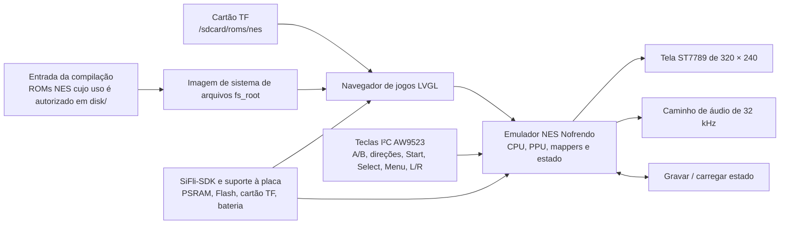

# Console portátil Pocket Pi com SF32 { #pocket-pi-sf32-handheld-game-console }

!!! note "Commit de referência fixado"
    Salvo indicação em contrário, as descrições do comportamento do código neste artigo referem-se ao commit [`7d9fac2`](https://github.com/SiFliSparks/PocketPi/commit/7d9fac2cb577d6c9b66a99521aebf3c9de0ae163) do PocketPi. A branch upstream `main` pode mudar; para reproduzir estes detalhes, use o commit fixado.

## O que é o Pocket Pi? { #what-is-pocket-pi }

[SiFliSparks/PocketPi](https://github.com/SiFliSparks/PocketPi) é um projeto de referência de console portátil e emulação para o SF32LB52. A revisão fixada integra o emulador NES Nofrendo, um navegador de jogos em LVGL, uma interface para display ST7789 8080 de 320 × 240, áudio, salvamento e carregamento de estados, um sistema de arquivos integrado e um diretório de ROMs no cartão TF. A configuração pública de compilação usa o alvo Huangshan Pi / `sf32lb52-lchspi-ulp`.

O projeto permite avaliar como gráficos locais, controles, áudio, armazenamento externo, alocação de PSRAM e carga do emulador coexistem em um sistema SF32LB52. O repositório não inclui ROMs comerciais; cada usuário deve fornecer arquivos `.nes`/`.NES` cujo uso esteja autorizado. O código disponível publicamente não constitui um projeto completo de console portátil pronto para produção nem substitui avaliações de segurança da bateria, áudio, EMC, comportamento térmico, licenciamento ou distribuição de conteúdo.


<div align="center"><em>Pocket Pi executando um jogo NES no SF32LB52</em></div>

## Por que usar a implementação SF32? { #why-the-sf32-implementation }

A emulação NES reúne diversas exigências de sistemas embarcados em uma carga de trabalho fácil de entender: emulação da CPU, gráficos do PPU, amostragem de áudio, controles de baixa latência, leitura de arquivos, buffer de quadros e estados salvos precisam funcionar em conjunto. Um sistema baseado no SF32LB52 oferece os recursos de display, áudio, armazenamento externo e PSRAM necessários; a Huangshan Pi também oferece uma plataforma de avaliação alimentada por bateria.

O projeto não garante compatibilidade total com todos os jogos NES. O suporte a mappers, a taxa de quadros, o áudio, o comportamento dos estados salvos, o pico de memória e a latência dos controles podem variar de um jogo para outro. Cada ROM ou mapper adicionado exige uma avaliação própria de compatibilidade e direitos autorais.

## Resultado, escopo e critérios de entrada { #outcome-scope-and-entry-criteria }

**Resultado esperado:** gerar uma imagem reproduzível a partir do commit do PocketPi fixado na especificação de software, iniciar pelo menos uma ROM de teste cujo uso seja autorizado, validar display, controles, áudio, pausa, salvamento e carregamento de estados, saída e recuperação, e então concluir uma adaptação de escopo limitado.

Esta página não garante compatibilidade com todos os mappers NES, temporização PAL/NTSC, caminhos de áudio dos jogos, formatos de estado salvo ou ROMs de terceiros. Ela não concede direitos para copiar ou distribuir conteúdo de jogos. A revisão fixada do repositório não contém um arquivo de licença na raiz; antes de incorporar o código a um produto ou distribuir binários, uma pessoa responsável deve determinar as licenças do PocketPi, do Nofrendo e de cada componente de terceiros integrado.

Antes de começar, tenha em mãos:

- [SF32LB52-DevKit-ULP / Huangshan Pi](../sf32-products/devkits/SF32LB52-DevKit-ULP.md), ou hardware compatível com a definição de placa `sf32lb52-lchspi-ulp` do repositório;
- o display 320 × 240, o expansor de entradas I²C AW9523, as teclas, o áudio e o caminho opcional do cartão TF previstos pelo código na revisão fixada; o nome da placa, por si só, não comprova que todos os periféricos estejam montados;
- SiFli-SDK, SCons, ferramentas de download via UART e registro de logs;
- uma ROM `.nes` de teste criada por você, em domínio público ou com licença adequada;
- a ROM em `disk/` no repositório para o sistema de arquivos integrado ou no diretório de ROMs do cartão TF configurado pelo firmware. A revisão fixada procura ROMs em `/sdcard/roms/nes` durante a execução; confira nessa revisão se o caminho corresponde ao ponto de montagem do cartão;
- meios para observar o comportamento dos quadros, áudio, entradas, memória e corrente.

<div align="center"><em>Tabela: base fixada do Pocket Pi e evidências necessárias antes da adaptação</em></div>

<div align="center" markdown>

| Área | Base do código-fonte na revisão fixada | Evidências necessárias antes da adaptação |
|:-----|:--------------------------|:-----------------------------------------|
| Placa | `sf32lb52-lchspi-ulp` | Revisões da placa, do expansor, do display, do áudio, do armazenamento e da alimentação |
| Conteúdo | Na revisão fixada, procura apenas `.nes` e `.NES`; um arquivo `.jpg` com o mesmo nome pode servir de capa | Origem/licença da ROM, hash do arquivo, mapper e origem da arte |
| Armazenamento | Gera `fs_root` a partir de `disk/`; também procura `/sdcard/roms/nes` durante a execução | Imagem do sistema de arquivos, formato do cartão TF, diretório e registro de recuperação de erros |
| Entradas | Na revisão fixada, o código lê A/B, direções, Start, Select, Menu, L/R e teclas relacionadas por um expansor I²C AW9523 | Esquemático/definição dos pinos, matriz completa de teclas e resultados de pressionamentos simultâneos |
| Emulador | Núcleo NES Nofrendo, display, caminho de áudio de 32 kHz e salvamento/carregamento de estados | Compatibilidade dos jogos, quadros/áudio, estados, memória e evidências após reset |

</div>

## Especificações de hardware e software { #hardware-and-software-specifications }

### Especificação de hardware { #hardware-specification }

<div align="center"><em>Tabela: Especificação de hardware do Pocket Pi</em></div>

<div align="center" markdown>

| Componente | Especificação necessária | Função | Status | Onde obter | Compatibilidade e observações sobre substituições |
|:-----------|:-------------------------|:-------|:-------|:-----------|:--------------------------------------------------|
| Base Huangshan Pi / SF32LB52-DevKit-ULP | Alvo `sf32lb52-lchspi-ulp`; na revisão fixada, o código do PocketPi espera um display ST7789 de 320 × 240, um expansor de entradas I²C AW9523, áudio e interface para cartão TF | Executa o emulador e os caminhos de display, controle, áudio e armazenamento | Obrigatório | [Referência da placa μForge](../sf32-products/devkits/SF32LB52-DevKit-ULP.md); [página LCKFB](https://lckfb.com/project/detail/lckfb-hspi-sf32lb52-ulp?param=baseInfo); [código do projeto](https://github.com/SiFliSparks/PocketPi) | Confirme a montagem e os periféricos exatos; o nome do alvo não comprova equivalência de outra placa |
| Cartão TF | Cartão e sistema de arquivos legíveis pelo firmware; o caminho em tempo de execução na revisão fixada é `/sdcard/roms/nes` | Armazenamento externo opcional de ROMs | Opcional | [Código do PocketPi](https://github.com/SiFliSparks/PocketPi) | Verifique ponto de montagem, formato, conexão e remoção com o dispositivo ligado e recuperação na revisão fixada |
| Host de compilação e cabo USB de dados | Host capaz de executar a cadeia de ferramentas selecionada do SiFli-SDK; cabo de dados para o caminho documentado de gravação/depuração da placa | Compilar, gravar e coletar logs seriais | Obrigatório | [Início rápido do SiFli-SDK](https://docs.sifli.com/projects/sdk/latest/sf32lb52x/quickstart/index.html) | Registre o sistema/arquitetura do host, cabo/adaptador, porta e método de recuperação; cabo somente para carga não serve |

</div>

!!! warning "A Huangshan Pi não está confirmada como uma combinação plug-and-play desses periféricos"
    O [guia da Huangshan Pi da SiFli](https://wiki.sifli.com/en/board/sf32lb52x/SF32LB52-%E9%BB%84%E5%B1%B1%E6%B4%BE.html) documenta um display AMOLED de 1,85 polegada, 390 × 450, com interface Quad-SPI, além dos botões de função e alimentação da placa. Já o código do PocketPi na revisão fixada espera uma interface para display ST7789 8080 de 320 × 240 e entradas AW9523 por I²C. O guia oficial da placa não confirma que a montagem documentada inclua esses periféricos compatíveis. Verifique o display, o adaptador e o hardware de entrada reais, ou porte os caminhos de software correspondentes e repita os testes de regressão de display/entradas antes de tratar esse alvo como pronto para uso sem adaptação.

### Especificação de software { #software-specification }

<div align="center"><em>Tabela: Especificação de software do Pocket Pi</em></div>

<div align="center" markdown>

| Pacote ou serviço | Versão ou revisão necessária | Função | Status | Onde obter | Compatibilidade e observações sobre atualizações |
|:------------------|:-----------------------------|:-------|:-------|:-----------|:-------------------------------------------------|
| SiFliSparks/PocketPi | Commit revisado [`7d9fac2`](https://github.com/SiFliSparks/PocketPi/commit/7d9fac2cb577d6c9b66a99521aebf3c9de0ae163) | Aplicação, integração do Nofrendo, imagem do sistema de arquivos e alvo da placa | Obrigatório | [Repositório](https://github.com/SiFliSparks/PocketPi) | Gerencie separadamente licenças e hashes do código-fonte e das ROMs |
| OpenSiFli/SiFli-SDK | O artigo não fixa um commit; selecione e registre uma revisão compatível | RTOS, suporte à placa, drivers, compilação SCons e ferramentas de gravação | Obrigatório | [Repositório](https://github.com/OpenSiFli/SiFli-SDK) | Não presuma que `main` seja compatível; registre juntos os commits do app e do SDK |
| Ambiente SCons e ferramentas de download UART | Versões compatíveis com a revisão selecionada do SiFli-SDK | Compila e grava `sf32lb52-lchspi-ulp` | Obrigatório | [Início rápido do SiFli-SDK](https://docs.sifli.com/projects/sdk/latest/sf32lb52x/quickstart/index.html) | Registre o SO, a configuração do SDK, o log de compilação e o script de download gerado |
| ROM de teste | Arquivo `.nes`/`.NES` selecionado pelo usuário com uso autorizado; registre o mapper e o SHA-256 | Valida a descoberta, a decodificação, a emulação e o áudio | Conteúdo de teste obrigatório | O PocketPi não publica ROM para download; forneça um arquivo com direitos liberados e consulte o [código do projeto](https://github.com/SiFliSparks/PocketPi) | Teste a compatibilidade por jogo e mapper; controle direitos e hash separadamente do código do projeto |
| Capa | `.jpg` opcional com o mesmo nome-base da ROM; registre a origem, os direitos e o SHA-256 | Testa a decodificação da capa e a imagem alternativa no navegador de jogos | Opcional | Fornecida pelo usuário; o PocketPi não publica capas. Consulte o [código do projeto](https://github.com/SiFliSparks/PocketPi) | Inclua em `disk/` somente imagens que possam ser redistribuídas; registre origem e hash |

</div>

## Escolher uma configuração de referência suportada { #choose-a-supported-baseline }
Use a revisão do PocketPi fixada na especificação de software, em vez de compilar o commit para o qual `main` apontar naquele momento:

```bash
git clone https://github.com/SiFliSparks/PocketPi.git
cd PocketPi
git checkout 7d9fac2cb577d6c9b66a99521aebf3c9de0ae163
cd project
scons --board=sf32lb52-lchspi-ulp -j8
```

O script de compilação transforma `../disk` em uma imagem de sistema de arquivos e a inclui no firmware como `fs_root`. No Windows, o arquivo gerado `build_sf32lb52-lchspi-ulp_hcpu\uart_download.bat` fornece o fluxo de download. Em outros sistemas, use a ferramenta de download correspondente do SiFli-SDK e registre os parâmetros equivalentes.

<div align="center"><em>Tabela: seleção da base do Pocket Pi</em></div>

<div align="center" markdown>

| Elemento | Escolha de referência | Limitação importante |
|:--------|:---------------------|:--------------------|
| ROM | Comece com um arquivo ROM `.nes` ou `.NES` pequeno, cujo uso seja autorizado e com mapper conhecido | Na revisão fixada, o scanner aceita somente `.nes` e `.NES`; aparecer na lista não comprova compatibilidade com o emulador |
| Capa | Arquivo `.jpg` opcional, no mesmo diretório e com o mesmo nome-base | Se a decodificação falhar, deve ser exibida a imagem padrão sem bloquear a lista de jogos |
| Display | A interface na revisão fixada usa 320 × 240 e o código seleciona rotação de 270° | Outro display LCD ou orientação exige regressão completa de display e controles |
| Entradas | Siga o mapeamento do AW9523 em `input.c` e `input.h` na revisão fixada | A seção do README sobre GPIO direto, nove teclas e combinações com Select está desatualizada |
| Estado salvo | Use as opções Save State / Load State do menu de pausa | Integridade após perda de energia, formato dos slots e compatibilidade entre versões ainda precisam ser comprovados |

</div>

!!! warning "A descrição das entradas no README diverge do código fixado"
    O README descreve `key_pin_def[]`, leitura de GPIO a 200 Hz e combinações com a tecla Select. O código da revisão fixada lê as teclas por meio de um expansor I²C AW9523 no endereço `0x5B`; Menu abre uma tela de pausa com Save State, Load State e Exit Game, enquanto L/R controlam o ajuste de áudio (Audio Shift). A reprodução do projeto e o projeto de hardware devem seguir o código fixado e o esquemático, não a antiga tabela de GPIO.

## Etapas do projeto { #delivery-map }

<div align="center"><em>Tabela: etapas do projeto Pocket Pi</em></div>

<div align="center" markdown>

| Etapa | Decisão que apoia | Resultado necessário |
|:------|:------------------|:--------------------|
| 1. Base sem modificações | O hardware de destino consegue listar e executar uma ROM cujo uso seja autorizado? | Registro de versões, compilação, ROM, inicialização, display e áudio |
| 2. Interação e recuperação | Entradas, pausa, salvamento, carregamento, saída e reset são confiáveis? | Registro funcional e de recuperação de falhas no nível do jogo |
| 3. Reprodução do código-fonte | Um segundo engenheiro consegue reconstruir o mesmo sistema de arquivos e a mesma imagem? | Compilação com versões fixadas, hashes dos artefatos e resultado repetido |
| 4. Adaptação controlada | É possível alterar uma ROM, a interface ou o hardware sem quebrar a base? | Registro da alteração, licença do conteúdo, desempenho e regressão |
| 5. Revisão do produto | A referência é suficientemente sólida para hardware portátil personalizado e uma estratégia de conteúdo? | Decisão sobre compatibilidade, licenças, energia e riscos |

</div>

## Arquitetura do sistema e dependências { #system-architecture-and-dependencies }

<div align="center"><em>Figura: caminho de execução do Pocket Pi</em></div>



Os principais domínios de falha são sistema de arquivos/ROM, mapper/emulador, PSRAM/memória, display/temporização dos quadros, entradas AW9523, áudio, estado salvo e alimentação/reset. Diante de uma tela preta, primeiro diferencie “ROM não encontrada”, “falha ao decodificar a capa”, “mapper não compatível”, “falha na alocação do buffer de quadros” e “falha no caminho do LCD”, em vez de atribuir tudo genericamente a uma falha do emulador.

## Etapa 1 — Estabeleça a base de jogo sem modificações { #stage-1-establish-the-untouched-game-baseline }

**Objetivo:** usar uma ROM de teste cujo uso seja autorizado para comprovar o caminho completo, da entrada de compilação até o jogo em execução.

1. Fixe os commits do PocketPi e do SiFli-SDK, além das revisões da placa e dos periféricos.
2. Coloque em `disk/` uma ROM `.nes` cujo uso esteja autorizado; se incluir uma capa, use um arquivo `.jpg` com o mesmo nome-base. Registre o hash, a procedência e o mapper da ROM.
3. Faça uma compilação limpa e confirme que `fs_root` foi gerado e está incluído nos artefatos de download.
4. Grave o firmware e faça uma inicialização a frio. Confirme que o jogo aparece na lista, que a capa ou a imagem padrão está visível e que o jogo inicia.
5. Registre o tempo de inicialização, a estabilidade do vídeo, a resposta das teclas, o áudio e os logs seriais; depois, reinicie e repita.

**Evidências a guardar:** commits do repositório/SDK, placa e periféricos, hash/licença da ROM, log de compilação, imagem do sistema de arquivos, log de download, log serial e fotos da lista de jogos e do jogo em execução.

**Critério de saída do ponto de controle 1:** duas inicializações a frio listam e executam a mesma ROM, com comportamento repetível do display, dos controles básicos (direções/A/B/Start/Select) e do áudio.

## Etapa 2 — Valide entradas, estados e recuperação de falhas { #stage-2-validate-input-state-and-fault-recovery }

**Objetivo:** transformar “o jogo inicia” em uma base de console portátil que possa ser revisada.

<div align="center"><em>Tabela: validação essencial do Pocket Pi</em></div>

<div align="center" markdown>

| Teste | Método | Evidência de aprovação |
|:-----|:-------|:----------------------|
| Conjunto completo de teclas | Teste A, B, direções, Start, Select, Menu, L e R individualmente e nas combinações necessárias | Nenhuma tecla fica presa, trocada ou repetida sem explicação; o mapeamento corresponde ao código na revisão fixada |
| Menu de pausa | Durante o jogo, pressione Menu e teste voltar, Save State, Load State e Exit Game | Foco, pausa/retomada e saída podem ser repetidos de forma confiável |
| Salvar/carregar estado | Salve em uma cena reconhecível, altere o estado e carregue novamente | O estado esperado é restaurado; arquivo e slot de salvamento podem ser rastreados |
| Sistemas de arquivos | Teste `disk/` vazio, extensão inválida, ROM danificada, JPG ausente/danificado e cartão TF indisponível | A interface não trava; os logs seriais permitem diagnóstico; a arte padrão e o sistema de arquivos raiz continuam utilizáveis |
| Reset e alimentação | Reinicie ou corte a alimentação durante o jogo, na pausa, antes/depois de salvar e na lista | O sistema de arquivos permanece íntegro; o dispositivo retorna a uma lista recuperável ou a um estado de falha explícito |
| Teste de duração | Execute um jogo representativo por um período prolongado | Não há crescimento contínuo de memória, falha de áudio/vídeo, perda de entrada ou aumento anormal de temperatura |

</div>

**Critério de saída do ponto de controle 2:** controles, display, áudio, pausa, salvamento, carregamento, saída e reset estão registrados para a ROM escolhida, e cada falha é associada a um domínio definido.

## Etapa 3 — Crie uma base reproduzível de código-fonte e conteúdo { #stage-3-build-a-reproducible-source-and-content-baseline }

**Objetivo:** permitir que outro engenheiro reconstrua o mesmo firmware e a mesma imagem de conteúdo.

1. Registre as revisões do PocketPi, do SiFli-SDK e de qualquer núcleo de terceiros.
2. Crie um manifesto de `disk/` com nomes de arquivo, hashes, procedência e licenças de cada ROM e capa. Não faça commit de ROMs que você não possa redistribuir.
3. Compile a partir de um diretório de saída vazio e guarde `fs_root`, firmware, resultados de memória/partições, script de download e hashes.
4. Recompile em um segundo computador ou diretório limpo e repita os testes essenciais da Etapa 2.

**Critério de saída do ponto de controle 3:** os manifestos de código-fonte e conteúdo permitem reproduzir uma imagem com hashes iguais ou diferenças explicadas, sem depender de arquivos locais não documentados.

## Etapa 4 — Adapte uma variável por vez { #stage-4-adapt-one-variable-at-a-time }

**Objetivo:** medir os limites entre emulador, conteúdo e hardware.

<div align="center"><em>Tabela: ordem de adaptação controlada do Pocket Pi</em></div>

<div align="center" markdown>

| Categoria da alteração | Boa primeira alteração | Regressão necessária |
|:-----------------------|:-----------------------|:--------------------|
| Conteúdo | Adicione uma ROM cujo uso seja autorizado e uma capa opcional | Detecção, mapper, inicialização, quadros/áudio, entradas, salvamento de estado e licenciamento |
| Interface da lista de jogos | Fonte, capa, ordenação ou aviso de lista vazia | Memória, rolagem, imagem de capa padrão, nomes longos e JPG danificado |
| Entradas | Altere um mapeamento AW9523 ou o layout físico | Todas as teclas, entradas simultâneas, menu, falha I²C e inicialização |
| Display | Orientação, LCD ou estratégia de buffer de quadros | Geometria 320 × 240, temporização dos quadros, rasgos na imagem, memória e recuperação ao sair |
| Áudio | Volume, ajuste de áudio (shift) ou hardware de saída | Caminho de 32 kHz, distorção, esgotamento do buffer de áudio, concorrência com display/armazenamento e mute |
| Armazenamento | Diretório no cartão TF ou política de arquivos de estado | Conexão/remoção com o dispositivo ligado, corrupção, perda de energia, mídia cheia e caminho alternativo |

</div>

**Critério de saída do ponto de controle 4:** a alteração e os direitos do conteúdo foram revisados, a imagem original pode ser restaurada e todos os testes da Etapa 2 aplicáveis à ROM selecionada foram aprovados.

## Etapa 5 — Revisão de prontidão do produto { #stage-5-product-readiness-review }

Antes de desenvolver hardware de console portátil personalizado ou distribuir conteúdo, responda:

- Quais mappers são necessários para os jogos previstos? A taxa de quadros, o áudio, a memória e o comportamento ao salvar o estado de cada ROM foram qualificados?
- As licenças e os direitos de distribuição do PocketPi, Nofrendo, SiFli-SDK, fontes, capas, sons e ROMs estão claros?
- AW9523, LCD, áudio, cartão TF, bateria e circuito de carga têm esquemáticos completos, BOMs e testes de produção?
- Qual é a corrente durante jogo, lista, pausa, suspensão e desligamento, além da autonomia, temperatura e comportamento com bateria fraca?
- Como os estados salvos são protegidos e migrados após perda de energia, atualização de versão, mídia cheia ou corrupção?
- Como recuperar o dispositivo após corrupção do sistema de arquivos, falha de atualização, tela preta ou ROM que não inicia?

**Critério de saída do ponto de controle 5:** há responsáveis designados pela matriz de compatibilidade, licenças de conteúdo/software, propriedade do hardware, alimentação e riscos de recuperação, além de uma decisão de prosseguir, adiar ou interromper.

## Transição para o projeto do produto { #handoff-to-product-design }
Leve adiante a seleção do chip/módulo SF32, os picos de PSRAM e Flash, o caminho do display/buffer de quadros, a matriz de entradas AW9523, o amplificador e o alto-falante, o cartão TF e o sistema de arquivos integrado, o formato dos estados salvos, a bateria/recarga, a porta de download para recuperação, a matriz de compatibilidade ROM/mapper e o manifesto completo de licenças. Continue por [SF32LB52x](../sf32-products/chips/SF32LB52x.md), [SF32LB52-DevKit-ULP](../sf32-products/devkits/SF32LB52-DevKit-ULP.md), [SiFli-SDK: compilar, gravar e monitorar](../develop/platforms/sifli-sdk/build-flash-monitor.md) e [Projeto para produção](../hardware/design-for-production.md).

## Fontes de referência { #authoritative-sources }
- [SiFliSparks/PocketPi](https://github.com/SiFliSparks/PocketPi)
- [Commit de referência fixado `7d9fac2`](https://github.com/SiFliSparks/PocketPi/commit/7d9fac2cb577d6c9b66a99521aebf3c9de0ae163)
- [Placa Huangshan Pi SF32LB52-ULP da LCKFB](https://lckfb.com/project/detail/lckfb-hspi-sf32lb52-ulp?param=baseInfo)
- [OpenSiFli/SiFli-SDK](https://github.com/OpenSiFli/SiFli-SDK)
- [Wiki da SiFli: guia da placa de desenvolvimento Huangshan Pi](https://wiki.sifli.com/en/board/sf32lb52x/SF32LB52-%E9%BB%84%E5%B1%B1%E6%B4%BE.html)
- [Guia de início do SiFli-SDK](https://docs.sifli.com/projects/sdk/latest/en/sf32lb52x/quickstart/get-started.html)
- [pebri86/esplay-retro-emulation](https://github.com/pebri86/esplay-retro-emulation)
- [Documentação do LVGL](https://docs.lvgl.io/latest/en/html/index.html)
