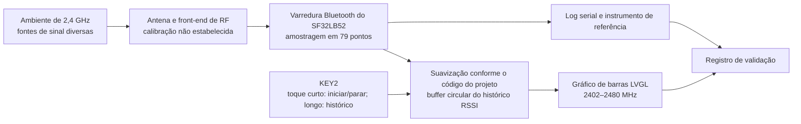

# Radiation Monitor: visualizador portátil de intensidade de sinal { #radiation-monitor-portable-signal-strength-detector }

## O que é o Radiation Monitor? { #what-is-radiation-monitor }

[SiFliSparks/RadiationMonitor](https://github.com/SiFliSparks/RadiationMonitor) é um visualizador portátil da intensidade do sinal na banda Bluetooth, baseado no SF32LB52 e no SiFli-SDK. O firmware percorre 79 pontos de frequência entre 2402 e 2480 MHz e exibe os níveis recebidos em um gráfico de barras LVGL. A tecla KEY2 inicia ou interrompe a varredura e permite consultar o histórico armazenado.

O projeto permite estudar a varredura da banda Bluetooth, o processamento de dados em tempo real, a visualização por frequência e a interação com um único botão. Não é um analisador de espectro calibrado nem identifica a origem do sinal recebido. Transmissões próximas em 2,4 GHz e as condições de medição podem afetar o gráfico. Sem calibração e comparação em condições controladas, os valores não devem ser usados em medições regulatórias, de certificação ou de RF de precisão.

<em>Gráfico de barras do Radiation Monitor com 79 pontos</em>

## Por que implementar no SF32? { #why-the-sf32-implementation }

O SF32LB52 combina Bluetooth 5.3 de modo duplo, MCU de dois núcleos e recursos de display. O projeto usa o SiFli-SDK e o LVGL para executar no dispositivo a amostragem das frequências, a suavização, o armazenamento em buffer do histórico e a atualização do display. Isso torna o projeto uma referência útil para experimentos iniciais com painéis de visualização de RF, indicadores de interferência em campo ou interfaces de diagnóstico de produção.

O repositório não especifica procedimento de calibração, orçamento de incerteza nem condições de medição rastreáveis. Portanto, os resultados precisam ser validados para cada combinação de silício, revisão do SDK e firmware, placa, antena, gabinete, ruído da placa e temporização. A transferência para outra placa SF32LB52 ou para uma PCB de produto exige nova validação; uma compilação bem-sucedida não comprova equivalência entre as medições.

## Resultado, escopo e critérios de entrada { #outcome-scope-and-entry-criteria }

**Resultado esperado:** reproduzir o gráfico de 79 pontos em hardware SF32LB52 com versões fixadas, verificar a repetibilidade do início e da interrupção, confirmar o algoritmo e a profundidade reais da suavização com base no código fixado, testar o histórico documentado de 10 registros e a recuperação e reunir evidências para decidir se vale investir em calibração ou hardware personalizado.

Este artigo não interpreta a altura das barras de RSSI como ciclo de trabalho, taxa de transferência, potência de transmissão, identificação de protocolo ou potência espectral para fins regulatórios. Também não afirma que o repositório forneça um projeto completo para produção, um método de calibração ou uma licença de software explícita.

Antes de começar, tenha à disposição:

- uma placa SF32LB52 com display. O README do projeto menciona SF32LB52x e o diretório de saída `build_sf32lb52-lchspi-ulp_hcpu`; a lista de placas suportadas da SiFli indica `sf32lb52-lchspi-ulp` para a Huangshan Pi. Registre a revisão real da placa e confira a configuração de compilação do projeto;
- SiFli-SDK, SCons, um fluxo para gravar o firmware e recursos para capturar os logs seriais;
- uma fonte controlável de 2,4 GHz ou pelo menos dois cenários reproduzíveis, como um dispositivo BLE anunciante selecionado, desligado e ligado;
- se a precisão numérica for necessária, um analisador de espectro calibrado ou instrumento de medição de potência, além de condições fixas para antena, distância e blindagem;
- um registro de teste com o estado do display, a saída serial, a orientação da placa, a distância, a alimentação e o ambiente.

<em>Tabela: contrato do projeto Radiation Monitor</em>

| Área | Base de referência fixada | Evidências necessárias antes da adaptação |
|:-----|:------------------------|:------------------------------------|
| Varredura de frequência | 79 pontos entre 2402 e 2480 MHz | Commit do firmware, revisões do SDK e da placa e log completo da varredura |
| Processamento | A descrição do módulo no README diz que se calcula a média das dez varreduras anteriores; o resumo menciona 30. O README não informa se a média é feita sobre valores de potência linear ou dBm | Revisão do código fixado, escala e profundidade da média, resultados brutos e suavizados e comparação com uma fonte estável |
| Histórico | Buffer circular com dez registros | Registro dos testes de interrupção, navegação, retorno circular e reinício |
| Interface | Gráfico de barras LVGL com eixo Y nominal de -110 a -20 dBm | Captura de tela e conferência da correspondência entre rótulos e índices do vetor |
| Limites da medição | Não há calibração rastreável nem incerteza informada | Registro do instrumento de referência, do arranjo de teste e do erro de medição, ou indicação explícita de que o produto exibe apenas tendências relativas |

## Especificações de hardware e software { #hardware-and-software-specifications }

### Especificação de hardware { #hardware-specification }

<em>Tabela: Especificação de hardware do Radiation Monitor</em>

| Componente | Especificação necessária | Função | Status | Onde obter | Compatibilidade e observações sobre substituições |
|:-----------|:-------------------------|:-------|:-------|:-----------|:--------------------------------------------------|
| SF32LB52-LCHSPI-ULP / Huangshan Pi | Use como ponto de partida o alvo de placa SCons da SiFli `sf32lb52-lchspi-ulp`; registre as revisões exatas da placa, da antena e do display | Executa a varredura Bluetooth, o gráfico, os controles e o histórico | Obrigatório; confirme a montagem exata | [Referência relacionada do μForge DevKit-ULP](../sf32-products/devkits/SF32LB52-DevKit-ULP.md); [placas suportadas pelo SiFli-SDK](https://docs.sifli.com/projects/sdk/latest/en/sf32lb52x/supported_boards/index.html); [página LCKFB](https://lckfb.com/project/detail/lckfb-hspi-sf32lb52-ulp?param=baseInfo); [código do projeto](https://github.com/SiFliSparks/RadiationMonitor) | O diretório `build_sf32lb52-lchspi-ulp_hcpu` do README não identifica a PCB, a antena nem a revisão exata do display |
| Host, cabo USB de dados e alimentação controlada | Host com as ferramentas SiFli-SDK selecionadas, cabo de dados, log serial e fonte monitorada | Compilar, gravar, observar e repetir medições | Obrigatório | [Início rápido do SiFli-SDK](https://docs.sifli.com/projects/sdk/latest/sf32lb52x/quickstart/index.html) | Registre porta, tensão, versões do host/ferramentas e método de recuperação |

### Especificação de software { #software-specification }

<em>Tabela: Especificação de software do Radiation Monitor</em>

| Pacote ou serviço | Versão ou revisão necessária | Função | Status | Onde obter | Compatibilidade e observações sobre atualizações |
|:------------------|:-----------------------------|:-------|:-------|:-----------|:-------------------------------------------------|
| SiFliSparks/RadiationMonitor | Commit fixado [`670cf20`](https://github.com/SiFliSparks/RadiationMonitor/commit/670cf20b931e82b7ff1cd14fa6727e460c4f677a) | Lógica de varredura RF, gráfico de 79 pontos, suavização e histórico | Obrigatório | [Repositório](https://github.com/SiFliSparks/RadiationMonitor) | As descrições de suavização do README são conflitantes; confira a implementação desse commit antes de definir a referência de medição |
| OpenSiFli/SiFli-SDK | O artigo não fixa um commit; selecione e registre uma revisão compatível | RTOS, caminho de varredura Bluetooth, drivers do display e ambiente de compilação/gravação | Obrigatório | [Repositório](https://github.com/OpenSiFli/SiFli-SDK) | Uma compilação bem-sucedida não comprova calibração de RF nem equivalência de medições em outra placa |
| SCons e ferramentas do SDK para o host | Versões do ambiente SiFli-SDK selecionado | Compila e grava o alvo SF32LB52 | Obrigatório | [Início rápido do SiFli-SDK](https://docs.sifli.com/projects/sdk/latest/sf32lb52x/quickstart/index.html) | Registre o alvo exato, SO, versões das ferramentas e imagem gerada |

## Escolher uma configuração de referência suportada { #choose-a-supported-baseline }
Use o commit fixado [`670cf20`](https://github.com/SiFliSparks/RadiationMonitor/commit/670cf20b931e82b7ff1cd14fa6727e460c4f677a), em vez da branch upstream `main`, que pode mudar. O README indica `build_sf32lb52-lchspi-ulp_hcpu` como diretório de saída; a lista de placas da SiFli indica `sf32lb52-lchspi-ulp` para a Huangshan Pi / LCHSPI-ULP. Isso define o nome da placa no SDK, não o comando exato do projeto nem a montagem testada. O README não informa a revisão da placa nem um comando SCons completo; confira a configuração na primeira reprodução e não presuma compatibilidade com todas as placas SF32LB52x.

<em>Tabela: seleção da configuração de referência do Radiation Monitor</em>

| Elemento | Configuração de referência | Não presuma que |
|:--------|:----------------|:--------------|
| Placa | Comece pelo argumento SCons `sf32lb52-lchspi-ulp`, confira a configuração do projeto e registre a PCB utilizada | O diretório de saída `build_sf32lb52-lchspi-ulp_hcpu` do README prova que os caminhos de antena e display de todas as placas SF32LB52x são equivalentes |
| SDK | Registre o commit do SiFli-SDK com o qual a compilação funciona | Não presuma que a versão mais recente do SDK mantém o comportamento de varredura Bluetooth do projeto |
| Suavização | Resolva com o código fixado a divergência do README entre 30 varreduras e a média das dez varreduras anteriores; confirme se a média usa valores de potência linear ou dBm e determine sua profundidade | A descrição do módulo menciona dez varreduras; o resumo menciona 30, e nenhuma das duas especifica a escala da média |
| Temporização | O README informa intervalo de atualização dos dados de 30 ms; meça o tempo da varredura completa dos 79 pontos | 30 ms é um período garantido de atualização completa dos 79 pontos |
| Licenciamento | Antes de reutilizar ou distribuir, confirme as licenças do repositório e do código incorporado | A disponibilidade pública do código concede automaticamente direitos para distribuí-lo em um produto |

!!! warning "A documentação upstream diverge sobre a profundidade da suavização"
    A visão geral de recursos do README menciona a média de 30 varreduras, enquanto a descrição do módulo diz que se calcula a média das dez varreduras anteriores e aponta para `src/BT/bt_repeat.c` como módulo de varredura. O README não informa se a média usa valores de potência linear ou dBm, e as duas contagens não estabelecem qual comportamento o código fixado implementa. Confira nessa revisão exata a escala da média, a profundidade do buffer e o comportamento no dispositivo antes de adotar qualquer contagem como referência de medição. O README também informa intervalo de atualização de 30 ms, que não representa necessariamente o tempo de uma varredura completa dos 79 pontos.

## Etapas do projeto { #delivery-map }

<em>Tabela: etapas do projeto Radiation Monitor</em>

| Etapa | Decisão que a etapa permite tomar | Resultado exigido |
|:------|:---------------------|:----------------|
| 1. Referência sem alterações | A placa-alvo consegue varrer e exibir os 79 pontos de forma confiável? | Versão, placa, log, captura de tela e registro da fonte controlada |
| 2. Dados e recuperação | É possível confiar na suavização, na interrupção, no histórico e no comportamento após o reset? | Testes funcionais e de recuperação determinísticos |
| 3. Reprodução do código | Outro engenheiro consegue gerar a mesma imagem? | Compilação limpa, imagem do firmware, gravação e resultado reproduzido |
| 4. Adaptação da medição | É possível alterar uma função de exibição ou calibração sem ocultar o comportamento de referência? | Registro da alteração, dados comparativos, erro e regressão |
| 5. Avaliação do produto | O projeto deve continuar como indicador de tendências ou avançar para o desenvolvimento de um instrumento? | Meta de precisão, licenciamento, hardware e decisão sobre riscos |

## Arquitetura do sistema e dependências { #system-architecture-and-dependencies }

<em>Figura: caminho dos dados no Radiation Monitor</em>

Os principais domínios de falha são a entrada de RF/antena, o comportamento da varredura e a calibração, o processamento de dados, o buffer do histórico, a máquina de estados do botão, o mapeamento no LVGL e a alimentação. Uma barra alta indica apenas que a implementação observou um valor de recepção relativamente forte; sem uma comparação controlada, ela não identifica o transmissor, a modulação nem uma condição de conformidade.

## Etapa 1 — Estabeleça a referência de varredura sem alterações { #stage-1-establish-the-untouched-scan-baseline }

**Objetivo:** comprovar que o hardware selecionado e o código-fonte produzem uma exibição reproduzível dos 79 pontos.

1. Fixe os commits do repositório e do SiFli-SDK, a revisão da placa, a antena e a conexão do display; faça uma compilação limpa e grave o firmware.
2. Com um cenário de RF estável, inicie o dispositivo e registre o gráfico inicial, a saída serial e o estado da tecla KEY2.
3. Pressione KEY2 brevemente para iniciar a varredura. Confirme a cobertura e as marcações do eixo X em 2402, 2441 e 2480 MHz.
4. Use um dispositivo BLE anunciante controlado ou outra fonte reproduzível e registre os resultados com a fonte desligada e ligada, as alterações de distância e a orientação da placa.
5. Reinicie o dispositivo e repita o teste; confira se o vetor de 79 pontos e sua representação no gráfico não estão deslocados nem incluem dados antigos.

**Evidências a guardar:** revisões do código-fonte, do SDK e da placa; logs de compilação e gravação; descrição do ambiente; configuração da fonte; distância e orientação; log serial; capturas de tela; e resultado após o reset.

**Critério de saída do ponto de controle 1:** duas inicializações independentes varrem e exibem os 79 pontos; as alterações no cenário controlado produzem respostas na mesma direção; e os índices do gráfico e os rótulos de frequência foram conferidos.

## Etapa 2 — Valide o processamento, o histórico e a recuperação { #stage-2-validate-processing-history-and-recovery }

**Objetivo:** comprovar que a interface representa um fluxo de dados explicável, e não uma animação acidental.

<em>Tabela: validação funcional do Radiation Monitor</em>

| Teste | Método | Evidência de aprovação |
|:-----|:-------|:--------------|
| Algoritmo e profundidade da suavização | Registre os valores brutos e `rssi_res` para uma frequência; compare-os com o commit fixado e resolva a divergência do README | A escala e a profundidade da média correspondem à revisão exata do código e foram confirmadas no dispositivo |
| Início/parada | Durante a varredura, pressione KEY2 brevemente para interrompê-la e depois retome | O histórico é mantido durante a interrupção; a retomada ocorre sem travar o dispositivo |
| Histórico | Com a varredura interrompida, mantenha KEY2 pressionada por mais tempo, repetindo a ação | É possível percorrer até dez registros em ordem inversa, com retorno circular correto |
| Histórico vazio | Interrompa a varredura ou mantenha KEY2 pressionada antes de acumular um histórico válido | Não há acesso fora dos limites nem falha; a interface indica claramente que não há dados |
| Reset | Reinicie durante a varredura, com ela interrompida e durante a consulta ao histórico | O dispositivo retorna a um estado inicial conhecido, sem valores antigos sem explicação |
| Alteração da interferência | Altere a fonte, a distância ou a blindagem | A resposta é reproduzível; a latência e o comportamento de retenção de pico são registrados |

**Critério de saída do ponto de controle 2:** a suavização, a profundidade do histórico, o estado da tecla e o comportamento após o reset correspondem ao código-fonte; situações anormais são observáveis, em vez de passarem despercebidas.

## Etapa 3 — Crie uma base de código reproduzível { #stage-3-build-a-reproducible-source-baseline }

**Objetivo:** reproduzir a imagem da Etapa 2 a partir de um ambiente limpo.

1. Registre os commits do projeto e do SDK, o sistema operacional do computador, as versões do SCons e do compilador e o parâmetro de placa realmente utilizado.
2. Remova os artefatos de compilação, configure novamente e compile; guarde as imagens, as informações de memória/partições e os logs completos.
3. Grave o firmware com o script de download gerado e registre a porta, a taxa de transmissão e o resultado.
4. Repita o processo em outro computador ou diretório limpo e execute novamente as verificações principais da Etapa 2.

**Critério de saída do ponto de controle 3:** o projeto gera uma imagem com comportamento equivalente sem depender de arquivos de placa não rastreados, arquivos gerados ou artefatos de compilação obsoletos.

## Etapa 4 — Faça uma adaptação controlada de medição ou interface { #stage-4-make-one-controlled-measurement-or-ui-adaptation }

**Objetivo:** avaliar uma possibilidade de produto sem perder a referência original.

Entre as alterações possíveis estão o registro dos valores brutos, a inclusão de marcações explícitas a cada 1 MHz, a retenção de pico, outra forma de selecionar o histórico, um offset de calibração ou a exportação de tendências relativas para um computador. Altere apenas uma categoria por vez e mantenha a imagem original.

Se adicionar calibração, defina a fonte de referência, a frequência, o nível de entrada, a antena e o cabo, a distância, a orientação, a temperatura e a incerteza. Raramente um único offset global é suficiente para compensar a resposta em frequência, as variações entre placas e os efeitos do gabinete.

**Critério de saída do ponto de controle 4:** a alteração passa pelos testes de regressão originais dos 79 pontos, do início/interrupção, do histórico, do reset e da fonte controlada; toda afirmação de precisão identifica o instrumento de referência e as condições do teste.

## Etapa 5 — Avalie a prontidão para o produto { #stage-5-product-readiness-review }

A equipe deve responder:

- O produto precisa apenas indicar tendências relativas de interferência ou exige medições absolutas de potência rastreáveis e sua incerteza?
- A documentação confirma o suporte à implementação de varredura Bluetooth do projeto no silício e no SDK escolhidos? Quais limites de concorrência se aplicam?
- Quanto a antena, o gabinete, o ruído do display, a operação do DC/DC, o nível da bateria e a temperatura alteram o resultado?
- O produto consegue manter a comunicação Bluetooth necessária durante a varredura ou essas funções precisam ser mutuamente exclusivas?
- A latência medida da varredura de 79 pontos com a suavização verificada no código atende aos requisitos da interface?
- Como serão definidos os direitos de distribuição e uso comercial se o RadiationMonitor e o código incorporado não tiverem uma licença explícita no nível superior do repositório?

**Critério de saída do ponto de controle 5:** há responsáveis definidos pelo objetivo de medição, pelo plano de calibração, pela estratégia de concorrência de rádio, pelo licenciamento e pela propriedade do hardware e do software; a decisão de avançar, adiar ou interromper também está registrada.

## Transição para o projeto do produto { #handoff-to-product-design }
Leve adiante o dispositivo SF32-alvo, a placa e a antena, a implementação de varredura Bluetooth e as restrições de modo/API confirmadas no commit fixado, a definição das frequências e dos dados, os registros brutos e suavizados, o orçamento de atualização da interface, o gabarito de calibração, os testes de ruído da alimentação, o caminho de recuperação e os limites dos testes de produção. Continue com [SF32LB52x](../sf32-products/chips/SF32LB52x.md), [SF32LB52-DevKit-ULP](../sf32-products/devkits/SF32LB52-DevKit-ULP.md), o [guia de projeto de hardware do SF32LB52x](../hardware/chip-guides/SF32LB52x_hardware_design_guide.md) e os [testes de desempenho de RF do SiFli-SDK](../develop/platforms/sifli-sdk/application-notes/rf-performance-tests.md).

## Fontes de referência { #authoritative-sources }
- [SiFliSparks/RadiationMonitor](https://github.com/SiFliSparks/RadiationMonitor)
- [README upstream da branch `main`](https://github.com/SiFliSparks/RadiationMonitor/blob/main/README.md)
- [Commit de referência fixado `670cf20`](https://github.com/SiFliSparks/RadiationMonitor/commit/670cf20b931e82b7ff1cd14fa6727e460c4f677a)
- [Catálogo de projetos SiFli Sparks](https://sparks.sifli.com/#projects)
- [OpenSiFli/SiFli-SDK](https://github.com/OpenSiFli/SiFli-SDK)
- [Placas suportadas pelo SiFli-SDK](https://docs.sifli.com/projects/sdk/latest/en/sf32lb52x/supported_boards/index.html)
- [Guia de testes de RF do SiFli-SDK](https://docs.sifli.com/projects/sdk/latest/en/sf32lb52x/app_note/rf_test_guide.html)
- [Visão geral de hardware do SF32LB52x](https://wiki.sifli.com/en/hardware/SF32LB52/SF32LB52-Overview-B3.html)
- [Início rápido do SiFli-SDK para SF32LB52x](https://docs.sifli.com/projects/sdk/latest/sf32lb52x/quickstart/index.html)
