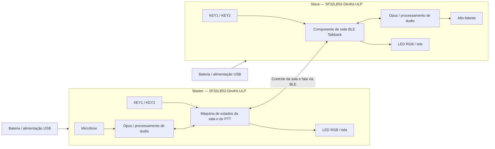

# Intercomunicador BLE Talkback para SF32 { #sf32-ble-talkback-intercom }

## O que é o Talkback? { #what-is-talkback }
[OpenSiFli Talkback](https://github.com/OpenSiFli/sifli-sdk-demo/tree/main/talkback) é um exemplo de comunicação BLE no modo push-to-talk (PTT) entre vários dispositivos, destinado ao `SF32LB52-DevKit-ULP`, também conhecido como Huangshan Pi. No modo Master, o dispositivo cria uma sala; no modo Slave, procura uma sala e entra nela. Depois de entrar, o usuário mantém pressionada a tecla de fala para transmitir e a solta para parar. A implementação de referência oficial comporta até oito dispositivos, com até três participantes falando ao mesmo tempo.

O projeto usa o Opus para codificar a fala e reúne LED RGB, teclas e tela em uma interface local simples. Também implementa reconexão do Slave com uma tecla, indicação da tensão e do nível da bateria, entrada em suspensão após 60 segundos sem interação e desligamento e acionamento por pressão longa do botão de energia. Por isso, é uma referência mais útil para um intercomunicador portátil do que um exemplo isolado de áudio ponto a ponto.

## O que o SF32 oferece ao Talkback? { #why-the-sf32-implementation }
Este roteiro reúne BLE, áudio, tela, teclas, monitoramento da bateria e recursos de baixo consumo do SF32LB52 em uma base funcional. A equipe pode avaliar o desempenho de rede e de áudio em hardware de desenvolvimento compatível antes de investir em projetos próprios de RF, áudio e alimentação.

O limite de “até oito dispositivos e três participantes falando simultaneamente” é um limite da implementação upstream, não uma capacidade do produto validada para diferentes distâncias, interferências, perdas de pacotes e todos os padrões de simultaneidade. A documentação upstream também não especifica autenticação das salas, política de criptografia do enlace, garantia de privacidade da voz, situação de conformidade regulatória de rádio nem o escopo completo da licença do componente binário `talk_back`. Cada um desses pontos exige análise específica do produto.

**Nota sobre a fonte da placa:** A página chinesa da SiFli Wiki para a placa ULP está marcada como ainda não publicada; ela só informa o uso em sensores de baixo consumo e dispositivos vestíveis, opções de sensores de 3 ou 6 eixos e pontos de teste reservados para medições de baixo consumo. Não é uma especificação completa da placa. Confira os periféricos na revisão real da placa e no esquemático; o comportamento do Talkback descrito a seguir se baseia no código-fonte fixado do aplicativo.

## Resultado, escopo e critérios de entrada { #outcome-scope-and-entry-criteria }
**Resultado esperado:** usar pelo menos duas placas com revisões controladas para reproduzir a criação e a entrada em salas, a comunicação PTT, a saída e reconexão, a suspensão e retomada e o comportamento da indicação da bateria. Em seguida, reunir evidências suficientes para decidir se o desenvolvimento de hardware próprio se justifica.

**Fora do escopo:** esta página não comprova alcance de longa distância, qualidade de voz em enlaces degradados, criptografia de ponta a ponta, certificação, consumo do produto final, consistência entre antenas, conformidade regulatória nem compatibilidade com dispositivos BLE arbitrários.

**Critérios de entrada:** a equipe consegue preparar o ambiente de compilação do SiFli-SDK, gravar o firmware pela UART, inspecionar logs e conectar com segurança um alto-falante e uma bateria. Uma base completa de comunicação por voz exige pelo menos duas placas da mesma revisão.

<div align="center"><em>Tabela: contrato do projeto</em></div>

<div align="center" markdown>

| Área | Requisito da configuração de referência | Evidências a registrar antes de prosseguir |
|:-----|:---------------------|:------------------------------------|
| Limites da reprodução | Primeiro, manter inalterados o alvo upstream, as dependências e a interação padrão | Revisão da placa, commit do aplicativo, revisão do SDK, registro da resolução de dependências e hash do firmware |
| Limites funcionais | Comprovar criação e entrada em sala, PTT, saída, reconexão do Slave, suspensão/retomada e indicação da bateria | Registro de operação, logs UART, estados do LED e resultados da recuperação de falhas |
| Limites do produto | Acústica, RF, segurança, privacidade, licenciamento, alimentação e regulamentação exigem validações próprias | Risco, responsável, plano de tratamento e decisão de prosseguir ou interromper |

</div>

## Especificações de hardware e software { #hardware-and-software-specifications }
### Especificação de hardware { #hardware-specification }
<div align="center"><em>Tabela: Especificações de hardware</em></div>

<div align="center" markdown>

| Componente | Especificação necessária | Função | Situação | Onde obter | Compatibilidade e observações sobre substituição |
|:----------|:-----------------------|:-----|:-------|:----------------|:-------------------------------------|
| SF32LB52-DevKit-ULP / LCKFB-HSPI-SF32LB52-ULP | Alvo `sf32lb52-lchspi-ulp`; no mínimo 2 e no máximo 8 placas | Executa o Talkback e fornece BLE, microfone, tela, teclas, LED RGB, alimentação e caminhos de áudio | Obrigatório | [Referência da placa μForge](../sf32-products/devkits/SF32LB52-DevKit-ULP.md); [página da placa LCKFB](https://lckfb.com/project/detail/lckfb-hspi-sf32lb52-ulp?param=baseInfo); [loja SiFli de amostras e kits](https://sifli.taobao.com/) | Registre cada revisão de hardware; uma placa SF32LB52 ainda não validada não é um substituto equivalente |
| Alto-falante | Um alto-falante externo de 3 W/4 Ω ou 2 W/8 Ω por placa, conectado pelo conector GH-1.25 mm | Reproduz a fala recebida | Obrigatório | Normalmente incluído no kit da placa; antes da compra, confira o conteúdo com a [referência da placa](../sf32-products/devkits/SF32LB52-DevKit-ULP.md) | Não conecte uma carga que exceda os limites do amplificador Classe D integrado e do conector |
| Cabos USB de dados e computador host | Um cabo USB-C com suporte a dados por placa; computador capaz de executar as ferramentas do SiFli-SDK | Alimentação, gravação pela UART e registro de logs | Obrigatório | Cabo USB-C de dados padrão; as ferramentas estão no [SiFli-SDK](https://github.com/OpenSiFli/SiFli-SDK) | Cabos somente para carga não permitem gravar o firmware; registre as portas e o ambiente do computador |
| Bateria de lítio de uma célula | Deve ser compatível com o conector, a polaridade e o circuito de carga da placa | Uso móvel, suspensão/retomada e validação do nível da bateria | Obrigatória para validar o produto; opcional em testes de bancada | O repositório Talkback não informa um canal de compra separado; antes de adquirir, confirme a interface na [referência da placa](../sf32-products/devkits/SF32LB52-DevKit-ULP.md) | Antes de conectar, verifique polaridade, faixa de tensão, capacidade e proteção; a aparência do conector não comprova compatibilidade |
| Microfone, teclas, LED RGB e tela integrados | Componentes originais da placa de desenvolvimento | Captam a fala e indicam função, pareamento, transmissão, recepção e suspensão | Integrados | Incluídos na placa; não são adquiridos separadamente | Substituir o hardware de áudio ou da interface homem-máquina (HMI) exige regressão de ganho, temporização, códigos das teclas e mapa de estados |

</div>

### Especificação de software { #software-specification }
<div align="center"><em>Tabela: Especificações de software</em></div>

<div align="center" markdown>

| Pacote ou serviço | Versão ou revisão necessária | Função | Situação | Onde obter | Compatibilidade e observações sobre atualizações |
|:-------------------|:-----------------------------|:-----|:-------|:----------------|:-------------------------------|
| OpenSiFli `sifli-sdk-demo/talkback` | Commit analisado neste artigo: [`6fa55ac`](https://github.com/OpenSiFli/sifli-sdk-demo/commit/6fa55ac65b51fca5eac6660a7e481a30e07388ee) | Aplicativo, configuração da placa e ponto de entrada da compilação | Obrigatório | [Diretório do código-fonte Talkback](https://github.com/OpenSiFli/sifli-sdk-demo/tree/main/talkback) | A branch upstream `main` muda; fixe um commit antes de reunir evidências. O caminho atual é `talkback/project`; o caminho `example/ble/talkback/project` no README está desatualizado |
| SiFli-SDK | O `conanfile.py` declara compatibilidade com `^2.4`; o upstream não fixa um commit exato do SDK | Base para RT-Thread, BLE, áudio, alimentação, compilação e gravação | Obrigatório | [OpenSiFli/SiFli-SDK](https://github.com/OpenSiFli/SiFli-SDK) | Selecione e registre um commit específico que satisfaça `^2.4`; uma branch `main` móvel não é uma revisão de referência |
| `talk_back/1.2@sifli` | `1.2` | Componente de rede e áudio BLE do Talkback | Obrigatório | Resolvido pelo [manifesto Conan](https://github.com/OpenSiFli/sifli-sdk-demo/blob/6fa55ac65b51fca5eac6660a7e481a30e07388ee/talkback/project/conanfile.py) do projeto | O upstream não publica nessa página o código-fonte independente, o hash do pacote, o servidor do pacote nem os termos completos da licença; arquive o pacote e o registro de resolução e encerre esse risco antes do uso no produto |
| Configuração do Opus e do AECM/AGC do WebRTC | Definida em conjunto pelo aplicativo fixado, pelo SDK e pela dependência Conan | Codificação de fala, tratamento de eco e controle de ganho | Obrigatório | [Configuração do projeto](https://github.com/OpenSiFli/sifli-sdk-demo/blob/6fa55ac65b51fca5eac6660a7e481a30e07388ee/talkback/project/proj.conf) e dependências fixadas do SDK | Não registre apenas as macros de recursos; mantenha as versões efetivamente resolvidas das bibliotecas e os documentos de licença |
| SCons, compilador e ferramentas de gravação UART | Versões compatíveis com o SiFli-SDK selecionado | Configuram, compilam e gravam as imagens | Obrigatório | Disponibilizados pelo ambiente do [SiFli-SDK selecionado](https://github.com/OpenSiFli/SiFli-SDK) | Registre o sistema operacional host, a versão da toolchain, o comando de compilação e o hash do script gerado |

</div>

## Escolher uma configuração de referência suportada { #choose-a-supported-baseline }
Comece com duas placas `SF32LB52-DevKit-ULP` da mesma revisão. Fixe o repositório do exemplo no commit `6fa55ac`, selecione e registre um commit específico do SiFli-SDK que satisfaça `^2.4` e guarde o registro de resolução Conan de `talk_back/1.2@sifli`. Na primeira reprodução, não altere os parâmetros de áudio, a lógica de papéis nem a temporização dos recursos de baixo consumo.

Na raiz do repositório, entre no caminho que realmente existe:

```bash
cd talkback/project
scons --board=sf32lb52-lchspi-ulp -j8
```

No Windows, o script de gravação gerado é `build_sf32lb52-lchspi-ulp_hcpu\uart_download.bat`. Execute-o e informe a porta COM correta quando solicitado. Use a mesma imagem de referência em todos os dispositivos e registre a identificação de cada placa e o hash da imagem.

### Controles padrão e indicação de estado { #default-controls-and-state-indication }
<div align="center"><em>Tabela: Comportamento padrão das teclas e do LED</em></div>

<div align="center" markdown>

| Estado | KEY1 | KEY2 | LED |
|:------|:-----|:-----|:----|
| Em espera | Um Slave que já entrou em uma sala com sucesso pressiona brevemente para reconectar; caso contrário, uma pressão breve reinicia o temporizador de suspensão | Pressão breve alterna entre Master e Slave; pressão longa inicia o pareamento | Master: azul contínuo; Slave: vermelho contínuo |
| Pareamento | — | Master cria uma sala; Slave procura uma sala | Master: azul piscando; Slave: vermelho piscando |
| Aguardando início | — | Pressão longa no Master confirma o início | Master: azul piscando; Slave: vermelho piscando |
| Na sala | Depois de soltar KEY2, pressione brevemente para sair | Mantenha pressionada para falar; solte para parar | Verde contínuo durante a transmissão; laranja contínuo durante a recepção |
| Suspensão | Qualquer tecla reativa o dispositivo | Qualquer tecla reativa o dispositivo | Apagado |

</div>

## Etapas do projeto { #delivery-map }
<div align="center"><em>Tabela: etapas e decisões do projeto</em></div>

<div align="center" markdown>

| Etapa | Decisão a apoiar | Evidência mínima |
|:------|:-------------------|:-----------------|
| Estabelecer a referência sem alterações | O conjunto fixado compila, é gravado e inicializa de forma confiável? | Manifesto de versões, log de compilação limpa, hash da imagem e registro de inicialização |
| Validar a comunicação entre dois dispositivos | A criação de sala, a entrada e o PTT padrão funcionam? | Papéis, LEDs, ações das teclas e registro de comunicação bidirecional entre dois dispositivos |
| Validar rede e recuperação | Saída, timeout, reconexão e limites de simultaneidade são aceitáveis? | Matriz de injeção de falhas, tempo de recuperação, logs e estados de falha |
| Avaliar áudio e alimentação | A acústica e o comportamento da bateria atendem ao formato pretendido? | Medições de qualidade de áudio, latência, alcance, corrente, suspensão e retomada |
| Revisar a prontidão do produto | Há evidências suficientes para financiar o hardware próprio? | Registro de riscos, responsáveis e decisão de prosseguir, adiar ou interromper |

</div>

## Arquitetura do sistema e dependências { #system-architecture-and-dependencies }
<div align="center"><em>Figura: Papéis dos dispositivos Talkback e caminhos de áudio e controle</em></div>



Os principais domínios de falha são a busca BLE e a criação de salas, a sincronização dos estados da sala, o agendamento de participantes simultâneos, o caminho Opus/acústica, os eventos das teclas, bateria fraca e suspensão, a recuperação pelo botão de alimentação e os detalhes não publicados do componente e de seu licenciamento. Primeiro diagnostique o papel e o estado do dispositivo; depois, diferencie falhas de rádio, áudio e alimentação local.

## Etapa 1 — Estabelecer a base de código-fonte sem alterações { #stage-1-establish-the-untouched-source-baseline }

**Objetivo:** comprovar que o código-fonte, o SDK e as dependências resolvidas e fixadas geram uma imagem reproduzível.

1. Fixe o aplicativo e um commit específico do SDK; guarde a saída da resolução de dependências.
2. Compile `sf32lb52-lchspi-ulp` em um diretório limpo e grave o firmware em duas placas.
3. Confirme que cada dispositivo inicia como Slave, com o LED vermelho contínuo; em seguida, verifique as teclas, a tela, a bateria e os caminhos de áudio do alto-falante.

**Evidências a registrar:** manifesto completo de versões, logs de compilação e gravação, hashes do firmware, revisão de ambas as placas e registros de inicialização.

**Critério para concluir a etapa 1:** os mesmos insumos geram e gravam de forma reproduzível a mesma imagem de referência nos dois dispositivos, e o estado inicial corresponde ao comportamento upstream.

## Etapa 2 — Validar a configuração da sala e o PTT bidirecional { #stage-2-validate-room-setup-and-bidirectional-ptt }

**Objetivo:** comprovar que o usuário consegue criar e usar a sala mínima sem intervenção do depurador.

1. No estado de espera, pressione KEY2 brevemente em um dispositivo para torná-lo Master, indicado pelo LED azul contínuo; deixe o outro como Slave, com o LED vermelho.
2. Mantenha KEY2 pressionada nos dois dispositivos: o Master cria uma sala e o Slave a procura. O pareamento expira após 30 segundos.
3. No estado de espera pelo início, mantenha KEY2 pressionada no Master para iniciar. Durante a conversa, mantenha KEY2 pressionada para falar e solte-a para parar.
4. Confirme o LED verde contínuo durante a transmissão, o laranja contínuo durante a recepção e a inteligibilidade da fala nos dois sentidos.

**Evidências a registrar:** papéis dos dispositivos, sequência de operação, estados do LED, logs UART, amostras de áudio bidirecional e resultados das tentativas.

**Critério para concluir a etapa 2:** pelo menos dois dispositivos concluem repetidas sessões PTT bidirecionais, os indicadores correspondem ao sentido real do áudio e o timeout de 30 segundos retorna a um estado explicável.

## Etapa 3 — Validar saída, reconexão e limites de capacidade { #stage-3-validate-leave-reconnect-and-capacity-boundaries }

**Objetivo:** confirmar que os mecanismos upstream de recuperação e os limites de capacidade não deixam o usuário sem saída.

1. No estado de conversa, solte KEY2 antes de pressionar KEY1 brevemente para sair; o dispositivo não pode sair enquanto transmite.
2. Se um Slave já tiver entrado em uma sala com sucesso, pressione KEY1 brevemente no estado de espera para reconectar. O Master não dispõe de um mecanismo equivalente.
3. Injete operação fora de alcance, timeout de pareamento, perda do Master e reinicialização após interrupção da alimentação.
4. Se a operação com vários participantes for necessária, teste a quantidade prevista de participantes e os limites declarados de oito dispositivos e três participantes falando simultaneamente.

**Evidências a registrar:** estado inicial, evento disparador, ação de recuperação, tempo de recuperação, logs e composição final da sala para cada falha.

**Critério para concluir a etapa 3:** cada falha prevista tem uma forma de recuperação explícita, repetível e compreensível para o usuário; a capacidade e a simultaneidade necessárias foram medidas no ambiente de RF pretendido, em vez de simplesmente presumidas a partir dos limites declarados.

## Etapa 4 — Avaliar áudio, desempenho de RF e consumo de energia { #stage-4-qualify-acoustics-rf-and-low-power }

**Objetivo:** decidir se o comportamento observado na placa de desenvolvimento atende aos requisitos previstos de gabinete, alcance e autonomia.

1. Registre inteligibilidade, distorção por saturação, eco e cortes no início/fim do PTT em ambiente silencioso, durante fala simultânea próxima ao microfone, com ruído de fundo e em diferentes níveis de volume do alto-falante.
2. Registre conexão, interrupções e recuperação na distância prevista, com obstáculos e sob interferência de 2,4 GHz.
3. Verifique a suspensão após 60 segundos sem interação, o retorno ao papel de Slave, a ativação por qualquer tecla, o desligamento/acionamento por pressão longa e a indicação do LED abaixo de 20% de bateria.
4. Meça a corrente em espera, transmissão, recepção, suspensão e retomada; não use medições da placa de desenvolvimento como estimativa da autonomia do produto final.

**Evidências a registrar:** ambiente, orientação da placa e da antena, arquivos de áudio, distância e interferência, traços de corrente, condições da bateria e resultados de recuperação.

**Critério para concluir a etapa 4:** a equipe definiu e atendeu aos limites de acústica, RF, consumo e ativação para o ambiente pretendido, atribuindo responsáveis e ações a cada requisito não atendido.

## Etapa 5 — Revisar a prontidão do produto { #stage-5-product-readiness-review }

Antes de desenvolver o hardware próprio, responda pelo menos às seguintes perguntas:

- Como a sala identifica dispositivos confiáveis e quais mecanismos de autenticação, criptografia e proteção contra repetição se aplicam à fala e aos dados de controle?
- Quem é responsável pelas licenças, por disponibilizar o código-fonte e por responder a vulnerabilidades de `talk_back/1.2@sifli`, Opus, componentes WebRTC e arquivos de código-fonte do repositório?
- Que alcance, latência, perda de pacotes e recuperação foram medidos com a antena e o gabinete previstos, com bloqueio pelo corpo e com a simultaneidade pretendida?
- Como o microfone, o amplificador, a cavidade do alto-falante e os limites de volume atenderão aos requisitos acústicos e de segurança?
- Como o dispositivo se recupera de bateria fraca, perda anormal de alimentação, firmware corrompido ou falha na atualização em campo?
- Quais atividades de conformidade são aplicáveis a Bluetooth, compatibilidade eletromagnética (EMC), rádio e bateria?

**Critério para concluir a etapa 5:** o registro de riscos contém evidências, responsáveis, medidas de mitigação e uma decisão explícita de prosseguir, adiar ou interromper. Segurança, licenciamento e regulamentação não podem ficar como pendências futuras sem responsável.

## Transição para o projeto do produto { #handoff-to-product-design }
O pacote de transferência deve incluir o código-fonte, o SDK e as dependências fixados; os papéis e a máquina de estados; a matriz de capacidade e recuperação; as medições de áudio, RF e alimentação; as premissas de antena e acústica; os limites da bateria e do carregamento; o modelo de segurança e privacidade; os documentos de licenciamento; os requisitos de teste de produção e o plano de recuperação. Use o [caminho de integração do SF32LB52x](../sf32-products/chips/SF32LB52x.md#integration-path) para selecionar o chip, o módulo, a placa, o guia de projeto de hardware e o checklist. Leve os comportamentos validados para o esquemático e o layout próprios e verifique-os novamente, em vez de presumir que os resultados da placa de desenvolvimento se transferem sem alterações.

## Fontes de referência { #authoritative-sources }
- [Diretório OpenSiFli Talkback](https://github.com/OpenSiFli/sifli-sdk-demo/tree/main/talkback)
- [Commit do aplicativo analisado: `6fa55ac`](https://github.com/OpenSiFli/sifli-sdk-demo/commit/6fa55ac65b51fca5eac6660a7e481a30e07388ee)
- [README oficial do Talkback](https://github.com/OpenSiFli/sifli-sdk-demo/blob/6fa55ac65b51fca5eac6660a7e481a30e07388ee/talkback/README.md)
- [Manifesto Conan do Talkback](https://github.com/OpenSiFli/sifli-sdk-demo/blob/6fa55ac65b51fca5eac6660a7e481a30e07388ee/talkback/project/conanfile.py)
- [Configuração do projeto Talkback](https://github.com/OpenSiFli/sifli-sdk-demo/blob/6fa55ac65b51fca5eac6660a7e481a30e07388ee/talkback/project/proj.conf)
- [OpenSiFli/SiFli-SDK](https://github.com/OpenSiFli/SiFli-SDK)
- [Fonte oficial da Wiki do SF32LB52-DevKit-ULP](https://github.com/OpenSiFli/SiFli-Wiki/blob/main/source/en/board/sf32lb52x/SF32LB52-DevKit-ULP.md)
- [Fonte chinesa da SiFli Wiki para SF32LB52-DevKit-ULP](https://github.com/OpenSiFli/SiFli-Wiki/blob/main/source/zh_CN/board/sf32lb52x/SF32LB52-DevKit-ULP.md)
