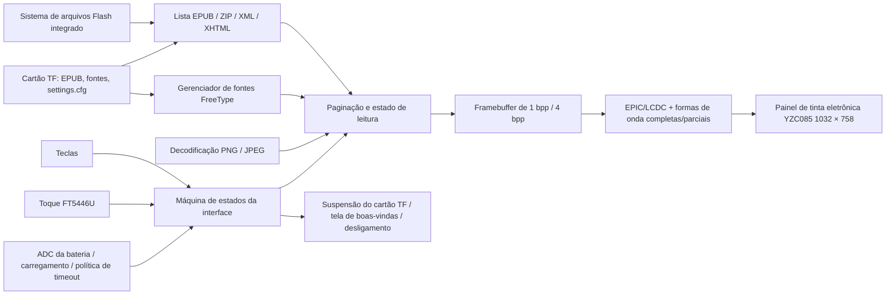

# Leitor de EPUB com e-paper SF32 { #sf32-e-paper-epub-reader }

## O que é o EPD Reader? { #what-is-epd-reader }

[OpenSiFli EPD Reader](https://github.com/OpenSiFli/EPD_Reader) adapta o projeto [atomic14/diy-esp32-epub-reader](https://github.com/atomic14/diy-esp32-epub-reader) ao hardware SiFli `SF32-OED-EPD`. O SF32LB52x atua como processador. O sistema lê arquivos EPUB do sistema de arquivos integrado ou de um cartão TF, analisa ZIP/XML/XHTML, usa fontes FreeType e decodificadores de imagem para compor as páginas e, em seguida, controla um display de tinta eletrônica com formas de onda de atualização completa e parcial.

O aplicativo atual oferece telas de biblioteca, sumário, leitura, configurações de leitura e de funções, boas-vindas/tela apagada, bateria fraca, carregamento e desligamento. Aceita teclas e toque, textos em chinês e inglês, fontes TTF/OTF carregadas dinamicamente, ajustes no tamanho e no peso da fonte, espaçamento entre linhas e margens, além de salvar as configurações de leitura no cartão TF. Para economizar recursos, a fonte chinesa incluída não habilita estilos separados de negrito e itálico por padrão; valide o resultado real das opções de peso com a fonte escolhida. É uma referência completa para um terminal de leitura com baixa frequência de atualização do display, mas não comprova conformidade geral com EPUB nem constitui um leitor eletrônico pronto para produção.

## Por que usar SF32 nesta implementação? { #why-the-sf32-implementation }
Este roteiro reúne em um único aplicativo o armazenamento do SF32LB52, a aceleração de display EPIC/LCDC, o toque, as teclas, o monitoramento da bateria e o gerenciamento de baixo consumo. Para uma equipe de produto, o valor não está apenas em exibir uma página: o exemplo permite avaliar em conjunto o uso de memória durante a composição, o efeito fantasma nas atualizações completas/parciais, a adaptação das formas de onda, o gerenciamento de energia do cartão TF, o acesso às fontes, o fluxo de interação e o comportamento de suspensão no hardware compatível.

A documentação da placa da SiFli inclui um link para uma página que anuncia a placa para venda, mas não confirma que a placa, o painel e o hardware de toque oferecidos correspondam à base de software V1.1 do projeto. Também não especifica uma configuração de referência completa nem uma fonte separada para o painel. O upstream não informa a taxa de cobertura de EPUB, a faixa de temperatura de operação do painel, a vida útil em produção nem a corrente em cada modo. Por isso, esta página trata a revisão do hardware, a combinação de painel e toque e o commit do software como uma base de engenharia obrigatória. Outros módulos de tinta eletrônica não são substitutos diretos.

**Verificação da base documental:** O [guia da SiFli para o SF32LB52-OED-6'-EPD](https://github.com/OpenSiFli/SiFli-Wiki/blob/main/source/zh_CN/board/sf32lb52x/SF32LB52-OED-6%27-EPD.md) descreve um painel OPM060DA de 6 polegadas com resolução de 758 × 1024. O diagrama de blocos também mostra os caminhos da placa: interface EPD 8080 de 8 bits, toque por I²C, cartão TF por SPI1, microfone analógico/PA de áudio, USB-UART e alimentação por bateria/carregador. Já a configuração V1.1 fixada do EPD Reader seleciona o YZC085 V1.05, de 1032 × 758, e a foto da placa na Wiki está identificada como V1.2. Essas fontes não comprovam que OPM060DA e YZC085 sejam intercambiáveis nem que a V1.1 seja fornecida com o painel da Wiki. Confira as marcações da placa e do painel reais e, em seguida, use o alvo do projeto, a forma de onda e os ajustes VCOM correspondentes.

**Requisito de alimentação:** o guia da placa da SiFli exige que a bateria permaneça conectada durante o funcionamento; o VBUS USB-C serve para carregar e não consegue alimentar a placa sozinho. O guia especifica uma bateria de 1000–1500 mAh e recomenda uma Li-Po de uma célula, 1500 mAh, com conector MX1.25. Como a placa fotografada no guia está identificada como V1.2 e a base do projeto aponta para V1.1, confirme o conector de alimentação, a polaridade e os limites de carga da placa exata antes de escolher a bateria.

## Resultado, escopo e critérios de entrada { #outcome-scope-and-entry-criteria }
**Resultado esperado:** em uma placa `SF32-OED-EPD_V1.1` fixada, usando o painel YZC085 V1.05 com resolução configurada de 1032 × 758, reproduzir compilação e gravação, biblioteca/sumário/leitura, entrada por tecla e toque, persistência das configurações, atualização completa/parcial, bateria fraca, suspensão e desligamento; depois, registrar as evidências necessárias para decidir sobre o produto.

**Fora do escopo:** esta página não comprova compatibilidade completa com EPUB/CSS/fontes, suporte a DRM, compatibilidade das formas de onda com painéis arbitrários, qualidade de leitura comercial, distribuição sem fio de conteúdo, certificação nem confiabilidade em produção. O código fixado inclui opções de configuração e uma interface de status para Bluetooth/PAN, mas o README upstream não descreve um fluxo de distribuição de conteúdo por essa conexão. Trate os arquivos locais como a base reproduzível; a transferência pela rede não foi verificada e fica fora do escopo.

**Critérios de entrada:** a equipe consegue compilar e gravar aplicativos do SiFli-SDK e identificar a revisão da placa, o modelo do painel, a orientação do cabo flexível, a polaridade da bateria e o sistema de arquivos do cartão TF. Se a origem da placa/painel e a documentação de hardware não estiverem claras, suspenda qualquer compromisso de compra até que a SiFli ou o fornecedor do hardware confirme esses dados.

<div align="center"><em>Tabela: contrato do projeto</em></div>

<div align="center" markdown>

| Área | Requisito da configuração de referência | Evidências a registrar antes de prosseguir |
|:-----|:---------------------|:------------------------------------|
| Limites de versão | Fixar placa, painel, controlador de toque, commit do aplicativo e commit do submódulo do SDK | Fotos, marcações, configuração, commits, hashes das imagens e orientação do cabo |
| Limites de leitura | Testar separadamente amostras integradas, livros no cartão TF, sumário, imagens, chinês/inglês e configurações | Manifesto de conteúdo, resultados por página, logs e classificação das falhas |
| Limites do display | Formas de onda, VCOM, resolução, barramento e temperatura devem corresponder ao painel | Registros de atualização completa/parcial, efeito fantasma, tempo de atualização, temperatura e corrente |
| Limites do produto | Licenciamento, direitos de conteúdo, alimentação, confiabilidade, rádio e regulamentação exigem análise própria | Registro de riscos, responsáveis e decisão de prosseguir ou interromper |

</div>

## Especificações de hardware e software { #hardware-and-software-specifications }
### Especificação de hardware { #hardware-specification }
<div align="center"><em>Tabela: Especificações de hardware</em></div>

<div align="center" markdown>

| Componente | Especificação necessária | Função | Status | Onde obter | Compatibilidade e observações sobre substituição |
|:----------|:-----------------------|:-----|:-------|:----------------|:-------------------------------------|
| Placa SF32-OED-EPD V1.1 | SF32LB52x; alvo de software `sf32-oed-epd_v11`; o mapa do projeto prevê uma região QSPI NOR de 16 MiB e uma região PSRAM de 8 MiB | Processamento, armazenamento, display, entrada, bateria e gerenciamento de energia | Obrigatória | O [guia da placa da SiFli](https://github.com/OpenSiFli/SiFli-Wiki/blob/main/source/zh_CN/board/sf32lb52x/SF32LB52-OED-6%27-EPD.md) inclui um link para uma página que anuncia a placa para venda; confirme a revisão, o painel e o hardware de toque com o vendedor. Use a [configuração fixada da placa V1.1](https://github.com/OpenSiFli/EPD_Reader/tree/7d72223c513d0a77eb251a3acb0f18cadb8d4d89/epdiy-epub/sf32-oed-epd_v11) para identificar o alvo de software | V1.2 e V1.2-SPI usam alvos próprios; a aparência do conector não basta para tratá-las como substitutas |
| Módulo de display de tinta eletrônica YZC085 V1.05 | 1032 × 758; interface EPD/DBI de 8 bits; configuração padrão da V1.1. A configuração fixada do projeto e o guia da placa citado não confirmam a diagonal física nem o DPI do painel; confira essas características nas marcações e na documentação do fabricante. | Exibe páginas EPUB e a interface | Obrigatório | Canal de aquisição não publicado; compare a [opção Kconfig fixada](https://github.com/OpenSiFli/EPD_Reader/blob/7d72223c513d0a77eb251a3acb0f18cadb8d4d89/epdiy-epub/project/Kconfig.proj) com o modelo físico | R7D005 (1448 × 1072) e OPM037A3 (240 × 416, SPI) são configurações distintas, não substitutas sem configuração; valide forma de onda, VCOM, temporização e resolução para cada painel |
| Interface de toque FT5446U | Padrão da V1.1: `TSC_USING_FT5446U_V01` | Seleção por toque, mudança de página e sobreposição acionada por gesto para cima | Obrigatório quando o toque for usado | Obtenha com o conjunto correspondente de placa/painel V1.1; não há canal independente publicado | A V1.2 usa GT967 por padrão, e a configuração SPI de 3,7 polegadas seleciona FT6336U; os drivers não são intercambiáveis |
| Cartão TF | Reconhecido pelo driver SPI de armazenamento da placa e pelo sistema de arquivos FAT | Armazenamento de EPUB, fontes externas e persistência de `/settings.cfg` | Obrigatório para a configuração de referência completa; opcional se forem usados apenas exemplos integrados | Cartão TF padrão; o upstream não especifica marca nem capacidade | O firmware dá prioridade ao cartão TF; registre capacidade, formato e arquivos e teste a recuperação após remoção ou corrupção |
| Cabo USB de dados e computador de compilação | Cabo com transmissão de dados; computador capaz de executar as ferramentas do SiFli-SDK | Download USB-UART, depuração/logs e carga da bateria; não alimenta a placa sozinho | Obrigatórios | Cabo de dados padrão; ferramentas do [commit fixado do SDK](https://github.com/OpenSiFli/SiFli-SDK/commit/8a1eb8a34be02c1df8529c9e8f0e69172bf9ef36) | O VBUS USB-C não opera a placa sem uma bateria conectada; um cabo apenas para carga não grava o firmware |
| Conjunto de bateria/alimentação | O guia da placa da SiFli especifica 1000–1500 mAh e recomenda uma bateria Li-Po de uma célula, 1500 mAh, com conector MX1.25; verifique a entrada e a polaridade da placa V1.1 exata | Alimentação necessária para operar a placa; validação de bateria fraca, carga, suspensão e uso portátil | Obrigatório para operar a placa | O número de peça exato não foi publicado; consulte o [guia da placa da SiFli](https://github.com/OpenSiFli/SiFli-Wiki/blob/main/source/zh_CN/board/sf32lb52x/SF32LB52-OED-6%27-EPD.md) e confirme conector, polaridade e limites com o fornecedor | A SiFli especifica corrente máxima de 1 A para o carregador linear e ajuste padrão de corrente constante de 1000 mA; confirme que isso se aplica à placa V1.1 antes do projeto do produto |

</div>

### Especificação de software { #software-specification }
<div align="center"><em>Tabela: Especificações de software</em></div>

<div align="center" markdown>

| Pacote ou serviço | Versão ou revisão necessária | Função | Status | Onde obter | Compatibilidade e observações sobre atualizações |
|:-------------------|:-----------------------------|:-----|:-------|:----------------|:-------------------------------|
| OpenSiFli EPD Reader | Commit analisado neste artigo: [`7d72223`](https://github.com/OpenSiFli/EPD_Reader/commit/7d72223c513d0a77eb251a3acb0f18cadb8d4d89); obtenha os submódulos recursivamente | Projeto principal, aplicativo, definições de placa, formas de onda e versão fixada do SDK | Obrigatório | [OpenSiFli/EPD_Reader](https://github.com/OpenSiFli/EPD_Reader) | Use `git clone --recursive` ou inicialize os submódulos; a branch `main`, por ser móvel, serve apenas para localizar o projeto |
| Aplicativo `epdiy-epub` | Fixado pelo commit `7d72223` | Localização e análise de EPUB, máquina de estados das páginas, fontes, renderização, entrada e política de energia | Obrigatório | [Diretório fixado do aplicativo](https://github.com/OpenSiFli/EPD_Reader/tree/7d72223c513d0a77eb251a3acb0f18cadb8d4d89/epdiy-epub) | Adaptado do projeto atomic14; o aplicativo principal usa licença MIT, mas as bibliotecas de terceiros mantêm suas próprias licenças |
| Submódulo SiFli-SDK | [`8a1eb8a`](https://github.com/OpenSiFli/SiFli-SDK/commit/8a1eb8a34be02c1df8529c9e8f0e69172bf9ef36) | RT-Thread, BSP, sistemas de arquivos, Bluetooth, rede, gerenciamento de energia, compilação e gravação | Obrigatório | [Submódulo do repositório](https://github.com/OpenSiFli/EPD_Reader/tree/7d72223c513d0a77eb251a3acb0f18cadb8d4d89/SiFli-SDK) | Esta é a versão fixada pelo upstream para uma compilação reproduzível; qualquer atualização exige regressão de display, armazenamento, entrada e alimentação |
| Dependências de EPUB/renderização | Fixadas pelo aplicativo: EPDIY, tinyxml2, miniz 2.2.0, PNGdec, TJpgDec, FreeType e fonte integrada | Renderização EPD e processamento de arquivos compactados, XML/XHTML, PNG/JPEG e fontes | Obrigatórias | Diretórios fixados [`lib/`](https://github.com/OpenSiFli/EPD_Reader/tree/7d72223c513d0a77eb251a3acb0f18cadb8d4d89/epdiy-epub/lib) e [`font/`](https://github.com/OpenSiFli/EPD_Reader/tree/7d72223c513d0a77eb251a3acb0f18cadb8d4d89/epdiy-epub/font) | Revise cada licença e o arquivo NOTICE das fontes; a licença MIT do projeto principal não cobre automaticamente todo o código e todas as fontes de terceiros |
| SCons, compilador e ferramentas de gravação UART | Ambiente compatível com o commit fixado do SDK | menuconfig, compilação, geração de imagens do sistema de arquivos/formas de onda e gravação | Obrigatórios | Fornecidos pelo [SiFli-SDK fixado](https://github.com/OpenSiFli/SiFli-SDK/commit/8a1eb8a34be02c1df8529c9e8f0e69172bf9ef36) | Guarde a configuração do ambiente, os comandos, as imagens geradas e os logs de gravação |
| Arquivos EPUB e fontes | EPUB sem DRM aprovado pela equipe; `.ttf`/`.otf` opcionais, até 64 fontes externas | Conteúdo de leitura e seleção de fontes | EPUB obrigatório; fontes externas opcionais | Conteúdo próprio ou licenciado; o diretório [`disk/`](https://github.com/OpenSiFli/EPD_Reader/tree/7d72223c513d0a77eb251a3acb0f18cadb8d4d89/epdiy-epub/disk) do repositório contém amostras de teste | A equipe é responsável pelos direitos de conteúdo e fontes; teste as estruturas EPUB, os idiomas e as imagens usados pelo produto |

</div>

## Escolher uma configuração de referência suportada { #choose-a-supported-baseline }
Na primeira reprodução, use `SF32-OED-EPD V1.1 + YZC085 V1.05 + FT5446U`. O upstream documenta um caminho explícito de compilação e gravação para `sf32-oed-epd_v11`, e o Kconfig define essa combinação como padrão da V1.1. Fixe o commit principal `7d72223` e o submódulo do SDK `8a1eb8a`; na primeira rodada, não altere ao mesmo tempo a placa, o painel, o controlador de toque e a forma de onda.

```bash
git clone --recursive https://github.com/OpenSiFli/EPD_Reader.git
cd EPD_Reader/epdiy-epub/project
scons --board=sf32-oed-epd_v11 --board_search_path=.. -j8
```

No Windows, o script de gravação é `build_sf32-oed-epd_v11_hcpu\uart_download.bat`. Execute-o e informe a porta COM quando solicitado. Para consultar as opções:

```bash
scons --board=sf32-oed-epd_v11 --board_search_path=.. --menuconfig
```

## Etapas do projeto { #delivery-map }
<div align="center"><em>Tabela: etapas e decisões do projeto</em></div>

<div align="center" markdown>

| Etapa | Decisão a apoiar | Evidência mínima |
|:------|:-------------------|:-----------------|
| Fixar hardware e código-fonte | O conjunto físico corresponde à configuração upstream V1.1? | Fotos das marcações e do painel, orientação das conexões, commits, submódulos e configuração |
| Estabelecer a base de leitura | A imagem fixada conclui o fluxo local de EPUB? | Logs de compilação/gravação, manifesto de amostras, páginas e registro de entrada |
| Validar conteúdo e recuperação | Livros reais, fontes, cartão TF e configurações funcionam de forma repetível? | Matriz de compatibilidade, recuperação após ausência/corrupção de arquivos ou fontes e resultados de persistência |
| Avaliar a qualidade do display e o consumo de energia | Formas de onda, efeito fantasma, atualização e comportamento da bateria sustentam a direção do produto? | Temperatura, atualização completa/parcial, VCOM, tempo de atualização e medições de corrente |
| Adaptar e revisar | É possível fazer uma alteração delimitada com segurança e prosseguir com o produto? | Alteração, regressão, registro de riscos e decisão de prosseguir ou interromper |

</div>

## Arquitetura do sistema e dependências { #system-architecture-and-dependencies }
<div align="center"><em>Figura: Conteúdo EPUB, renderização, entrada e caminhos até o display de tinta eletrônica</em></div>



Os principais domínios de falha são a análise do arquivo compactado e do XHTML, os arquivos de fonte e a memória, a detecção e alimentação do cartão TF, o mapeamento de toque/teclas, o modelo do painel e sua forma de onda/VCOM, o efeito fantasma na atualização completa/parcial, o ADC da bateria e o estado de carga, além do desligamento e da retomada. Mantenha qualquer recurso sem fio futuro fora da configuração de referência para arquivos locais, display e alimentação até que a documentação do projeto confirme seu suporte e descreva como o conteúdo será transferido.

## Etapa 1 — Fixar a base física e de código-fonte { #stage-1-pin-the-physical-and-source-baseline }

**Objetivo:** comprovar que placa, painel, controlador de toque e código-fonte correspondem a uma combinação compatível.

1. Registre as marcações da placa V1.1, o dispositivo SF32, o modelo do painel, o controlador de toque, a orientação do cabo flexível e a fonte de alimentação.
2. Fixe o commit principal e o submódulo do SDK e guarde o estado completo dos submódulos.
3. Compile e grave em um ambiente limpo; calcule o hash de cada imagem gerada e do script de gravação.

**Evidências a registrar:** fotos do conjunto, identificadores dos componentes, estado do Git, configuração, logs de compilação/gravação, hashes das imagens e log de inicialização.

**Critério para atingir o ponto de controle 1:** o conjunto corresponde à combinação padrão `sf32-oed-epd_v11`, e os insumos fixados geram e inicializam de forma reproduzível a mesma imagem.

## Etapa 2 — Validar o fluxo de leitura sem alterações { #stage-2-validate-the-untouched-reading-flow }

**Objetivo:** comprovar o fluxo principal do usuário antes de fazer qualquer alteração.

1. Localize os arquivos EPUB separadamente no armazenamento integrado e no cartão TF; o firmware dá prioridade ao cartão TF.
2. Conclua o fluxo Home (Início) → Library (Biblioteca) → Contents (Sumário) → Reading (Leitura). Verifique quatro itens de biblioteca por página, seis itens de sumário por página e o comportamento de teclas/toque “selecionar e confirmar”.
3. Valide a mudança de página para a esquerda/direita, a sobreposição acionada pelo gesto para cima, os saltos `-5/-1/+1/+5`, o retorno ao sumário/biblioteca e o acesso às configurações de leitura.
4. Teste chinês, inglês, PNG/JPEG e navegação entre capítulos; registre estruturas de conteúdo não suportadas ou malformadas.

**Evidências a registrar:** origem e hash dos EPUBs de teste, fotos das páginas, sequência de interação, logs, memória disponível e falhas classificadas.

**Critério para atingir o ponto de controle 2:** o fluxo principal se repete no conjunto de amostras previsto, e cada falha é classificada como conteúdo, fonte, armazenamento, memória, entrada ou display, em vez de ser descrita apenas como “intermitente”.

## Etapa 3 — Validar configurações, armazenamento e recuperação { #stage-3-qualify-settings-storage-and-recovery }

**Objetivo:** garantir que eventos de armazenamento não deixem o usuário sem possibilidade de recuperação ao usar conteúdo e configurações reais.

1. Coloque arquivos `.ttf`/`.otf` em `/fonts` no cartão TF; valide a descoberta de até 64 fontes externas, a seleção e a alternativa usada quando uma fonte deixa de estar disponível.
2. Teste tamanhos de fonte de 24–48 px, peso da fonte, espaçamento entre linhas de 1,0×–2,0×, margens de 5–20 px e persistência após reinicialização por meio de `/settings.cfg`.
3. Em pontos seguros, sem gravação em andamento, teste ausência, remoção e reinserção do cartão, configurações corrompidas e fontes indisponíveis; não remova o cartão durante uma gravação de modo a corromper intencionalmente o sistema de arquivos.
4. Confirme o limite atual: “Continue Reading” (“Continuar lendo”) mantém o índice do livro e o capítulo abertos mais recentemente durante a execução atual; não descreva isso como sincronização completa do progresso de leitura entre reinicializações.

**Evidências a registrar:** especificação e formato do cartão, manifesto de arquivos, arquivo de configurações, resultados após reinicialização, logs de erro e ações de recuperação.

**Critério para atingir o ponto de controle 3:** o conteúdo e as configurações previstos carregam de forma repetível; ausência do cartão, configuração inválida ou fonte ausente acionam alternativas compreensíveis sem impedir o retorno à tela Início.

## Etapa 4 — Avaliar a qualidade do display de tinta eletrônica e o consumo de energia { #stage-4-qualify-e-paper-quality-and-power }

**Objetivo:** determinar se o driver do display e a política de baixo consumo atendem à experiência de leitura pretendida.

1. Valide os períodos de atualização completa 5, 10, 20 e sempre (`0`), registrando efeito fantasma, piscadas, tempo de atualização e consistência das páginas.
2. Valide a forma de onda, o VCOM e a temporização do painel previsto em toda a faixa de temperatura esperada; não copie valores de outra configuração de painel.
3. Valide as opções de timeout escolhidas pelo usuário: 5/10/30 minutos, 1 hora e nunca. Verifique também a política padrão independente, que abre a tela de desligamento após cinco horas sem interação no loop principal.
4. Valide a porcentagem da bateria na barra de status e o ícone de carregamento, inclusive a remoção do ícone quando a carga chega a 98%; meça a corrente durante paginação, atualização parcial/completa, inatividade, ativação/suspensão do cartão TF, bateria fraca, carregamento e desligamento.

**Evidências a registrar:** versão do painel e da forma de onda, temperatura, imagens das páginas, estatísticas de atualização, traços de corrente, condições da bateria e resultados de ativação/desligamento.

**Critério para atingir o ponto de controle 4:** os limites de qualidade do display, latência de atualização, temperatura, consumo e recuperação estão definidos e foram atendidos; cada desvio tem um encaminhamento explícito.

## Etapa 5 — Fazer uma adaptação controlada e revisar a prontidão { #stage-5-make-a-controlled-adaptation-and-review-readiness }

**Objetivo:** comprovar que a equipe consegue adaptar um aspecto delimitado sem comprometer a configuração de referência.

Alterações adequadas incluem adicionar uma fonte licenciada, ajustar uma página, implementar uma correção delimitada de compatibilidade EPUB ou adicionar um driver separado para um novo painel. O trabalho com outro painel deve abranger Kconfig, resolução/DPI, toque, barramento, forma de onda, faixas de temperatura, LUT, temporização e VCOM, mantendo o alvo original da placa para os testes de regressão.

Na revisão do produto, responda pelo menos às seguintes perguntas:

- Qual taxa de compatibilidade e limite de memória se aplicam ao conjunto de EPUB/XHTML/CSS/imagens/idiomas previsto?
- Quem controla e especifica o fornecimento do painel, a forma de onda, o VCOM, a faixa de temperatura e a vida útil?
- Como as licenças do conteúdo, das fontes, do aplicativo principal e de cada biblioteca de terceiros permitem a distribuição?
- Como o dispositivo se recupera de corrupção do cartão TF ou das configurações, bateria fraca, desligamento anormal, firmware corrompido ou atualização interrompida?
- Se Bluetooth/PAN fizer parte do escopo, como serão definidos seu propósito, pareamento, segurança, privacidade e conformidade de rádio?
- Como os testes de produção cobrirão defeitos/efeito fantasma no display, toque, teclas, armazenamento, ADC da bateria, carregamento e corrente em suspensão?

**Evidências a registrar:** revisão da alteração, diff, matriz de regressão, registro de riscos, responsáveis e decisão sobre o produto.

**Critério para atingir o ponto de controle 5:** a alteração controlada passa por todos os testes de regressão aplicáveis, e os riscos restantes de conteúdo, display, alimentação, segurança, licenciamento, fornecimento e regulamentação têm responsáveis, medidas de mitigação e uma decisão de prosseguir, adiar ou interromper.

## Transição para o projeto do produto { #handoff-to-product-design }
O pacote de transição deve incluir as revisões da placa, do painel e do toque; código-fonte e SDK fixados; memória e partições; sistemas de arquivos; fontes e conteúdo; forma de onda/VCOM/temporização; política de atualização completa/parcial; mapa de entradas; curva da bateria; medições de consumo; recuperação de falhas; manifesto de licenças e plano de testes de produção. Use o [caminho de integração do SF32LB52x](../sf32-products/chips/SF32LB52x.md#integration-path) para selecionar chip, módulo, placa, guia de projeto de hardware e checklist; em seguida, projete o hardware próprio com base nos limites funcionais já validados.

## Fontes de referência { #authoritative-sources }
- [OpenSiFli/EPD_Reader](https://github.com/OpenSiFli/EPD_Reader)
- [Commit analisado do projeto: `7d72223`](https://github.com/OpenSiFli/EPD_Reader/commit/7d72223c513d0a77eb251a3acb0f18cadb8d4d89)
- [README oficial do EPD Reader em chinês](https://github.com/OpenSiFli/EPD_Reader/blob/7d72223c513d0a77eb251a3acb0f18cadb8d4d89/epdiy-epub/README.md)
- [Commit fixado do submódulo SiFli-SDK: `8a1eb8a`](https://github.com/OpenSiFli/SiFli-SDK/commit/8a1eb8a34be02c1df8529c9e8f0e69172bf9ef36)
- [Kconfig de placa e painel do EPD Reader](https://github.com/OpenSiFli/EPD_Reader/blob/7d72223c513d0a77eb251a3acb0f18cadb8d4d89/epdiy-epub/project/Kconfig.proj)
- [Configuração da placa EPD Reader V1.1](https://github.com/OpenSiFli/EPD_Reader/tree/7d72223c513d0a77eb251a3acb0f18cadb8d4d89/epdiy-epub/sf32-oed-epd_v11)
- [Licença MIT do aplicativo principal EPD Reader](https://github.com/OpenSiFli/EPD_Reader/blob/7d72223c513d0a77eb251a3acb0f18cadb8d4d89/epdiy-epub/LICENSE)
- [atomic14/diy-esp32-epub-reader](https://github.com/atomic14/diy-esp32-epub-reader)
- [Guia SiFli para compilar e gravar o SF32LB52x](https://docs.sifli.com/projects/sdk/latest/sf32lb52x/quickstart/build.html)
- [Guia de hardware em chinês da SiFli para SF32LB52-OED-6'-EPD](https://github.com/OpenSiFli/SiFli-Wiki/blob/main/source/zh_CN/board/sf32lb52x/SF32LB52-OED-6%27-EPD.md)
