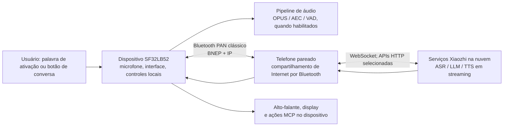

# Assistente de voz Xiaozhi para SF32 { #sf32-xiaozhi-voice-assistant }

## O que é o Xiaozhi? { #what-is-xiaozhi }

[Xiaozhi](https://github.com/78/xiaozhi-esp32) é um chatbot de voz de código aberto baseado em MCP, que ganhou notoriedade com sua implementação para ESP32 em 2025. Ele combina um dispositivo de interação por voz com serviços de modelos de linguagem de grande porte (LLMs) na nuvem e extensões MCP no dispositivo ou na nuvem. Por isso, é um ponto de partida prático para desenvolver hardware de IA conversacional, e não apenas um aplicativo de chat por texto.

## Por que a implementação em SF32? { #why-the-sf32-implementation }
[78/xiaozhi-sf32](https://github.com/78/xiaozhi-sf32) é a implementação para SF32, mas adota deliberadamente outra estratégia de conectividade. Enquanto o projeto original para ESP32 oferece Wi-Fi e outras opções de conexão direta, a versão para SF32 usa [Bluetooth PAN](../learn/bluetooth/pan.md) clássico para acessar a Internet por meio de um telefone pareado. Assim, o telefone assume a conexão de longa distância, o que pode reduzir significativamente o consumo de energia da conectividade no dispositivo em projetos dependentes do telefone. A economia real varia conforme o telefone, as condições de rádio, o tempo dedicado às conversas e a política de energia. Essa abordagem é especialmente adequada a produtos pessoais e portáteis alimentados por bateria, como pingentes, crachás, assistentes compactos e pequenos dispositivos vestíveis.

Esta é uma referência de produto particularmente útil porque reúne aspectos que muitas vezes são tratados separadamente: hardware de display e áudio, conectividade fornecida pelo telefone, serviço de voz na nuvem, fluxo de ativação para o usuário, controles do dispositivo e capacidade de atualização em campo.

## Resultado, escopo e critérios de entrada { #outcome-scope-and-entry-criteria }
Esta página apresenta um roteiro de engenharia completo para transformar essa referência em uma direção de produto. Ela **não** afirma que o Xiaozhi seja um modelo de linguagem executado no próprio dispositivo sem depender da nuvem, que todos os recursos upstream estejam qualificados para produção ou que uma placa de desenvolvimento compatível equivalha a um produto final certificado. O dispositivo acessa a Internet por Bluetooth PAN por meio de um telefone pareado e depende dos serviços Xiaozhi na nuvem para a conversa. Antes de assumir um compromisso com o produto, confirme os termos do serviço, a titularidade da conta, a privacidade, a segurança, os custos, a disponibilidade e a adequação às regiões de lançamento.

**Resultado esperado:** um assistente de voz e display reproduzível, capaz de ser provisionado pelo telefone, concluir uma conversa apoiada pela nuvem, controlar uma função segura do dispositivo, recuperar-se da perda da conexão PAN e gerar evidências para decidir se vale a pena desenvolver hardware próprio.

**Público-alvo:** engenheiros de firmware, hardware e produto que já conseguem compilar e gravar uma base do SF32 e estão preparados para trabalhar com C/C++, esquemáticos da placa, configuração Bluetooth e integração com serviços na nuvem.

<div align="center"><em>Tabela: contrato do projeto</em></div>

<div align="center" markdown>

| Área | Base do projeto | Evidências exigidas antes da próxima etapa |
|:-----|:-----------------|:-------------------------------|
| Hardware | Um alvo Xiaozhi SF32LB52 documentado, seus caminhos de áudio/display e download por USB e sua fonte de alimentação. | Inicialização a frio, botões, interface gráfica, microfone, alto-falante e indicação de carga/bateria, quando aplicável. |
| Conectividade | Um telefone que pareie como `sifli-pan` e compartilhe Internet por Bluetooth PAN. | A interface da placa confirma o PAN; a perda e a reconexão podem ser reproduzidas. |
| Serviço | Uma conta Xiaozhi, a ativação do dispositivo e um agente configurado no console Xiaozhi. | A solicitação de conversa chega ao serviço e a resposta retorna à placa. |
| Firmware | Commit upstream, revisão do submódulo SDK, alvo da placa e método de compilação/gravação registrados. | Compilação limpa reproduzível, gravação, log serial e artefato de firmware. |
| Adaptação do produto | Uma única alteração bem delimitada, como identidade visual da interface, nome Bluetooth, curva da bateria ou saída segura controlada por MCP. | O fluxo original de voz continua funcionando após a alteração. |

</div>

## Especificações de hardware e software { #hardware-and-software-specifications }
O manifesto a seguir define uma referência concreta para compilação a partir do código-fonte: **SF32LB52-DevKit-Nano-R16N16 V1.0.0**, com o display e o circuito de áudio externos documentados pela SiFli. Esta não é uma lista de materiais universal para todas as placas Xiaozhi compatíveis. Se escolher DevKit-ULP, DevKit-LCD ou Xiaotangyuan, substitua todo este manifesto pelo conjunto documentado para essa placa e registre os componentes exatos do fornecedor e a revisão da placa.

### Especificação de hardware { #hardware-specification }
<div align="center"><em>Tabela: especificação do hardware de referência Xiaozhi Nano</em></div>

<div align="center" markdown>

| Componente | Especificação necessária | Função | Status | Onde obter | Compatibilidade e observações sobre substituições |
|:----------|:-----------------------|:-----|:-------|:----------------|:-------------------------------------|
| SF32LB52-DevKit-Nano-R16N16 V1.0.0 | SF32LB52JUD6, 16 MB OPI PSRAM e 16 MB de Flash SPI NOR | Processamento SF32, Bluetooth PAN, download/debug por USB, interface e conexões de áudio | Obrigatório | [Página do produto SiFli](https://www.sifli.com/zh-hans/SF32LB52_DevKit_Nano); [loja oficial SiFli](https://sifli.taobao.com/) | Não substitua pela variante Nano N4 sem rever o alvo do firmware e o orçamento de memória. Registre a revisão da PCB e o link do pedido ao fornecedor. |
| Display AMOLED de 1,85 polegada, 390 × 450, e adaptador FPC de 16 para 22 pinos | Conjunto de display QSPI e pinagem FPC usados na montagem oficial do Xiaozhi Nano | Interface do usuário | Obrigatório | [Página oficial do hardware Xiaozhi Nano](https://docs.sifli.com/projects/xiaozhi/get-started/SF32LB52-DevKit-Nano/) | A página oficial não fornece link de compra. Fixe o controlador do painel, a orientação do FPC, o código do componente do fornecedor e o link de compra antes de considerar a base reproduzível. |
| Módulo de microfone MEMS analógico | Saída analógica compatível com `MIC_BIAS`, `MIC_ADC` e GND | Captura de voz | Obrigatório | [Link do componente publicado no guia oficial](https://item.taobao.com/item.htm?id=595237371680) | Qualquer substituto exige validação de polarização, nível de saída, ruído e desempenho acústico. |
| Módulo amplificador PAM8302 | Entrada diferencial de `DACP`/`DACN`; desligamento controlado por `PA30` | Acionamento do alto-falante | Obrigatório | [Link do componente publicado no guia oficial](https://item.taobao.com/item.htm?id=535743493142) | Considere outro amplificador uma alteração de hardware e verifique novamente polaridade de habilitação, ganho, corrente em repouso e ruído. |
| Alto-falante com caixa | 8 Ω, 2–3 W | Reprodução de voz | Obrigatório | [Link do componente publicado no guia oficial](https://item.taobao.com/item.htm?id=895176389650) | Para qualquer substituição de caixa ou impedância, valide novamente a saída acústica, a temperatura do amplificador e a corrente. |
| Jumpers e protoboard de 400 pontos | Conjunto de fios e protoboard correspondentes ao protótipo Nano documentado | Interconexão do protótipo | Obrigatório para o protótipo documentado | [Jumpers](https://item.taobao.com/item.htm?id=39961676503); [protoboard de 400 pontos](https://item.taobao.com/item.htm?id=39828824454) | Só substitua por uma PCB revisada depois de validar a fiação de referência e transferir a pinagem sem alterações. |
| Cabo USB Type-C de dados e computador de desenvolvimento | Cabo Type-C com suporte a dados; computador com Windows, Linux ou macOS | Alimentação, gravação, compilação e captura de logs seriais | Obrigatório | [Requisitos de preparação do SiFli-SDK](https://docs.sifli.com/projects/sdk/latest/en/sf32lb52x/quickstart/get-started.html) | Um cabo apenas para carga não permite gravar nem capturar logs. Registre o sistema operacional e a arquitetura do host. |
| Telefone Android ou iOS com compartilhamento de Internet por Bluetooth | Deve parear como `sifli-pan` e fornecer acesso à Internet via Bluetooth PAN clássico | Conexão de rede complementar | Obrigatório | [Configuração oficial do PAN para Xiaozhi](https://docs.sifli.com/projects/xiaozhi/get-started/) | Registre o modelo do telefone e a versão do sistema operacional. Valide perda, novo pareamento e compartilhamento em cada combinação de telefone/SO compatível. |

</div>

Os URLs de componentes de terceiros acima são links de marketplaces publicados no guia oficial do Nano SiFli, não garantias de códigos permanentes dos fabricantes. Guarde capturas de tela ou comprovantes dos componentes avaliados e, antes do projeto do produto, substitua cada dependência de marketplace por um código qualificado do fornecedor e seu datasheet.

### Especificação de software { #software-specification }
<div align="center"><em>Tabela: especificação do software de referência Xiaozhi</em></div>

<div align="center" markdown>

| Pacote ou serviço | Versão ou revisão necessária | Função | Status | Onde obter | Compatibilidade e notas sobre atualizações |
|:-------------------|:-----------------------------|:-----|:-------|:----------------|:-------------------------------|
| Firmware Xiaozhi SF32 pré-compilado | v1.4.0 | Imagem de referência sem modificações, para validação inicial e recuperação | Obrigatório nas Etapas 1–2 | [Versão v1.4.0](https://github.com/78/xiaozhi-sf32/releases/tag/v1.4.0) | Para a base Nano R16N16, selecione `sf32lb52-nano_52j.zip`. Não misture arquivos de placas diferentes. |
| Código-fonte `78/xiaozhi-sf32` | Commit [`1d3ef641ace47fae68227e9173647fd5db01f6f5`](https://github.com/78/xiaozhi-sf32/commit/1d3ef641ace47fae68227e9173647fd5db01f6f5) | Código da aplicação e configuração da placa | Obrigatório nas Etapas 3–4 | [Repositório](https://github.com/78/xiaozhi-sf32) | Esta é a versão do código analisada neste artigo. Registre qualquer commit posterior como uma nova base e repita todas as verificações. |
| Submódulo SiFli-SDK | Commit [`0d2de1480f735e05017c41436e655a1688063881`](https://github.com/OpenSiFli/SiFli-SDK/tree/0d2de1480f735e05017c41436e655a1688063881) | Drivers SF32, RTOS, middleware, scripts da cadeia de ferramentas e ambiente SCons | Obrigatório nas Etapas 3–4 | [OpenSiFli/SiFli-SDK](https://github.com/OpenSiFli/SiFli-SDK) pelo submódulo `sdk` do repositório | Use a revisão do submódulo registrada no commit da aplicação escolhido; não atualize o SDK de forma independente em uma base mantida. |
| Interface gráfica do sftool | v1.2.1; registre o SHA-256 do arquivo para o sistema operacional escolhido na página da versão | Gravação de imagens pré-compiladas e recuperação local | Obrigatória para o fluxo documentado com interface gráfica da v1.4.0 | [Versão v1.2.1 e arquivos por plataforma](https://github.com/OpenSiFli/sftool-gui/releases/tag/v1.2.1) | Registre o sistema operacional do host, o nome do arquivo e o checksum. Qualifique versões posteriores antes de adotá-las. |
| Ferramentas do host de compilação | Scripts de instalação/exportação fornecidos pelo SiFli-SDK fixado; ambiente SCons criado por esses scripts | Configuração e compilação do código-fonte | Obrigatórias nas Etapas 3–4 | [Guia oficial de compilação do Xiaozhi](https://docs.sifli.com/projects/xiaozhi/source-build/) | Registre o sistema operacional, a arquitetura, o resultado dos scripts e o ambiente exportado. Uma ferramenta instalada globalmente não deve substituir silenciosamente o ambiente do SDK fixado. |
| Console e serviço Xiaozhi na nuvem | Serviço hospedado em `xiaozhi.me`; registre a data de validação, o titular da conta, a configuração do agente e o endpoint | Ativação, ASR/LLM/TTS em streaming e MCP na nuvem | Obrigatório para as conversas | [Console Xiaozhi](https://xiaozhi.me) | O serviço hospedado não tem uma versão que o usuário possa fixar. Considere comportamento, termos, disponibilidade e acesso regional dependências controladas externamente. |

</div>

## Escolher uma configuração de referência suportada { #choose-a-supported-baseline }
A documentação de início rápido do Xiaozhi da SiFli lista quatro alvos para firmware pré-compilado: SF32LB52-DevKit-ULP (Huangshan), SF32LB52-DevKit-LCD, SF32LB52-DevKit-Nano e a placa de expansão Xiaotangyuan. A documentação de compilação a partir do código-fonte lista atualmente DevKit-ULP, DevKit-LCD e DevKit-Nano. Se a personalização do código-fonte for requisito do projeto, escolha uma placa presente nessa lista; não presuma que a existência de uma imagem pré-compilada implique suporte documentado para compilação.

<div align="center"><em>Tabela: seleção da placa</em></div>

<div align="center" markdown>

| Placa | Escolha esta opção quando | Cuidados antes de levar o projeto ao produto |
|:------|:------------|:----------------------|
| [SF32LB52-DevKit-ULP](https://docs.sifli.com/projects/xiaozhi/get-started/SF32LB52-DevKit-ULP/) | Você quer seguir o exemplo documentado de compilação para ULP e avaliar uma configuração voltada à bateria. | Recalibre a curva da bateria sempre que usar uma bateria diferente da referência documentada. |
| [SF32LB52-DevKit-LCD](https://docs.sifli.com/projects/xiaozhi/get-started/SF32LB52-DevKit-LCD/) | Você precisa de uma referência explícita de integração de display e alto-falante. | As instruções de AMOLED 390 × 450, orientação do FPC, conexão `SPK`, `KEY1` e `KEY2` são específicas desta placa. |
| [SF32LB52-DevKit-Nano](https://docs.sifli.com/projects/xiaozhi/get-started/SF32LB52-DevKit-Nano/) | Você quer uma base SF32LB52 documentada e compacta. | Confirme a configuração exata de display, áudio, alimentação e entradas antes de reutilizar a fiação de outra placa. |
| [Placa de expansão Xiaotangyuan](https://docs.sifli.com/projects/xiaozhi/get-started/SF32LB52-XTY-AI-THT/) | Você está seguindo o fluxo de início rápido correspondente para firmware pré-compilado. | Confirme o suporte atual à compilação e à personalização antes de adotá-la como base do produto. |

</div>

## Etapas do projeto { #delivery-map }
Use as etapas como pontos de decisão, não como uma lista de recursos. Cada uma deixa um artefato que permite revisar e repetir a decisão seguinte.

<div align="center"><em>Tabela: etapas do projeto</em></div>

<div align="center" markdown>

| Etapa | Decisão apoiada | Resultado exigido |
|:------|:---------------------|:----------------|
| 1. Base de referência | A placa, o telefone, a conta e o serviço documentados funcionam juntos sem alterações? | Registro de uma sessão de conversa conhecida e funcional. |
| 2. Validação da recuperação | A base continua confiável diante das falhas que o usuário pode encontrar? | Registro aprovado dos testes de falha e recuperação. |
| 3. Base de código-fonte | A equipe consegue reproduzir o firmware sem depender de uma imagem fornecida? | Artefato de compilação com versões fixadas e respectivos logs. |
| 4. Adaptação controlada | É possível implementar uma alteração no produto sem perder o comportamento de referência? | Alteração revisada e evidências dos testes de regressão. |
| 5. Decisão de produto | Os riscos de hardware, serviço, segurança e recuperação estão suficientemente compreendidos para justificar o próximo investimento? | Registro aprovado de prontidão do produto e transferência para o projeto de hardware. |

</div>

## Arquitetura do sistema e dependências { #system-architecture-and-dependencies }
<div align="center"><em>Figura: fluxo do produto Xiaozhi com SF32</em></div>



A documentação oficial de arquitetura descreve o Bluetooth PAN sobre Bluetooth clássico como caminho de rede, com uma pilha IP leve no dispositivo. O WebSocket é indicado como principal canal de aplicação em tempo real, enquanto algumas interações com APIs usam HTTP. A visão geral da SiFli lista como funções implementadas a ativação por palavra-chave (KWS), o diálogo contínuo, AEC/VAD, expressões dinâmicas, fontes vetoriais e MCP local. Outros materiais oficiais também descrevem a interface gráfica, o gerenciamento de bateria/energia, extensões MCP na nuvem e OTA por PAN; confirme o suporte específico na placa e no firmware escolhidos.

Esse fluxo cria quatro domínios de falha que precisam ser diagnosticados separadamente: hardware e áudio locais; pareamento Bluetooth e PAN; acesso à Internet e aos serviços na nuvem; e configuração do aplicativo e do serviço. Um pareamento BLE bem-sucedido, por si só, não comprova que a placa tenha acesso à Internet nem que o serviço de voz esteja ativado.

## Etapa 1 — Estabelecer a base de referência sem modificações { #stage-1-establish-the-untouched-reference-baseline }

1. Conclua a configuração de hardware oficial específica da placa. No DevKit-LCD, isso inclui a montagem indicada de AMOLED/FPC, um alto-falante em `SPK`, `KEY1` para ativação/conversa e pressionamento prolongado de `KEY2` para desligar.
2. Grave o firmware pré-compilado compatível seguindo o procedimento oficial do Xiaozhi. O guia de início rápido recomenda a ferramenta gráfica de gravação e informa que, na data do guia, a gravação pelo terminal não é compatível com o firmware v1.4.0 ou posterior.
3. No telefone, habilite o **compartilhamento de Internet por Bluetooth antes do pareamento**. Pareie com o dispositivo `sifli-pan` e use a interface da placa e o estado de compartilhamento do telefone para confirmar que o PAN está ativo, e não apenas o pareamento Bluetooth. No iOS, o guia oficial observa que talvez seja necessário reiniciar o telefone se `sifli-pan` não aparecer.
4. Siga o fluxo oficial de ativação no console Xiaozhi em [xiaozhi.me](https://xiaozhi.me): crie/configure um agente e adicione o código do dispositivo exibido pela placa.
5. Faça uma conversa usando o botão de conversa da placa ou o método de ativação configurado. Registre no projeto a versão do firmware, a placa, o modelo/SO do telefone e o identificador da conta/agente do serviço.

**Critério de saída do ponto de controle 1:** após uma inicialização a frio, o dispositivo estabelece o PAN, indica que está ativado, aceita uma solicitação de conversa, reproduz a resposta e apresenta o estado esperado na interface.

## Etapa 2 — Comprovar a recuperação e os comportamentos essenciais do produto { #stage-2-prove-recovery-and-product-critical-behavior }

Execute estes testes antes de alterar o código-fonte. Eles transformam a demonstração em uma base confiável:

<div align="center"><em>Tabela: evidências de validação da base</em></div>

<div align="center" markdown>

| Teste | Método | Evidência de aprovação |
|:-----|:-------|:--------------|
| PAN indisponível | Faça o pareamento sem habilitar o compartilhamento de Internet por Bluetooth. | A interface/log identifica claramente a ausência do PAN; habilitar o compartilhamento e reconectar restaura o serviço. |
| Perda do PAN | Desabilite o compartilhamento, desconecte o Bluetooth ou afaste o telefone durante o repouso e durante uma conversa. | O dispositivo detecta a falha, retorna a um estado recuperável e reconecta pelo fluxo documentado de ativação/reconexão. |
| Suspensão e retomada | Deixe o dispositivo em repouso até suspender e, em seguida, use o controle de ativação designado. | A ativação, reconexão e conversa seguinte podem ser repetidas sem gravar o firmware novamente. |
| Áudio e interface | Faça várias conversas em volume realista. | A captura é inteligível, a reprodução é limpa, a interface continua responsiva e não ocorrem reinicializações. |
| Indicação da bateria | Carregue e descarregue em níveis representativos. | O nível indicado é plausível; baterias diferentes da referência são sinalizadas para calibração da curva. |
| Limite do serviço | Teste intencionalmente uma conta/agente sem a configuração esperada. | A falha pode ser diferenciada de problemas de PAN e de hardware. |

</div>

O guia oficial alerta que a curva padrão em `battery_table.c`, específica de cada placa, pode não ser precisa para outra bateria. Para a bateria do produto, obtenha os dados de carga/descarga do fornecedor ou faça medições; atualize `charging_curve_table` e `discharge_curve_table`, recompile e repita os testes de bateria.

**Critério de saída do ponto de controle 2:** todos os testes têm resultados registrados, as falhas podem ser diferenciadas por domínio e cada método documentado de recuperação funciona sem nova gravação do firmware nem correção manual do estado.

## Etapa 3 — Criar uma base de código-fonte reproduzível { #stage-3-build-a-reproducible-source-baseline }

O repositório inclui o SiFli-SDK como submódulo. Clone o repositório recursivamente e registre o commit do Xiaozhi e o commit do submódulo SDK:

```bash
git clone --recursive https://github.com/78/xiaozhi-sf32.git
cd xiaozhi-sf32
git checkout 1d3ef641ace47fae68227e9173647fd5db01f6f5
git submodule update --init --recursive
cd sdk
# Windows: .\install.ps1, then .\export.ps1
# macOS/Linux: ./install.sh, then . ./export.sh
```

No exemplo oficial de compilação por script para DevKit-ULP, compile a partir de `app/project` usando o caminho documentado para a placa externa:

```bash
scons --board=sf32lb52-lchspi-ulp --board_search_path="../boards" -j8
```

Consulte a página oficial de compilação específica da placa para obter o alvo exato e o script de download; não reutilize o nome da placa ULP nem o caminho do artefato gerado para outra placa. O registro de uma compilação reproduzível deve incluir SO do host, resultado da instalação das ferramentas, ambiente exportado, argumento da placa, revisões upstream/SDK, log de compilação, imagem gravada e log serial.

**Critério de saída do ponto de controle 3:** um checkout limpo em outra máquina — ou após excluir o diretório de compilação — gera uma imagem aprovada em todos os testes da Etapa 2.

## Etapa 4 — Fazer adaptações de forma deliberada { #stage-4-adapt-deliberately }

Faça uma alteração por vez e preserve a imagem de referência aprovada. O material oficial de personalização aborda o nome Bluetooth, gráficos estáticos e animados, fontes, DFU por PAN e MCP.

<div align="center"><em>Tabela: sequência segura de adaptação</em></div>

<div align="center" markdown>

| Tipo de alteração | Comece por | Regressão necessária |
|:-------------|:-----------|:--------------------|
| Identidade do produto | Nome Bluetooth, imagem estática, fonte ou animação. | Gravação, ativação, PAN, interface e uma conversa. |
| Bateria/hardware do produto | Curva da bateria, parâmetros do display, caminho de áudio e comportamento dos botões. | Testes de alimentação, ativação, áudio/interface e conversas repetidas. |
| Controle local do dispositivo | Uma ferramenta MCP de escopo restrito, com parâmetros limitados e callback seguro. | Autorização do comando, entradas inválidas, desconexão durante a ação, estado físico seguro e log auditável. |
| Extensão na nuvem | Um serviço MCP externo. | Autenticação do endpoint, armazenamento de segredos, disponibilidade/recuperação após reinício, privilégio mínimo e consentimento visível ao usuário. |
| Atualização em campo | DFU_PAN e um servidor OTA. | Detecção de versão, integridade de CRC/partições, interrupção da atualização, rollback/recuperação e origem da imagem. |

</div>

Para MCP no dispositivo, o guia oficial usa `McpServer::AddCommonTools()` em `app/src/mcp/mcp_server.cc`. Trate ações solicitadas por um LLM como solicitações não confiáveis: valide faixa e estado no callback, mantenha as saídas em estados seguros por padrão e não exponha controles irreversíveis, perigosos ou sensíveis à segurança sem autorização específica do produto.

Para OTA por PAN, a documentação oficial descreve três classes de imagem que podem ser distribuídas separadamente: código, recursos gráficos e fontes. Ela orienta o uso da tabela de partições para determinar o endereço e o tamanho de cada imagem. O OTA em produção exige política de versões, controle de acesso ao servidor, validação de integridade, teste de interrupção e um método de recuperação local ou com fio antes de ser habilitado para os usuários.

**Critério de saída do ponto de controle 4:** a alteração escolhida, seu método de rollback/recuperação e todos os resultados de regressão aplicáveis estão registrados; o fluxo original de conversa e os limites de segurança das ações do dispositivo continuam aprovados.

## Etapa 5 — Avaliar a prontidão para o produto { #stage-5-product-readiness-review }

Não avance para o hardware personalizado até que a equipe consiga responder a todas estas perguntas:

- Quais versões de telefone/SO são compatíveis com o fluxo exato de configuração do PAN e qual é a alternativa quando não forem?
- Quais endpoints de nuvem e MCP serão usados, e com que conta e agente? Quem será responsável por gerenciá-los e rotacionar as credenciais?
- Quais dados de áudio, dispositivo e usuário saem do dispositivo; como o consentimento é obtido; e quais são os requisitos de retenção e região?
- Quais valores de corrente foram medidos durante conversas ativas, repouso conectado, suspensão, carga e ativação, usando a bateria e o gabinete previstos?
- Como o dispositivo se recupera de uma atualização malsucedida, perda do telefone, indisponibilidade da nuvem, recurso corrompido ou configuração incorreta?
- Quais partes do código upstream, serviço, comportamento do modelo e infraestrutura OTA são controladas pela equipe do produto e quais dependem de fornecedores externos?

**Critério de saída do ponto de controle 5:** as respostas, os responsáveis e os riscos residuais estão registrados e foram aceitos pela equipe do produto; cada pendência tem uma mitigação, um adiamento explícito ou uma decisão de interromper.

## Transição para o projeto do produto { #handoff-to-product-design }
Leve a seleção do componente SF32, a arquitetura de alimentação, o projeto do display e do áudio, a estratégia de RF, o plano de armazenamento/partições, os testes de produção e as premissas de recuperação para [Projeto para produção](../hardware/design-for-production.md). Use o [caminho de integração do SF32LB52](../sf32-products/chips/SF32LB52x.md#integration-path) para escolher o chip, módulo, placa, guia e checklist pertinentes.

**Definição de conclusão do projeto:** esta referência cumpriu seu papel quando uma nova pessoa da equipe consegue reproduzir a base selecionada, identificar o responsável ou o método de recuperação de cada falha observada, recompilar a imagem personalizada e revisar as evidências necessárias para decidir sobre hardware próprio. A partir daí, ela serve como referência de desenvolvimento de produto — não como uma demonstração não avaliada a ser levada diretamente à produção.

## Fontes de referência { #authoritative-sources }
- [Repositório 78/xiaozhi-esp32](https://github.com/78/xiaozhi-esp32)
- [Repositório 78/xiaozhi-sf32](https://github.com/78/xiaozhi-sf32)
- [Wiki da SiFli: visão geral do AI Xiaozhi (em chinês)](https://github.com/OpenSiFli/SiFli-Wiki/blob/main/source/zh_CN/application/xiaozhi.md)
- [Início rápido do Xiaozhi SiFli](https://docs.sifli.com/projects/xiaozhi/get-started/)
- [Compilação do Xiaozhi SiFli a partir do código-fonte](https://docs.sifli.com/projects/xiaozhi/source-build/)
- [Arquitetura do Xiaozhi SiFli](https://docs.sifli.com/projects/xiaozhi/architecture/)
- [Personalização do Xiaozhi SiFli](https://docs.sifli.com/projects/xiaozhi/custom/)
- [Guia DFU_PAN do Xiaozhi SiFli](https://docs.sifli.com/projects/xiaozhi/custom/dfu_pan.html)
- [Guia MCP do Xiaozhi SiFli](https://docs.sifli.com/projects/xiaozhi/custom/mcp.html)
