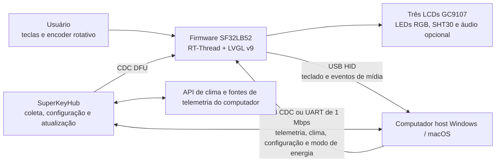

# Teclado macro multifuncional SuperKey { #superkey-multifunction-macro-keyboard }

## O que é o SuperKey? { #what-is-superkey }

[SiFliSparks/SuperKey](https://github.com/SiFliSparks/SuperKey) é uma implementação de referência baseada no SF32LB52 para um teclado macro multifuncional com telas. O firmware de código aberto roda em RT-Thread e LVGL v9, controla três telas LCD GC9107 de 128 × 128, três LEDs RGB, quatro teclas físicas, um encoder rotativo e um sensor de temperatura e umidade SHT30, e se conecta ao computador como um dispositivo USB composto HID/CDC.

O SuperKey vai além de um teclado de atalhos. Ele reúne estes caminhos de produto em uma referência funcional:

- saída USB HID para teclado e controles de mídia;
- recepção de dados de desempenho do computador, clima, configuração e estado de energia por USB CDC ou UART de 1 Mbps;
- páginas nas três telas para monitoramento de desempenho, clima, relógio, utilitários, música e mapeamentos personalizados de teclas;
- aplicativo complementar [SuperKeyHub](https://github.com/SiFliSparks/SuperKeyHub), que coleta dados do computador, configura funções e inicia atualizações de firmware;
- hardware reproduzível com o projeto aberto [sf32-keyboard](https://oshwhub.com/sifli/sf32-keyboard).


<div align="center"><em>Interface do SuperKey em três telas</em></div>

## Por que usar a implementação com SF32? { #why-the-sf32-implementation }

O SuperKey precisa de recursos gráficos, várias telas, um dispositivo USB composto, teclas e encoder, sensores, efeitos RGB, sistema de arquivos e áudio opcional. O SF32LB52 mantém essas tarefas em tempo real no MCU, permitindo que o dispositivo inicie a interface e ofereça funções HID básicas mesmo quando o aplicativo complementar não está em execução. O aplicativo no computador cuida da telemetria do sistema e dos dados da Internet, tarefas mais adequadas a um sistema operacional de desktop.

Essa divisão atende a controladores de desktop, teclados para fluxos de trabalho, painéis de status e HMIs compactas, mas traz dependências explícitas. A exibição de dados avançados requer o aplicativo complementar, drivers e APIs externas; as versões do firmware e do aplicativo precisam ser compatíveis; e falhas de USB, suspensão do computador e configurações corrompidas exigem testes de recuperação independentes.

## Resultado, escopo e critérios de entrada { #outcome-scope-and-entry-criteria }

**Resultado:** reproduzir uma configuração do SuperKey com versões fixadas e validar HID, CDC, a interface de três telas, entradas, sensores e recuperação após a suspensão; em seguida, alterar apenas uma categoria de comportamento e manter evidências de compilação, comunicação e regressão para a análise do produto.

Este artigo não atesta que a PCB aberta esteja pronta para produção nem que haja compatibilidade com todas as fontes de telemetria do computador, serviços meteorológicos, pontes seriais, hosts USB ou versões de sistema operacional. Os dados de ações, clima e desempenho podem depender da versão do SuperKeyHub, de APIs de terceiros, das permissões do sistema e do hardware do computador.

Antes de começar, tenha em mãos:

- hardware do SuperKey montado conforme o projeto aberto, incluindo três telas LCD GC9107, teclas, encoder e conexão USB para dados;
- um computador com Windows 10/11 para o fluxo principal documentado. O repositório do SuperKeyHub declara suporte a Windows e macOS, mas valide a gravação da placa, a comunicação CDC e a recuperação no sistema operacional escolhido;
- uma versão do SuperKeyHub compatível com o firmware;
- um ambiente SiFli-SDK, o submódulo do SDK obtido recursivamente e uma conexão funcional de gravação/recuperação;
- uma API Key, um API Host e uma configuração de cidade válidos do QWeather, caso o clima faça parte dos testes;
- um registro de testes que cubra enumeração USB, logs seriais, comportamento das teclas, estado das telas e recuperação após suspensão.

<div align="center"><em>Tabela: contrato do projeto SuperKey</em></div>

<div align="center" markdown>

| Área | Base conhecida | Evidências necessárias antes da adaptação |
|:-----|:---------------|:------------------------------------------|
| Hardware | Hardware aberto `sf32-keyboard` e alvo de placa `sf32lb52-superkey` | Revisão da placa e da montagem, LCDs e dispositivos de entrada, alimentação e registro da conexão USB |
| Firmware | Repositório SuperKey, submódulo SiFli-SDK, RT-Thread, LVGL v9 e CherryUSB | Commit do firmware, commit do SDK, log de compilação, imagem e log de gravação |
| Aplicativo complementar | SuperKeyHub com protocolo de firmware compatível | Versão do aplicativo, sistema operacional, porta, configuração da API e log da conexão |
| Comportamento principal | HID, CDC, três telas, encoder, teclas, sensor e modos de energia | Registro de inicialização a frio, atualização de dados, entradas, desconexão e recuperação da suspensão |
| Adaptação | Alterar uma única função de interface, tecla, LED ou campo de dados por vez | Alteração revisada, imagem para rollback e resultado completo da regressão |

</div>

## Especificações de hardware e software { #hardware-and-software-specifications }

### Especificação de hardware { #hardware-specification }

<div align="center"><em>Tabela: Especificação de hardware do SuperKey</em></div>

<div align="center" markdown>

| Componente | Especificação necessária | Função | Status | Onde obter | Compatibilidade e observações sobre substituições |
|:-----------|:-------------------------|:-------|:-------|:-----------|:--------------------------------------------------|
| Conjunto de hardware aberto do SuperKey | Configuração SF32LB52 com três LCDs GC9107 de 128 × 128, três LEDs RGB, quatro teclas, encoder rotativo, SHT30 e USB, conforme descrito pelo projeto | Controle do teclado macro, telas, entrada, sensores e USB HID/CDC | Obrigatório | [Projeto aberto `sf32-keyboard`](https://oshwhub.com/sifli/sf32-keyboard); [repositório SuperKey](https://github.com/SiFliSparks/SuperKey) | Os arquivos de projeto não são uma especificação de placa montada disponível para compra; as revisões de pinagem e de montagem devem ser registradas |
| Computador host e conexão USB de dados | Windows 10/11 é o fluxo principal documentado; conexão USB de dados | Executa SuperKeyHub, fornece o host HID/CDC e permite gravação/recuperação | Obrigatório | [Documentação SuperKey](https://sparks.sifli.com/projects/superkey/) | O repositório do SuperKeyHub declara suporte a Windows/macOS; qualifique CDC, DFU, gravação e recuperação no SO escolhido |
| Conta/configuração da API QWeather | API Key, API Host e configuração da cidade | Recurso opcional de clima | Opcional | [QWeather](https://www.qweather.com/) | Não armazene credenciais no repositório; verifique os termos e a disponibilidade do serviço |

</div>

### Especificação de software { #software-specification }

<div align="center"><em>Tabela: Especificação de software do SuperKey</em></div>

<div align="center" markdown>

| Pacote ou serviço | Versão ou revisão necessária | Função | Status | Onde obter | Compatibilidade e observações sobre atualizações |
|:------------------|:-----------------------------|:-------|:-------|:-----------|:-------------------------------------------------|
| Firmware SuperKey | Versão v1.4.2; registre o commit exato utilizado | Firmware SF32, UI LVGL, USB, sensor e atualização | Obrigatório | [Versão v1.4.2](https://github.com/SiFliSparks/SuperKey/releases/tag/v1.4.2) | Fixe o commit do firmware; não deduza compatibilidade com o host apenas pelos números de versão |
| SuperKeyHub | Versão ou commit verificado com o firmware v1.4.2 | Telemetria do host, configuração e interface de atualização | Obrigatório para recursos do host | [Repositório](https://github.com/SiFliSparks/SuperKeyHub) | O material de lançamento citado não estabelece um par fixo de firmware/aplicativo; teste telemetria, configuração e DFU e registre a combinação |
| Submódulo SiFli-SDK, RT-Thread, LVGL e CherryUSB | Revisões registradas pelo checkout do firmware selecionado | Compilação do firmware e pilha USB | Obrigatório para compilar o código-fonte | [Repositório SuperKey](https://github.com/SiFliSparks/SuperKey) | Clone recursivamente e preserve as revisões dos submódulos; não atualize dependências separadamente |

</div>

## Escolher uma configuração de referência suportada { #choose-a-supported-baseline }
A página de releases do projeto inclui o firmware [v1.4.2](https://github.com/SiFliSparks/SuperKey/releases/tag/v1.4.2), que serve como ponto de partida fixo. O material citado não especifica uma versão compatível do SuperKeyHub; selecione e fixe uma versão ou commit do Hub, teste telemetria, configuração e DFU com a v1.4.2 e registre o par testado, sem presumir compatibilidade pelos números de versão.

<div align="center"><em>Tabela: seleção da base do SuperKey</em></div>

<div align="center" markdown>

| Elemento da base | Ponto de partida recomendado | Limitação importante |
|:-----------------|:----------------------------|:---------------------|
| Firmware | SuperKey v1.4.2 ou um commit validado pela equipe | As versões do firmware e do protocolo do host precisam corresponder |
| Aplicativo complementar | Versão ou commit do SuperKeyHub verificado com o firmware v1.4.2 | O material citado não estabelece um par fixo; valide dados CDC, configuração e DFU no sistema operacional escolhido |
| Alvo de compilação | `sf32lb52-superkey`, com arquivos da placa em `app/boards` | Não é um alvo genérico para placas de desenvolvimento SF32LB52 |
| Comunicação | Valide primeiro o USB composto HID + CDC; se usar UART de 1 Mbps, valide-a separadamente | “USB enumerado” não comprova que as interfaces HID e CDC estejam funcionando |
| Atualização | DFU por CDC iniciado pelo aplicativo, mantendo também um caminho cabeado de gravação e recuperação | Não deve ser tratado como solução de atualização em campo antes de validar interrupções, incompatibilidade de versões e recuperação |

</div>

A integração contínua do projeto usa o alvo a seguir. Instale e carregue o ambiente do SiFli-SDK antes de executar os comandos localmente:

```bash
git clone --recursive https://github.com/SiFliSparks/SuperKey.git
cd SuperKey/SiFli-SDK
./install.sh
. ./export.sh
cd ../app/project
scons --board=sf32lb52-superkey --board_search_path="../boards" -j8
```

No Windows, use os scripts de instalação e configuração do ambiente do SiFli-SDK para PowerShell. O paralelismo pode ser ajustado, mas o nome da placa, o caminho de busca da placa e as revisões dos submódulos devem constar do registro de compilação.

## Etapas do projeto { #delivery-map }

<div align="center"><em>Tabela: etapas do projeto SuperKey</em></div>

<div align="center" markdown>

| Etapa | Decisão que orienta | Resultado necessário |
|:------|:--------------------|:---------------------|
| 1. Base sem alterações | O hardware aberto, o firmware e o aplicativo complementar funcionam juntos conforme registrado? | Registro de uma sessão funcional com versões fixadas |
| 2. Comunicação e recuperação | Falhas de USB, serial, suspensão, desconexão e configuração podem ser diagnosticadas e recuperadas? | Registro de injeção de falhas e recuperação |
| 3. Reprodução do build a partir do código-fonte | A equipe consegue reconstruir a mesma imagem a partir de um checkout limpo? | Ambiente de compilação, imagem, gravação e resultado reproduzível |
| 4. Adaptação controlada | É possível alterar um comportamento do produto sem comprometer a base? | Alteração delimitada, caminho de rollback e evidências de regressão |
| 5. Análise do produto | A referência é sólida o suficiente para uma placa, um gabinete ou um lote piloto próprios? | Riscos atribuídos e decisão de avançar, adiar ou interromper |

</div>

## Arquitetura do sistema e dependências { #system-architecture-and-dependencies }

<div align="center"><em>Figura: caminhos de dados e controle do produto SuperKey</em></div>



Classifique as falhas em cinco domínios: hardware e tela do dispositivo, entrada HID, canal de dados CDC/UART, aplicativo complementar e permissões do sistema, e serviços externos de dados. Uma tela de clima vazia não indica necessariamente uma falha no firmware; a API Key, o API Host, a configuração da cidade ou o envio dos dados podem ser a causa.

## Etapa 1 — Estabeleça a base de referência sem alterações { #stage-1-establish-the-untouched-reference-baseline }

**Objetivo:** comprovar o funcionamento de todo o caminho de referência antes de alterar o código.

1. Siga as instruções de montagem do projeto para conferir a orientação dos cabos LCD, as chaves, o encoder, o gabinete e o conector USB; registre as revisões da placa e do firmware.
2. Instale uma versão compatível do SuperKeyHub. Confirme a enumeração do dispositivo e, em seguida, teste HID e CDC separadamente.
3. Configure as credenciais de clima, a porta e a comunicação serial a 1 Mbps. Registre o comportamento sem o aplicativo complementar; depois, conecte-o e habilite o envio de dados.
4. Verifique a navegação nas três telas, o mapeamento das teclas, o controle de mídia, o encoder, os dados do SHT30, os efeitos dos LEDs e um ciclo completo de atualização da telemetria.
5. Faça uma inicialização a frio e repita os testes. Salve fotos da interface, logs do aplicativo e do dispositivo e o resultado da consulta de versão.

**Evidências a manter:** revisão do hardware, tag/commit do firmware, commit do SDK, versão do aplicativo complementar, sistema operacional, configurações de porta e API, enumeração USB, logs, telas e registro das entradas.

**Critério de saída da Etapa 1:** duas inicializações a frio concluem a entrada HID, a atualização de dados via CDC e a interação com as três telas; cada domínio de falha pode ser distinguido pelos logs ou por um estado observável.

## Etapa 2 — Valide os limites de falha e recuperação { #stage-2-validate-fault-and-recovery-boundaries }

**Objetivo:** comprovar que interrupções comuns em um computador desktop não deixam o dispositivo em um estado de demonstração que exija regravação do firmware.

<div align="center"><em>Tabela: testes de falha e recuperação do SuperKey</em></div>

<div align="center" markdown>

| Teste | Método | Evidência de aprovação |
|:------|:-------|:-----------------------|
| Aplicativo complementar ausente | Feche o SuperKeyHub e reinicie o dispositivo | A interface local e o HID continuam funcionando; os valores dependentes do aplicativo aparecem claramente como desatualizados ou indisponíveis |
| Perda de CDC | Desconecte e reconecte o USB ou troque de porta durante o envio de dados | O dispositivo não trava; a consulta de versão e o envio de dados voltam a funcionar após a reconexão |
| Suspensão do computador | Habilite `power_mode sleep/normal` e execute um ciclo de suspensão e retomada do computador | LCDs, LEDs, retroiluminação e sensores param/retomam conforme esperado, e os dados voltam a ser atualizados |
| Incompatibilidade de versões | Em um ambiente controlado, teste uma combinação incompatível de aplicativo e firmware | A combinação é rejeitada ou apresenta um erro diagnosticável, sem aplicar uma atualização incompatível |
| Falha da API | Use uma configuração de clima inválida ou desconecte a rede | A falha do clima não afeta HID, CDC, a interface local nem a recuperação |
| Interrupção do DFU | Interrompa uma atualização em uma unidade de teste recuperável | O caminho cabeado de gravação mantido disponível restaura a imagem conhecida |

</div>

**Critério de saída da Etapa 2:** cada falha aplicável tem um resultado reproduzível de detecção e recuperação, sem depender de reparos manuais de estado não documentados.

## Etapa 3 — Crie uma base de código reproduzível { #stage-3-build-a-reproducible-source-baseline }

**Objetivo:** permitir que outro engenheiro compile, grave a imagem e repita a Etapa 2 a partir de um checkout limpo.

1. Clone o repositório recursivamente e registre os commits do SuperKey e do SiFli-SDK.
2. Faça uma compilação limpa usando o alvo `sf32lb52-superkey` e o caminho de busca `../boards`.
3. Guarde o log de compilação, a saída de memória/partições, o script de gravação, as imagens geradas e o log serial.
4. Repita a compilação em outro computador ou após apagar o diretório de build; grave a imagem no mesmo hardware e repita os principais testes de regressão.

**Critério de saída da Etapa 3:** a imagem aprovada na Etapa 2 pode ser gerada sem arquivos não rastreados, artefatos antigos ou substituições manuais de binários.

## Etapa 4 — Adapte uma variável do produto por vez { #stage-4-adapt-one-product-variable-at-a-time }

**Objetivo:** validar os limites da alteração sem comprometer a referência aprovada.

<div align="center"><em>Tabela: ordem de adaptação controlada do SuperKey</em></div>

<div align="center" markdown>

| Categoria da alteração | Bom primeiro passo | Regressão necessária |
|:-----------------------|:-------------------|:---------------------|
| Identidade e interface | Alterar um ícone, fonte, layout de página ou ajuste de rotação | Atualização das três telas, rotação, fontes, inicialização a frio e uso de memória |
| Fluxo das teclas | Alterar um mapeamento HID ou combinação de teclas | Pressionar/soltar, várias teclas, desconexão inesperada e persistência da configuração |
| Campo de dados | Alterar um valor de telemetria ou sensor | Compatibilidade do protocolo, verificação de faixa, timeout de atualização e comportamento com versões antigas do aplicativo |
| Efeito dos LEDs | Alterar uma cor ou animação | Limites de brilho, suspensão, feedback das teclas e operação prolongada |
| Atualização | Alterar a política de versões ou a interface de atualização | Origem da imagem, validação de versão, interrupção, rollback e recuperação cabeada |

</div>

**Critério de saída da Etapa 4:** a alteração foi revisada, a imagem original pode ser restaurada e os testes de HID, CDC, tela, entradas, suspensão e recuperação foram aprovados.

## Etapa 5 — Revise a prontidão para o produto { #stage-5-product-readiness-review }

Antes de desenvolver hardware próprio ou montar um lote piloto, a equipe deve responder:

- O produto continuará dependendo do SuperKeyHub, de privilégios de administrador e de um serviço de clima de terceiros? Quem será responsável por essas dependências?
- Como serão gerenciadas as versões do firmware, do aplicativo complementar e do protocolo, e como serão bloqueadas combinações incompatíveis?
- Quais combinações de computadores, hubs USB, cabos, políticas de suspensão e softwares de segurança foram testadas?
- Qual é o uso de memória, a temperatura e a corrente com as três telas, os dados USB, os LEDs, os sensores e o áudio opcional operando ao mesmo tempo?
- Como recuperar as configurações, os mapeamentos de teclas e o estado da atualização após uma queda de energia ou dano ao armazenamento?
- As licenças da placa aberta, do gabinete, das fontes, dos ícones, da música e das APIs de terceiros permitem a distribuição planejada?

**Critério de saída da Etapa 5:** cada risco residual tem responsável, evidências e uma decisão de tratamento; a equipe decidiu avançar, adiar ou interromper.

## Transição para o projeto do produto { #handoff-to-product-design }
Leve adiante a seleção do SF32 e da memória, os descritores USB HID/CDC, as conexões das três telas e da retroiluminação, as interfaces de entrada e dos sensores, a política de energia e suspensão, o sistema de arquivos e as partições de atualização, o protocolo do aplicativo complementar, os pontos de teste de produção e o caminho de recuperação validado. Consulte [SF32LB52x](../sf32-products/chips/SF32LB52x.md), o [guia de projeto de hardware do SF32LB52x](../hardware/chip-guides/SF32LB52x_hardware_design_guide.md), [Compilar, gravar e monitorar com o SiFli-SDK](../develop/platforms/sifli-sdk/build-flash-monitor.md) e [Projeto para produção](../hardware/design-for-production.md) para continuar.

## Fontes de referência { #authoritative-sources }
- [Repositório do firmware SiFliSparks/SuperKey](https://github.com/SiFliSparks/SuperKey)
- [Lançamento SuperKey v1.4.2](https://github.com/SiFliSparks/SuperKey/releases/tag/v1.4.2)
- [Repositório do aplicativo complementar SiFliSparks/SuperKeyHub](https://github.com/SiFliSparks/SuperKeyHub)
- [Documentação do projeto SuperKey](https://sparks.sifli.com/projects/superkey/)
- [Hardware aberto sf32-keyboard](https://oshwhub.com/sifli/sf32-keyboard)
- [OpenSiFli/SiFli-SDK](https://github.com/OpenSiFli/SiFli-SDK)
