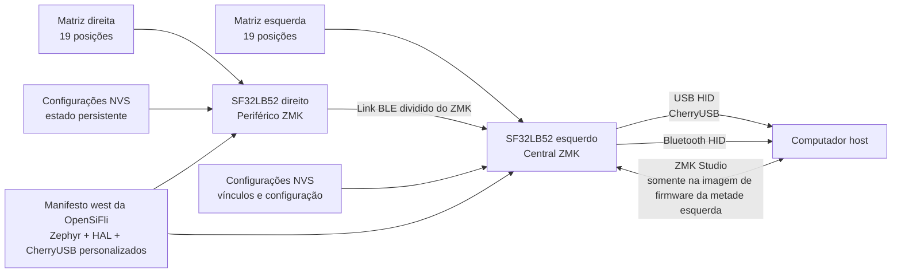

# Firmware de teclado ZMK no SF32 { #zmk-keyboard-firmware-on-sf32 }

## O que é o ZMK no SF32? { #what-is-zmk-on-sf32 }

[ZMK Firmware](https://zmk.dev/) é um firmware de teclado sob licença MIT, desenvolvido sobre o Zephyr. O projeto principal do ZMK fornece o modelo de aplicação usado por muitos teclados com e sem fio, inclusive os divididos em duas metades: varredura da matriz, mapas de teclas e camadas, comportamentos de tecla, HID por USB e Bluetooth, configurações persistentes e definições extensíveis de placas/shields.

[OpenSiFli/zmk](https://github.com/OpenSiFli/zmk) é um repositório derivado (fork) do ZMK, mantido pela OpenSiFli. A versão analisada acrescenta:

- uma variante de placa `sf32lb52_devkit_lcd/sf32lb525uc6/zmk`;
- integração do SoC SF32LB52 à árvore da aplicação ZMK;
- configurações para placa única, teclado dividido, ZMK Studio e o shield `urchin_sf32lb52`;
- um backend CherryUSB adaptado ao SF32;
- uma partição NVS de 256 KB para armazenar configurações e suporte à persistência das configurações Bluetooth;
- um mapa de teclas do teclado dividido Urchin com três camadas, controles de perfil Bluetooth e atalhos de desbloqueio do ZMK Studio.

Esta é uma adaptação em desenvolvimento, não uma versão de produto ZMK para SF32 identificada por uma tag de lançamento. O README na raiz do repositório derivado ainda é o README genérico do projeto principal ZMK e não oferece um guia de início rápido específico para SF32. Use a placa, o shield, o manifesto, o código-fonte e o commit como referência executável. Antes de adaptar, reúna evidências próprias de compilação limpa, gravação, funcionamento e recuperação.

## Por que usar a implementação SF32? { #why-the-sf32-implementation }

A adaptação para SF32 demonstra como executar o modelo de teclado do ZMK no SF32LB52 mantendo as convenções do Zephyr para a árvore de dispositivos (devicetree), Kconfig, `west`, mapas de teclas, shields e teclados divididos em duas metades. A referência `urchin_sf32lb52` distribui um layout de 38 teclas entre as metades. A configuração esquerda exerce a função central: habilita CherryUSB e ZMK Studio e pode disponibilizar HID por USB ao computador anfitrião. A configuração direita exerce a função periférica. O ZMK BLE é habilitado nas duas metades.

Esse repositório derivado é útil para avaliar um teclado sem fio dividido em duas metades, um dispositivo de entrada USB/Bluetooth para desktop, um teclado macro programável ou um produto HMI personalizado com SF32. A contrapartida é o nível de maturidade das dependências: o manifesto `west` fixa um ramo personalizado do Zephyr (`v4.3+sf32-zmk_fixes`), uma revisão específica do SiFli HAL e o ramo personalizado `zephyr-adapt` do CherryUSB. Essas dependências fazem parte dos limites de compatibilidade da adaptação. Não as substitua pelas versões mais recentes do projeto principal sem uma migração completa e uma rodada de regressão.

## Resultado, escopo e critérios de entrada { #outcome-scope-and-entry-criteria }

**Resultado esperado:** compilar e gravar imagens Urchin com versões fixadas para os lados esquerdo e direito; validar toda a matriz de teclas, as camadas, HID por USB, o link BLE entre metades e os caminhos até o host, a persistência das configurações, o limite do ZMK Studio e a recuperação; depois, fazer uma alteração controlada no mapa de teclas ou no hardware, com evidências reproduzíveis.

Esta página não afirma paridade completa de recursos com o projeto principal do ZMK, compatibilidade com qualquer shield ZMK, autonomia de bateria pronta para produção, desempenho de rádio comprovado ou suporte à migração para outra revisão do Zephyr/ZMK. Também não define uma PCB de teclado pronta para produção: a configuração Urchin do repositório associa uma matriz de referência aos pinos do SF32LB52-DevKit-LCD; essa associação precisa ser adaptada deliberadamente para cada projeto de hardware personalizado.

Antes de começar, prepare:

- duas placas SF32LB52-DevKit-LCD compatíveis com a variante `sf32lb525uc6/zmk` do repositório derivado;
- um gabarito de teste para teclado dividido de 38 teclas, ligado exatamente conforme as sobreposições de configuração (overlays) `urchin_sf32lb52_left` e `urchin_sf32lb52_right`, ou um shield de teste menor e documentado para as verificações iniciais da adaptação;
- um host com ambiente Zephyr/ZMK `west` funcional e espaço de armazenamento suficiente para os módulos fixados no repositório derivado;
- conexões de gravação, console serial e recuperação verificadas para cada metade antes de testar a comunicação entre elas;
- um cabo USB de dados para a metade esquerda/central e um meio independente de alimentar e recuperar a metade direita/periférica;
- um host Bluetooth, um host compatível com ZMK Studio se esse recurso estiver no escopo e um método para medir a corrente de cada metade;
- um registro do commit do repositório derivado, das revisões do manifesto, dos identificadores da placa e do shield, dos registros de compilação e gravação, dos resultados dos testes de teclas, dos vínculos Bluetooth, do estado das configurações e das medições de corrente.

<div align="center"><em>Tabela: contrato do projeto ZMK no SF32</em></div>

<div align="center" markdown>

| Área | Base de referência analisada | Evidência necessária antes da adaptação |
|:-----|:-----------------------------|:---------------------------------------|
| Repositório derivado | OpenSiFli/zmk em um commit fixado | Commit do repositório, relação com o projeto principal, revisões do manifesto e registro das diferenças locais |
| Placa | `sf32lb52_devkit_lcd/sf32lb525uc6/zmk` | Revisão exata da placa, caminho de gravação/recuperação e log do console |
| Configuração de referência em duas metades | `urchin_sf32lb52_left` como central e `urchin_sf32lb52_right` como periférico | Fiação, correspondência entre imagem e metade, teste completo da matriz e resultado do link entre metades |
| Caminhos até o host | USB/CherryUSB e BLE HID a partir da metade central | Evidências de enumeração, pareamento/vínculo, reconexão, perfil e recuperação de falhas |
| Configuração | Mapa de teclas de três camadas, configurações NVS e ZMK Studio no lado esquerdo | Resultado tecla por tecla, teste de persistência, autorização do Studio e registro de reversão |
| Adaptação | Uma alteração por vez no mapa, na matriz, no transporte, na alimentação ou nas dependências | Alteração revisada, imagens originais e resultado completo da regressão |

</div>

## Especificações de hardware e software { #hardware-and-software-specifications }

### Especificação de hardware { #hardware-specification }

<div align="center"><em>Tabela: Especificação de hardware do ZMK no SF32</em></div>

<div align="center" markdown>

| Componente | Especificação necessária | Função | Status | Onde obter | Compatibilidade e observações sobre substituições |
|:-----------|:-------------------------|:-------|:-------|:-----------|:--------------------------------------------------|
| Duas placas SF32LB52-DevKit-LCD | Alvo `sf32lb52_devkit_lcd/sf32lb525uc6/zmk`; registre a revisão de cada placa | Metades central e periférica da configuração documentada do teclado dividido | Obrigatório para testes do teclado dividido | [Referência da placa μForge](../sf32-products/devkits/SF32LB52-DevKit-LCD.md); [variante de placa OpenSiFli no commit revisado](https://github.com/OpenSiFli/zmk/tree/fd4d5843065f65ed5ed6198dc2e5d0520330bf8e/app/boards/sifli/sf32lb52_devkit_lcd) | As imagens central e periférica têm funções/configurações diferentes; mantenha um caminho de recuperação independente para cada placa |
| Gabarito de teste do teclado dividido Urchin e interconexões | Matriz de 38 teclas conectada conforme os overlays `urchin_sf32lb52_left` e `urchin_sf32lb52_right` | Verifica a matriz, a comunicação entre metades e as funções de cada lado | Obrigatório para validar por completo o teclado dividido | [Shield Urchin no commit revisado](https://github.com/OpenSiFli/zmk/tree/fd4d5843065f65ed5ed6198dc2e5d0520330bf8e/app/boards/shields/urchin_sf32lb52) | Os overlays são uma referência de ligação, não uma garantia para outra PCB ou qualquer shield |
| Host USB/BLE e cabos de dados | Host USB para a metade central; host Bluetooth HID; acesso independente à alimentação e à gravação/recuperação da metade periférica | Conexão ao host, validação de entrada, registros e recuperação | Obrigatório | [Repositório derivado ZMK da OpenSiFli](https://github.com/OpenSiFli/zmk) | Registre o sistema operacional, o vínculo BLE, o cabo/porta e a conexão de recuperação de cada metade |

</div>

### Especificação de software { #software-specification }

<div align="center"><em>Tabela: Especificação de software do ZMK no SF32</em></div>

<div align="center" markdown>

| Pacote ou serviço | Versão ou revisão necessária | Função | Status | Onde obter | Compatibilidade e observações sobre atualizações |
|:------------------|:-----------------------------|:-------|:-------|:-----------|:-------------------------------------------------|
| OpenSiFli/zmk | Commit revisado [`fd4d5843065f`](https://github.com/OpenSiFli/zmk/tree/fd4d5843065f65ed5ed6198dc2e5d0520330bf8e) | Adaptação para SF32, aplicação ZMK e configuração Urchin | Obrigatório | [Repositório no commit revisado](https://github.com/OpenSiFli/zmk/tree/fd4d5843065f65ed5ed6198dc2e5d0520330bf8e) | Não é uma versão marcada do ZMK para SF32; não substitua esta adaptação pelo projeto principal sem migrá-la e validá-la |
| Dependências do manifesto west | Revisões exatas resolvidas por `app/west.yml` no commit fixado | Zephyr, `hal_sifli`, CherryUSB e outros módulos | Obrigatório | [Manifesto west fixado](https://github.com/OpenSiFli/zmk/blob/fd4d5843065f65ed5ed6198dc2e5d0520330bf8e/app/west.yml) | Execute e preserve `west list`; não atualize dependências separadamente |
| Ferramentas `west`/Zephyr e toolchain de compilação | Versões compatíveis com o manifesto fixado; registre versões instaladas e SO do host | Configura, compila e gera as imagens esquerda/direita | Obrigatório | [Documentação ZMK](https://zmk.dev/docs); [documentação Zephyr](https://docs.zephyrproject.org/) | Recompile ambas em espaço de trabalho limpo e preserve diretórios e hashes separados |
| Host ZMK Studio | Versão de host/aplicação compatível, caso Studio esteja ativado na configuração selecionada | Caminho opcional de configuração/keymap | Opcional | [Documentação do ZMK Studio](https://zmk.dev/docs/features/studio) | A configuração revisada ativa Studio na metade esquerda/central; valide autorização e reversão antes do uso no produto |

</div>

## Escolher uma configuração de referência suportada { #choose-a-supported-baseline }
A base OpenSiFli analisada é o commit `fd4d5843065f`, de 27/05/2026. Ela inclui a atualização do shield Urchin e da configuração da placa disponível nesse commit, mas não é uma versão ZMK para SF32 identificada por tag. Fixe esse commit para a reprodução inicial ou registre e revise explicitamente qualquer commit mais recente.

<div align="center"><em>Tabela: seleção da base ZMK no SF32</em></div>

<div align="center" markdown>

| Elemento da base | Ponto de partida recomendado | Limitação importante |
|:-----------------|:----------------------------|:--------------------|
| Repositório derivado ZMK | OpenSiFli/zmk `fd4d5843065f` | Não a substitua por zmkfirmware/zmk; o projeto principal não inclui esta adaptação para SF32. |
| Alvo da placa | `sf32lb52_devkit_lcd/sf32lb525uc6/zmk` | Variante do SF32LB52-DevKit-LCD específica para ZMK. |
| Shields próximos de um produto | `urchin_sf32lb52_left` e `urchin_sf32lb52_right` | Os overlays definem mapas GPIO e funções diferentes; as imagens não são intercambiáveis. |
| Shields de diagnóstico | `sf32lb52_test`, `sf32lb52_split_test_left/right` e `sf32lb52_zmkstudio_test` | São referências para o desenvolvimento da adaptação, não garantias de compatibilidade de produto. |
| Função de cada metade | Esquerda = central; direita = periférica | USB e ZMK Studio são habilitados na configuração esquerda; não presuma simetria entre as metades. |
| Manifesto de dependências | Zephyr personalizado `v4.3+sf32-zmk_fixes`, `hal_sifli` fixado e CherryUSB personalizado `zephyr-adapt` | Atualizar qualquer uma dessas dependências altera o limite de compatibilidade. |
| Licença | O repositório derivado de ZMK e as adições identificadas para SF32 usam cabeçalhos/licença MIT | Revise separadamente os módulos, o hardware, os recursos do mapa de teclas e o conteúdo do produto. |

</div>

Os comandos a seguir combinam o fluxo de trabalho `west` do repositório derivado com os identificadores exatos da placa SF32 e dos shields Urchin. Mantenha separados os dois diretórios de compilação para não confundir as imagens:

```bash
git clone https://github.com/OpenSiFli/zmk.git
cd zmk
git checkout fd4d5843065f

west init -l app
west update --fetch-opt=--filter=tree:0
west zephyr-export

west build -s app -p always -d build-left \
  -b sf32lb52_devkit_lcd/sf32lb525uc6/zmk -- \
  -DSHIELD=urchin_sf32lb52_left

west build -s app -p always -d build-right \
  -b sf32lb52_devkit_lcd/sf32lb525uc6/zmk -- \
  -DSHIELD=urchin_sf32lb52_right
```

Registre o `west list` final, o Kconfig e o devicetree gerados, os hashes dos artefatos, as etiquetas que identificam a imagem e a metade correspondente e o procedimento real de gravação. Não inicie os testes do teclado dividido até conseguir recuperar cada placa de forma independente.

## Etapas do projeto { #delivery-map }

<div align="center"><em>Tabela: etapas do projeto ZMK no SF32</em></div>

<div align="center" markdown>

| Etapa | Decisão que apoia | Resultado necessário |
|:------|:------------------|:--------------------|
| 1. Configuração de referência sem alterações | O repositório derivado fixado, o alvo da placa, os shields, a fiação e o host funcionam em conjunto? | Imagens esquerda/direita com versões fixadas e uma sessão de digitação conhecida como funcional |
| 2. Entrada, transporte e recuperação | É possível diagnosticar e recuperar falhas da matriz, USB, BLE, comunicação entre metades, configurações e Studio? | Cobertura das teclas e registro de injeção de falhas e recuperação |
| 3. Reprodução da compilação a partir do código-fonte | Um segundo ambiente consegue gerar as duas imagens sem depender de estado oculto? | Manifesto, compilações limpas, hashes dos artefatos, gravações e resultado repetido |
| 4. Adaptação controlada | É possível alterar um comportamento do teclado ou um mapeamento de hardware sem quebrar a base? | Alteração delimitada, caminho de reversão e evidências de regressão |
| 5. Revisão do produto | A adaptação está madura o bastante para uma PCB personalizada ou um protótipo com bateria? | Riscos atribuídos e decisão de prosseguir, adiar ou interromper |

</div>

## Arquitetura do sistema e dependências { #system-architecture-and-dependencies }

<div align="center"><em>Figura: caminhos do teclado dividido ZMK no SF32LB52</em></div>



Trate cada falha como um domínio distinto: matriz e fiação física, comunicação da metade direita para a esquerda, USB do lado esquerdo, Bluetooth do host, vínculos e configurações armazenados, ZMK Studio, gravação e recuperação da placa e conjunto de dependências fixadas. Se uma tecla não chegar ao host, a falha pode ocorrer antes da varredura, durante a comunicação entre metades, no mapa de teclas central ou no destino HID selecionado. Diagnostique o caminho nessa ordem.

## Etapa 1 — Estabeleça a base da adaptação sem alterações { #stage-1-establish-the-untouched-port-baseline }

**Objetivo:** comprovar a referência exata da OpenSiFli antes de alterar o mapa de teclas, um overlay ou uma dependência.

1. Registre as revisões das duas placas e ligue os gabaritos exatamente de acordo com os overlays Urchin esquerdo e direito. Identifique placas e cabos USB/de gravação conforme a função.
2. Compile as duas imagens no commit fixado, salve `west list` e inspecione a configuração gerada para confirmar a placa, o shield, a função de cada metade, BLE, CherryUSB, ZMK Studio e NVS esperados.
3. Grave cada imagem usando o caminho de recuperação previamente verificado para aquela placa. Registre a inicialização a frio e o comportamento do console antes de parear as metades ou o host.
4. Estabeleça o link BLE entre as metades e verifique as 38 posições nas camadas `default`, `lower` e `raise`. Teste deliberadamente a seleção/limpeza de perfis Bluetooth e os atalhos de desbloqueio do Studio para evitar acioná-los por acidente durante os testes de digitação.
5. Valide USB HID e ZMK Studio na metade esquerda e, depois, Bluetooth HID no host escolhido. Repita após uma inicialização a frio.

**Evidências a guardar:** registros das placas e da fiação, revisões do repositório derivado e do manifesto, configurações geradas, hashes das imagens, registros de gravação e inicialização, matriz completa de posições das teclas, resultados por camada, destino HID selecionado e versões do host/Studio.

**Critério de saída do ponto de controle 1:** duas inicializações a frio reproduzem as 38 posições, as três camadas, a comunicação da metade direita para a esquerda e pelo menos um destino HID do host; as duas metades continuam recuperáveis de forma independente.

## Etapa 2 — Valide entrada, transporte, configurações e recuperação { #stage-2-validate-input-transport-settings-and-recovery }

**Objetivo:** comprovar que falhas realistas do teclado são visíveis e recuperáveis sem reconstruir a partir de um estado desconhecido.

<div align="center"><em>Tabela: testes de falha e recuperação do ZMK no SF32</em></div>

<div align="center" markdown>

| Teste | Método | Evidência de aprovação |
|:-----|:-------|:----------------------|
| Cobertura da matriz | Teste cada posição, combinações de rollover, cada camada e as duas entradas diretas | Nenhuma tecla ausente, duplicada, presa ou atribuída à metade errada; a ordem de pressionamento/liberação está registrada |
| Perda da comunicação entre metades | Desligue ou afaste a metade direita durante a inatividade e a digitação | O comportamento das teclas esquerdas e da conexão com o host permanece definido; a metade direita reconecta sem nova gravação nem teclas presas |
| Interrupção USB | Desconecte/reconecte os dados USB do lado esquerdo durante a digitação ou o uso do Studio | HID e Studio se recuperam independentemente; nenhum modificador permanece preso e nenhuma configuração é corrompida |
| Perda de BLE com o host | Desative o Bluetooth do host, troque o perfil e reconecte | O estado do destino HID e do perfil fica visível; a reconexão e a remoção deliberada dos vínculos seguem um procedimento registrado |
| Persistência das configurações | Altere uma configuração reversível, desligue e ligue as duas metades e restaure a base | O estado NVS esperado persiste; há um procedimento documentado de reset/recuperação para remover estados danificados ou indesejados |
| Limite do ZMK Studio | Tente uma alteração autorizada, interrompa a sessão em uma configuração recuperável e restaure | Apenas a imagem central expõe o Studio; alterações inválidas/incompletas não inutilizam o teclado |
| Ciclo de alimentação | Reinicie cada metade separadamente e depois ambas ao mesmo tempo, registrando corrente e despertar | Funções, comunicação entre metades, destino HID e estado de liberação das teclas se recuperam de forma previsível |

</div>

**Critério de saída do ponto de controle 2:** cada falha aplicável tem um resultado repetível de detecção e recuperação; nenhum teste deixa um estado HID preso; configurações ou vínculos podem voltar à base registrada sem substituir arquivos fora de controle de versão.

## Etapa 3 — Crie uma configuração de referência reproduzível a partir do código-fonte { #stage-3-build-a-reproducible-source-baseline }

**Objetivo:** permitir que outro engenheiro gere novamente as duas imagens e repita a Etapa 2 a partir de fontes limpas.

1. Comece com uma cópia de trabalho limpa do repositório derivado no commit registrado e execute `west init`, `west update` e `west zephyr-export` sem substituir módulos localmente.
2. Salve `west list`, as versões do compilador e das ferramentas, o `.config` e o devicetree gerados, a saída de memória, os registros de compilação e os hashes dos dois artefatos.
3. Grave as imagens identificadas como esquerda e direita nas metades correspondentes e repita todos os testes da Etapa 2.
4. Compare os artefatos e a configuração com o registro original; explique qualquer diferença não reproduzível antes de prosseguir.

**Critério de saída do ponto de controle 3:** um segundo ambiente gera imagens corretamente identificadas e aprovadas na Etapa 2, sem overlays fora de controle de versão, resultados de compilação obsoletos ou revisões flutuantes de dependências.

## Etapa 4 — Adapte um limite do teclado por vez { #stage-4-adapt-one-keyboard-boundary-at-a-time }

**Objetivo:** fazer uma alteração de produto preservando a adaptação comprovadamente funcional e os caminhos de recuperação independentes.

<div align="center"><em>Tabela: ordem de adaptação controlada do ZMK no SF32</em></div>

<div align="center" markdown>

| Categoria da alteração | Boa primeira alteração | Regressão necessária |
|:-----------------------|:-----------------------|:--------------------|
| Mapa de teclas | Um vínculo de tecla, uma camada, uma função hold-tap ou uma combinação | Todas as posições e camadas, ordem de pressionamento/liberação, rollover, perda da comunicação entre metades e os dois destinos HID do host |
| Matriz/PCB | Uma alteração em linha, coluna, entrada direta ou orientação do diodo | Revisão elétrica, devicetree gerado, matriz completa, curto-circuito e teclas fantasma (ghosting), despertar e recuperação |
| Studio | Um parâmetro editável ou item de layout exposto | Autorização, alterações válidas/inválidas, persistência, desconexão, restauração e compatibilidade entre versões |
| Transporte | Um destino USB/BLE ou uma alteração da política de comunicação entre metades | Enumeração, pareamento, vínculos, troca de perfil, reconexão entre metades, prevenção de tecla presa e corrente |
| Gestão de energia | Uma configuração de suspensão, despertar, varredura ou rádio | Corrente ativa, inativa e em suspensão por metade, latência, todas as fontes de despertar, reconexão entre metades e retenção das configurações |
| Migração de dependências | Uma atualização de ZMK, Zephyr, HAL ou CherryUSB | Diff do manifesto, compilações limpas, diff das configurações geradas, todos os testes da Etapa 2, corrente e reversão |

</div>

**Critério de saída do ponto de controle 4:** a alteração foi revisada, as imagens e configurações originais podem ser restauradas e todos os testes aplicáveis de matriz, camadas, divisão, USB, BLE, Studio, alimentação e recuperação foram aprovados.

## Etapa 5 — Revisão de prontidão do produto { #stage-5-product-readiness-review }

Antes de projetar uma PCB de teclado personalizada ou um protótipo com bateria, responda:

- Quem mantém o repositório derivado ZMK da OpenSiFli, o ramo personalizado do Zephyr, a revisão do SiFli HAL, a adaptação CherryUSB e as futuras atualizações de segurança ou compatibilidade?
- Quais recursos do projeto principal do ZMK foram realmente exercitados no SF32 e quais apenas existem na árvore herdada?
- Como serão controlados na fabricação e na assistência a identificação das imagens esquerda/direita, a revisão da placa, o mapa de teclas, a configuração, os vínculos e o estado de restauração de fábrica?
- Quais valores de corrente foram medidos em cada metade durante a operação ativa, em repouso conectado, desconectada e em suspensão, considerando a taxa de varredura, a reconexão e a proteção da bateria?
- Quais hosts, sistemas operacionais, controladores USB, pilhas Bluetooth, caminhos de despertar, casos de rollover e condições de interferência foram testados?
- É possível recuperar o produto sem abri-lo ou descartá-lo após falha em atualização de dependência, alteração do Studio, gravação de configuração ou atualização em campo?
- As licenças ZMK/Zephyr, os arquivos da PCB e do gabinete, o conteúdo do mapa de teclas, logotipos, fontes e configurações incluídas são compatíveis com a distribuição pretendida?

**Critério de saída do ponto de controle 5:** cada risco residual tem um responsável, evidências e uma decisão de tratamento; a equipe decidiu explicitamente prosseguir, adiar ou interromper.

## Transição para o projeto do produto { #handoff-to-product-design }
Leve adiante o modelo exato do componente SF32 e sua memória, as funções e o transporte das metades, o mapa de linhas/colunas/entradas diretas, a orientação dos diodos, a conexão USB, as premissas de antena e gabinete, a política NVS/configurações, as interfaces de gravação e recuperação, o orçamento de energia por metade, os gabaritos de teste, a identificação das imagens e o manifesto fixado. Continue com [SF32LB52-DevKit-LCD](../sf32-products/devkits/SF32LB52-DevKit-LCD.md), os [limites da plataforma Zephyr](../develop/platforms/zephyr/overview.md), a [arquitetura Bluetooth](../learn/bluetooth/overview.md), o [guia de projeto de hardware do SF32LB52x](../hardware/chip-guides/SF32LB52x_hardware_design_guide.md) e [Projeto para produção](../hardware/design-for-production.md).

## Fontes de referência { #authoritative-sources }
- [Repositório derivado OpenSiFli/zmk para SF32](https://github.com/OpenSiFli/zmk)
- [Commit analisado do OpenSiFli/zmk](https://github.com/OpenSiFli/zmk/tree/fd4d5843065f65ed5ed6198dc2e5d0520330bf8e)
- [Variante de placa ZMK SF32LB52 no commit revisado](https://github.com/OpenSiFli/zmk/tree/fd4d5843065f65ed5ed6198dc2e5d0520330bf8e/app/boards/sifli/sf32lb52_devkit_lcd)
- [Shield dividido Urchin SF32LB52 no commit revisado](https://github.com/OpenSiFli/zmk/tree/fd4d5843065f65ed5ed6198dc2e5d0520330bf8e/app/boards/shields/urchin_sf32lb52)
- [Manifesto west do ZMK OpenSiFli no commit revisado](https://github.com/OpenSiFli/zmk/blob/fd4d5843065f65ed5ed6198dc2e5d0520330bf8e/app/west.yml)
- [Projeto principal zmkfirmware/zmk](https://github.com/zmkfirmware/zmk)
- [Documentação do ZMK](https://zmk.dev/docs/)
- [Documentação do projeto Zephyr](https://docs.zephyrproject.org/)
