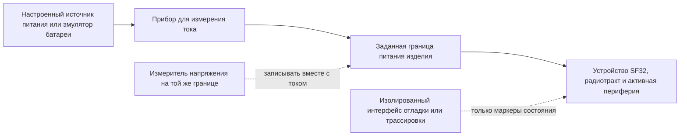
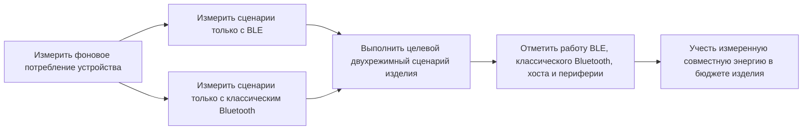

# Профилирование энергопотребления Bluetooth { #bluetooth-low-power-profiling }

В этой статье описано, как измерить **фактическое энергопотребление устройства при работе Bluetooth**: в режимах Bluetooth Low Energy (BLE), классического Bluetooth (BR/EDR) и при их совместной работе в двухрежимном изделии. Для каждого сценария определите точку измерения и то, какие цепи входят в измеряемую границу; регистрируйте ток и напряжение и собирайте достаточно данных о прошивке, чтобы объяснить важные участки кривой потребления.

Разделы о классическом и двухрежимном Bluetooth применимы только к устройствам и конфигурациям прошивки с поддержкой BR/EDR. Для изделия только с BLE следует использовать тот же метод, но ограничить план сценариев режимами BLE.

[Online Power Profiler for Bluetooth LE](https://devzone.nordicsemi.com/power/w/opp/2/online-power-profiler-for-bluetooth-le) от Nordic — полезный концептуальный ориентир для BLE. Nordic описывает его как модель, основанную на измерениях и выдающую ожидаемые значения, а не как измерительный прибор для конкретного устройства. Опубликованные данные о точности относятся только к референсным компонентам Nordic и неприменимы к SF32. Этот инструмент не моделирует классический Bluetooth или двухрежимное изделие. Используйте модель, чтобы определить, что проверять; результат для изделия устанавливайте измерением целевого устройства.

## Определите, что именно измеряете { #define-what-you-are-measuring }

Под «энергопотреблением Bluetooth» могут подразумеваться совершенно разные величины. Измерение только радиотракта помогает оптимизировать параметры соединения, но не показывает энергопотребление готового изделия, когда работают контроллер, процессор приложения, датчики, дисплей, память и система питания.

<div align="center"><em>Таблица: границы измерения энергопотребления Bluetooth</em></div>

<div align="center" markdown>

| Граница измерения | Что входит | Когда применять | Ограничение |
|:------------------|:-----------|:---------------|:------------|
| Подсистема Bluetooth или выбранная шина питания | Радиотракт/контроллер и выбранный путь питания | Поиск причины роста потребления радиотракта или контроллера | Не отражает потребление всего устройства от батареи |
| Входная шина питания MCU | MCU, контроллер и встроенная периферия, питаемые от этой шины | Сравнение состояний прошивки на плате с контролируемой конфигурацией | Не учитывает внешние компоненты на других шинах питания и потери регулятора |
| Батарея или основной вход питания изделия | Регуляторы, MCU, внешняя память, датчики, дисплей и другие потребители | Расчёт времени работы от батареи и приёмка изделия | Необходимо контролировать всё подключённое оборудование и источники питания |

</div>

Для заявления о времени работы изделия от батареи измеряйте, по возможности, на батарее или основном входе питания. Записывайте напряжение одновременно с током, чтобы рассчитывать мощность и энергию, а не просто ток без условий питания.

## Подготовьте воспроизводимый тест { #set-up-a-repeatable-test }

Для прибора и устройства необходимо чётко определить общую границу измерения и задокументировать её. Power Profiler Kit II (PPK II) от Nordic можно использовать как источник питания и измеритель тока, если его диапазоны напряжения и тока подходят для установки. Подойдёт и эквивалентный источник-измеритель или анализатор тока. Важнее правильная методика, а не марка прибора.

В [режиме Source Meter](https://docs.nordicsemi.com/r/bundle/ug_ppk2/page/ug/ppk/measure_current_source_meter.html) PPK II питает устройство сам; в [режиме Ampere Meter](https://docs.nordicsemi.com/r/bundle/ug_ppk2/page/ug/ppk/measure_current_ampere_meter.html) питание поступает от внешнего источника через прибор. Выберите режим, соответствующий предусмотренному пути питания. Заданное напряжение источника — не записанная осциллограмма напряжения устройства: контролируйте напряжение в точке измерения, особенно если просадки или изменение напряжения батареи влияют на энергию.

Перед подключением DUT проверьте рабочие пределы PPK II. В режиме Source Meter выходное напряжение регулируется в диапазоне 0,8–5,0 V, максимальный ток DUT — 600 mA. Для режима Ampere Meter требуется внешний источник 0,8–5,0 V; допустимый ток при непрерывном измерении — до 1 A. Если ток DUT в режиме Source Meter может превышать 400 mA, Nordic рекомендует дополнительно подключить к PPK II USB-источник с номинальным током не менее 1 A. Это ограничения прибора, а не рекомендуемые рабочие значения для устройства. См. спецификацию Nordic по [максимальному току DUT](https://docs.nordicsemi.com/r/bundle/ug_ppk2/page/ug/ppk/ppk_max_dut_current.html) и [условиям питания](https://docs.nordicsemi.com/r/bundle/ug_ppk2/page/ug/ppk/ppk_power_supply.html).

<div align="center"><em>Рисунок: схема измерения энергопотребления Bluetooth на устройстве</em></div>



Перед каждым измерением:

1. Отключите питание USB, отладчик и другие источники, которые могут обойти измерительный прибор или добавить нагрузку. Оставьте только интерфейсы, необходимые для сценария.
2. Подайте заданное напряжение на выбранную границу измерения. Запишите все питаемые шины, перемычки, модули и внешние устройства.
3. Используйте сборку прошивки и настройки управления питанием (PM), предусмотренные для изделия. Перед итоговыми измерениями отключите подробное диагностическое логирование, если оно не входит в серийную конфигурацию.
4. Для сравнения используйте одни и те же телефон, аксессуар, тестовое приложение, расстояние, ориентацию антенны и радиочастотную обстановку.
5. Записывайте достаточно длинный интервал, включающий много повторяющихся событий Bluetooth, а не только один удобный импульс.

## Разберите энергопотребление по этапам рекламного события BLE { #read-a-ble-advertising-event-as-a-set-of-power-components }

Типичное рекламное событие BLE (advertising event) — это не один импульс радиотракта. Сначала кратковременно включается питание и выполняется подготовка, затем запускается высокочастотный кварцевый генератор и стабилизируется его работа. Когда питание и тактирование готовы, устройство ожидает в режиме Standby до запланированного запуска радио. В показанном здесь примере сканируемой или подключаемой рекламной передачи радиотракт запускается, устройство передаёт данные по одному из основных рекламных каналов и открывает окно приёма на том же канале. После первых двух окон приёма устройство возвращается в режим ожидания перед передачей на следующем канале; после последнего окна выполняется постобработка. В неподключаемом и несканируемом событии рекламной передачи устройство не принимает запросы. Реальные этапы зависят от настроенного типа рекламной передачи и карты каналов.

Полная последовательность на схеме: предварительная обработка → запуск кварца → ожидание → запуск радиотракта → передача TX → переключение TX/RX → приём RX → ожидание → передача TX → переключение TX/RX → приём RX → ожидание → передача TX → переключение TX/RX → приём RX → постобработка. Радиотракт запускается только один раз; передача на каналах 38 и 39 начинается после перехода в режим ожидания по завершении окна RX предыдущего канала. Последовательность этапов соответствует [иллюстрации типичного события рекламной передачи BLE от Nordic](https://devzone.nordicsemi.com/power/w/opp/2/online-power-profiler-for-bluetooth-le). Это общие этапы BLE-события, а не состояния радиотракта, специфичные для Nordic; при перерисовке дополнительные состояния не добавлялись. Уровни тока и временные пропорции приведены для иллюстрации, это не результаты измерений SF32. Измеряйте их на целевом устройстве.

<div align="center"><em>Рисунок: этапы рекламного события BLE</em></div>


На рисунке показано обычное legacy-событие рекламной передачи BLE с поддержкой сканирования или подключения на трёх первичных каналах: 37, 38 и 39. Обмен после получения запроса не показан. Номера каналов приведены для иллюстрации: спецификация Bluetooth Core разрешает использовать включённые индексы первичных каналов в любом порядке, а настроенная карта каналов определяет, какие именно индексы используются. На каждом используемом индексе передаётся не более одного рекламного PDU, обычно по одному на индекс. Три передачи — это копии рекламных данных на разных каналах, а не повторные попытки, зависящие от подтверждения. В событиях с поддержкой сканирования или подключения канальный уровень принимает допустимые запросы на том же первичном канале; события без поддержки сканирования и подключения не открывают окно приёма запросов. Расширенная реклама, другая карта каналов или фактически принятый запрос могут изменить осциллограмму. Сверяйте настроенное поведение со [спецификацией канального уровня Bluetooth Core 6.2](https://www.bluetooth.com/wp-content/uploads/Files/Specification/HTML/Core-62/out/en/low-energy-controller/link-layer-specification.html), [вводным материалом Bluetooth SIG](https://www.bluetooth.com/bluetooth-le-primer/) и измерениями устройства.

<div align="center"><em>Таблица: этапы осциллограммы энергопотребления рекламного события BLE</em></div>

<div align="center" markdown>

| Этап | Типичные потребители энергии | Что измерять и проверять |
|:-----|:-----------------------------|:-------------------------|
| Предварительная обработка | Кратковременное включение питания, при котором ток может быть относительно высоким, а также подготовка CPU/контроллера, обработка полезной нагрузки, DMA, доступ к памяти и настройка периферии | `I_pre` и `t_pre`: определите необходимые действия при пробуждении и включении питания, а затем устраните или объедините лишние операции |
| Запуск кварцевого генератора | Запуск и стабилизация высокочастотного тактирования | `I_xtal` и `t_xtal`: проверьте, что политика тактирования и последовательность пробуждения не занимают больше времени, чем необходимо |
| Режим ожидания | Выбранное состояние низкого энергопотребления после готовности питания и тактирования, а также логика сохранения состояния, низкочастотное тактирование и активные источники пробуждения | Измерьте `I_standby`, начальное ожидание до запуска радио и периоды ожидания между каналами после RX; не приравнивайте этот внутренний ток события к току сна между полными событиями |
| Запуск радиотракта | Подготовка радио/контроллера и необходимого пути питания RF перед первой передачей | `I_start` и `t_start`: найдите лишнюю подготовку и повторный запуск, которого можно избежать |
| Передача по радиоканалу (TX) | Тракт передачи, работа контроллера и отправка рекламных пакетов по каналам 37, 38 и 39 | Измерьте `I_tx` и `t_tx` для каждого пакета; мощность TX, длина пакета и активные каналы определяют энергию пакетов и события |
| Переключение радио | Переключение радиотракта с передачи на приём и переход контроллера в другое состояние | `I_switch` и `t_switch`: учитывайте каждый переход, а не считайте его интервалом без энергопотребления |
| Приём по радиоканалу (RX), если включён | Тракт приёма и работа контроллера в ожидании запроса сканирования или подключения | `I_rx` и `t_rx`: учитывайте этот этап только при наличии окон приёма в выбранном типе и конфигурации рекламной передачи |
| Постобработка | Обработчики протокола, работа CPU, доступ к памяти/периферии и ответ приложения до перехода в сон | `I_post` и `t_post`: проверьте, что тактирование, ограничения PM и внешние компоненты своевременно отключаются |

</div>

На устройстве SF32 используйте названия этапов как ориентиры для разметки осциллограммы, а не как состояния радиотракта Nordic или заданные значения тока и длительности. Наличие приёма зависит от настроенного поведения рекламной передачи и должно быть подтверждено по осциллограмме целевого устройства.

Энергия полного события равна площади под осциллограммой с учётом напряжения:

```text
E_event = sum(V_stage x I_stage x t_stage)
```

При постоянном напряжении питания средний ток для периодической рекламной передачи можно оценить так:

```text
Q_event = sum(I_stage x t_stage)
I_average = (Q_event + I_idle x (T_cycle - t_event)) / T_cycle
```

`Q_event` включает заряд всех этапов полного события, в том числе внутренних периодов ожидания; `t_event` — полная длительность события. `I_idle` — ток, измеренный между полными событиями, а не внутренний ток события `I_standby`. `T_cycle` — измеренный интервал от начала одного события до начала следующего, включая задержку рекламной передачи и влияние планировщика. Если интервалы меняются, интегрируйте достаточно длинную репрезентативную осциллограмму, а не принимайте настроенный интервал рекламной передачи за точную длительность цикла.

При постоянном напряжении удвоение измеренного тока или длительности этапа удваивает его энергию. Короткие импульсы TX, RX и запуска могут определять энергию события; при больших интервалах средний ток может определяться потреблением между событиями. Отмечайте этапы сигналами GPIO или событиями прошивки с минимальными накладными расходами и измеряйте ток на входе питания всего изделия, прежде чем выбирать направление оптимизации.

В BR/EDR Inquiry Scan и Page Scan — разные процедуры сканирования. В подключённом режиме Sniff возможности приёма на стороне Peripheral сокращаются до запланированных точек Sniff; трафик удалённого устройства может продлить работу радиотракта за пределы такой точки. Это временные характеристики, а не оценки тока. Запишите фактически включённую политику Scan, параметры Sniff и трафик удалённого устройства и измерьте несколько циклов ([Bluetooth Core Specification: BR/EDR Baseband](https://www.bluetooth.com/wp-content/uploads/Files/Specification/HTML/Core-62/out/en/br-edr-controller/baseband-specification.html); [HCI Scan Enable](https://www.bluetooth.com/wp-content/uploads/Files/Specification/HTML/Core-62/out/en/host-controller-interface/host-controller-interface-functional-specification.html)).

## Составьте отдельный план измерений для каждого режима { #build-a-mode-specific-measurement-plan }

Не считайте «Bluetooth включён» единым рабочим состоянием. BLE и классический Bluetooth используют разные процедуры соединения и низкого энергопотребления. В двухрежимном изделии режимы могут совместно использовать радиоподсистему, ресурсы контроллера, тактирование, память и нередко задачи приложения. Начните с минимальных воспроизводимых сценариев, а затем измерьте точное сочетание режимов, используемое в серийном изделии.

<div align="center"><em>Таблица: охват сценариев Bluetooth</em></div>

<div align="center" markdown>

| Возможности радиосвязи | Сценарий | Что задать перед измерением | Какой результат сохранить |
|:-----------------------|:---------|:---------------------------|:--------------------------|
| BLE | Рекламная передача, подключение без передачи данных, передача данных приложением и повторное подключение | Роль, интервал, мощность TX, полезную нагрузку, удалённое устройство, условия начала и завершения | Средний ток, энергию события и энергию на завершённое действие |
| Классический Bluetooth (BR/EDR) | Состояние Scan | Включён ли inquiry scan, page scan или оба режима; политика обнаружения/подключения | Средний ток и энергию за представительный интервал сканирования |
| Классический Bluetooth (BR/EDR) | Подключённый режим Sniff | Параметры Sniff, удалённое устройство, состояние соединения и фоновую активность приложения | Средний ток и энергию за множество интервалов Sniff |
| Классический Bluetooth (BR/EDR) | Активная нагрузка профиля | Профиль и роль, например передача данных SPP/PAN или аудио A2DP/HFP; полезную нагрузку или длительность аудиосессии | Энергию на завершённую передачу или сессию и устойчивую среднюю мощность |
| Двухрежимный Bluetooth | Использование BLE и классического Bluetooth в одном сценарии | Задействованные соединения или режимы, их параметры, приоритетную нагрузку и поведение при переключениях/повторных подключениях | Измеренную среднюю мощность комбинированного сценария и энергию полного сценария изделия |

</div>

[Тест энергопотребления BLE/BT](https://docs.sifli.com/projects/sdk/latest/en/sf32lb52x/example/pm/bt/README.html) от SiFli — полезная отправная точка: он охватывает рекламную передачу и соединения BLE, а также режимы Scan и Sniff классического Bluetooth. Результат на одной плате не является спецификацией изделия. Используйте сведения о поддерживаемой плате, контакте пробуждения, консоли и настройке PM для воспроизводимого базового теста, а затем повторите на целевом устройстве роль, настройку соединения, трафик и политику энергопотребления, предусмотренные для изделия.

## Сначала измерьте BLE отдельно от других режимов { #profile-ble-as-a-standalone-radio-mode }

Начните с BLE без классического Bluetooth. Так вы получите базовый результат для BLE, не смешанный с трафиком профилей классического Bluetooth и переключением между режимами.

<div align="center"><em>Таблица: отдельные сценарии BLE</em></div>

<div align="center" markdown>

| Сценарий | Настройка | Что рассчитывать | Типичная причина ошибочного результата |
|:---------|:----------|:-----------------|:--------------------------------------|
| Передача рекламных пакетов | Неподключённое устройство передаёт рекламные пакеты с документированными типом и набором каналов | Средний ток и энергию за интервал рекламной передачи | Сканирование телефоном, отладочный трафик или рекламная передача без снижения активности со временем |
| Подключение без передачи данных | Устройство подключено, приложение не передаёт данные; зафиксируйте использование сопряжения, сохранения ключей и шифрования | Средний ток за множество интервалов соединения | CPU приложения пробуждается при каждом событии соединения; таймеры или уведомления остаются активными |
| Действие пользователя | Одна типичная команда GATT, передача данных датчика или действие через интерфейс | Энергию на завершённое действие и прирост относительно состояния покоя | Измерение только радиотракта без учёта хоста, дисплея или датчика |
| Передача пакета данных или OTA | Полезная нагрузка и условие завершения заданы заранее | Энергию на байт или завершённую передачу и её длительность | Использование пиковой скорости как характеристики всей передачи |
| Отключение и повторное подключение | Удалённое устройство BLE выходит из зоны действия, возвращается и подключается заново | Энергию и время восстановления | Неограниченные повторы или постоянно активная агрессивная политика рекламной передачи |

</div>

Запишите роль BLE, удалённое устройство, параметры соединения или рекламной передачи, мощность TX, полезную нагрузку, условие начала и завершения, а также частоту реального использования. Без этих сведений нельзя сопоставить осциллограммы разных версий прошивки.

## Затем измерьте классический Bluetooth отдельно { #profile-classic-bluetooth-as-a-standalone-radio-mode }

В двухрежимном изделии измерьте классический Bluetooth отдельно, прежде чем включать BLE. Так будут видны базовые режимы Scan и Sniff и работа конкретных профилей без наложения событий BLE.

<div align="center"><em>Таблица: отдельные сценарии классического Bluetooth</em></div>

<div align="center" markdown>

| Сценарий | Настройка | Что рассчитывать | Типичная причина ошибочного результата |
|:---------|:----------|:-----------------|:--------------------------------------|
| Scan | Включена предусмотренная для изделия политика inquiry scan, page scan или обоих режимов | Средний ток и энергию за представительный интервал сканирования | Используется более интенсивная политика сканирования, чем в серийном изделии |
| Подключённый режим Sniff | Подключённое соединение классического Bluetooth работает с заданными параметрами Sniff | Средний ток за множество интервалов Sniff | Соединение остаётся активным из-за трафика удалённого устройства или приложения, но это не учитывается |
| Активная нагрузка профиля | Задана передача данных SPP/PAN, поток A2DP, вызов HFP или другая нагрузка профиля изделия | Энергию на завершённую передачу или сессию и устойчивую среднюю мощность | Измеряется радиотракт без кодека, усилителя, дисплея, памяти или работы хоста, необходимых профилю |
| Отключение и повторное подключение | Удалённое устройство классического Bluetooth выходит из зоны действия, возвращается и подключается заново | Энергию и время восстановления | Неограниченные повторы или постоянно активная политика обнаружения |

</div>

Запишите роль классического Bluetooth, удалённое устройство, политику Scan или Sniff, мощность TX, профиль, полезную нагрузку или длительность сессии, условие начала и завершения, а также частоту реального использования. Для аудиопрофилей граница измерения должна включать фактически используемый в изделии аудиотракт.

## Измеряйте двухрежимную работу как отдельный сценарий { #measure-dual-mode-behavior-as-its-own-scenario }

Нельзя рассчитывать энергопотребление двухрежимного изделия простым сложением результатов измерения BLE и классического Bluetooth. Два режима могут совместно использовать время работы радиотракта, обработку контроллера, тактирование, память и пробуждения приложения. Поэтому результат совместной работы может существенно отличаться от арифметической суммы двух раздельных средних значений.

<div align="center"><em>Рисунок: последовательность профилирования двухрежимного Bluetooth</em></div>



Профилируйте двухрежимное изделие только после того, как определены отдельные базовые значения BLE и классического Bluetooth. Например, если изделие сохраняет соединение BLE во время потоковой передачи аудио по классическому Bluetooth, измерьте на одном и том же оборудовании и с одним и тем же удалённым устройством все следующие состояния:

1. Политику BLE-подключения без передачи данных, отдельно.
2. Потоковую передачу или профиль данных классического Bluetooth, отдельно.
3. Фактический совместный установившийся режим, включая предусмотренный трафик BLE.
4. Переходы в этот совместный режим и выход из него, а также восстановление после ошибок и повторное подключение.

Маркеры трассировки должны отмечать события BLE, работу профиля классического Bluetooth, вызовы приложения, обработку аудио или данных и смену состояния PM. Это позволяет отличить планирование работы радио от вызванной им системной нагрузки и обнаружить неожиданные взаимодействия — например, когда обработчик BLE не даёт CPU приложения перейти в сон во время сеанса классического Bluetooth.

## Свяжите осциллограмму с поведением прошивки { #correlate-the-trace-with-firmware-behavior }

Чтобы определить фактическое потребление устройства, необходимо установить причину каждой его перемены. Отмечайте или записывайте начало и завершение операций изделия, чтобы понять, почему изменился ток:

- До и после передачи, запущенной приложением, или серии уведомлений.
- При включении или выключении дисплея, датчика, Flash, аудиотракта или другого внешнего компонента.
- При запросе прошивкой состояния PM и фактическом переходе устройства в это состояние.
- При начале повторного подключения, новой попытки или восстановления после ошибки.

Используйте трассировочный GPIO, маркер события с минимальными накладными расходами или воспроизводимый тестовый сценарий. Журнал через последовательный интерфейс полезен при первичной настройке, но сам может влиять на ток. Считайте логирование при итоговых измерениях контролируемой переменной теста, а не бесплатным каналом наблюдения.

<div align="center"><em>Таблица: интерпретация осциллограммы энергопотребления Bluetooth</em></div>

<div align="center" markdown>

| Наблюдение на осциллограмме | Вероятное значение | Что проверить в прошивке или аппаратуре |
|:----------------------------|:------------------|:----------------------------------------|
| Короткие регулярные импульсы над низким фоновым уровнем | Запланированные события рекламной передачи или соединения BLE или активность Scan/Sniff классического Bluetooth | Режим, интервал или политика Scan/Sniff, роль радио и фактическое состояние низкого энергопотребления между событиями |
| Сразу после каждого радиособытия появляется более крупный импульс | Обработчик хоста, обработка протокола или работа приложения | Какой обработчик запущен, полезны ли данные и можно ли объединить обработку |
| Во время сеанса классического Bluetooth наблюдается постоянная или частая активность | Активный трафик профиля классического Bluetooth, часто вместе с обработкой хоста, аудио или данных | Профиль, путь кодека/данных, трафик удалённого устройства, тактирование аудио, внешние компоненты и границы сеанса |
| Импульсы BLE и классического Bluetooth чередуются | Планирование двухрежимной работы или связанная нагрузка хоста | Какое соединение вызвало каждый участок, какие операции общие и не задерживает ли один режим переход в сон или не увеличивает повторы |
| После ожидаемого события ток остаётся высоким | Активно ограничение PM, периферия или внешний интерфейс | Активные запросы состояния и ограничения PM, таймеры, тактирование, состояния выводов, питание дисплея/датчиков и обработка ошибок |
| Периодически появляются длинные импульсы | Повторы, сканирование, повторные подключения, трафик удалённого устройства или действия пользователя | Условия RF, поведение удалённого устройства, политика ожидания/повторов и тестовый сценарий |
| Фоновый уровень изменяется после подключения модуля или кабеля | Изменилась электрическая граница измерения | Пути обратного питания, адаптеры UART, внешние подтяжки, шины питания модулей и разводка питания |

</div>

## Рассчитайте фактическую энергию и суточное потребление { #calculate-actual-energy-and-daily-consumption }

Для переменного во времени сигнала рассчитайте энергию, интегрируя ток и напряжение:

```text
E_scenario = integral(V(t) x I(t) dt)
P_average = E_scenario / T_scenario
```

Если напряжение на границе измерения постоянно, для сравнения можно использовать средний ток. Тем не менее записывайте напряжение, особенно при переходе от стабилизированной шины к входу батареи.

Для повторяющегося сценария изделия:

```text
E_day = sum(E_scenario x events_per_day) + E_mode_idle + E_other_states
```

Разделите сутки на неперекрывающиеся периоды. В `E_mode_idle` и `E_other_states` учитывайте только время, ещё не включённое в полную энергию сценариев. Одновременную работу BLE и классического Bluetooth измеряйте как единый комбинированный сценарий, а не складывайте результаты изолированных режимов. Если модель уже учитывает базовое потребление за все 24 часа, добавляйте только превышение энергии каждого действия над этой базой, а не его полную энергию. При расчёте в вольтах, амперах и секундах результат получается в джоулях; для перевода в Wh разделите его на 3600.

Энергия сценария должна включать всю работу устройства, необходимую для его завершения. Например, уведомление с телефона может включать событие подключения, обработку хостом, обращение к датчику или Flash, обновление дисплея и возврат в сон. Измерение только импульса RF занижает энергопотребление; измерение всего изделия без маркеров осциллограммы не позволяет понять, что именно следует оптимизировать.

## Сопоставьте модель с измерениями устройства { #reconcile-the-model-with-the-device }

Сначала используйте модель, чтобы упорядочить вероятные источники потребления, а затем скорректируйте её по реальным измерениям. Расхождение между оценкой и осциллограммой полезно: оно может указывать на пропущенное событие, неверную длительность, неожиданное пробуждение или неучтённую внешнюю нагрузку.

<div align="center"><em>Рисунок: цикл проверки фактического энергопотребления Bluetooth</em></div>


<div align="center"><em>Таблица: вопросы для сопоставления модели и измерений</em></div>

<div align="center" markdown>

| Расхождение модели и измерений | Что проверить |
|:-------------------------------|:--------------|
| Средний ток выше ожидаемого | Переходит ли устройство в запрошенное состояние PM? Не удерживают ли его активным таймеры, логирование или тактирование периферии? |
| Энергия события выше ожидаемой | Выполняли ли хост, дисплей, датчик, память или логика повторных попыток лишнюю работу? Вызывают ли плохие условия RF повторы или повышение мощности TX? |
| Потребление в простое BLE или классического Bluetooth определяет время работы от батареи | Подходят ли состоянию изделия параметры соединения BLE, политика Scan/Sniff классического Bluetooth, частота уведомлений и пробуждений приложения? |
| Результат двухрежимного теста отличается от суммы тестов в одном режиме | Какие периоды радио, задачи контроллера, общие источники тактирования, обработчики приложения, пути аудио/данных или ограничения PM перекрываются или мешают переходу в сон? |
| На повторное подключение уходит много энергии | Ограничены ли повторы и реалистична ли политика обнаружения устройства? |
| Результаты на плате и в готовом изделии различаются | Чем отличаются внешние шины питания, потери регуляторов, модули, влияние антенны/корпуса и подтяжки интерфейсов? |

</div>

## Начните с воспроизводимой базовой конфигурации SiFli { #start-from-a-repeatable-sifli-baseline }

До измерения прошивки изделия используйте примеры SiFli-SDK, чтобы воспроизводимо задать состояние Bluetooth. Поддерживаемая плата, путь питания, положение перемычек, настройки SDK и процедура тестирования — это базовые данные, а не спецификация изделия.

<div align="center"><em>Таблица: отправные примеры SiFli-SDK для профилирования Bluetooth</em></div>

<div align="center" markdown>

| Цель измерения | Официальный пример для начала | Что затем измерить на изделии |
|:----------------|:------------------------------|:-----------------------------|
| Энергопотребление рекламной передачи и соединения BLE | [Тест энергопотребления BLE: реклама и подключение](https://docs.sifli.com/projects/sdk/latest/en/sf32lb52x/example/pm/ble/README.html) | Политику рекламной передачи изделия, параметры соединения, обработчики, поведение удалённого устройства и антенну |
| Scan и Sniff классического Bluetooth | [Тест энергопотребления BLE/BT](https://docs.sifli.com/projects/sdk/latest/en/sf32lb52x/example/pm/bt/README.html) | Политику сканирования для серийного изделия, параметры Sniff, поведение удалённого устройства и фактическое состояние соединения в простое |
| Нагрузка профиля классического Bluetooth | [Примеры Bluetooth SDK](bluetooth-sdk-examples.md) | Реальную передачу SPP/PAN или сеанс A2DP/HFP, включая необходимую работу хоста, аудиотракта, памяти и внешних компонентов |
| Работа изделия в двухрежимном сценарии | [Тест энергопотребления BLE/BT](https://docs.sifli.com/projects/sdk/latest/en/sf32lb52x/example/pm/bt/README.html) и наиболее подходящий пример профиля | Точное одновременное или попеременное поведение BLE и классического Bluetooth, включая переходы, общую обработку и политику PM изделия |
| Подключённый сервис GATT | [Периферийное устройство BLE](https://docs.sifli.com/projects/sdk/latest/sf32lb58x/example/ble/peripheral/README.html) | Реальные характеристики, частоту уведомлений, безопасность и взаимодействие с телефоном |
| Передача данных по BLE | [Пропускная способность BLE](https://docs.sifli.com/projects/sdk/latest/sf32lb58x/example/ble/throughput/README.html) | Энергию на завершённую передачу данных и полное время выполнения |
| Другие сценарии Bluetooth | [Примеры Bluetooth SDK](bluetooth-sdk-examples.md) | Наиболее близкую роль или профиль классического Bluetooth, BLE либо LE Audio до интеграции в изделие |

</div>

## Контрольный список перед выпуском { #release-review-checklist }

- [ ] Задокументированы граница измерения и напряжение питания.
- [ ] Для каждого важного для выпуска сценария записаны ток и напряжение.
- [ ] USB, отладчик, адаптеры UART и источники внешних модулей контролировались или явно включены в измерения.
- [ ] Осциллограммы сопоставлены с событиями прошивки, запросами на переход в состояние PM и фактически достигнутыми состояниями.
- [ ] При необходимости измерены рекламная передача и подключение BLE без передачи данных и Scan/Sniff классического Bluetooth.
- [ ] Для каждого серийного профиля данных или аудио классического Bluetooth задана и измерена рабочая нагрузка.
- [ ] Двухрежимные сценарии измерялись как совместные состояния изделия, а не оценивались сложением результатов отдельных режимов.
- [ ] При необходимости измерены типичные передача данных, отключение и повторное подключение.
- [ ] Энергия сценариев пересчитана по реалистичной частоте использования за день и сопоставлена с бюджетом батареи.
- [ ] Для самого значимого источника энергопотребления назначен ответственный и принято решение об оптимизации или допустимости результата.

## Связанные материалы { #related-resources }

- [Обзор Bluetooth](overview.md) — BLE, классический Bluetooth, профили, безопасность и сосуществование системных нагрузок.
- [Примеры Bluetooth SDK](bluetooth-sdk-examples.md) — выбор проектов классического Bluetooth, BLE и LE Audio.
- [Обзор низкого энергопотребления](../low-power/overview.md) — проектирование PM и общий бюджет энергопотребления изделия.
- [Измерение и проверка энергопотребления](../low-power/measurement-and-validation.md) — процесс проверки от компонентов до готового изделия.
- [Профилирование энергопотребления умных часов](../low-power/smartwatch-power-profiling.md) — подробный пример расчёта суточного энергопотребления.
