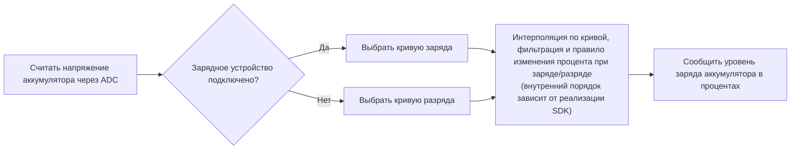

# Оценка уровня заряда аккумулятора { #battery-capacity-calculation }

Калькулятор уровня заряда аккумулятора в SiFli-SDK оценивает остаточный заряд в процентах по измеренному напряжению. Это не кулонометр: точность результата зависит от заданной зарядной характеристики аккумулятора и корректности сведений о состоянии зарядного устройства.

Модуль определяет состояние зарядного устройства, выбирает соответствующую кривую заряда или разряда и вычисляет процент интерполяцией. Для стабилизации результата также применяется первичный фильтр скачков и дополнительный фильтр со взвешенным усреднением. В опубликованной документации не описан полностью внутренний порядок фильтров, поэтому перед тем, как полагаться на конкретную последовательность, проверьте реализацию в используемой ревизии SDK.

## Функции калькулятора { #what-the-calculator-does }

<div align="center"><em>Таблица: принцип работы калькулятора уровня заряда аккумулятора</em></div>
<div align="center" markdown>

| Функция | Поведение |
| --- | --- |
| Кривые заряда и разряда | Выбирает подходящую зависимость «напряжение — уровень заряда» с учётом текущего состояния зарядки. |
| Линейная интерполяция | Вычисляет процент заряда между соседними точками выбранной кривой. |
| Первичный фильтр | Фильтрует скачки напряжения по заданному порогу и числу последовательных отсчётов, превышающих этот порог. |
| Вторичный фильтр | При включении вычисляет взвешенное среднее предыдущего и текущего значений напряжения. |
| Определение состояния зарядки | Выбирает кривую заряда или разряда на основании конфигурации обнаружения зарядного устройства на плате. |

</div>

<div align="center"><em>Диаграмма: алгоритм оценки уровня заряда аккумулятора</em></div>



Диаграмма показывает общий принцип и не гарантирует внутреннюю последовательность вызовов. В опубликованной документации не указан точный порядок интерполяции, фильтрации и правила изменения процента при заряде/разряде. Проверьте реализацию в ревизии SDK, используемой в устройстве. Согласно документации, при зарядке сообщаемый процент не уменьшается, а при разрядке не увеличивается.

## Сначала настройте плату { #configure-the-board-first }

Перед использованием промежуточного ПО SiFli-SDK для оценки уровня заряда аккумулятора настройте плату в menuconfig:

1. Включите поддержку ADC для измерения напряжения аккумулятора.
2. Включите функцию расчёта уровня заряда аккумулятора.
3. Включите поддержку зарядки.
4. Выберите микросхему зарядного устройства, установленную на плате. Используйте вариант простого зарядного устройства только в том случае, если ни одна из перечисленных микросхем не подходит.
5. Настройте вывод платы для обнаружения подключения зарядного устройства.
6. Задайте полярность этого вывода в соответствии с аппаратной схемой.

Макрос `BSP_CHARGER_INT_PIN_ACTIVE_HIGH` задаёт полярность сигнала обнаружения зарядного устройства. Если макрос определён, высокий уровень означает, что зарядное устройство подключено; если не определён — подключению соответствует низкий уровень. Неверная полярность приводит к выбору неправильной кривой и может вызвать зависание отображаемого процента или его изменение в неверном направлении.

## Используйте характеристики аккумулятора { #use-battery-curves-from-the-actual-cell }

Файл `battery_table.c` в каталоге платы приведён для примера и не является универсальной моделью характеристик аккумулятора. Запросите у производителя зависимость напряжения от уровня заряда для используемого аккумулятора и настройте соответствующие таблицы поиска для изделия.

<div align="center"><em>Таблица: требования к кривым заряда аккумулятора</em></div>
<div align="center" markdown>

| Таблица | Требуемое определение |
| --- | --- |
| `charging_curve_table` | Таблица `const battery_lookup_point_t[]` для зарядки. Значения напряжения должны располагаться по убыванию. |
| `discharge_curve_table` | Таблица `const battery_lookup_point_t[]` для разрядки. Значения напряжения должны располагаться по убыванию. |
| Содержимое таблиц | Точки должны соответствовать процентам от 100 до 0 и отражать реальные характеристики аккумулятора. |
| Расположение таблиц | Файл `battery_table.c`, специфичный для платы. |

</div>

Для заряда и разряда нужны отдельные кривые: при одном и том же уровне заряда напряжение аккумулятора различается в этих режимах. Не подставляйте произвольную кривую литиевого аккумулятора с напряжением 4,2 V только потому, что совпадает его номинальная химическая система.

!!! warning "Проверьте масштаб напряжения для SDK и платы"
    В опубликованной документации SiFli есть несоответствие единиц: для `voltage_mv` и обоих порогов фильтрации указаны mV, однако в примере `38000` передаётся как `3.8 V`, а в примере кривой `41808` используется для `4.18 V`. Эти числа согласуются с масштабом 0,1 mV, но документация явно его не задаёт. Поэтому это вывод из чисел, а не гарантия API. Перед использованием калькулятора проверьте тракт преобразования ADC, таблицу характеристик аккумулятора и сравнение порогов в точной ревизии SDK и конфигурации платы.

    Значение ADC, выбранная таблица кривой и пороги фильтрации должны использовать совместимые масштабы. В документации для порогов приведены значения `50` и `30` с единицами mV; не пересчитывайте их только на основании примеров напряжения. Проверьте, как используемая ревизия SDK интерпретирует и сравнивает каждое поле. Не меняйте только масштаб показаний ADC, оставляя таблицу или пороги в другом масштабе.

## Настройте калькулятор { #configure-the-calculator }

Структура `battery_calculator_config_t` содержит две таблицы кривых и параметры фильтрации.

<div align="center"><em>Таблица: параметры калькулятора уровня заряда аккумулятора</em></div>
<div align="center" markdown>

| Поле | Назначение | Значение из опубликованного примера (единица по документации) |
| --- | --- | --- |
| `charging_table`, `charging_table_size` | Кривая заряда и количество точек | Зависит от платы |
| `discharging_table`, `discharging_table_size` | Кривая разряда и количество точек | Зависит от платы |
| `charge_filter_threshold` | Порог скачка напряжения при зарядке | `50` (в документации указано mV; проверьте шкалу целевой версии SDK) |
| `discharge_filter_threshold` | Порог скачка напряжения при разрядке | `30` (в документации указано mV; проверьте шкалу целевой версии SDK) |
| `filter_count` | Число последовательных отсчётов, превысивших порог и необходимых первичному фильтру для подтверждения изменения | `3` |
| `secondary_filter_enabled` | Включает взвешенный вторичный фильтр | `true` |
| `secondary_filter_weight_pre` | Вес предыдущего значения напряжения | `90` |
| `secondary_filter_weight_cur` | Вес текущего значения напряжения | `10` |

</div>

При включённом вторичном фильтре сумма `secondary_filter_weight_pre + secondary_filter_weight_cur` должна быть равна `100`. Подбирайте пороги, количество измерений и веса с учётом характеристик реального аккумулятора, переходных процессов нагрузки и требований изделия. Справочные значения SDK не заменяют калибровку.

## Инициализация и расчёт { #initialize-and-calculate }

Перед запросом процента заряда инициализируйте калькулятор. В опубликованной документации SiFli функция инициализации объявлена с типом возврата `void`; при сборке ориентируйтесь на заголовочный файл точной ревизии SDK вашего проекта.

```c
void battery_calculator_init(battery_calculator_t *calc,
                             const battery_calculator_config_t *config);
```

API возвращает процент от 0 до 100: это уровень заряда, а не ёмкость аккумулятора в mAh. Перед интеграцией проверьте заголовочный файл и реализацию точной ревизии SDK на наличие дополнительных ограничений параметров или возвращаемого статуса инициализации.

Передавайте напряжение в масштабе, который ожидает используемая ревизия SDK. Хотя опубликованный параметр API называется `voltage_mv`, фактический масштаб нужно проверить, как описано выше:

```c
uint8_t battery_calculator_get_percent(battery_calculator_t *calc,
                                       uint32_t voltage_mv);
```

<div align="center"><em>Таблица: Рекомендуемая последовательность интеграции</em></div>
<div align="center" markdown>

| Шаг | Действие |
| --- | --- |
| 1 | Настройте ADC платы, тип зарядного устройства, вывод его обнаружения и полярность сигнала. |
| 2 | Задайте проверенные кривые заряда и разряда в `battery_table.c`. |
| 3 | Инициализируйте `battery_calculator_t` с помощью `battery_calculator_config_t`. |
| 4 | Считайте напряжение аккумулятора через настроенный тракт ADC. |
| 5 | Проверьте единый масштаб напряжения, таблиц и порогов, затем передайте напряжение функции `battery_calculator_get_percent()`. |
| 6 | Используйте отфильтрованный результат в интерфейсе пользователя, логике предупреждения о низком заряде и телеметрии изделия. |

</div>

## Проверьте работу на устройстве { #verify-behavior-on-product-hardware }

Отображаемый процент должен соответствовать фактическому состоянию устройства, а не просто выглядеть правдоподобно в лабораторных условиях. Во время зарядки и разрядки, а также при подключении и отключении кабеля совместно проверяйте состояние сигнала обнаружения зарядного устройства, измеренное напряжение, выбранную кривую и отображаемый процент.

<div align="center"><em>Таблица: Диагностика проблем с отображением уровня заряда</em></div>
<div align="center" markdown>

| Симптом | Что проверить в первую очередь |
| --- | --- |
| Процент меняется слишком резко | Сначала убедитесь, что показание ADC, таблицы кривых и пороги используют один масштаб. Затем настройте соответствующий порог или `filter_count`; при необходимости включите или усильте вторичный фильтр. |
| Процент отображается неточно | Получите кривую для используемого аккумулятора и повторно откалибруйте точки таблицы. |
| Процент не меняется | Проверьте состояние зарядного устройства, передаваемое программе, и полярность `BSP_CHARGER_INT_PIN_ACTIVE_HIGH`. Согласно опубликованной документации, во время зарядки процент не уменьшается, а во время разрядки не увеличивается. |
| Процент меняется в неверном направлении | Проверьте вывод обнаружения зарядного устройства, его электрическую полярность и выбранную кривую заряда или разряда. |

</div>

Официальную документацию по промежуточному ПО SiFli-SDK для оценки уровня заряда аккумулятора и актуальные снимки экрана с настройками см. в разделе [Расчёт ёмкости аккумулятора в SiFli-SDK](https://docs.sifli.com/projects/sdk/latest/sf32lb58x/middleware/battery_calculator.html). Для оценки времени автономной работы всей системы перейдите к статье [Анализ энергопотребления умных часов](smartwatch-power-profiling.md); методику проверки измерениями см. в разделе [Измерение и проверка энергопотребления](measurement-and-validation.md).

Опубликованная документация служит отправной точкой, но не заменяет проверку ревизии SDK, используемой в продукте. Чтобы устранить несоответствие масштаба, проверьте в этой ревизии тракт ADC, таблицу характеристик аккумулятора, сравнение порогов и заголовок API.
