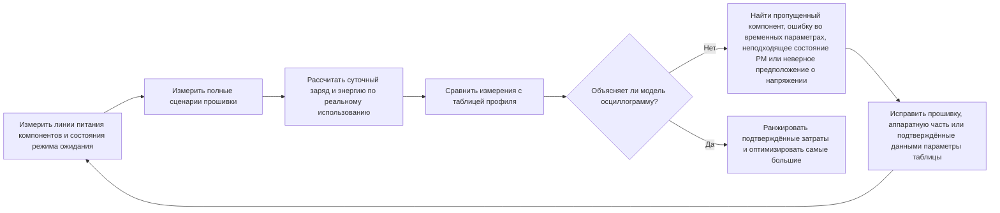

# Измерение и проверка энергопотребления { #power-measurement-and-validation }

Оценке автономности можно доверять только тогда, когда предположения модели согласуются с измерениями на реальном оборудовании. Используйте эту статью вместе с [обзором энергосберегающего проектирования](overview.md) и примером [анализа энергопотребления умных часов](smartwatch-power-profiling.md). Сначала измерьте отдельные компоненты, затем проверьте полные сценарии прошивки, согласуйте модель суточного использования с измерениями и оптимизируйте самые значимые подтверждённые источники энергопотребления.

## Измеряйте энергию, а не только ток { #measure-energy-not-current-alone }

Ток — лишь часть результата. Записывайте напряжение на проверяемом устройстве (DUT, `V_DUT`) вместе с осциллограммой тока, чтобы определить мгновенную мощность и энергию, а также электрический заряд:

```text
power_W(t) = voltage_V(t) x current_A(t)
energy_Wh = integral(power_W(t) dt) / 3600
energy_mWh = energy_Wh x 1000
charge_mAh = integral(current_mA(t) dt) / 3600
```

Здесь `t` задаётся в секундах. Деление на `3600` переводит секунды в часы; для расчёта мощности используйте ток в A, а для расчёта заряда — в mA.

Результат интеграла энергии выражается в Wh; умножьте его на 1000, прежде чем складывать со значениями профиля в mWh. Заряд (mAh) и энергия (mWh) — разные величины, их нельзя подменять друг другом.

При стабильном питании запишите измеренное значение `V_DUT` для данного сеанса и используйте его вместе с осциллограммой тока. Если напряжение меняется, измеряйте его синхронно с током либо запишите достаточно синхронизированных точек, чтобы обоснованно рассчитать среднюю мощность. Сравнение только в mAh может скрыть реальную разницу в энергии, если между измерениями изменились напряжение питания, рабочая точка стабилизатора или состояние батареи.

## Подготовьте измерительный стенд и исходные условия { #set-up-the-measurement-baseline }

В качестве опорного прибора для измерения тока используйте Nordic [Power Profiler Kit II (PPK2)](https://docs.nordicsemi.com/r/bundle/ug_ppk2/page/ug/ppk/ppk_user_guide_intro.html). В режиме Source Meter он питает проверяемое устройство (DUT), а в режиме Ampere Meter PPK2 включают последовательно между DUT и внешним источником питания, чтобы измерять ток. В Source Meter заданное выходное напряжение служит контролируемым условием испытания. В Ampere Meter измеряйте и записывайте напряжение внешнего источника на самом DUT. В обоих случаях нужно фиксировать фактическое напряжение на DUT, а не только номинал батареи или настройку лабораторного источника.

PPK2 предоставляет осциллограмму тока, накопленный заряд и данные измерений, которые можно экспортировать. На логическом порту доступны цифровые входы D0–D7, а также контакты VCC/GND для DUT. Подключите VCC и GND к логическому питанию и общей земле DUT, а GPIO-маркеры — к D0–D7. Напряжение VCC логического порта должно находиться в диапазоне 1,65–5,5 V по спецификации Nordic; также проверьте совместимость уровней маркерных сигналов. Частота дискретизации цифровых входов составляет 100 kHz, типичная полоса пропускания — 50 kHz, поэтому очень короткие этапы могут отображаться ненадёжно. См. спецификации Nordic по [разъёмам](https://docs.nordicsemi.com/r/bundle/ug_ppk2/page/ug/ppk/ppk_user_guide_connectors.html), [питанию](https://docs.nordicsemi.com/r/bundle/ug_ppk2/page/ug/ppk/ppk_power_supply_specs.html) и [разрешению цифровых входов](https://docs.nordicsemi.com/r/bundle/ug_ppk2/page/ug/ppk/digital_input_resolution.html). Используйте GPIO-маркеры для обозначения пробуждения, обновления дисплея, радиообмена, опроса датчиков и возврата в сон. Поддерживаемые режимы и требования к подключению описаны в официальном [руководстве PPK2](https://docs.nordicsemi.com/r/bundle/ug_ppk2/).

Во время работы PPK2 его USB-подключение для передачи данных и питания должно оставаться подключённым, как требует Nordic. Это отдельное требование от дополнительного USB-источника, рекомендуемого для высоких нагрузок в режиме Source Meter и описанного в следующем абзаце.

Перед подключением DUT убедитесь, что выбранный режим PPK2 поддерживает его напряжение и пиковый ток. Nordic указывает диапазон напряжения DUT 0,8–5,0 V, максимальный непрерывный ток DUT 1 A в режиме Ampere Meter и максимальный ток 600 mA в режиме Source Meter. Если DUT потребляет в режиме Source Meter более 400 mA, Nordic рекомендует подключить к PPK2 дополнительный USB-источник питания с током не менее 1 A. См. [спецификацию максимального допустимого тока DUT](https://docs.nordicsemi.com/r/bundle/ug_ppk2/page/ug/ppk/ppk_max_dut_current.html) и [рекомендации по питанию](https://docs.nordicsemi.com/r/bundle/ug_ppk2/page/ug/ppk/ppk_power_supply.html). Это ограничения прибора, а не рекомендуемые рабочие параметры изделия. Для измерений за пределами поддерживаемого диапазона используйте оборудование с подходящими номиналами.

<div align="center"><em>Таблица: обязательные данные для каждого измерения</em></div>

<div align="center" markdown>

| Что записать | Зачем это нужно |
|:-------|:-----------------|
| Идентификатор теста, ревизию платы, установленные компоненты и ревизию прошивки | Чтобы воспроизводить и сравнивать результаты. |
| `V_DUT`: заданное значение, измерения в начале и конце, изменения в ходе записи | Для корректного расчёта мощности и энергии. |
| Осциллограмму тока, средний и пиковый ток, среднюю мощность, заряд (mAh), энергию (mWh) и длительность записи | Чтобы отличать короткие пики тока от длительного потребления и фиксировать мощность и энергию за измерение. |
| Температуру, состояние батареи или настройку лабораторного источника, радиоокружение | Чтобы не принять изменение условий за улучшение прошивки. |
| Включённую периферию, политику тактирования, состояние PM и источники пробуждения | Чтобы объяснить, почему устройство перешло или не перешло в нужное состояние энергосбережения. |
| Маркеры прошивки и условия запуска записи | Чтобы связать энергию с конкретной операцией, а не с неопределённым участком осциллограммы. |

</div>

## Измерьте каждый компонент до испытаний всего устройства { #characterize-each-component-before-full-system-tests }

Прежде чем делать выводы по осциллограмме всей платы, измерьте каждый компонент на отдельно подключаемой линии питания или в специальной оснастке. Цель — не получить ещё одно паспортное число, а определить режимы, нагрузки и настройки прошивки, от которых зависит энергопотребление компонента в реальном изделии.

<div align="center"><em>Таблица: план измерений отдельных компонентов</em></div>

<div align="center" markdown>

| Компонент | Что измерить как минимум | Что внести в модель |
|:----------|:-------------------|:--------------------|
| MCU | Активные вычисления, Idle, каждый предусмотренный режим сна, интервалы пробуждения и переключения тактирования | Ток и длительность каждого состояния прошивки, неожиданные пробуждения и ограничения PM, препятствующие энергосбережению. |
| Внешняя PSRAM | Режим ожидания (standby) или сохранение данных, чтение, запись, пакетные обращения и циклы обновления памяти (refresh), если применимо | Ток линии питания для каждого характера обращений и время работы в каждом случае. |
| Внешняя Flash | Deep Power-Down или режим ожидания, чтение, запись, стирание и задержку пробуждения | Энергию на обращение или операцию и ток в неактивном состоянии. |
| Каждый внешний датчик | Все включённые режимы, частоту выдачи данных, политику FIFO или прерываний, долю времени активности | Энергию на отсчёт или интервал; при измерении полного сценария — также затраты на обслуживание датчика со стороны MCU. |
| Вибромотор и его драйвер | Запуск, амплитуду, паттерн вибрации, длительность, торможение или свободный выбег | Энергию на паттерн вибрации, а не только пиковый ток мотора. |
| Аудиокодек и усилитель мощности | Выключенное состояние, режим ожидания, воспроизведение или запись, выходной уровень, реальный импеданс динамика или нагрузки | Энергию на аудиосеанс и ток утечки всей аудиоцепи в выключенном состоянии. |
| Дисплей, сенсорный ввод, радио, PMIC и другие нагрузки | Соответствующие активные, неактивные состояния и состояния сохранения данных | Отдельные предположения о токе либо явно выделенные записи `Other` с указанными границами измерения. |

</div>

Если требуется определить энергию всего изделия, измеряйте на входе питания от батареи. Измерения отдельных линий по-прежнему необходимы для поиска причин, но перед включением в модель автономности пересчитайте их на сторону батареи с учётом измеренных КПД и собственного тока потребления стабилизаторов. Сумма токов отдельных линий не равна току на входе от батареи.

## Проверьте управление состояниями питания в драйверах { #verify-driver-controlled-power-states }

Компонент достигает указанного в спецификации состояния энергосбережения только тогда, когда драйвер применяет документированные настройки и последовательность действий. Даже функционально исправный драйвер может расходовать лишнюю энергию: оставить сигнал разрешения активным, отправить неверную команду перехода в режим ожидания, не остановить тактирование или обмен по шине, переключить питание, сброс и интерфейсные сигналы в неправильном порядке. Для каждого требуемого состояния воспроизведите в прошивке условия спецификации и убедитесь, что измеренные ток, напряжение, заряд и энергия соответствуют применимым требованиям либо проверенной рабочей точке изделия.

<div align="center"><em>Таблица: проверка состояний питания, управляемых драйвером</em></div>

<div align="center" markdown>

| Область управления | Требование к драйверу | Подтверждение измерением |
|:-------------|:-------------------|:---------------------|
| Регистры режимов и команды энергосбережения | Применять документированные настройки режима ожидания, отключения, сохранения данных, частоты выдачи данных и прерываний; проверять статус, если компонент это поддерживает. | Ток и энергия соответствуют выбранному режиму, а применённая конфигурация записана в протоколе теста. |
| Ответственность за блокировки и ограничения PM | Определите, отвечает ли за каждую блокировку или ограничение PM драйвер компонента или служба более высокого уровня. Активируйте каждую блокировку или ограничение только пока нужен защищаемый ресурс; снимайте их на всех путях успешного завершения, ошибки и досрочного возврата, как только компонент можно безопасно перевести в состояние ожидания. | Записи подтверждают, что блокировки и ограничения действуют в течение необходимого интервала, не снимаются преждевременно и не остаются после завершения операции или ошибки, мешая переходу в сон. |
| Последовательность питания, разрешения, сброса и тактирования | Соблюдать требуемые порядок и интервалы при включении, работе и отключении компонента. | GPIO-маркеры и осциллограмма потребления показывают отсутствие непредусмотренных интервалов активности и пиков тока. |
| SPI, I2C, UART и другие шины управления | Останавливать ненужный обмен; переводить сигналы выбора микросхемы, тактирования, данных и прерываний в указанное неактивное состояние. | Между транзакциями компонент остаётся в требуемом состоянии энергосбережения. |
| Подтяжки GPIO и высокоимпедансное состояние | Явно задавать каждый управляющий вывод: выход высокого или низкого уровня, вход с правильной подтяжкой вверх или вниз либо высокоимпедансное состояние (high-Z) только если внешняя цепь задаёт уровень. | Ток проверен при включённом и выключенном втором устройстве, в том числе при сбросе и в состояниях по умолчанию. |
| Интерфейсы между доменами питания | Не подавать сигнал на обесточенный компонент через управляющий вывод или вывод данных, если аппаратная часть явно не допускает такой режим. | При отключении любой стороны интерфейса отсутствуют обратное питание и утечки. |
| Обработка ошибок и возобновление работы | Восстанавливать правильное состояние после тайм-аутов, неудачных передач, пробуждений и сбросов прошивки. | Длительные записи не показывают постоянного или постепенно растущего избыточного тока из-за незавершённых процедур очистки. |

</div>

Корректные логические уровни не гарантируют низких утечек. Внутренние подтяжки, конфликтующие настройки подтяжек, состояния по умолчанию после сброса, цепи ESD и подтяжки шин могут создавать утечки или обратное питание, даже если оба устройства находятся в разумных логических состояниях. Измерьте ток интерфейса при питании обеих сторон, при отключении одной стороны и во время перехода между этими условиями. Если результат не соответствует ожиданиям, сначала отличите ошибку настроек или последовательности драйвера от пути утечки на плате и лишь затем меняйте таблицу профиля энергопотребления.

## Проверьте сценарии прошивки { #validate-firmware-scenarios }

Когда поведение компонентов известно, измерьте полные сценарии прошивки, с которыми сталкивается пользователь. Сценарий включает совместно работающие компоненты, состояния PM, пробуждения и временные интервалы. Для умных часов начните со сценариев из модели [анализа энергопотребления умных часов](smartwatch-power-profiling.md): ожидание с выключенным дисплеем, уведомления, оповещения о входящем звонке, включение экрана при поднятии запястья, автоматическое измерение пульса, ручное измерение SpO2, запись тренировок, будильники, мониторинг сна и синхронизация с приложением. Если включены NFC, звонки по Bluetooth и AOD, добавьте их как отдельные сценарии.

<div align="center"><em>Таблица: протокол проверки сценария</em></div>

<div align="center" markdown>

| Для каждого сценария | Что проверить | Что уточнить в профиле |
|:------------------|:-------|:---------------------------|
| Маркеры начала и конца | Осциллограмма охватывает весь путь от пробуждения до возврата в сон. | Границы и длительность сценария. |
| Работа компонентов и линий питания | Активны только предусмотренные компоненты. | Правильные предположения о компонентах и распределение `Other`. |
| Состояние PM после завершения работы | Система переходит в предусмотренное состояние сна. | Ток в неактивном состоянии или режиме ожидания и предположение об оставшемся времени. |
| Ток, `V_DUT`, заряд (mAh) и энергия (mWh) на одно выполнение | Измерение отражает затраты на стороне батареи. | Заряд (mAh) и энергия (mWh) на событие. |
| Поведение изделия | Условия измерения сохраняют требуемые задержки, надёжность радиосвязи, качество звука и удобство использования. | Допустимую рабочую точку, а не непригодную для изделия настройку энергосбережения. |

</div>

Разделите осциллограмму на этапы с помощью GPIO-маркеров прошивки. Например, при поднятии запястья можно выделить распознавание жеста, пробуждение MCU, включение дисплея, отрисовку, время работы экрана, снижение яркости или выключение и возврат в сон. Вместо одного среднего тока получаются конкретные операции, которые могут оптимизировать разработчики прошивки и аппаратной части.

## Согласуйте профиль суточного использования с измерениями { #reconcile-the-daily-use-profile }

Итоговая проверка — не набор отдельных измерений в наилучших условиях. Воспроизведите или восстановите типичные сутки по измеренной энергии сценариев и реальной частоте их выполнения. Сравните результат с таблицей профиля как по заряду, так и по энергии:

```text
daily_charge_mAh = sum(occurrences_per_day x charge_per_occurrence_mAh)
daily_energy_mWh = sum(occurrences_per_day x energy_per_occurrence_mWh)
```

<div align="center"><em>Схема: цикл согласования профиля энергопотребления</em></div>



Если измерение не совпадает с моделью, не меняйте таблицу только ради совпадения. Найдите проверяемую причину: пропущенную нагрузку, неверную долю времени активности, ошибочное предположение о потерях стабилизатора, нежелательное пробуждение, оставленный включённым компонент или границы измерения, отличающиеся от модели. Обновляйте таблицу только по данным измерений после исправления аппаратной части или прошивки. До выпуска задайте явный критерий согласования для конкретного изделия; допустимая ошибка зависит от заявленной автономности, рабочего диапазона и оставшейся неопределённости.

<div align="center"><em>Таблица: как разбирать расхождения с профилем</em></div>

<div align="center" markdown>

| Расхождение | Вероятная причина | Следующая проверка |
|:---------|:-------------|:-----------|
| Потребление компонента выше ожидаемого | Неверный режим, утечки линии питания, потери стабилизатора или нагрузка измерительной оснастки | Изолировать линию; проверить выводы выбора режима, напряжение и установленные на плате компоненты. |
| Энергия сценария выше суммы по компонентам | Лишние пробуждения, длительная работа дисплея или радио, обслуживающий код либо перекрывающиеся нагрузки | Добавить маркеры прошивки и сравнить состояния компонентов во всём сценарии. |
| Суточный профиль выше суммы сценариев | Неверно заданы частота использования, время ожидания при активном соединении, отключённая функция или фоновая задача | Проверить число событий, таймеры, расписание радио и оценку оставшегося времени в режиме ожидания. |
| Модель и измерение совпадают только в одной конфигурации | Различаются напряжение, температура, радиоокружение, состояние батареи или сборка прошивки | Повторить те же сценарии во всём предусмотренном рабочем диапазоне. |

</div>

## Оптимизируйте крупнейшие подтверждённые затраты энергии { #optimize-the-largest-verified-contributors }

По согласованному профилю определите, где усилия принесут наибольший результат. Разделяйте два вопроса: какой компонент потребляет больше всего энергии и какой сценарий изделия потребляет больше всего энергии? Ответы могут различаться. Например, дисплей может быть крупнейшим потребителем среди компонентов, а частота срабатываний функции включения экрана при поднятии запястья — сделать этот сценарий самым энергозатратным.

1. **Сначала улучшайте прошивку, если причина в поведении системы.** Уберите нежелательные пробуждения, сократите опрос, объединяйте работу в пакеты, уменьшите время работы экрана, исключите лишнюю перерисовку, своевременно снимайте ограничения PM и уменьшайте долю активности датчиков или радио без нарушения требований изделия.
2. **Улучшайте аппаратную часть, если ограничение действительно связано с компонентом.** Выбирайте менее энергозатратные датчики, память, стабилизаторы, кодеки, усилители, дисплеи или тактильные устройства только после сравнения измеренной энергии в нужном режиме, а не рекламируемого тока из спецификации для другого состояния.
3. **Повторно измеряйте изменённый компонент и сценарий.** Замена может сместить узкое место, изменить время пробуждения или потребовать другой рабочей точки стабилизатора.
4. **Обновляйте профиль и повторяйте сравнение за полные сутки.** Изменение завершено лишь тогда, когда улучшились и осциллограмма сценария, и энергетический бюджет изделия.

## Подтверждающие материалы для выпуска { #release-evidence }

Перед заявлением об автономности сохраните записи измерений компонентов и сценариев, профиль суточного использования, данные напряжения, маркеры прошивки и связывающие их предположения с указанием версий. Повторяйте затронутую часть проверки при изменении расписания прошивки, политики дисплея, параметров радио, частоты работы датчиков, компонентов питания или предположений об использовании изделия.

!!! note "Автоматически созданный материал"
    Эта страница составлена без отдельного исходного документа. Прежде чем полагаться на технические утверждения, сверьте их с официальной документацией SiFli.
