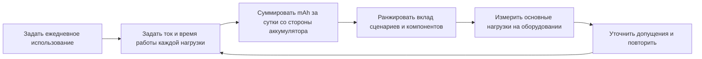
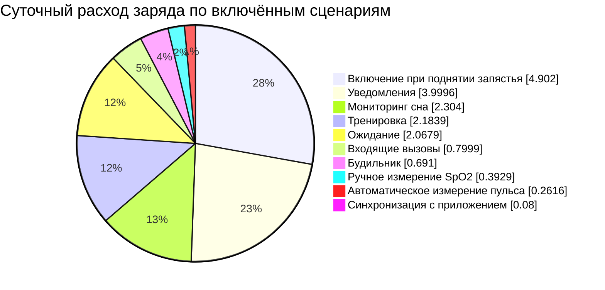
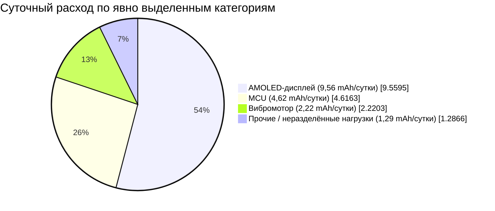
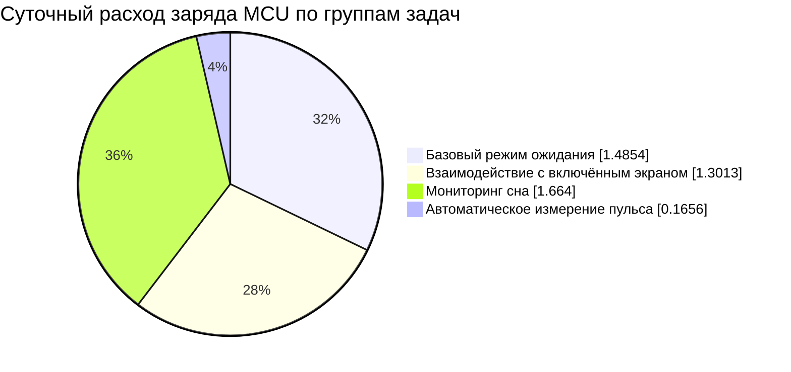

# Анализ энергопотребления умных часов { #power-profiling-a-smartwatch }

Анализ энергопотребления позволяет оценить автономность по ожидаемому ежедневному использованию и, что важнее, определить, какие нагрузки стоит оптимизировать в первую очередь. В статье разобран пример из [англоязычной рабочей книги Excel с данными профиля энергопотребления умных часов](assets/smartwatch-power-profile-data.xlsx). Вы узнаете, как пересчитать действия пользователя в mAh за сутки, найти нагрузки с наибольшим вкладом в расход заряда и превратить расчётную модель в план измерений.

!!! warning "Модель, а не спецификация устройства"
    Значения тока и допущения об использовании относятся к предоставленной модели. Это не результаты измерений конкретного устройства SF32, дисплея, аккумулятора или конструкции часов. Прежде чем заявлять автономность продукта на основании расчёта, замените эти допущения результатами измерений на вашем оборудовании.
    В рабочей книге нет журнала измерений, поэтому ни одно входное значение не определено как результат измерения на оборудовании. Результат 13,15 дня — расчётная оценка, а не измеренное время автономной работы.

Рекомендации по архитектуре и прошивке приведены в статье [Обзор энергосберегающего проектирования](overview.md), а порядок измерений для проверки модели — в статье [Измерение и проверка энергопотребления](measurement-and-validation.md).

## Обзор системы умных часов { #smartwatch-system-overview }

Сначала определите границы модели. В рабочей книге смоделированы часы с питанием от аккумулятора, MCU, AMOLED-дисплеем, вибромотором и неразделённой категорией нагрузок `Other`. Размер, разрешение и яркость панели, архитектура радиотракта и отдельные датчики в ней не указаны. Значения тока дисплея ниже — входные параметры модели, а не результаты измерений или характеристики конкретной панели. `Other` обозначает границу детализации модели, а не один физический компонент.

<div align="center"><em>Таблица: система умных часов и исходные параметры модели</em></div>

<div align="center" markdown>

| Параметр | Значение в рабочей книге | Значение для расчёта |
|:-----|----------------------:|:---------------|
| Ток AMOLED при обычной работе | 15 mA | Используется для уведомлений, входящих вызовов и включения экрана при поднятии запястья. |
| Ток AMOLED с постоянно включённым дисплеем (AOD) | 2 mA | Задан в модели, но сценарий AOD в базовой конфигурации отключён. |
| Номинальная ёмкость аккумулятора | 250 mAh | Исходная ёмкость до применения запаса модели. |
| Запас на деградацию аккумулятора | 7% | Снижает доступную ёмкость до 232,5 mAh. |
| Номинальное напряжение аккумулятора | 3,87 V | Используется во вспомогательном расчёте нормализации по напряжению. |

</div>

## Энергопотребление по сценариям { #power-consumption-by-scenario }

Сценарий — это целое действие пользователя или событие системы, а не работа отдельного компонента. Уведомление о сообщении может разбудить MCU, включить AMOLED-дисплей, запустить вибромотор и оставить фоновые нагрузки активными. Каждая строка `Display` в исходной матрице относится к AMOLED-дисплею. Строки компонентов сгруппированы по сценариям; рассчитанные суточные значения сохранены, чтобы их можно было сверить с источником. Частота событий и длительность, на которых основаны эти значения, приведены в следующем разделе.

<div align="center"><em>Таблица: полная модель энергопотребления по компонентам</em></div>

<div align="center" markdown>

| Сценарий | Компонент | Напряжение | Ток | Коэффициент напряжения* | Расход заряда за сутки | Доля суточного расхода |
|:---------|:----------|--------:|--------:|----------------:|-------------:|----------------------:|
| Базовый режим ожидания | MCU | 3,3 V | 0,102 mA | 85,27% | 1,4854 mAh | 8,40% |
| Базовый режим ожидания | Дисплей | 3,3 V | 0 mA | 85,27% | 0 mAh | 0,00% |
| Базовый режим ожидания | Вибромотор | 3,3 V | 0 mA | 85,27% | 0 mAh | 0,00% |
| Базовый режим ожидания | Other (прочие нагрузки) | 3,87 V | 0,04 mA | 100,00% | 0,5825 mAh | 3,29% |
| Уведомление о сообщении | MCU | 3,3 V | 2,507 mA | 85,27% | 0,3482 mAh | 1,97% |
| Уведомление о сообщении | Дисплей | 3,3 V | 15 mA | 85,27% | 2,0833 mAh | 11,78% |
| Уведомление о сообщении | Вибромотор | 3,3 V | 11,25 mA | 85,27% | 1,5625 mAh | 8,84% |
| Уведомление о сообщении | Other (прочие нагрузки) | 3,87 V | 0,04 mA | 100,00% | 0,0056 mAh | 0,03% |
| Оповещение о входящем вызове | MCU | 3,3 V | 2,507 mA | 85,27% | 0,0696 mAh | 0,39% |
| Оповещение о входящем вызове | Дисплей | 3,3 V | 15 mA | 85,27% | 0,4167 mAh | 2,36% |
| Оповещение о входящем вызове | Вибромотор | 3,3 V | 11,25 mA | 85,27% | 0,3125 mAh | 1,77% |
| Оповещение о входящем вызове | Other (прочие нагрузки) | 3,87 V | 0,04 mA | 100,00% | 0,0011 mAh | 0,01% |
| Включение экрана при поднятии запястья | MCU | 3,3 V | 2,607 mA | 85,27% | 0,7242 mAh | 4,10% |
| Включение экрана при поднятии запястья | Дисплей | 3,3 V | 15 mA | 85,27% | 4,1667 mAh | 23,56% |
| Включение экрана при поднятии запястья | Вибромотор | 3,3 V | 0 mA | 85,27% | 0 mAh | 0,00% |
| Включение экрана при поднятии запястья | Other (прочие нагрузки) | 3,87 V | 0,04 mA | 100,00% | 0,0111 mAh | 0,06% |
| Автоматическое измерение пульса | MCU | 3,3 V | 0,207 mA | 85,27% | 0,1656 mAh | 0,94% |
| Автоматическое измерение пульса | Дисплей | 3,3 V | 0 mA | 85,27% | 0 mAh | 0,00% |
| Автоматическое измерение пульса | Вибромотор | 3,3 V | 0,08 mA | 85,27% | 0,0640 mAh | 0,36% |
| Автоматическое измерение пульса | Other (прочие нагрузки) | 3,87 V | 0,04 mA | 100,00% | 0,0320 mAh | 0,18% |
| Ручное измерение SpO2 | MCU | 3,3 V | 2,6 mA | 85,27% | 0,0578 mAh | 0,33% |
| Ручное измерение SpO2 | Дисплей | 3,3 V | 15 mA | 85,27% | 0,3333 mAh | 1,89% |
| Ручное измерение SpO2 | Вибромотор | 3,3 V | 0 mA | 85,27% | 0 mAh | 0,00% |
| Ручное измерение SpO2 | Other (прочие нагрузки) | 3,87 V | 0,08 mA | 100,00% | 0,0018 mAh | 0,01% |
| Запись тренировки | MCU | 3,3 V | 0,207 mA | 85,27% | 0,0296 mAh | 0,17% |
| Запись тренировки | Дисплей | 3,3 V | 15 mA | 85,27% | 2,1429 mAh | 12,12% |
| Запись тренировки | Вибромотор | 3,3 V | 0 mA | 85,27% | 0 mAh | 0,00% |
| Запись тренировки | Other (прочие нагрузки) | 3,87 V | 0,08 mA | 100,00% | 0,0114 mAh | 0,06% |
| Вибрация будильника | MCU | 3,3 V | 2,6 mA | 85,27% | 0,0650 mAh | 0,37% |
| Вибрация будильника | Дисплей | 3,3 V | 15 mA | 85,27% | 0,3750 mAh | 2,12% |
| Вибрация будильника | Вибромотор | 3,3 V | 10 mA | 85,27% | 0,2500 mAh | 1,41% |
| Вибрация будильника | Other (прочие нагрузки) | 3,87 V | 0,04 mA | 100,00% | 0,0010 mAh | 0,01% |
| Мониторинг сна | MCU | 3,3 V | 0,208 mA | 85,27% | 1,6640 mAh | 9,41% |
| Мониторинг сна | Дисплей | 3,3 V | 0 mA | 85,27% | 0 mAh | 0,00% |
| Мониторинг сна | Вибромотор | 3,3 V | 0 mA | 85,27% | 0 mAh | 0,00% |
| Мониторинг сна | Other (прочие нагрузки) | 3,87 V | 0,08 mA | 100,00% | 0,6400 mAh | 3,62% |
| Синхронизация данных с приложением | MCU | 3,3 V | 2,5 mA | 85,27% | 0,0069 mAh | 0,04% |
| Синхронизация данных с приложением | Дисплей | 3,3 V | 15 mA | 85,27% | 0,0417 mAh | 0,24% |
| Синхронизация данных с приложением | Вибромотор | 3,3 V | 11,25 mA | 85,27% | 0,0313 mAh | 0,18% |
| Синхронизация данных с приложением | Other (прочие нагрузки) | 3,87 V | 0,04 mA | 100,00% | 0,0001 mAh | 0,0006% |
| Операция с NFC-картой | MCU | 3,3 V | 2,5 mA | 85,27% | 0 mAh | 0,00% |
| Операция с NFC-картой | Дисплей | 3,3 V | 15 mA | 85,27% | 0 mAh | 0,00% |
| Операция с NFC-картой | Вибромотор | 3,3 V | 11,25 mA | 85,27% | 0 mAh | 0,00% |
| Операция с NFC-картой | Other (прочие нагрузки) | 3,87 V | 0,04 mA | 100,00% | 0 mAh | 0,00% |
| Звонок по Bluetooth | MCU | 3,3 V | 10 mA | 85,27% | 0 mAh | 0,00% |
| Звонок по Bluetooth | Дисплей | 3,3 V | 15 mA | 85,27% | 0 mAh | 0,00% |
| Звонок по Bluetooth | Вибромотор | 3,3 V | 11,25 mA | 85,27% | 0 mAh | 0,00% |
| Звонок по Bluetooth | Other (прочие нагрузки) | 3,87 V | 0,04 mA | 100,00% | 0 mAh | 0,00% |
| AOD, обновление MCU раз в минуту | MCU | 3,3 V | 2,5 mA | 85,27% | 0 mAh | 0,00% |
| AOD, обновление MCU раз в минуту | Дисплей | 3,3 V | 0 mA | 85,27% | 0 mAh | 0,00% |
| AOD, обновление MCU раз в минуту | Вибромотор | 3,3 V | 0 mA | 85,27% | 0 mAh | 0,00% |
| AOD, обновление MCU раз в минуту | Other (прочие нагрузки) | 3,87 V | 0,08 mA | 100,00% | 0 mAh | 0,00% |
| AOD, включённый дисплей | MCU | 3,3 V | 0 mA | 85,27% | 0 mAh | 0,00% |
| AOD, включённый дисплей | Дисплей | 3,3 V | 2 mA | 85,27% | 0 mAh | 0,00% |
| AOD, включённый дисплей | Вибромотор | 3,3 V | 0 mA | 85,27% | 0 mAh | 0,00% |
| AOD, включённый дисплей | Other (прочие нагрузки) | 3,87 V | 0,08 mA | 100,00% | 0 mAh | 0,00% |

</div>

\*В рабочей книге столбец обозначен как “Power-Conversion Efficiency (%)”, но его формула рассчитывает лишь отношение напряжений, а не измеренный КПД стабилизатора. Подраздел «Проверка допущения о преобразовании питания» ниже объясняет, как это влияет на оценку автономности. Суточный расход заряда и проценты здесь округлены; точные формулы и значения доступны в скачиваемом файле. Для выбора приоритетов используйте расположенные ниже таблицы с ранжированием, а для проверки исходного тока или напряжения отдельной нагрузки возвращайтесь к этой матрице.

<div align="center"><em>Схема: цикл анализа энергопотребления умных часов</em></div>



### Пересчёт сценария в суточный расход заряда { #convert-a-scenario-into-daily-charge }

Если ток нагрузки уже задан со стороны аккумулятора, суточный расход заряда рассчитывается напрямую:

```text
daily_charge_mAh = current_mA x active_time_seconds_per_day / 3600
```

Если нагрузка питается через стабилизатор, сначала рассчитайте ток со стороны аккумулятора, затем учтите время работы:

```text
battery_current_mA = (load_voltage_V x load_current_mA) /
                     (battery_voltage_V x regulator_efficiency)
```

Используйте измеренный КПД стабилизатора при предусмотренном токе нагрузки. Заявленный максимальный КПД редко показателен для часов, которые большую часть суток работают при малой нагрузке.

### Проверка допущения о преобразовании питания { #check-the-workbooks-conversion-assumption }

Столбец “Power-Conversion Efficiency (%)” в рабочей книге рассчитывается как `load voltage / battery voltage`. Последующая формула расхода заряда делит на этот коэффициент и на напряжение аккумулятора, поэтому напряжения сокращаются. Суточный расход заряда в итоге равен току нагрузки, умноженному на время: ток аккумулятора принимается равным току нагрузки. Это не расчёт идеального преобразования мощности. Такой подход похож на модель линейного стабилизатора без учёта тока покоя; для импульсного стабилизатора он не является универсальным.

Например, нагрузка с током 1 mA при 3,3 V, питаемая от аккумулятора 3,87 V через идеальный преобразователь, потребляла бы от аккумулятора примерно 0,853 mA, тогда как рабочая книга учитывает 1 mA. Для реального преобразователя результат зависит от КПД и тока покоя. Поэтому одно лишь это допущение не позволяет определить, оптимистична или консервативна оценка автономности. Ранжирование полезно для первичной проверки принятых токов и длительностей, но не заменяет окончательный расчёт расхода заряда аккумулятора. Для окончательного бюджета продукта замените вспомогательный коэффициент измеренным КПД каждой линии питания в соответствующем диапазоне нагрузок. Учтите ток покоя, не добавляя его повторно, если он уже включён в измерение, а также потери в защите аккумулятора и цепи питания от зарядного устройства.

## Расчёт суточного расхода по использованию продукта { #calculate-daily-consumption-from-product-usage }

Один и тот же сценарий может давать незначительный вклад или определять основной расход — в зависимости от использования продукта. Для моделирования репрезентативного дня в рабочей книге включены следующие сценарии: базовое ожидание, уведомления, входящие вызовы, включение экрана при поднятии запястья, измерения пульса и SpO2, запись тренировки, будильники, мониторинг сна и синхронизация с приложением. NFC, звонки по Bluetooth и оба сценария AOD установлены в ноль и поэтому не входят в оценку автономности в 13,15 дня.

<div align="center"><em>Таблица: профиль ежедневного использования и вклады</em></div>

<div align="center" markdown>

| Сценарий | Событий за сутки | Длительность события | Общая длительность за сутки | Доля суточного расхода | Состояние в модели |
|:---------|--------------------:|------------------------:|-----------------------:|----------------------:|:----------------|
| Базовый режим ожидания | 1 | Оставшиеся секунды суток (`=G7`) | 52 425,7 s | 11,69% | Включён |
| Уведомление о сообщении | 100 | 5 s | 500 s | 22,62% | Включён |
| Оповещение о входящем вызове | 10 | 10 s | 100 s | 4,52% | Включён |
| Включение экрана при поднятии запястья | 200 | 5 s | 1 000 s | 27,72% | Включён |
| Автоматическое измерение пульса | 48 | 60 s | 2 880 s | 1,48% | Включён |
| Ручное измерение SpO2 | 2 | 40 s | 80 s | 2,22% | Включён |
| Запись тренировки | 1 | `3600 / 7` s | 514,3 s | 12,35% | Включён; один час в неделю, усреднённый за сутки |
| Вибрация будильника | 3 | 30 s | 90 s | 3,91% | Включён |
| Мониторинг сна | 1 | `8 x 3600` s | 28 800 s | 13,03% | Включён |
| Синхронизация данных с приложением | 20 | 0,5 s | 10 s | 0,45% | Включён |
| Операция с NFC-картой | 0 | 5 s | 0 s | 0,00% | Отключён |
| Звонок по Bluetooth | 0 | `2 x 60` s | 0 s | 0,00% | Отключён |
| AOD, обновление MCU раз в минуту | 0 | 0,05 s | 0 s | 0,00% | Отключён |
| AOD, включённый дисплей | 0 | `(24 - 8) x 3600` s | 0 s | 0,00% | Отключён |

</div>

Пустые ячейки сценариев в исходной матрице оставлены намеренно. За каждой именованной строкой сценария идут нагрузки дисплея, вибромотора и `Other`. Они используют частоту и длительность из строки сценария выше, поэтому в источнике название указано только один раз.

<div align="center"><em>Таблица: расчётные результаты ежедневного использования</em></div>

<div align="center" markdown>

| Результат | Расчёт | Значение |
|:-------|:------------|------:|
| Доступная ёмкость аккумулятора | `250 mAh x (1 - 7%)` | 232,5 mAh |
| Расчётный суточный расход | Сумма нагрузок всех включённых сценариев | 17,68 mAh/сутки |
| Средний ток аккумулятора | `17.68 mAh/day / 24 h` | 0,74 mA |
| Оценка автономности | `232.5 mAh / 17.68 mAh/day` | 13,15 дня |

</div>

Ранжирование сценариев лучше помогает выбрать действия, чем итоговое число дней автономности. Сначала проверяйте гипотезы оптимизации для самых крупных вкладов.

<div align="center"><em>Таблица: вклад включённых сценариев в модели часов</em></div>

<div align="center" markdown>

| Сценарий | Расход заряда за сутки | Доля суточного расхода | Предполагаемое ежедневное использование |
|:---------|------------:|----------------------:|:-----------------------|
| Включение экрана при поднятии запястья | 4,90 mAh | 27,72% | 200 событий по 5 s. |
| Уведомление о сообщении | 4,00 mAh | 22,62% | 100 уведомлений по 5 s. |
| Мониторинг сна | 2,30 mAh | 13,03% | 8 h. |
| Запись тренировки | 2,18 mAh | 12,35% | 1 h в неделю, усреднённый за сутки. |
| Базовый режим ожидания | 2,07 mAh | 11,69% | Оставшееся время после включённых активностей. |
| Оповещение о входящем вызове | 0,80 mAh | 4,52% | 10 оповещений по 10 s. |
| Вибрация будильника | 0,69 mAh | 3,91% | 3 будильника по 30 s. |
| Ручное измерение SpO2 | 0,39 mAh | 2,22% | 2 измерения по 40 s. |
| Автоматическое измерение пульса | 0,26 mAh | 1,48% | 48 измерений по 60 s. |
| Синхронизация данных с приложением | 0,08 mAh | 0,45% | 20 передач по 0,5 s. |

</div>

<div align="center"><em>Диаграмма: вклад включённых сценариев в модели часов</em></div>



Два наиболее энергоёмких сценария взаимодействия с включённым экраном дают около половины суточного расхода заряда модели. Это проверяемый измерениями результат, а не общее утверждение, что дисплеи потребляют энергию. Прежде чем заниматься меньшими нагрузками, уточните реальное число включений при поднятии запястья, время работы экрана, яркость, порядок обновления изображения и политику уведомлений.

<div align="center"><em>Таблица: суточный расход заряда по категориям компонентов</em></div>

<div align="center" markdown>

| Категория компонентов | Расход заряда за сутки | Доля суточного расхода | Что проверить |
|:-------------------|------------:|----------------------:|:-------------------|
| AMOLED-дисплей | 9,56 mAh | 54,06% | Соответствуют ли яркость, время включения и обновления реальному использованию? |
| MCU | 4,62 mAh | 26,11% | Возвращает ли прошивка MCU в предусмотренный режим сна между задачами? |
| Вибромотор | 2,22 mAh | 12,56% | Нужны ли заданная сила, рисунок и длительность вибрации для каждого события? |
| Прочие / неразделённые нагрузки | 1,29 mAh | 7,28% | Проверены ли отдельными измерениями допущения о датчиках, PMIC, радио и токах утечки? |

</div>

<div align="center"><em>Диаграмма: известное распределение суточного расхода в модели часов</em></div>



Последний сектор намеренно оставлен как `Other / unallocated` (прочие / неразделённые нагрузки). В рабочей книге нет отдельных значений со стороны аккумулятора для Bluetooth, акселерометра или гироскопа. Отключённый сценарий звонков по Bluetooth не означает нулевого потребления Bluetooth: синхронизация с приложением также может использовать радиоканал, но эта энергия отдельно не выделена. Аналогично, потребление датчиков может находиться в `Other`, однако предоставленные данные не позволяют разделить его между акселерометром и гироскопом.

Чтобы получить диаграмму с пятью категориями — MCU, дисплей, вибромотор, Bluetooth и объединённая категория акселерометра с гироскопом, — добавьте отдельные строки для ожидания и передачи по Bluetooth, режимов и долей времени работы акселерометра, а также режимов и долей времени работы гироскопа. Измерьте каждую строку на входе аккумулятора либо примените измеренный КПД стабилизатора, прежде чем добавлять её к суммарному значению mAh со стороны аккумулятора. Затем замените сектор `Other / unallocated`, а не добавляйте второй, пересекающийся сектор датчиков или Bluetooth.

### Базовое потребление MCU, работа по сценариям и нагрузки датчиков { #separate-standby-mcu-active-mcu-and-sensors }

В рабочей книге есть отдельная категория `MCU`, но отрисовка графики не выделена в самостоятельный путь выполнения. Поэтому корректнее отдельно рассматривать базовую строку ожидания MCU и строки MCU, отнесённые к пользовательским сценариям. Потребление датчиков не выделено в отдельную категорию.

<div align="center"><em>Таблица: детализация категории MCU</em></div>

<div align="center" markdown>

| Группа задач MCU | Расход заряда за сутки | Доля общего суточного расхода | Доля расхода MCU | Пояснение |
|:-------------------|------------:|----------------------------:|--------------------:|:---------------|
| Базовый режим ожидания | 1,49 mAh | 8,40% | 32,18% | 0,102 mA в оставшиеся 14,56 h модели. Это допущение о категории MCU на уровне системы, а не проверенный ток утечки самого кристалла. |
| Взаимодействие с включённым экраном | 1,30 mAh | 7,36% | 28,19% | Сообщения, входящие вызовы, включение при поднятии запястья, SpO2, тренировки, будильники и синхронизация. Включает обработку событий и возможную работу с графикой. |
| Мониторинг сна | 1,66 mAh | 9,41% | 36,04% | 0,208 mA в течение 8 h; крупнейшая отдельная строка MCU в модели. |
| Автоматическое измерение пульса | 0,17 mAh | 0,94% | 3,59% | Измерения по расписанию и связанная с ними работа MCU. |
| **Итого MCU** | **4,62 mAh** | **26,11%** | **100%** | Все строки таблицы, явно отнесённые к MCU. |

</div>

<div align="center"><em>Диаграмма: суточный расход заряда категории MCU</em></div>



Два сравнения помогают избежать ошибочного вывода:

- **Базовая строка ожидания MCU и строки сценариев с включённым экраном:** на базовое ожидание приходится 1,49 mAh/сутки — немного больше, чем 1,30 mAh/сутки, отнесённые к MCU во всех сценариях взаимодействия с включённым экраном. В этой модели снижение принятого базового тока столь же важно, как сокращение общей работы MCU в этих сценариях. Таблица не выделяет энергозатраты на отрисовку графики отдельно.
- **Базовая строка ожидания MCU и остальные явно указанные строки MCU:** суммарно они дают 3,13 mAh/сутки, что в 2,11 раза больше базового ожидания. Самая большая отдельная строка вне базового ожидания — мониторинг сна: 1,66 mAh/сутки. Это отнесённая к сценарию нагрузка MCU, а не измерение только тока активного CPU.

В рабочей книге датчики не выделены в отдельную категорию. Их потребление может входить в `Other`, где также могут учитываться PMIC, радио, токи утечки и другие фоновые нагрузки. Всего эта категория даёт 1,29 mAh/сутки (7,28%). Даже если отнести весь расход `Other` к датчикам, явно выделенная категория MCU всё равно больше: 4,62 mAh/сутки против 1,29 mAh/сутки, то есть в 3,59 раза. Это сравнение категорий модели, а не прямое измерение кристалла MCU и датчиков. Реальную долю датчиков можно определить, только выделив их линии питания из общей категории `Other`.

<div align="center"><em>Таблица: дальнейшие измерения для разделения оставшихся нагрузок</em></div>

<div align="center" markdown>

| Вопрос | Текущая граница модели | Необходимое измерение |
|:---------|:--------------------------|:-------------------|
| Каков ток утечки MCU? | Базовый ток категории `MCU` включает не только утечку самого кристалла. | Измерьте питание MCU в предусмотренном режиме сна, затем отдельно измерьте утечки на уровне платы. |
| Сколько энергии требуется для отрисовки? | Время MCU при включённом экране включает также пробуждение, обработку событий и работу драйвера дисплея. | Отметьте интервал отрисовки в прошивке и проинтегрируйте ток за этот интервал. |
| Какой расход относится к датчикам? | Датчики не выделены в отдельную категорию; они могут входить в `Other`. | Измерьте питание каждого датчика или добавьте строку для каждого режима и доли времени работы датчика. |
| Что остаётся в `Other`? | PMIC, радио, токи утечки и датчики объединены. | Поочерёдно отключайте или изолируйте линию питания либо подсистему и сверяйте суммарный расход со стороны аккумулятора. |

</div>

## От ранжирования к проектным решениям { #turn-the-ranking-into-design-work }

Начинайте с наибольшего расчётного вклада и проверяйте порядок измерениями. Для этой модели разумна следующая последовательность:

1. **Управление дисплеем:** измерьте полную кривую тока при включении экрана от поднятия запястья. Сначала уменьшайте ложные срабатывания, время включения, яркость, полную перерисовку экрана и ненужную анимацию, а уже затем добивайтесь снижения тока MCU на несколько микроампер.
2. **Политика уведомлений:** объединяйте несрочные уведомления, если это допустимо для пользовательского опыта. Проверьте, действительно ли каждое событие требует одновременно экрана и вибрации.
3. **Ожидание с сохранением соединения:** убедитесь, что после каждого события MCU входит в предусмотренный режим сна. Проверьте периодические таймеры, циклы опроса, обратные вызовы Bluetooth и запросы к подсистеме управления питанием.
4. **Вибросигналы:** подбирайте амплитуду и длительность с помощью тестов восприятия. Более короткая или слабая вибрация может снизить расход энергии без ухудшения заметности уведомлений.
5. **Длительная работа с датчиками:** анализируйте мониторинг сна и запись тренировки как целые сценарии, включая долю времени работы датчиков, обработку данных, обращения к памяти и активность радио.

Не оптимизируйте отдельное число в таблице без учёта системы. Внешне экономичное изменение может увеличить частоту пробуждений, ухудшить пользовательский опыт или продлить активную работу настолько, что ожидаемая экономия исчезнет.

## Проверка модели на оборудовании { #validate-the-model-on-hardware }

Модель полезна, когда её регулярно уточняют по измерениям. Для каждой крупной нагрузки фиксируйте напряжение аккумулятора или источника питания, температуру, ревизию платы, версию прошивки, включённые радиоинтерфейсы, режим дисплея и диапазон измерения.

<div align="center"><em>Таблица: минимальный план проверки профиля умных часов</em></div>

<div align="center" markdown>

| Измеряемый сценарий | Что измерить | Что уточнить в модели |
|:---------------|:----------------|:---------------------------------|
| Ожидание с выключенным экраном | Средний ток и неожиданные пробуждения за длительную запись | Базовые токи MCU, датчиков, PMIC и других фоновых нагрузок. |
| Включение экрана при поднятии запястья | Обнаружение жеста, задержку пробуждения, ток дисплея и время включённого экрана | Фактическое число событий, время работы дисплея и энергозатраты интерфейса. |
| Уведомление | Активность MCU, дисплея, вибромотора и Bluetooth во время одного оповещения | Энергию одного уведомления и реальное число уведомлений за сутки. |
| Мониторинг сна | Полную ночную кривую тока или репрезентативный повторяемый интервал | Долю времени работы датчиков и энергозатраты периодической обработки. |
| Запись тренировки | Активность датчиков, дисплея, памяти и радио за предусмотренную тренировку | Энергию на тренировку и реалистичную частоту за неделю. |
| AOD, NFC и звонки по Bluetooth | Отдельные измерения перед включением в прогноз | Собственные сценарии, а не небольшую поправку к ожиданию. |

</div>

## Как поддерживать достоверность модели { #keep-the-profile-honest }

- Отключённые сценарии не включены в бюджет; это не означает отсутствия расхода энергии. Сейчас в рабочей книге для сценариев NFC, звонков по Bluetooth и AOD задан нулевой расход заряда.
- Разделяйте пользовательские функции и фоновую работу на отдельные сценарии. Это помогает явно обсуждать компромиссы при анализе продукта.
- По возможности измеряйте на входе от аккумулятора. Измерения отдельных линий питания тоже полезны, но перед расчётом автономности необходимо учесть потери стабилизатора и ток покоя.
- Меняйте по одному допущению и сравнивайте mAh за сутки, а не только мгновенный ток.
- Пересчитывайте профиль при изменении управления дисплеем, настроек Bluetooth, частоты измерений датчиков, политики управления питанием или существенной функции прошивки.

## Основные выводы { #key-takeaways }

- Автономность равна эффективной ёмкости аккумулятора, делённой на суточный расход заряда. Модель даёт 13,15 дня при доступных 232,5 mAh и расходе 17,68 mAh/сутки включённых нагрузок.
- В предоставленной базовой конфигурации расход определяет поведение дисплея. Одни только включения экрана при поднятии запястья и уведомления о сообщениях дают около половины суточного расхода заряда.
- Ранжирование сценариев показывает, что измерять и оптимизировать сначала; оно полезнее единственного значения среднего тока.
- Прежде чем заявлять автономность продукта по прогнозу из рабочей книги, учтите реальный КПД преобразователя и ток покоя.
- Повторяйте цикл: моделируйте реальное использование, измеряйте основные сценарии, уточняйте допущения и затем оптимизируйте.
