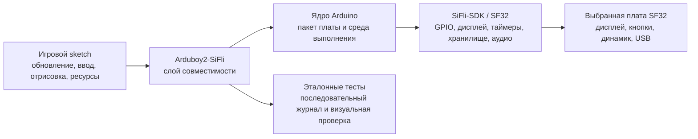

# Порт Arduboy2 для SF32LB52 { #arduboy2-on-sifli }

## Что такое Arduboy2-SiFli? { #what-is-arduboy2-sifli }

[OpenSiFli/Arduboy2-SiFli](https://github.com/OpenSiFli/Arduboy2-SiFli) — порт библиотеки [Arduboy2](https://github.com/MLXXXp/Arduboy2), поддерживаемый OpenSiFli для среды разработки SiFli. Arduboy2 задаёт модель приложения для компактного игрового устройства: цикл кадров, буфер дисплея, кнопки, спрайты, текст и, при необходимости, управление звуком. Поэтому порт SiFli полезен как проверка совместимости: он позволяет оценить, какую часть игры в стиле Arduboy можно сохранить при адаптации платы, дисплея, ввода, аудио и процесса сборки для SF32.

Репозиторий содержит референсную программную реализацию, а не готовую игровую консоль или проект аппаратуры для производства. README, дерево исходного кода, примеры, история issues и файлы лицензий служат основными источниками сведений о целевой плате, поддерживаемых API, инструкциях сборки и условиях распространения. Эта страница систематизирует инженерные решения для этой реализации, но не заменяет исполняемые инструкции из репозитория.

## Зачем нужен этот порт для SF32? { #why-the-sifli-implementation }

Приложение в стиле Arduboy позволяет в компактном примере проверить сразу несколько проектных решений для встраиваемого устройства: предсказуемый цикл отрисовки, небольшие монохромные или низкого разрешения ресурсы, ввод кнопками, временные характеристики аудио и ограниченный бюджет памяти. Перенос этой модели на SF32 может стать отправной точкой для портативных игр, демонстраторов интерфейса, учебных устройств и других продуктов с локальным и предсказуемым взаимодействием.

Ценность порта не в том, что любой sketch для Arduboy заработает без изменений, а в том, что он показывает границы совместимости:

- Игра может сохранить высокоуровневую логику обновления, ввода, рисования и работы с ресурсами, если она использует только поддерживаемый API Arduboy2.
- Порт должен адаптировать предположения о дисплее, кнопках, аудио, временных интервалах и хранении данных, которые были заложены в исходное оборудование.
- Любой sketch, напрямую работающий с регистрами AVR, специальными выводами Arduboy, транзакциями дисплея, таймерами или структурой EEPROM, требует осознанной адаптации и отдельного подтверждения регрессионными тестами.

Это инженерные ожидания, а не подтверждённые измерениями заявления о совместимости. Сверьте их с актуальной версией репозитория OpenSiFli и зафиксируйте результат для выбранных платы и коммита.

## Результат, область применения и условия начала { #outcome-scope-and-entry-criteria }
На этой странице описан поэтапный путь от примера OpenSiFli к воспроизводимой игре или интерактивной демонстрации на SF32. Она **не** утверждает, что порт поддерживает все возможности Arduboy2, любые игры Arduboy или платы SF32, и не гарантирует временные характеристики дисплея и аудио производственного уровня. Страница также не предоставляет лицензий на игры, шрифты, графику и другие ресурсы из сторонних репозиториев.

**Ожидаемый результат:** сборка Arduboy2-SiFli с зафиксированным исходным кодом, запускающая один пример из репозитория или небольшой тестовый sketch, демонстрирующая выбранные пути дисплея/ввода/аудио и сохраняющая данные для решения о целесообразности разработки более крупной игры или адаптации продукта.

**Для кого:** инженеры по прошивке, аппаратуре и продукту, умеющие работать с инструментами Arduino, читать код C/C++, загружать прошивку в плату SF32, анализировать последовательный вывод и выполнять базовые измерения дисплея, ввода и питания.

Перед началом подготовьте:

- Отладочную плату SF32LB52 с вариантом ArduinoCore-Zephyr `sf32lb52_devkit_lcd_sf32lb525uc6`, а также внешние периферийные устройства, описанные ниже. В README указано, что дисплей, кнопки, внешняя EEPROM и аудиотракт проверялись на оборудовании SF32LB52. Путь для RGB-светодиода описан, но результаты его тестирования не приведены. Физическая ревизия платы и точная модель OLED-модуля также не зафиксированы.
- Заведомо работоспособную установку Arduino и соответствующий пакет плат OpenSiFli. Имя варианта задаёт программную конфигурацию и карту выводов, но не доказывает, что все физические версии SF32LB52-DevKit-LCD соответствуют внешней разводке проекта. Перед подключением периферии сверьтесь со схемой конкретной платы.
- Точный commit Arduboy2-SiFli, версию ядра/пакета Arduino, ОС хоста и инструмент загрузки.
- USB-кабель с линиями данных и возможность сохранить последовательный журнал и наблюдать за дисплеем, кнопками и звуком.
- Права на использование и распространение всех игр, изображений, шрифтов и звуковых ресурсов, включённых в производную адаптацию.

<em>Таблица: исходные условия и доказательства по проекту</em>

| Область | Исходная конфигурация проекта | Что подтвердить до адаптации |
|:-----|:-----------------|:---------------------------|
| Исходный код | Зафиксированный commit OpenSiFli/Arduboy2-SiFli и ревизии его зависимостей. | Чистый checkout и воспроизводимая запись сборки. |
| Плата | SF32LB52 и вариант ArduinoCore-Zephyr `sf32lb52_devkit_lcd_sf32lb525uc6` с внешней периферией, указанной ниже. | Запишите физическую ревизию платы, подключение, источник питания и успешную загрузку; в репозитории не зафиксированы ревизия платы и модель OLED. |
| Инструменты | Arduino IDE или CLI, пакет плат OpenSiFli и документированный способ загрузки. | Версии пакетов, выбранная плата, вывод компилятора, журналы загрузки и последовательного порта. |
| Эталонное поведение | Один upstream-пример или минимальный sketch, проверяющий порт. | Обновление дисплея, реакция на ввод и поддерживаемое поведение аудио наблюдаемы и воспроизводимы. |
| Изменение продукта | Одна ограниченная адаптация игры или интерфейса. | После изменения эталонный тест продолжает проходить; сведения о ресурсах и лицензиях сохранены. |

## Аппаратные и программные спецификации { #hardware-and-software-specifications }
### Аппаратная спецификация { #hardware-specification }

<em>Таблица: Аппаратная спецификация Arduboy2-SiFli</em>

| Компонент | Требования | Назначение | Статус | Где получить | Совместимость и варианты замены |
|:----------|:-----------|:-----------|:-------|:-------------|:--------------------------------|
| Отладочная плата SF32LB52 | Вариант ArduinoCore-Zephyr `sf32lb52_devkit_lcd_sf32lb525uc6`; в репозитории не зафиксирована физическая ревизия платы | Запускает порт и предоставляет назначенные выводы MCU | Обязательна | [Исходники Arduboy2-SiFli](https://github.com/OpenSiFli/Arduboy2-SiFli); [вариант ArduinoCore-zephyr](https://github.com/OpenSiFli/ArduinoCore-zephyr) | Указан программный вариант платы и карта выводов, а не проверенная физическая сборка; до подключения сверьте фактическую ревизию и схему |
| Монохромный OLED-дисплей | 128 × 64 пикселя, подключение по SPI1; точная модель модуля и контроллера в репозитории не указана | Отображает кадровый буфер игры | Обязателен | [Исходники Arduboy2-SiFli](https://github.com/OpenSiFli/Arduboy2-SiFli) | Внешнее устройство. До использования проверьте контроллер, напряжение, разъём, ориентацию и временные параметры по документации модуля и платы |
| Шесть игровых кнопок | Совместимые с Arduboy входы, активный низкий уровень с подтяжкой вверх; карта выводов приведена в репозитории | Считывают направления и кнопки A/B | Обязательны | [Исходники Arduboy2-SiFli](https://github.com/OpenSiFli/Arduboy2-SiFli) | Кнопки внешние; сверьте назначенные Arduino IO с конкретной платой и зафиксируйте подключение и устранение дребезга |
| Внешняя EEPROM | AT24C02 или AT24C32 по I2C1, адрес `0x50` | Поддерживает функции библиотеки, использующие EEPROM | Необязательна; требуется только для функций, использующих EEPROM | [Исходники Arduboy2-SiFli](https://github.com/OpenSiFli/Arduboy2-SiFli) | Проверьте микросхему, напряжение, подтяжки и разводку шины; конфигурация с установленной EEPROM в репозитории не задана |
| Аудиовыход и RGB-индикатор | Поддерживаемые аудиобэкенды используют назначенные выходы динамика; внешним RGB-светодиодом с общим катодом управляет программный PWM | Дополнительный звук и цветовая индикация | Необязательно; выбирается для проверяемого скетча | [Исходники Arduboy2-SiFli](https://github.com/OpenSiFli/Arduboy2-SiFli) | В исходниках не приведён полный перечень компонентов (BOM) для динамика и светодиода; проверьте внешнюю схему, выводы, ток и аудиоповедение |
| Хост и USB-подключение для передачи данных | Хост, поддерживаемый выбранной средой Arduino; кабель с линиями данных и доступ к последовательным логам | Сборка, загрузка и наблюдение за эталонной работой | Обязательны | [ArduinoCore-zephyr](https://github.com/OpenSiFli/ArduinoCore-zephyr) | Запишите ОС хоста, кабель/порт, версии пакетов и способ восстановления; кабеля только для зарядки недостаточно |

### Программная спецификация { #software-specification }

<em>Таблица: Программная спецификация Arduboy2-SiFli</em>

| Пакет или сервис | Требуемая версия или ревизия | Назначение | Статус | Где получить | Совместимость и обновление |
|:-----------------|:----------------------------|:-----------|:-------|:-------------|:---------------------------|
| OpenSiFli/Arduboy2-SiFli | Выберите и зафиксируйте commit; статья не задает конкретную ревизию | Слой совместимости SF32 и примеры | Обязателен | [Репозиторий](https://github.com/OpenSiFli/Arduboy2-SiFli) | Повторно проверьте целевую плату, зависимости и поддерживаемые API для выбранного commit |
| OpenSiFli/ArduinoCore-zephyr и пакет платы | Определите и запишите совместимый с портом commit/версию пакета | Среда Arduino, описание платы, компилятор и интеграция загрузки | Обязательны | [Репозиторий](https://github.com/OpenSiFli/ArduinoCore-zephyr) | Не заменяйте core или пакет платы на более новый без чистой сборки и регрессионной проверки периферии |
| Тестовый скетч и игровые ресурсы | Один пример из репозитория либо отдельно лицензированный тестовый скетч; зафиксируйте ревизии и лицензии ресурсов | Проверяет выбранный API и продуктовый сценарий | Выберите один вариант | [Примеры Arduboy2-SiFli](https://github.com/OpenSiFli/Arduboy2-SiFli) | Статья не предоставляет права на распространение сторонних игр, шрифтов, изображений и звуков |

## Выбор поддерживаемой базовой конфигурации { #choose-a-supported-baseline }
Начните с сочетания платы и ПО, указанного в репозитории OpenSiFli, а не выбирайте похожую плату из каталога продуктов. Пакет платы, подключение дисплея, карта ввода, способ загрузки и предположения библиотеки входят в исходную конфигурацию.

В репозитории Arduboy2-SiFli нет отдельного файла с картой выводов платы: подробная таблица опубликована в README в разделе [SiFli IO mapping](https://github.com/OpenSiFli/Arduboy2-SiFli#sifli-io-mapping). Логические определения выводов библиотеки находятся в [`pins_sifli.h`](https://github.com/OpenSiFli/Arduboy2-SiFli/blob/master/src/platforms/sifli/pins_sifli.h), а разводка для конкретной платы задается в [Devicetree overlay](https://github.com/OpenSiFli/ArduinoCore-zephyr/blob/main/variants/sf32lb52_devkit_lcd_sf32lb525uc6/sf32lb52_devkit_lcd_sf32lb525uc6.overlay) проекта ArduinoCore-Zephyr. Эти источники описывают программную исходную конфигурацию, а не проверенную физическую сборку. Перед подключением сверьте фактическую ревизию платы и ее схему.

<em>Таблица: выбор исходной конфигурации</em>

| Элемент конфигурации | Где проверить | Не следует предполагать, что |
|:-----------------|:---------------|:--------------|
| Целевая плата | Вариант ArduinoCore-Zephyr `sf32lb52_devkit_lcd_sf32lb525uc6`, указанный в README Arduboy2-SiFli, затем схема физической платы. | Программный вариант подтверждает совместимость всех физических ревизий платы и конфигураций периферии. |
| Ядро Arduino | Пакет и ревизия OpenSiFli, указанные для целевой платы. | Последний пакет взаимозаменяем с ревизией, использованной в репозитории. |
| Дисплей и ввод | Определения выводов/конфигурации в репозитории и схема физической платы. | Геометрия исходного дисплея Arduboy, полярность кнопок и имена выводов совпадают с платой SF32. |
| Аудио | Поддерживаемый в репозитории аудиовыход и конфигурация конкретной платы. | Наличие API для тонов доказывает готовность временных характеристик динамика, громкости и питания для продукта. |
| Загрузка и восстановление | Документированный процесс Arduino или `sftool` для выбранной платы. | Успешная загрузка с одного компьютера подтверждает наличие восстанавливаемого пути обновления в эксплуатации. |

В репозитории указаны программный вариант платы и карта выводов периферии; также сообщается, что дисплей, кнопки, внешняя EEPROM и аудиотракт проверялись на оборудовании SF32LB52. Путь для внешнего RGB-светодиода описан, но результаты его тестирования не приведены. Физическая ревизия платы, точная модель/контроллер OLED-модуля и полный комплект аксессуаров не указаны. Перед подключением или заявлением о воспроизводимости аппаратной конфигурации сверьте карту выводов варианта со схемой конкретной платы и запишите использованные компоненты и ревизии. Не заполняйте пробелы данными о выводах или адресах из другого проекта SF32.

## Этапы проекта { #delivery-map }
Используйте этапы как точки принятия решений, а не как перечень функций.

<em>Таблица: этапы проекта</em>

| Этап | Какое решение помогает принять | Что должно быть получено |
|:------|:---------------------|:----------------|
| 1. Неизменённый пример | Удаётся ли собрать, загрузить и запустить документированный порт на выбранной базе? | Заведомо работоспособный sketch, записи commit/пакета, журнал загрузки и наблюдаемое поведение. |
| 2. Проверка периферии | Предсказуемо ли работают дисплей, ввод, аудио, сброс и временные характеристики на реальной плате? | Запись испытаний периферии, включая отказы и восстановление. |
| 3. Воспроизводимая база исходников | Сможет ли другой инженер собрать тот же образ из чистого checkout? | Артефакт чистой сборки, сведения о среде и повторный результат. |
| 4. Контролируемая адаптация игры | Можно ли внести ограниченное изменение в игру или интерфейс, не нарушив работу порта? | Проверенное изменение, сведения о ресурсах/лицензиях и результат регрессии. |
| 5. Оценка готовности продукта | Достаточно ли надёжен пример, чтобы оправдать собственную аппаратуру или дальнейшие вложения в ПО? | Реестр рисков с ответственными, доказательствами, мерами снижения риска и решением продолжить, отложить или остановить работу. |

## Архитектура системы и зависимости { #system-architecture-and-dependencies }

<em>Рисунок: путь приложения Arduboy2-SiFli</em>

Это модель для принятия решений, а не утверждение, что в репозитории используются именно такие имена внутренних модулей. Прежде чем менять порт, проверьте фактические границы в исходном коде. Ключевые области проектирования продукта:

- **Кадры и временные характеристики:** игровой цикл должен обновлять и выводить кадры с повторяемой частотой; чувствительное к таймингам аудио и ввод необходимо измерить на целевой плате.
- **Дисплей:** слой совместимости должен сопоставить буфер и геометрию игры с выбранными контроллером дисплея, форматом пикселя, ориентацией и способом обновления.
- **Ввод:** имена и полярность кнопок, подавление дребезга, одновременные нажатия и поведение при пробуждении/сбросе следует проверить по разводке платы.
- **Аудио:** генерацию тонов, использование таймера, подключение динамика, громкость и отключение звука следует считать особенностями конкретной платы до проверки.
- **Ресурсы и хранение:** после компоновки выбранной игры необходимо измерить шрифты, спрайты, звуковые данные, размещение во flash и использование RAM.
- **Восстановление:** перед экспериментами с таймингами, памятью или низким энергопотреблением сохраните проверенный способ загрузки прошивки и восстановления.

Основные области отказа — совместимость приложения/API, конфигурация дисплея, подключение ввода, работа аудио/таймеров, память и размещение ресурсов, загрузка и восстановление. Не следует сводить отказ в любой из этих областей к формулировке «порт не работает».

## Этап 1 — Зафиксируйте неизменённый пример { #stage-1-establish-the-untouched-reference }

**Цель:** проверить работоспособность базы, описанной в репозитории, прежде чем менять библиотеку или игру.

1. Прочитайте инструкции репозитория, запишите основную ветку или выпуск, изучите примеры, конфигурацию платы, зависимости и файлы лицензий.
2. Установите точные версии ядра/пакета Arduino и инструментов, требуемые репозиторием. Запишите ОС хоста и версии инструментов.
3. Соберите и загрузите самый простой документированный пример или тестовый sketch.
4. Сохраните последовательный вывод и запишите изображение на дисплее, реакцию кнопок и наличие звука в примере.

**Что сохранить:** commit репозитория, версии зависимостей и пакетов, ревизию платы, сведения о подключении или схеме, результат сборки, журналы загрузки и последовательного порта, краткое описание поведения.

**Критерий завершения этапа 1:** исходный пример собирается и загружается на выбранную плату, а описанное поведение повторяется после сброса или цикла питания.

## Этап 2 — Проверьте периферию и временные характеристики { #stage-2-validate-peripheral-and-timing-boundaries }

**Цель:** отличить успешную компиляцию от пригодной для игрового устройства исходной конфигурации.

1. Проверьте очистку дисплея, обновление полного кадра, вывод спрайта или bitmap, работу с текстом и предположения примера о геометрии/ориентации.
2. Проверьте все используемые проектом входы: отпускание и одновременное нажатие кнопок, быстрые нажатия, а также пробуждение или сброс, если применимо.
3. Если используется аудио, проверьте запуск/остановку тона, взаимодействие с таймерами, отключение звука и влияние активности дисплея и ввода на аудиотракт.
4. Прервите штатную работу сбросом, отключением/подключением кабеля и недопустимой или неполной последовательностью ввода. Запишите, возвращается ли плата в рабочее состояние для загрузки и запуска.

**Что сохранить:** визуальные результаты или снимки экрана, матрицу ввода, наблюдения за таймингами и аудио, журнал сбросов/восстановления, а также измерения тока и задержки, влияющие на решение по продукту.

**Критерий завершения этапа 2:** выбранный путь работы с периферией достаточно понятен, чтобы отличать ошибки приложения от проблем конфигурации платы, таймингов или питания.

## Этап 3 — Создайте воспроизводимую базу исходников { #stage-3-build-a-reproducible-source-baseline }

**Цель:** обеспечить воспроизводимость порта без привязки к одной машине разработчика или готовому бинарному файлу.

1. Начните с чистого checkout и инициализируйте все зависимости репозитория.
2. Запишите пакет платы, версии Arduino IDE/CLI, компилятора и инструментов, файлы конфигурации и созданные ресурсы.
3. Выполните сборку в чистом каталоге, сохраните образ и доступные сведения map/size, а также команду или вывод инструмента загрузки.
4. Повторите сборку на второй машине или после удаления каталога сборки.

**Что сохранить:** ревизии исходников и зависимостей, сведения о хосте и инструментах, журнал сборки, бинарный файл или другой артефакт, отчёт о размере, журналы загрузки и последовательного порта.

**Критерий завершения этапа 3:** чистый checkout воспроизводит образ, проходящий проверки периферии этапа 2, без недокументированных локальных файлов и ручных правок.

## Этап 4 — Осознанно адаптируйте одну игру { #stage-4-adapt-one-game-deliberately }

**Цель:** проверить границы совместимости одним контролируемым изменением продукта.

Начните с небольшого sketch или игры с понятными требованиями к дисплею, вводу, аудио и ресурсам. Сохраните исходный образ примера и меняйте только один тип поведения за раз:

<em>Таблица: порядок контролируемой адаптации</em>

| Тип изменения | С чего начать | Необходимая регрессионная проверка |
|:-------------|:-----------|:--------------------|
| Айдентика и интерфейс | Экран заголовка, шрифт, спрайт, палитра или расположение элементов. | Сборка, загрузка, обновление кадров, ввод и проверка целостности ресурсов. |
| Логика игры | Одно ограниченное правило, уровень или переход состояния. | Повторяемая последовательность ввода, сброс, сохранение очков/состояния при наличии и тайминг кадров. |
| Аудио | Один тон или короткий эффект через поддерживаемый путь. | Запуск/остановка, отключение звука, взаимодействие с таймером и работа под нагрузкой дисплея/ввода. |
| Хранение | Небольшое изменение сохранения или загрузки ресурсов. | Отчёт о размере, поведение при потере питания, обработка повреждения и восстановление. |
| Адаптация платы | Осознанное изменение назначения выводов дисплея, кнопок или динамика. | Подтверждение по схеме/выводам, полная регрессия периферии и возврат к эталонному образу. |

Не переносите в проект SF32 доступ к регистрам AVR, предположения о выводах исходной Arduboy или адреса хранения без инженерного решения, подтверждённого источниками. Храните лицензии сторонних игр и ресурсов рядом с адаптированным кодом; удаляйте всё, условия распространения чего неясны.

**Что сохранить:** проверенный diff, происхождение ресурсов, изображения до и после, журналы сборки и загрузки, результаты регрессии и образ для отката.

**Критерий завершения этапа 4:** адаптированная игра проходит эталонные проверки периферии; ограничения по памяти, таймингам, восстановлению и лицензированию записаны.

## Этап 5 — Оцените готовность продукта { #stage-5-product-readiness-review }

Не переходите от демонстрации порта к собственной аппаратуре или полевым испытаниям, пока команда не ответит на вопросы:

- Для каких точных моделей платы SF32, дисплея, кнопок, динамика и источника питания подтверждена работа, а что пока остаётся предположением?
- Какие частота кадров, задержка ввода, поведение аудио, время запуска и профиль тока измерены на предполагаемой базе продукта?
- Сколько flash и RAM потребляют игра, ресурсы, шрифты и среда выполнения, включая максимальный объём контента?
- Что происходит после сброса, просадки питания, его потери во время сохранения, повреждения ресурсов, неудачной загрузки прошивки или незавершённого обновления?
- Кто поддерживает разные части порта: команда продукта, OpenSiFli, SiFli или исходное сообщество Arduboy2?
- Совместимы ли лицензии всех игр, шрифтов, изображений, звуков и библиотек с предполагаемой моделью распространения?

**Критерий завершения этапа 5:** для оставшихся рисков назначены ответственные и собраны доказательства; для каждого риска определена мера снижения, явно согласовано отложенное решение либо принято решение остановить работу.

## Передача материалов для проектирования изделия { #handoff-to-product-design }
Перенесите в раздел [«Аппаратная часть»](../hardware/index.md) выбранную модель SF32, архитектуру дисплея и ввода, план аудио и таймеров, размещение Flash и ресурсов, результаты измерений энергопотребления, способ восстановления и исходные допущения для производственных испытаний. Если требования игры к дисплею, памяти, типу корпуса, питанию или подключению меняют список подходящих устройств, воспользуйтесь [подбором компонентов SF32](../sf32-products/product-selector.md). Для подготовки программной среды начните с [руководства по началу работы с Arduino](../getting-started/arduino/getting-started-arduino.md), затем изучите [обзор платформы Arduino](../develop/platforms/arduino/overview.md).

Пример выполнил свою задачу по развитию продукта, когда другой инженер может повторно собрать порт, воспроизвести результаты проверки периферии, объяснить каждую адаптацию под конкретную плату и изучить доказательства до утверждения собственной платы или расширенной библиотеки игр.

## Основные источники { #authoritative-sources }
- [OpenSiFli/Arduboy2-SiFli](https://github.com/OpenSiFli/Arduboy2-SiFli)
- [MLXXXp/Arduboy2](https://github.com/MLXXXp/Arduboy2)
- [OpenSiFli/ArduinoCore-zephyr](https://github.com/OpenSiFli/ArduinoCore-zephyr)
- [Начало работы с Arduino на SF32](../getting-started/arduino/getting-started-arduino.md)
- [Обзор платформы Arduino](../develop/platforms/arduino/overview.md)
- [Подбор компонентов SF32](../sf32-products/product-selector.md)
