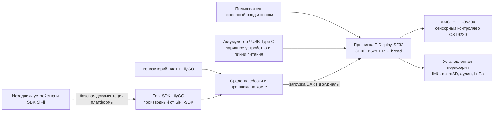

# LilyGO T-Display-SF32 { #lilygo-t-display-sf32 }

!!! warning "Сторонний проект — не проект SiFli"
    T-Display-SF32 публикует и поддерживает Xinyuan-LilyGO/LilyGO, а не SiFli или OpenSiFli. Для решений по аппаратуре, прошивке и поддержке конкретной платы используйте репозитории LilyGO. Источники SiFli остаются авторитетными для базового устройства SF32 и SiFli-SDK, но это не означает, что SiFli проверила эту плату LilyGO или поддерживает её.

## Что такое T-Display-SF32? { #what-is-t-display-sf32 }

[Xinyuan-LilyGO/T-Display-SF32](https://github.com/Xinyuan-LilyGO/T-Display-SF32) — платформа разработки на базе MCU SF32LB52x с AMOLED-дисплеем CO5300 диагональю 2,16 дюйма и сенсорным контроллером CST9220. В репозитории описаны 16 MB flash, 8 MB PSRAM, IMU BHI260AP, LoRa SX1262, интерфейс microSD, аудио, USB Type-C, поддержка зарядки, назначение выводов платы, примеры приложений, файлы аппаратуры, каталог заводской прошивки и отчёт о потреблении питания для этой платы.

Такое сочетание подходит для оценки носимого устройства с дисплеем, портативного контроллера, переносного сенсорного терминала или подключённого человеко-машинного интерфейса (HMI). Это пример платформы, а не готовое изделие: несмотря на множество доступных аппаратных функций, команда продукта должна выбрать нужные интерфейсы, воспроизвести известную базовую конфигурацию, измерить её на конкретной ревизии платы и проверить питание, RF, безопасность, обслуживание ПО и восстановление.

Таблица поддержки функций в репозитории различает автономную плату T-SF32-Display и дополнительную плату расширения T-SF32-Keyboard. Wi-Fi (ESP32-C6), GPS (L76K), матричная клавиатура и её светодиоды (TCA8418, AW21009, XL9555), BME280, ИК-передатчик и вибромотор (AW86224) доступны только с этой платой расширения и не входят в базовую конфигурацию автономной платы.

## Зачем нужна реализация на SF32? { #why-the-sf32-implementation }

На одной плате T-Display-SF32 графические возможности, Bluetooth, аудио и режимы низкого энергопотребления SF32LB52x объединены с внешними компонентами: дисплеем, сенсорным интерфейсом, датчиками движения, устройствами хранения и радиотрактом LoRa. LilyGO также предоставляет конфигурацию платы, специализированные драйверы, примеры и отдельный [форк SDK LilyGO](https://github.com/Xinyuan-LilyGO/SlFli-SDK-Lilygo), который, согласно описанию, основан на SiFli-SDK 2.4.0. Это может сократить первоначальную настройку платы по сравнению с использованием неизменённой универсальной цели SDK.

Компромисс связан с ответственностью за сопровождение. Поддержка платы, изменения драйверов, ревизии аппаратуры, комплектная прошивка и связь между форком SDK от LilyGO и основным SiFli-SDK контролируются вне SiFli. Поэтому для воспроизводимости зафиксируйте commit обоих репозиториев, сохраните работоспособный заводской образ/образ восстановления, а переход на более новую версию исходного SDK оформляйте как отдельное инженерное изменение.

## Результат, область применения и условия начала { #outcome-scope-and-entry-criteria }

**Ожидаемый результат:** зафиксировать версии базовой конфигурации T-Display-SF32; проверить дисплей и сенсорный ввод, выбранные периферийные устройства, поведение системы питания и восстановление; воспроизвести сборку из исходников; затем внести одно ограниченное изменение приложения и сохранить результаты регрессионной проверки для оценки продукта.

Эта страница не подтверждает, что все варианты платы укомплектованы всеми периферийными устройствами, что прошивка поставщика готова к производству, что отчёт о питании применим к другой ревизии или нагрузке, либо что работа LoRa разрешена в каждом регионе. Она также не распространяет поддержку SiFli на специализированную аппаратуру и драйверы LilyGO.

Перед началом подготовьте:

- Точную модель платы T-Display-SF32 и её аппаратную ревизию, а также схему или карту выводов;
- Источник питания с ограничением тока либо защищённый аккумулятор, напряжение и состояние которого можно контролировать;
- Заведомо исправный USB-кабель с линиями данных, документированный разъём Type-C для прошивки и сохранённый образ восстановления;
- Зафиксированные коммиты репозитория T-Display-SF32 и форка SDK LilyGO;
- Окружение Windows/PowerShell, описанное в fork SDK LilyGO для первой воспроизводимой сборки; другие варианты хост-систем требуют отдельной проверки;
- Только те тестовые аксессуары, которые нужны для интерфейсов в области работ: например, карту microSD, наушники или аудионагрузку и устройство LoRa для разрешённого диапазона;
- Журнал версий прошивки, сборок, последовательного вывода, фотографий, измерений тока, отказов и восстановления.

<div align="center"><em>Таблица: базовая конфигурация и доказательства по проекту T-Display-SF32</em></div>

<div align="center" markdown>

| Область | Начальная конфигурация | Что подтвердить до адаптации |
|:-----|:------------------|:------------------------------------|
| Ответственность | Плата, репозиторий и форк SDK LilyGO | Владельцы репозиториев, коммиты, ревизия платы и границы поддержки |
| Аппаратура | SF32LB52x, AMOLED/сенсорный экран 2,16 дюйма, внешняя память и установленные периферийные устройства | Проверка схемы/карты выводов, запись о сборке и перечень установленных компонентов |
| Прошивка | Комплектный заводской образ или неизменённый пример из репозитория | Идентификатор образа, журналы прошивки и загрузки, функциональная запись |
| Питание | Путь USB/зарядное устройство/аккумулятор, описанный LilyGO | Ограничения источника, результат запуска, поведение при выключении и измеренный ток выбранной нагрузки |
| Адаптация | По одному изменению примера, интерфейса, датчика, хранения, аудио или радиотракта | Проверенное изменение, образ для отката и полная регрессия |

</div>

## Аппаратные и программные спецификации { #hardware-and-software-specifications }

### Аппаратная спецификация { #hardware-specification }

<div align="center"><em>Таблица: Аппаратная спецификация T-Display-SF32</em></div>

<div align="center" markdown>

| Компонент | Требования | Назначение | Статус | Где получить | Совместимость и варианты замены |
|:----------|:-----------|:-----------|:-------|:-------------|:--------------------------------|
| Плата T-Display-SF32 | SF32LB52x; документированная конфигурация включает AMOLED CO5300 диагональю 2,16 дюйма, сенсор CST9220, 16 MB Flash, 8 MB PSRAM, IMU BHI260AP, LoRa SX1262, microSD, встроенные микрофон и усилитель динамика с аудиоразъёмом 3,5 mm, а также три пользовательские кнопки | Интегрированная платформа для вычислений, дисплея, датчиков, радиосвязи, хранения и аудио | Обязательно | [Репозиторий LilyGO](https://github.com/Xinyuan-LilyGO/T-Display-SF32); [файлы аппаратной части](https://github.com/Xinyuan-LilyGO/T-Display-SF32/tree/master/hardware) | Запишите точную ревизию платы и установленные компоненты; не считайте, что все варианты имеют одинаковую комплектацию |
| Плата расширения T-SF32-Keyboard | Дополнительная плата с Wi-Fi ESP32-C6, GPS L76K, подсистемой клавиатуры TCA8418/AW21009/XL9555, BME280, ИК-передатчиком и вибромотором AW86224 | Добавляет перечисленные функции беспроводной связи, позиционирования, клавиатуры, датчиков окружающей среды, ИК и тактильной отдачи | Необязательно; нужна только для этих функций | [Репозиторий LilyGO](https://github.com/Xinyuan-LilyGO/T-Display-SF32); [файлы аппаратной части](https://github.com/Xinyuan-LilyGO/T-Display-SF32/tree/master/hardware) | Эти компоненты не установлены на автономной T-SF32-Display. Wi-Fi и GPS используют общий UART2; проверьте их совместную конфигурацию на плате расширения |
| USB Type-C для данных и контролируемый источник питания | Кабель с линиями данных; источник с ограничением тока либо защищённый аккумулятор с контролем напряжения | Загрузка прошивки, сбор журналов и безопасная проверка питания | Обязательно | [Репозиторий LilyGO](https://github.com/Xinyuan-LilyGO/T-Display-SF32) | Линии D+/D- Type-C подключены к мосту USB-UART CH343P. Этот порт предназначен для прошивки по UART и журналов, а не для нативного USB-интерфейса устройства/хоста SF32. Также соблюдайте указанное для платы условие запуска при напряжении выше 3,5 V |
| Аксессуары для проверки отдельных интерфейсов | Карта microSD, аудионагрузка/наушники либо LoRa-устройство в разрешённом в регионе диапазоне — только для проверяемых интерфейсов | Проверка дополнительных интерфейсов платы | Необязательно; выбираются для каждого теста | [Примеры](https://github.com/Xinyuan-LilyGO/T-Display-SF32/tree/master/examples) | Перед подключением по документации платы проверьте точный разъём, напряжение, региональные требования и ревизию |

</div>

### Программная спецификация { #software-specification }

<div align="center"><em>Таблица: Программная спецификация T-Display-SF32</em></div>

<div align="center" markdown>

| Пакет или сервис | Требуемая версия или ревизия | Назначение | Статус | Где получить | Совместимость и обновление |
|:-----------------|:----------------------------|:-----------|:-------|:-------------|:---------------------------|
| Прошивка/исходники T-Display-SF32 | Зафиксируйте коммит репозитория; основной репозиторий не задаёт универсальную версию с тегом | Примеры платы, конфигурация и прошивка | Обязательно | [Репозиторий](https://github.com/Xinyuan-LilyGO/T-Display-SF32) | Сохраните заводской образ и вместе запишите ревизию платы и коммит |
| Форк LilyGO SiFli-SDK | Зафиксируйте коммит форка, который, согласно документации, основан на SiFli-SDK 2.4.0 | Поддержка платы, драйверы, сборка и загрузка | Обязательно | [Форк SDK LilyGO](https://github.com/Xinyuan-LilyGO/SlFli-SDK-Lilygo) | Указание на базу 2.4.0 не определяет точную ревизию форка; не заменяйте его незаметно основной версией SiFli-SDK |
| SCons и средства загрузки на хосте | Версии из выбранного форка; запишите ОС хоста и фактически выбранные версии | Сборка и загрузка цели `t-display-sf32_hcpu` | Обязательно | [Форк SDK LilyGO](https://github.com/Xinyuan-LilyGO/SlFli-SDK-Lilygo) | В документированном начальном процессе используется Windows/PowerShell; другие среды проверяйте отдельно |
| Заводская прошивка V1.2 | Образ для соответствующей ревизии платы/репозитория | Эталон неизменённого поведения и восстановления | Необязательно, но сохраните до изменений | [Каталог заводской прошивки](https://github.com/Xinyuan-LilyGO/T-Display-SF32/tree/master/firmware/T-SF32-Factory-V1.2) | Название каталога само по себе не подтверждает совместимость образа с платой; проверьте её перед загрузкой |

</div>

## Выбор поддерживаемой базовой конфигурации { #choose-a-supported-baseline }

Основной репозиторий T-Display-SF32 сейчас использует ветку `master` и не обозначает выпуск с тегом как универсальную базовую версию ПО. Запишите точный коммит, а не «последнюю версию». В репозитории есть каталог `firmware/T-SF32-Factory-V1.2`, но одного его имени недостаточно: зафиксируйте соответствующую ревизию платы, коммит репозитория и процедуру прошивки.

<div align="center"><em>Таблица: выбор базовой конфигурации T-Display-SF32</em></div>

<div align="center" markdown>

| Элемент базы | Рекомендуемая отправная точка | Важное ограничение |
|:-----------------|:------------------|:--------------------|
| Плата | Сфотографированная плата T-Display-SF32 с установленной ревизией | Не считайте карту выводов и состав периферии одинаковыми для другой ревизии или варианта, связанного с клавиатурой |
| Заводской режим | Каталог заводской версии V1.2 или неизменённая сборка `menu_app`, в зависимости от платы | До прошивки проверьте происхождение и совместимость; сохраните исходный образ |
| Исходники | Зафиксированный commit T-Display-SF32 | Репозиторий развивается независимо от SiFli-SDK |
| SDK | Зафиксированный коммит форка SDK LilyGO, описанный как производный от SiFli-SDK 2.4.0 | Не заменяйте его незаметно другой версией SDK: драйверы и конфигурация платы могут отличаться |
| Цель сборки | `t-display-sf32_hcpu` | Это цель платы LilyGO, а не универсальная цель SF32LB52x |
| Питание | Соблюдайте указанное LilyGO условие запуска при напряжении выше 3,5 V и реализуйте обнаружение напряжения/выключение при низком заряде в пользовательской прошивке | Проверяйте это требование платы; оно не заменяет техническую документацию на микросхему, ограничения аккумулятора или измерение поведения при просадке питания |

</div>

После настройки необходимого окружения README T-Display-SF32 описывает следующую последовательность сборки и прошивки в Windows:

```powershell
cd T-Display-SF32\examples\rt_os\rt_driver\project
scons --board=t-display-sf32_hcpu -j8
build_t-display-sf32_hcpu\uart_download.bat
```

Сохраните фактические коммиты репозитория и SDK, результат настройки переменных окружения, полный журнал сборки, созданные образы и журналы прошивки и загрузки. Число параллельных задач можно менять; цель сборки и ревизии исходников должны оставаться неизменными.

## Этапы проекта { #delivery-map }

<div align="center"><em>Таблица: этапы проекта T-Display-SF32</em></div>

<div align="center" markdown>

| Этап | Какое решение помогает принять | Требуемый результат |
|:------|:---------------------|:----------------|
| 1. База поставщика | Работают ли исходные плата и прошивка в соответствии с описанием? | Зафиксированная по версиям, сфотографированная заведомо рабочая сессия |
| 2. Проверка периферии и восстановления | Можно ли наблюдать выбранные интерфейсы, режимы питания и отказы, а затем восстановить работу? | Запись об инъекции отказов, измерениях и восстановлении |
| 3. Воспроизведение сборки | Может ли команда собрать и прошить то же поведение из чистых исходников? | Окружение, образ, журнал прошивки и повторный результат |
| 4. Контролируемая адаптация | Можно ли изменить одно поведение продукта, не нарушив базовую конфигурацию? | Ограниченное изменение, способ отката и результаты регрессии |
| 5. Оценка продукта | Подходит ли сторонняя платформа для дальнейшего прототипирования или разработки собственной аппаратуры? | Назначенные ответственные за риски и решение продолжить, отложить или остановить работу |

</div>

## Архитектура системы и зависимости { #system-architecture-and-dependencies }

<div align="center"><em>Рисунок: границы разработки и продукта T-Display-SF32</em></div>



Рассматривайте отказы как отдельные области: питание/зарядка платы, запуск и прошивка, дисплей/сенсорный ввод, каждое выбранное периферийное устройство, поддержка платы LilyGO и базовый SDK. Например, отказ примера дисплея может быть вызван питанием, ревизией платы, настройкой панели/сенсорного контроллера, приложением или несовместимостью SDK и драйвера. Формулировки «не работает SDK» недостаточно для диагностики.

## Этап 1 — Зафиксируйте исходную конфигурацию поставщика { #stage-1-establish-the-untouched-vendor-baseline }

**Цель:** установить фактическое поведение полученной платы и исходной конфигурации поставщика до изменения исходного кода.

1. Сфотографируйте обе стороны платы и запишите маркировку, установленные периферийные устройства, компоненты дисплея/сенсорного ввода, память, переключатели, разъёмы и commit репозитория.
2. Проверьте источник питания и полярность. LilyGO предупреждает, что для запуска требуется напряжение выше 3,5 V; используйте контролируемый источник и не проводите испытания на глубоко разряженном элементе.
3. Прошивайте только базовый образ, заведомо соответствующий плате, либо сначала запустите установленную прошивку, если её происхождение известно. По возможности сохраните исходный образ.
4. Проверьте меню на устройстве или неизменённые примеры для дисплея/сенсорного ввода и каждой периферии, выбранной для продукта. Фиксируйте отсутствующие функции или неустановленные компоненты, не считая это отказом.
5. Выполните два холодных запуска и сохраните журналы загрузки, фотографии интерфейса, результаты ввода и сенсорного теста, а также запись тока для чётко заданного сценария простоя или активной работы.

**Что сохранить:** ревизию платы и фотографии, идентификатор репозитория/образа, сведения об источнике и аккумуляторе, журналы прошивки и загрузки, перечень установленных устройств, результаты проверки функций и условия измерения тока.

**Критерий завершения контрольной точки 1:** после двух холодных запусков воспроизводится установленная базовая работа дисплея/сенсорного ввода, зафиксированы результаты для каждого установленного периферийного устройства в области работ, а исходный или заведомо рабочий образ можно восстановить.

## Этап 2 — Проверьте периферию, питание и восстановление { #stage-2-validate-peripheral-power-and-recovery-boundaries }

**Цель:** выяснить, можно ли обнаруживать отказы и восстанавливать работу без небезопасного использования аккумулятора и недокументированной перепрошивки.

<div align="center"><em>Таблица: проверка отказов и восстановления T-Display-SF32</em></div>

<div align="center" markdown>

| Проверка | Метод | Критерий прохождения |
|:-----|:-------|:--------------|
| Запас при запуске | Изменяйте напряжение источника с ограничением тока в предполагаемом рабочем диапазоне, не превышая документированные пределы | Измерены пороги и поведение запуска/выключения; повторные сбросы и неопределённые состояния не скрываются |
| Работа при низком заряде | Используйте контролируемый источник для проверки порогов предупреждения и выключения | Пользовательская прошивка предупреждает о разряде и выключается до безопасного предела разряда выбранного аккумулятора |
| Зарядка выключенного устройства | После выключения заводской прошивкой подключите USB-питание и используйте документированный способ пробуждения кнопкой | Состояние зарядки и пробуждение кнопкой соответствуют описанию поставщика; одно подключение USB не считается запуском устройства |
| Прерывание дисплея/сенсорного ввода | Выполните сброс или цикл питания во время работы интерфейса, затем повторите тесты касания краёв и углов | Дисплей и сенсорный ввод возвращаются в известное состояние без стойких искажений изображения и ложных срабатываний |
| Съёмный накопитель | Удаляйте, повреждайте или заменяйте тестовую карту только в контролируемых точках | Состояния отсутствия карты и ошибок поддаются диагностике; приложение не повреждает посторонние данные и не зависает |
| Канал LoRa | Используйте устройство-партнёр в разрешённом диапазоне и контролируемую RF-конфигурацию | Записаны частота и конфигурация; видны тайм-ауты и повторное подключение; дальность не заявляется без измерений |
| Восстановление flash | Прерывайте тестовую прошивку только на восстанавливаемом устройстве, затем используйте документированный путь Type-C/UART | Сохранённый заведомо рабочий образ восстановлен с записью инструментов и шагов |

</div>

**Критерий завершения контрольной точки 2:** для каждой подходящей проверки есть воспроизводимый результат и способ восстановления; пользовательская прошивка защищает от низкого заряда; ни один неустранённый отказ не может повредить аккумулятор или оставить плату неработоспособной без документированного пути восстановления.

## Этап 3 — Создайте воспроизводимую базу исходников { #stage-3-build-a-reproducible-source-baseline }

**Цель:** дать второму инженеру возможность создать и прошить ту же базовую конфигурацию из чистых исходников с зафиксированными версиями.

1. Получите зафиксированные коммиты репозитория платы и форка SDK LilyGO; запишите, какая основная версия SDK указана как база форка.
2. Настройте документированное окружение PowerShell и соберите `t-display-sf32_hcpu` в чистом каталоге.
3. Сохраните сведения об окружении, зависимостях, конфигурации, памяти/разделах, образе, прошивке и последовательных журналах.
4. Повторите сборку на другом компьютере или после удаления всех результатов сборки, затем выполните полную регрессию этапа 2.

**Критерий завершения контрольной точки 3:** для создания прошивки, проходящей проверки этапа 2, не требуются устаревший образ, неотслеживаемый файл платы или недокументированная замена SDK.

## Этап 4 — Адаптируйте по одному функциональному направлению { #stage-4-adapt-one-product-path-at-a-time }

**Цель:** внести одно полезное изменение, сохранив рабочую базовую конфигурацию поставщика и путь восстановления.

<div align="center"><em>Таблица: порядок контролируемой адаптации T-Display-SF32</em></div>

<div align="center" markdown>

| Тип изменения | Подходящее первое изменение | Необходимая регрессия |
|:-------------|:------------------|:--------------------|
| Интерфейс | Одна страница, значок, шрифт или действие сенсорного ввода | Холодный запуск, обновление всего экрана, границы касания, использование памяти и восстановление |
| Датчик | Одно значение или событие IMU | Идентификатор устройства, диапазон, частота дискретизации, обработка ошибок, ток покоя и пробуждение |
| Хранение/аудио | Одна операция с файлом или путь воспроизведения | Отсутствующий носитель, некорректные данные, пределы громкости/выхода, пропадание питания и восстановление файловой системы |
| LoRa | Один ограниченный обмен пакетами в разрешённом диапазоне | Запись конфигурации, тайм-аут, повторная попытка, ток, сосуществование и проверка нормативных требований |
| Питание | Одно изменение сна/пробуждения или управления линией питания | Все источники пробуждения, состояние дисплея/периферии, выключение при низком заряде, зарядка и повторные циклы |
| Миграция SDK | Кандидатное обновление форка LilyGO или исходного SDK | Diff конфигурации платы, чистая сборка, регрессия всей периферии, измерения тока и откат |

</div>

**Критерий завершения контрольной точки 4:** изменение проверено, исходный образ можно восстановить, а все применимые тесты дисплея, сенсорного ввода, периферии, питания, flash и восстановления пройдены.

## Этап 5 — Оцените готовность продукта { #stage-5-product-readiness-review }

Перед полевыми испытаниями или разработкой собственной печатной платы (PCB) ответьте на вопросы:

- Кто отвечает за файлы платы, fork SDK LilyGO, исправления драйверов, обновления безопасности и переход на следующие версии SiFli-SDK?
- Какие ревизии платы и установленные периферийные устройства входят в базовую конфигурацию продукта, и как будут определяться и проверяться поступающие экземпляры?
- Каковы измеренные токи в активном режиме, простое, сне, при запуске и выключении для заданной яркости дисплея, коэффициента заполнения (duty cycle) радиопередачи, накопителя и конфигурации датчиков?
- Как проверяются защита аккумулятора, зарядка, тепловой режим, корпус, доступ к разъёмам и восстановление выключенного устройства?
- Какой регион LoRa, какая антенна и какой план частот будут использоваться; какие параметры передачи и нормативные требования для них применимы?
- Совместимы ли лицензии файлов аппаратуры, прошивки, fork SDK, примеров, ресурсов и сторонних компонентов с предполагаемым распространением?
- Принимает ли команда зависимость от стороннего прототипа или уже проверила контролируемый fork и план сопровождения?

**Критерий завершения контрольной точки 5:** для каждого остаточного риска назначен ответственный, собраны доказательства и определён порядок действий; команда явно решила продолжить, отложить или остановить работу.

## Передача материалов для проектирования изделия { #handoff-to-product-design }

Зафиксируйте точную модель SF32 и устройства памяти, временные характеристики дисплея/сенсорного ввода, установленную периферию и шины, дерево питания, политику зарядного устройства и аккумулятора, стратегию антенны/RF, разъём загрузки и прошивки, схему разделов, доступ к производственным тестам, ответственность за fork ПО и проверенный путь восстановления. Продолжайте по [пути интеграции SF32LB52x](../sf32-products/chips/SF32LB52x.md#integration-path), [руководству по проектированию аппаратуры SF32LB52x](../hardware/chip-guides/SF32LB52x_hardware_design_guide.md), [сборке, прошивке и мониторингу последовательного вывода в SiFli-SDK](../develop/platforms/sifli-sdk/build-flash-monitor.md) и материалу [«Разработка для серийного производства»](../hardware/design-for-production.md).

## Основные источники { #authoritative-sources }

- [Репозиторий Xinyuan-LilyGO/T-Display-SF32](https://github.com/Xinyuan-LilyGO/T-Display-SF32)
- [README для T-Display-SF32 на китайском языке](https://github.com/Xinyuan-LilyGO/T-Display-SF32/blob/master/readme_cn.md)
- [Примеры для T-Display-SF32](https://github.com/Xinyuan-LilyGO/T-Display-SF32/tree/master/examples)
- [Файлы аппаратной части T-Display-SF32](https://github.com/Xinyuan-LilyGO/T-Display-SF32/tree/master/hardware)
- [Материалы испытаний энергопотребления T-Display-SF32](https://github.com/Xinyuan-LilyGO/T-Display-SF32/tree/master/lowpowertest)
- [Форк SDK Xinyuan-LilyGO/SlFli-SDK-Lilygo](https://github.com/Xinyuan-LilyGO/SlFli-SDK-Lilygo)
- [OpenSiFli/SiFli-SDK](https://github.com/OpenSiFli/SiFli-SDK)
