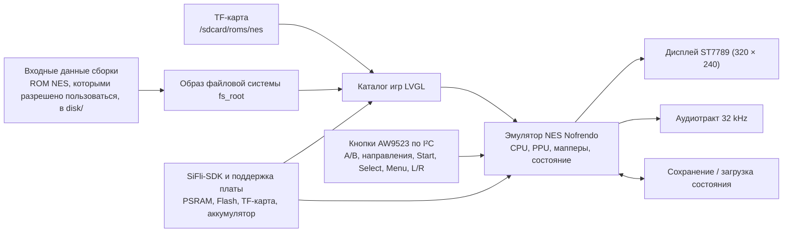

# Портативная игровая консоль Pocket Pi SF32 { #pocket-pi-sf32-handheld-game-console }

!!! note "Зафиксированный снимок исходников"
    Если не указано иное, описание поведения кода в этой статье относится к commit [`7d9fac2`](https://github.com/SiFliSparks/PocketPi/commit/7d9fac2cb577d6c9b66a99521aebf3c9de0ae163) проекта PocketPi. Ветка `main` исходного проекта может изменяться; для воспроизведения описанного состояния переключитесь на зафиксированный commit.

## Что такое Pocket Pi? { #what-is-pocket-pi }

[SiFliSparks/PocketPi](https://github.com/SiFliSparks/PocketPi) — это проект-образец портативной игровой консоли и эмулятора для SF32LB52. В зафиксированной ревизии исходного кода объединены эмулятор NES Nofrendo, игровой каталог на LVGL, дисплей ST7789 с интерфейсом 8080 и разрешением 320 × 240, аудиотракт, сохранение и загрузка состояния, встроенная файловая система и каталог ROM на TF-карте. В качестве открытой базовой конфигурации сборки используется Huangshan Pi / `sf32lb52-lchspi-ulp`.

Проект позволяет проверить совместную работу локальной графики, ввода, аудио, внешнего хранилища, распределения PSRAM и нагрузки эмулятора на системе SF32LB52. В репозитории нет коммерческих игровых ROM: пользователь должен самостоятельно предоставить файлы `.nes`/`.NES`, которыми вправе пользоваться. Открытый исходный код также не является готовым к серийному производству проектом портативной консоли и не заменяет проверку безопасности аккумулятора, аудио, ЭМС, теплового режима, лицензий и распространения контента.


<div align="center"><em>Запуск игры NES на Pocket Pi с SF32LB52</em></div>

## Зачем нужна реализация на SF32? { #why-the-sf32-implementation }

Эмуляция NES объединяет несколько характерных для встраиваемых систем задач в одном наглядном сценарии: эмуляция CPU, графика PPU, обработка аудиосэмплов, низколатентный ввод, чтение файлов, буферизация кадров и сохранение состояния должны работать согласованно. Система на базе SF32LB52 предоставляет необходимые для этого ресурсы дисплея, аудио, внешнего хранения и PSRAM; Huangshan Pi также служит платформой для оценки работы от аккумулятора.

Это не означает, что все игры NES полностью совместимы. Поддержка мапперов ROM, частота кадров, аудио, сохранение состояния, пиковое потребление памяти и задержка ввода могут различаться в зависимости от игры. Для каждого добавляемого ROM-файла или маппера отдельно проверяйте совместимость и авторские права.

## Результат, область применения и условия начала { #outcome-scope-and-entry-criteria }

**Ожидаемый результат:** собрать воспроизводимый образ из commit PocketPi, зафиксированного в спецификации ПО, запустить хотя бы один ROM-файл, которым разрешено пользоваться, проверить дисплей, ввод, аудио, паузу, сохранение, загрузку, выход и восстановление, а затем выполнить одно ограниченное изменение.

Эта статья не гарантирует поддержку всех мапперов NES, режимов PAL/NTSC, аудиотрактов игр, форматов сохранений или сторонних ROM-файлов. Она не предоставляет права копировать или распространять игровой контент. В корне репозитория на зафиксированной ревизии нет файла лицензии; прежде чем использовать код в продукте или распространять бинарные файлы, ответственный должен установить условия лицензирования PocketPi, Nofrendo и каждого включённого стороннего компонента.

Перед началом подготовьте:

- [SF32LB52-DevKit-ULP / Huangshan Pi](../sf32-products/devkits/SF32LB52-DevKit-ULP.md) либо оборудование, соответствующее описанию платы `sf32lb52-lchspi-ulp` в репозитории;
- дисплей 320 × 240, расширитель ввода-вывода AW9523 с интерфейсом I²C, кнопки, аудио и предусмотренный кодом зафиксированной ревизии опциональный тракт TF-карты; одно лишь название платы не подтверждает, что все периферийные устройства установлены;
- SiFli-SDK, SCons, средства загрузки по UART и ведения журналов;
- тестовую ROM `.nes`, созданную самостоятельно, находящуюся в общественном достоянии или имеющую подходящую лицензию;
- ROM-файл в каталоге `disk/` репозитория для встроенной файловой системы либо в каталоге ROM на TF-карте, настроенном в прошивке. Зафиксированная ревизия во время работы ищет ROM в `/sdcard/roms/nes`; проверьте по исходному коду этой ревизии, соответствует ли ему точка монтирования карты;
- средства наблюдения за кадрами, аудио, вводом, памятью и током потребления.

<div align="center"><em>Таблица: конфигурация Pocket Pi в зафиксированной ревизии и данные для адаптации</em></div>

<div align="center" markdown>

| Область | Конфигурация в зафиксированном исходном коде | Что зафиксировать перед адаптацией |
|:--------|:------------------------------------|:----------------------------------|
| Плата | `sf32lb52-lchspi-ulp` | Ревизии платы, расширителя, дисплея, аудио, хранилища и цепей питания |
| Контент | В зафиксированной ревизии сканируются только `.nes` и `.NES`; файл `.jpg` с тем же именем может служить обложкой | Источник и лицензия ROM, хеш файла, маппер и происхождение изображения |
| Хранение | Из `disk/` собирается `fs_root`; во время работы также выполняется поиск в `/sdcard/roms/nes` | Образ файловой системы, формат TF-карты, каталог и журнал восстановления после ошибок |
| Ввод | В зафиксированной ревизии код считывает A/B, направления, Start, Select, Menu, L/R и связанные кнопки через расширитель AW9523 I²C | Схема и назначение выводов, полная матрица кнопок и результаты одновременных нажатий |
| Эмулятор | Ядро NES Nofrendo, дисплей, аудиотракт 32 kHz, сохранение и загрузка состояния | Совместимость игр, кадры и аудио, состояние, память и результаты проверки после сброса |

</div>

## Аппаратные и программные спецификации { #hardware-and-software-specifications }

### Аппаратная спецификация { #hardware-specification }

<div align="center"><em>Таблица: Аппаратная спецификация Pocket Pi</em></div>

<div align="center" markdown>

| Компонент | Требования | Назначение | Статус | Где получить | Совместимость и варианты замены |
|:----------|:-----------|:-----------|:-------|:-------------|:--------------------------------|
| Базовая сборка Huangshan Pi / SF32LB52-DevKit-ULP | Цель платы `sf32lb52-lchspi-ulp`; исходники PocketPi в зафиксированной ревизии рассчитаны на дисплей ST7789 с разрешением 320 × 240, I²C-расширитель ввода-вывода AW9523, аудио и интерфейс TF-карты | Запускает эмулятор и подсистемы дисплея, ввода, аудио и хранения | Обязательно | [Описание платы μForge](../sf32-products/devkits/SF32LB52-DevKit-ULP.md); [страница LCKFB](https://lckfb.com/project/detail/lckfb-hspi-sf32lb52-ulp?param=baseInfo); [исходники проекта](https://github.com/SiFliSparks/PocketPi) | Проверьте точную сборку и установленную периферию; одно лишь имя цели не подтверждает эквивалентность плат |
| TF-карта | Карта и файловая система, читаемые выбранной прошивкой; в зафиксированной ревизии путь во время работы — `/sdcard/roms/nes` | Дополнительное внешнее хранилище ROM | Необязательно | [Исходники PocketPi](https://github.com/SiFliSparks/PocketPi) | Проверьте точку монтирования, формат, горячее подключение и восстановление на зафиксированной ревизии |
| Хост для сборки и USB-кабель с линиями данных | Хост с выбранной цепочкой инструментов SiFli-SDK; кабель с линиями данных для документированного подключения платы при загрузке/отладке | Сборка, загрузка и сбор журналов последовательного порта | Обязательно | [Краткое руководство SiFli-SDK](https://docs.sifli.com/projects/sdk/latest/sf32lb52x/quickstart/index.html) | Запишите ОС и архитектуру хоста, кабель/адаптер, порт и способ восстановления; кабель только для зарядки не подходит |

</div>

!!! warning "Huangshan Pi не подтверждена как готовая конфигурация с подходящей периферией"
    В [руководстве SiFli по Huangshan Pi](https://wiki.sifli.com/en/board/sf32lb52x/SF32LB52-%E9%BB%84%E5%B1%B1%E6%B4%BE.html) описан AMOLED-дисплей диагональю 1,85 дюйма, разрешением 390 × 450 и интерфейсом Quad-SPI, а также функциональная кнопка и кнопка питания платы. Исходный код PocketPi в зафиксированной ревизии, напротив, рассчитан на тракт дисплея ST7789 с разрешением 320 × 240 и интерфейсом 8080, а также на ввод через AW9523 по I²C. Официальное руководство не подтверждает, что в описанную сборку входят подходящие периферийные устройства. Проверьте фактические дисплей, адаптер и оборудование ввода либо перенесите соответствующие программные тракты и повторите регрессионные проверки дисплея и ввода, прежде чем считать эту плату готовой к использованию без адаптации.

### Программная спецификация { #software-specification }

<div align="center"><em>Таблица: Программная спецификация Pocket Pi</em></div>

<div align="center" markdown>

| Пакет или сервис | Требуемая версия или ревизия | Назначение | Статус | Где получить | Совместимость и обновление |
|:-----------------|:----------------------------|:-----------|:-------|:-------------|:---------------------------|
| SiFliSparks/PocketPi | Проверенный commit [`7d9fac2`](https://github.com/SiFliSparks/PocketPi/commit/7d9fac2cb577d6c9b66a99521aebf3c9de0ae163) | Приложение, интеграция Nofrendo, образ файловой системы и цель платы | Обязательно | [Репозиторий](https://github.com/SiFliSparks/PocketPi) | Отдельно учитывайте лицензии и хеши ROM и исходников репозитория |
| OpenSiFli/SiFli-SDK | В статье не зафиксирован точный commit; выберите совместимую ревизию и запишите её | RTOS, поддержка платы, драйверы, сборка SCons и средства загрузки | Обязательно | [Репозиторий](https://github.com/OpenSiFli/SiFli-SDK) | Не считайте `main` заведомо совместимым; используйте вместе зафиксированные commits приложения и SDK |
| Среда SCons и средства загрузки UART | Версии, соответствующие выбранной ревизии SiFli-SDK | Сборка и загрузка `sf32lb52-lchspi-ulp` | Обязательно | [Краткое руководство SiFli-SDK](https://docs.sifli.com/projects/sdk/latest/sf32lb52x/quickstart/index.html) | Запишите ОС хоста, настройку SDK, журнал сборки и созданный скрипт загрузки |
| Тестовая ROM | Выбранный пользователем файл `.nes`/`.NES`, который разрешено использовать; запишите mapper и SHA-256 | Проверка обнаружения файла, декодирования, эмуляции и аудио | Обязательный тестовый материал | PocketPi не публикует ROM для загрузки; подготовьте файл с подтверждёнными правами и сверьтесь с [исходниками проекта](https://github.com/SiFliSparks/PocketPi) | Проверяйте совместимость для каждой игры и mapper; права и хеш контента учитывайте отдельно от исходников проекта |
| Обложка | Необязательный файл `.jpg` с тем же базовым именем, что и ROM; запишите источник, права и SHA-256 | Проверка декодирования обложки и перехода к изображению по умолчанию в игровом каталоге | Необязательно | Предоставляется пользователем; PocketPi не публикует обложки. См. [исходники проекта](https://github.com/SiFliSparks/PocketPi) | Помещайте в `disk/` только изображения, разрешённые для распространения; запишите источник и хеш |

</div>

## Выбор поддерживаемой базовой конфигурации { #choose-a-supported-baseline }

Используйте ревизию PocketPi, зафиксированную в спецификации ПО, а не коммит, на который в данный момент указывает `main`:

```bash
git clone https://github.com/SiFliSparks/PocketPi.git
cd PocketPi
git checkout 7d9fac2cb577d6c9b66a99521aebf3c9de0ae163
cd project
scons --board=sf32lb52-lchspi-ulp -j8
```

Скрипт сборки преобразует `../disk` в образ файловой системы и добавляет его в прошивку под именем `fs_root`. В Windows для загрузки используется созданный файл `build_sf32lb52-lchspi-ulp_hcpu\uart_download.bat`. В других ОС применяйте соответствующую утилиту SiFli-SDK и фиксируйте эквивалентные параметры.

<div align="center"><em>Таблица: выбор базовой конфигурации Pocket Pi</em></div>

<div align="center" markdown>

| Элемент | Базовый вариант | Важное ограничение |
|:--------|:----------------|:-------------------|
| ROM | Начните с небольшого файла ROM `.nes` или `.NES`, которым разрешено пользоваться и у которого известен маппер | Сканер в зафиксированной ревизии принимает только `.nes` и `.NES`; наличие файла в списке не означает совместимость с эмулятором |
| Обложка | Необязательный файл `.jpg` в том же каталоге с тем же базовым именем | При ошибке декодирования должно отображаться изображение по умолчанию, а список игр должен оставаться доступным |
| Дисплей | Интерфейс в зафиксированной ревизии использует разрешение 320 × 240, а исходный код задаёт поворот на 270° | Для другого LCD или ориентации нужна полная регрессионная проверка дисплея и ввода |
| Ввод | Следуйте назначению AW9523 из `input.c` и `input.h` в зафиксированной ревизии | Раздел README о прямом GPIO, девяти кнопках и сочетаниях с Select устарел |
| Состояние игры | Используйте пункты Save State / Load State в меню паузы | Целостность после потери питания, формат слотов и совместимость между версиями ещё нужно подтвердить |

</div>

!!! warning "Описание ввода в README расходится с зафиксированным исходным кодом"
    В README описаны `key_pin_def[]`, опрос GPIO с частотой 200 Hz и сочетания с Select. Код зафиксированной ревизии считывает кнопки через расширитель AW9523 I²C с адресом `0x5B`; Menu открывает меню паузы с пунктами Save State, Load State и Exit Game, а L/R управляют настройкой Audio Shift. При воспроизведении проекта и разработке аппаратуры ориентируйтесь на зафиксированный исходный код и схему, а не на устаревшую таблицу GPIO.

## Этапы проекта { #delivery-map }

<div align="center"><em>Таблица: этапы проекта Pocket Pi</em></div>

<div align="center" markdown>

| Этап | Какое решение поддерживает | Требуемый результат |
|:-----|:---------------------------|:-------------------|
| 1. Неизменённая база | Может ли целевая аппаратура отобразить в списке и запустить одну ROM, которой разрешено пользоваться? | Запись версий, сборки, ROM, загрузки, изображения и аудио |
| 2. Взаимодействие и восстановление | Надёжны ли ввод, пауза, сохранение, загрузка, выход и сброс? | Запись функциональных проверок и восстановления на уровне игры |
| 3. Воспроизводимость исходников | Может ли второй инженер собрать такую же файловую систему и образ? | Сборка с зафиксированными версиями, хеши артефактов и повторный результат |
| 4. Контролируемая адаптация | Можно ли изменить ROM, интерфейс или аппаратуру, не нарушив базовую работу? | Описание изменения, лицензии контента, производительности и регрессионных тестов |
| 5. Оценка продукта | Достаточно ли надёжна эта основа для собственной портативной аппаратуры и стратегии распространения контента? | Решение по совместимости, лицензиям, питанию и рискам |

</div>

## Архитектура системы и зависимости { #system-architecture-and-dependencies }

<div align="center"><em>Рисунок: путь выполнения Pocket Pi</em></div>



К основным областям отказа относятся файловая система/ROM, маппер/эмулятор, PSRAM/память, дисплей/тайминг кадров, ввод AW9523, аудио, сохранение состояния и питание/сброс. При чёрном экране сначала выясните, не обнаружена ли ROM, не удалось ли декодировать обложку, поддерживается ли маппер, выделился ли буфер кадров и исправен ли тракт LCD. Не сводите все такие случаи к общей ошибке эмулятора.

## Этап 1 — Зафиксируйте исходную конфигурацию игры { #stage-1-establish-the-untouched-game-baseline }

**Цель:** на одной тестовой ROM, использование которой разрешено, подтвердить весь путь от входных данных сборки до запущенной игры.

1. Зафиксируйте коммиты PocketPi и SiFli-SDK, а также ревизии платы и периферийных устройств.
2. Поместите разрешённую ROM `.nes` в `disk/`; если добавляете обложку, используйте файл `.jpg` с тем же базовым именем. Запишите хеш ROM, источник и маппер.
3. Выполните чистую сборку и убедитесь, что `fs_root` создан и включён в файлы для загрузки.
4. Загрузите прошивку и выполните запуск после полного снятия питания. Убедитесь, что игра появилась в списке, отображается обложка или изображение по умолчанию и игру можно запустить.
5. Запишите время запуска, стабильность изображения, реакцию кнопок, аудио и последовательный журнал; затем сбросьте устройство и повторите тест.

**Сохраняемые свидетельства:** коммиты репозитория/SDK, версии платы и периферии, хеш и лицензия ROM, журнал сборки, образ файловой системы, журнал загрузки, последовательный журнал, снимки списка игр и работающей игры.

**Критерий выхода из контрольной точки 1:** при двух холодных запусках одна и та же ROM отображается в списке и запускается; поведение дисплея, основных направлений/A/B/Start/Select и аудио воспроизводимо.

## Этап 2 — Проверьте ввод, сохранения и восстановление после отказов { #stage-2-validate-input-state-and-fault-recovery }

**Цель:** превратить факт «игра запускается» в проверяемую базовую конфигурацию портативной консоли.

<div align="center"><em>Таблица: основные проверки Pocket Pi</em></div>

<div align="center" markdown>

| Проверка | Метод | Признак успешного прохождения |
|:---------|:-------|:------------------------------|
| Все кнопки | По отдельности и в нужных сочетаниях проверьте A, B, направления, Start, Select, Menu, L и R | Нет залипаний, перестановок или необъяснимых повторных нажатий; назначение соответствует коду зафиксированной ревизии |
| Экран паузы | Во время игры нажмите Menu; проверьте возврат, Save State, Load State и Exit Game | Фокус меню, пауза/возобновление и выход работают воспроизводимо |
| Сохранение/загрузка | Сохраните состояние в узнаваемом эпизоде, измените его и загрузите сохранение | Восстанавливается ожидаемое состояние; файл и слот сохранения можно отследить |
| Файловые системы | Проверьте пустой `disk/`, недопустимое расширение, повреждённую ROM, отсутствующий/повреждённый JPG и недоступную TF-карту | Интерфейс не завершается аварийно; последовательный журнал пригоден для диагностики; изображение по умолчанию и корневая файловая система остаются доступными |
| Сброс и питание | Выполняйте сброс или отключайте питание во время игры, паузы, до/после сохранения и на экране списка | Файловая система остаётся целой; устройство возвращается к доступному списку или выдаёт явное состояние отказа |
| Длительная работа | Запустите одну показательную игру на продолжительное время | Нет непрерывного роста потребления памяти, сбоев аудио/видео, потери ввода или аномального нагрева |

</div>

**Критерий выхода из контрольной точки 2:** для выбранной ROM задокументированы ввод, дисплей, аудио, пауза, сохранение, загрузка, выход и сброс; каждый отказ отнесён к определённой области.

## Этап 3 — Подготовьте воспроизводимую базу исходников и контента { #stage-3-build-a-reproducible-source-and-content-baseline }

**Цель:** дать другому инженеру возможность собрать ту же прошивку и образ контента.

1. Зафиксируйте версии PocketPi, SiFli-SDK и всех сторонних ядер.
2. Создайте для `disk/` манифест с именами файлов, хешами, источниками и лицензиями каждой ROM и обложки. Не добавляйте в репозиторий ROM, которые нельзя распространять.
3. Выполните сборку из пустого каталога результатов и сохраните `fs_root`, прошивку, результаты анализа памяти/разделов, скрипт загрузки и хеши.
4. Повторите сборку на втором компьютере или в чистом каталоге и заново выполните основные проверки этапа 2.

**Критерий выхода из контрольной точки 3:** по манифестам исходников и контента можно получить образ с совпадающими хешами либо объяснимыми различиями без недокументированных локальных файлов.

## Этап 4 — Меняйте только одну переменную за раз { #stage-4-adapt-one-variable-at-a-time }

**Цель:** измерить границы возможностей эмулятора, контента и аппаратуры.

<div align="center"><em>Таблица: контролируемая последовательность адаптации Pocket Pi</em></div>

<div align="center" markdown>

| Категория изменения | Подходящее первое изменение | Необходимые регрессионные проверки |
|:--------------------|:---------------------------|:---------------------------------|
| Контент | Добавьте одну ROM, которой разрешено пользоваться, и при необходимости обложку | Обнаружение, маппер, запуск, кадры/аудио, ввод, сохранение и лицензия |
| Интерфейс списка игр | Шрифт, обложка, сортировка или сообщение для пустого списка | Память, прокрутка, изображение по умолчанию, длинные имена файлов и повреждённый JPG |
| Ввод | Измените одно назначение AW9523 или физическое расположение кнопок | Все кнопки, одновременные нажатия, меню, сбой I²C и запуск |
| Дисплей | Ориентация, LCD или стратегия буферизации кадров | Геометрия 320 × 240, тайминг кадров, разрывы изображения, память и восстановление после выхода |
| Аудио | Громкость, Audio Shift или выходная аппаратура | Тракт 32 kHz, искажения, опустошение аудиобуфера, одновременная работа дисплея/хранилища и отключение звука |
| Хранение | Каталог на TF-карте или политика файлов состояния | Ограничения горячего подключения, повреждение данных, потеря питания, заполнение носителя и резервный путь |

</div>

**Критерий выхода из контрольной точки 4:** изменение и права на контент проверены, исходный образ можно восстановить, а все проверки этапа 2 для выбранной ROM проходят.

## Этап 5 — Оценка готовности продукта { #stage-5-product-readiness-review }

Перед разработкой собственной аппаратуры портативной консоли или распространением контента ответьте на вопросы:

- Какие мапперы требуются целевому набору игр? Проверены ли частота кадров, аудио, память и сохранение состояния для каждой ROM?
- Ясны ли лицензии и права распространения PocketPi, Nofrendo, SiFli-SDK, шрифтов, обложек, звуковых файлов и ROM?
- Подготовлены ли полные схемы, ведомость компонентов (BOM) и производственные тесты для AW9523, LCD, аудио, TF-карты, аккумулятора и цепи зарядки?
- Каковы ток потребления во время игры, отображения списка, паузы, сна и выключения, а также время работы, температура и поведение при низком заряде?
- Как защищать и переносить сохранения после потери питания, обновления версии, заполнения носителя или повреждения данных?
- Как восстановить устройство при повреждении файловой системы, неудачном обновлении, чёрном экране или ROM-файле, из-за которого устройство не загружается?

**Критерий выхода из контрольной точки 5:** для рисков, связанных с матрицей совместимости, лицензированием контента и ПО, ответственностью за аппаратную часть, питанием и восстановлением, назначены ответственные и принято решение продолжать, отложить или прекратить работу.

## Передача материалов для проектирования изделия { #handoff-to-product-design }

Передайте дальше сведения о выборе микросхемы/модуля SF32, пиковом использовании PSRAM и Flash, тракте дисплея/буфера кадров, матрице ввода AW9523, аудиоусилителе и динамике, TF-карте и встроенной файловой системе, формате сохранений, аккумуляторе/зарядке, порте загрузки для восстановления, матрице совместимости ROM/мапперов и полном манифесте лицензий. Продолжите с материалов [SF32LB52x](../sf32-products/chips/SF32LB52x.md), [SF32LB52-DevKit-ULP](../sf32-products/devkits/SF32LB52-DevKit-ULP.md), [Сборка, прошивка и мониторинг последовательного вывода в SiFli-SDK](../develop/platforms/sifli-sdk/build-flash-monitor.md) и [Разработка для серийного производства](../hardware/design-for-production.md).

## Основные источники { #authoritative-sources }

- [SiFliSparks/PocketPi](https://github.com/SiFliSparks/PocketPi)
- [Зафиксированный эталонный коммит `7d9fac2`](https://github.com/SiFliSparks/PocketPi/commit/7d9fac2cb577d6c9b66a99521aebf3c9de0ae163)
- [Плата LCKFB Huangshan Pi SF32LB52-ULP](https://lckfb.com/project/detail/lckfb-hspi-sf32lb52-ulp?param=baseInfo)
- [OpenSiFli/SiFli-SDK](https://github.com/OpenSiFli/SiFli-SDK)
- [Руководство SiFli по Huangshan Pi](https://wiki.sifli.com/en/board/sf32lb52x/SF32LB52-%E9%BB%84%E5%B1%B1%E6%B4%BE.html)
- [SiFli-SDK: руководство по началу работы](https://docs.sifli.com/projects/sdk/latest/en/sf32lb52x/quickstart/get-started.html)
- [pebri86/esplay-retro-emulation](https://github.com/pebri86/esplay-retro-emulation)
- [Документация LVGL](https://docs.lvgl.io/latest/en/html/index.html)
