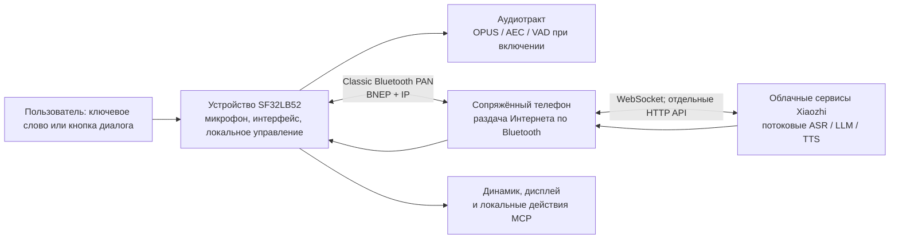

# Голосовой помощник Xiaozhi на SF32 { #sf32-xiaozhi-voice-assistant }

## Что такое Xiaozhi? { #what-is-xiaozhi }

[Xiaozhi](https://github.com/78/xiaozhi-esp32) — это чат-бот с голосовым управлением на основе MCP с открытым исходным кодом, получивший широкую известность благодаря реализации для ESP32 в 2025 году. Он объединяет устройство голосового взаимодействия с облачными сервисами больших языковых моделей и расширениями MCP на устройстве или в облаке. Поэтому проект служит практической отправной точкой для создания аппаратуры разговорного ИИ, а не только текстового чат-приложения.

## Почему реализация на SF32? { #why-the-sf32-implementation }
[78/xiaozhi-sf32](https://github.com/78/xiaozhi-sf32) — реализация для SF32 с намеренно изменённой схемой подключения. В исходном проекте для ESP32 поддерживаются Wi-Fi и другие варианты прямого доступа к сети, а версия для SF32 использует классический [Bluetooth PAN](../learn/bluetooth/pan.md), чтобы выходить в Интернет через сопряжённый телефон. Таким образом, подключение к внешней сети обеспечивает телефон, что в конструкции с привязкой к телефону может заметно снизить энергопотребление сетевых функций самого устройства. Фактическая экономия зависит от телефона, радиосреды, доли времени, приходящейся на диалоги, а также политики управления питанием. Такой подход особенно подходит для персональных портативных устройств с питанием от аккумулятора: кулонов, значков, компактных ассистентов и небольших носимых устройств.

Это особенно полезный пример продукта, поскольку он объединяет задачи, которые часто рассматривают по отдельности: дисплей и аудиотракт, сетевое подключение через телефон, облачный голосовой сервис, активацию устройства пользователем, органы управления устройством и обновление в полевых условиях.

## Результат, область применения и условия начала { #outcome-scope-and-entry-criteria }
На этой странице описан полный инженерный маршрут превращения этого примера в основу продукта. Здесь **не** утверждается, что Xiaozhi — это локальная LLM, работающая без сети, что все функции upstream-проекта готовы к производству или что поддерживаемая отладочная плата равнозначна сертифицированному готовому изделию. Устройство получает доступ в Интернет через Bluetooth PAN сопряжённого телефона и использует для диалога облачные сервисы Xiaozhi. До принятия решения о продукте проверьте условия сервиса, владельца учётной записи, требования к конфиденциальности и безопасности, стоимость, доступность и пригодность для целевых регионов.

**Результат:** воспроизводимо работающий голосовой ассистент с дисплеем, который настраивается через телефон, ведёт диалог с использованием облака, управляет одной безопасной функцией устройства, восстанавливается после потери PAN-соединения и позволяет собрать данные для решения о разработке собственной аппаратуры.

**Для кого:** инженеры по прошивке, аппаратуре и продукту, которые уже умеют собирать и прошивать базовую конфигурацию SF32 и готовы работать с C/C++, схемами платы, настройкой Bluetooth и интеграцией облачных сервисов.

<div align="center"><em>Таблица: исходные условия проекта</em></div>

<div align="center" markdown>

| Область | Базовая конфигурация проекта | Что подтвердить перед следующим этапом |
|:-----|:-----------------|:-------------------------------|
| Аппаратура | Один документированный целевой вариант Xiaozhi на SF32LB52, его аудио- и дисплейный тракты, загрузка через USB и источник питания. | Холодный запуск, кнопки, дисплей, микрофон, динамик, индикация зарядки/аккумулятора, если предусмотрена. |
| Подключение | Телефон, который сопрягается как `sifli-pan` и предоставляет Интернет через Bluetooth PAN. | Интерфейс платы подтверждает работу PAN; потеря связи и повторное подключение воспроизводимы. |
| Сервис | Учётная запись Xiaozhi, активация устройства и настроенный агент в консоли Xiaozhi. | Запрос диалога поступает в сервис, а ответ возвращается на плату. |
| Прошивка | Зафиксированы upstream-коммит, ревизия подмодуля SDK, целевая плата и способ сборки/загрузки. | Чистая воспроизводимая сборка, прошивка, последовательный журнал и файл прошивки. |
| Адаптация продукта | Одно намеренно ограниченное изменение: например, оформление интерфейса, имя устройства, кривая аккумулятора или безопасный выход под управлением MCP. | После изменения исходный голосовой цикл по-прежнему проходит проверку. |

</div>

## Аппаратные и программные спецификации { #hardware-and-software-specifications }
В перечне ниже задана конкретная конфигурация для сборки из исходного кода: **SF32LB52-DevKit-Nano-R16N16 V1.0.0** с внешним дисплеем и аудиосхемой, описанными SiFli. Это не универсальный перечень компонентов (BOM) для всех поддерживаемых плат Xiaozhi. Если выбрана DevKit-ULP, DevKit-LCD или Xiaotangyuan, замените весь перечень на документированную конфигурацию этой платы и зафиксируйте точные компоненты поставщика и ревизию платы.

### Аппаратная спецификация { #hardware-specification }
<div align="center"><em>Таблица: аппаратная спецификация эталонной сборки Xiaozhi Nano</em></div>

<div align="center" markdown>

| Компонент | Требуемые характеристики | Назначение | Статус | Где получить | Совместимость и замена |
|:----------|:-----------------------|:-----|:-------|:----------------|:-------------------------------------|
| SF32LB52-DevKit-Nano-R16N16 V1.0.0 | SF32LB52JUD6, 16 МБ OPI PSRAM и 16 МБ SPI NOR Flash | Вычисления SF32, Bluetooth PAN, загрузка/отладка через USB, интерфейс и аудиоинтерфейсы | Обязательно | [Страница продукта SiFli](https://www.sifli.com/zh-hans/SF32LB52_DevKit_Nano); [официальный магазин SiFli](https://sifli.taobao.com/) | Не заменяйте плату вариантом Nano N4, не проверив цель сборки прошивки и бюджет памяти. Запишите ревизию PCB и ссылку на заказ у поставщика. |
| AMOLED-дисплей 1,85 дюйма, 390 × 450, и адаптер FPC с 16 на 22 контакта | QSPI-дисплей и разводка FPC из официальной схемы подключения Xiaozhi Nano | Пользовательский интерфейс | Обязательно | [Официальная страница аппаратуры Xiaozhi Nano](https://docs.sifli.com/projects/xiaozhi/get-started/SF32LB52-DevKit-Nano/) | На официальной странице нет ссылки для заказа. До признания конфигурации воспроизводимой зафиксируйте контроллер панели, ориентацию FPC, номер детали поставщика и ссылку на покупку. |
| Аналоговый MEMS-микрофонный модуль | Аналоговый выход, совместимый с `MIC_BIAS`, `MIC_ADC` и GND | Захват голоса | Обязательно | [Ссылка на компонент из официального руководства](https://item.taobao.com/item.htm?id=595237371680) | Для замены проверьте смещение, уровень выходного сигнала, шум и акустические характеристики. |
| Усилительный модуль PAM8302 | Дифференциальный вход от `DACP`/`DACN`; выключение управляется `PA30` | Управление динамиком | Обязательно | [Ссылка на компонент из официального руководства](https://item.taobao.com/item.htm?id=535743493142) | Считайте другой усилитель изменением аппаратуры и повторно проверьте полярность включения, усиление, ток покоя и шум. |
| Динамик в корпусе | 8 Ом, 2–3 Вт | Воспроизведение голоса | Обязательно | [Ссылка на компонент из официального руководства](https://item.taobao.com/item.htm?id=895176389650) | При замене корпуса или импеданса повторно проверьте акустическую отдачу, температуру усилителя и ток. |
| Перемычки и макетная плата на 400 точек | Набор проводов и макетная плата, соответствующие описанному прототипу Nano | Соединения прототипа | Обязательно для описанного прототипа | [Перемычки](https://item.taobao.com/item.htm?id=39961676503); [макетная плата на 400 точек](https://item.taobao.com/item.htm?id=39828824454) | Переходите на проверенную PCB только после успешной проверки исходных соединений и точного переноса распиновки. |
| Кабель USB Type-C с передачей данных и компьютер разработчика | Кабель Type-C с передачей данных; компьютер под Windows, Linux или macOS | Питание, прошивка, сборка и сбор последовательных журналов | Обязательно | [Требования к подготовке SiFli SDK](https://docs.sifli.com/projects/sdk/latest/en/sf32lb52x/quickstart/get-started.html) | Кабель только для зарядки не подходит для прошивки и сбора журналов. Запишите ОС и архитектуру компьютера. |
| Телефон Android или iOS с раздачей Интернета по Bluetooth | Должен сопрягаться как `sifli-pan` и предоставлять доступ к Интернету через Classic Bluetooth PAN | Сетевое устройство-компаньон | Обязательно | [Официальная настройка PAN для Xiaozhi](https://docs.sifli.com/projects/xiaozhi/get-started/) | Запишите модель телефона и версию ОС. Проверьте потерю соединения, повторное сопряжение и раздачу на каждой поддерживаемой комбинации телефона/ОС. |

</div>

Приведённые выше ссылки на сторонние компоненты ведут на торговые площадки и опубликованы в официальном руководстве SiFli Nano; это не гарантированные постоянные номера деталей производителя. Сохраните снимки экрана или записи заказов для проверенных компонентов, а до проектирования изделия замените каждую такую зависимость на квалифицированный номер детали поставщика и паспорт компонента.

### Программная спецификация { #software-specification }
<div align="center"><em>Таблица: программная спецификация эталонной сборки Xiaozhi</em></div>

<div align="center" markdown>

| Пакет или сервис | Требуемая версия или ревизия | Назначение | Статус | Где получить | Совместимость и обновления |
|:-------------------|:-----------------------------|:-----|:-------|:----------------|:-------------------------------|
| Предварительно собранная прошивка Xiaozhi для SF32 | v1.4.0 | Неизменённый образ для исходной проверки и восстановления | Обязательна на этапах 1–2 | [Релиз v1.4.0](https://github.com/78/xiaozhi-sf32/releases/tag/v1.4.0) | Для Nano R16N16 выберите `sf32lb52-nano_52j.zip`. Не смешивайте архивы для разных плат. |
| Исходный код `78/xiaozhi-sf32` | Коммит [`1d3ef641ace47fae68227e9173647fd5db01f6f5`](https://github.com/78/xiaozhi-sf32/commit/1d3ef641ace47fae68227e9173647fd5db01f6f5) | Исходный код приложения и конфигурация платы | Обязателен на этапах 3–4 | [Репозиторий](https://github.com/78/xiaozhi-sf32) | В статье рассмотрен этот снимок исходников. Более поздний коммит фиксируйте как новую базовую версию и повторяйте все проверки. |
| Подмодуль SiFli-SDK | Коммит [`0d2de1480f735e05017c41436e655a1688063881`](https://github.com/OpenSiFli/SiFli-SDK/tree/0d2de1480f735e05017c41436e655a1688063881) | Драйверы SF32, RTOS, middleware, скрипты инструментов и среда сборки SCons | Обязателен на этапах 3–4 | [OpenSiFli/SiFli-SDK](https://github.com/OpenSiFli/SiFli-SDK) через подмодуль `sdk` репозитория | Используйте ревизию подмодуля, зафиксированную выбранным коммитом приложения; не обновляйте SDK отдельно в сохранённой базовой конфигурации. |
| Графическая утилита sftool | v1.2.1; сохраните SHA-256 файла для нужной ОС со страницы релиза | Запись предварительно собранного образа и локальное восстановление | Обязательна для описанного графического сценария v1.4.0 | [Релиз v1.2.1 и файлы для платформ](https://github.com/OpenSiFli/sftool-gui/releases/tag/v1.2.1) | Запишите ОС компьютера, имя файла и контрольную сумму. Перед заменой квалифицируйте более позднюю версию. |
| Инструменты на компьютере сборки | Скрипты установки/экспорта из зафиксированного SiFli-SDK; среда SCons, созданная этими скриптами | Настройка и компиляция исходного кода | Обязательны на этапах 3–4 | [Официальное руководство по сборке Xiaozhi](https://docs.sifli.com/projects/xiaozhi/source-build/) | Запишите ОС и архитектуру, результаты скриптов и экспортированную среду. Глобально установленная утилита не должна незаметно подменять среду зафиксированного SDK. |
| Облачная консоль и сервис Xiaozhi | Сервис размещён на `xiaozhi.me`; запишите дату проверки, владельца учётной записи, настройки агента и endpoint | Активация, потоковые ASR/LLM/TTS и MCP в облаке | Требуется для диалога | [Консоль Xiaozhi](https://xiaozhi.me) | Для размещённого сервиса пользователь не может зафиксировать версию. Считайте его работу, условия, доступность и региональный доступ внешними зависимостями. |

</div>

## Выбор поддерживаемой базовой конфигурации { #choose-a-supported-baseline }
В документации SiFli по быстрому запуску Xiaozhi перечислены четыре платы с готовой прошивкой: SF32LB52-DevKit-ULP (Huangshan), SF32LB52-DevKit-LCD, SF32LB52-DevKit-Nano и плата расширения Xiaotangyuan. В руководстве по сборке из исходников сейчас указаны DevKit-ULP, DevKit-LCD и DevKit-Nano. Если проекту нужна адаптация исходного кода, выбирайте плату из списка для сборки из исходников: наличие готового образа само по себе не означает, что для платы документирована сборка из исходников.

<div align="center"><em>Таблица: выбор платы</em></div>

<div align="center" markdown>

| Плата | Когда выбрать | Что проверить перед разработкой изделия |
|:------|:------------|:----------------------|
| [SF32LB52-DevKit-ULP](https://docs.sifli.com/projects/xiaozhi/get-started/SF32LB52-DevKit-ULP/) | Нужен документированный пример сборки ULP из исходников и сценарий оценки с питанием от аккумулятора. | Для аккумулятора, отличного от указанного в базовой конфигурации, заново откалибруйте кривую аккумулятора. |
| [SF32LB52-DevKit-LCD](https://docs.sifli.com/projects/xiaozhi/get-started/SF32LB52-DevKit-LCD/) | Нужен явный пример подключения дисплея и динамика. | Указания для AMOLED 390 × 450, ориентации FPC, разъёма `SPK` и кнопок `KEY1`/`KEY2` относятся именно к этой плате. |
| [SF32LB52-DevKit-Nano](https://docs.sifli.com/projects/xiaozhi/get-started/SF32LB52-DevKit-Nano/) | Нужна компактная документированная базовая конфигурация SF32LB52. | Перед переносом разводки с другой платы уточните точную конфигурацию дисплея, аудио, питания и пользовательских органов управления. |
| [Плата расширения Xiaotangyuan](https://docs.sifli.com/projects/xiaozhi/get-started/SF32LB52-XTY-AI-THT/) | Вы используете соответствующий сценарий быстрого запуска с готовой прошивкой. | Перед выбором платы в качестве продуктовой базы уточните актуальный статус сборки из исходников и возможностей адаптации. |

</div>

## Этапы проекта { #delivery-map }
Рассматривайте этапы как контрольные точки принятия решений, а не как список функций. По итогам каждого этапа должен оставаться артефакт, позволяющий обоснованно и повторяемо принять следующее решение.

<div align="center"><em>Таблица: этапы и результаты проекта</em></div>

<div align="center" markdown>

| Этап | Какое решение помогает принять | Что должно быть подготовлено |
|:------|:---------------------|:----------------|
| 1. Эталонная конфигурация | Работают ли вместе описанные плата, телефон, учётная запись и сервис без изменений? | Запись успешного контрольного диалога. |
| 2. Проверка восстановления | Сохраняет ли базовая конфигурация работоспособность при типичных пользовательских сбоях? | Протокол успешно пройденных тестов отказов и восстановления. |
| 3. Сборка из исходников | Может ли команда самостоятельно воспроизвести прошивку, не полагаясь на готовый образ? | Артефакт сборки с зафиксированными версиями и журналы. |
| 4. Контролируемая адаптация | Можно ли внести одно изменение, не нарушив эталонное поведение? | Проверенное изменение и результаты регрессионных тестов. |
| 5. Решение о продукте | Достаточно ли изучены риски аппаратуры, сервиса, безопасности и восстановления для дальнейших инвестиций? | Согласованный отчёт о готовности к продукту и передача требований на разработку аппаратуры. |

</div>

## Архитектура системы и зависимости { #system-architecture-and-dependencies }
<div align="center"><em>Рисунок: продуктовый поток Xiaozhi на SF32</em></div>



В официальном руководстве по архитектуре сетевым каналом указан Bluetooth PAN поверх Classic Bluetooth; на устройстве используется облегчённый IP-стек. Основным каналом обмена данными в реальном времени служит WebSocket, а HTTP используется для отдельных вызовов API. В обзоре SiFli среди реализованных функций перечислены пробуждение по ключевому слову (KWS), непрерывный диалог, AEC/VAD, динамические выражения, векторные шрифты и локальный MCP. В других официальных материалах также описаны экранный интерфейс, управление питанием и аккумулятором, облачные расширения MCP и OTA через PAN; конкретную поддержку следует проверять для выбранной платы и версии прошивки.

В этой схеме есть четыре области отказа, которые нужно диагностировать независимо: локальная аппаратура и аудиотракт; сопряжение Bluetooth и соединение PAN; доступ к Интернету и облачному сервису; конфигурация приложения и сервиса. Успешное сопряжение по BLE само по себе не подтверждает, что плата получила доступ в Интернет или что голосовой сервис активирован.

## Этап 1 — Зафиксируйте исходную эталонную конфигурацию { #stage-1-establish-the-untouched-reference-baseline }

1. Соберите аппаратную конфигурацию по официальной инструкции для выбранной платы. Для DevKit-LCD это включает описанное подключение AMOLED-дисплея и FPC, динамика к `SPK`, использование `KEY1` для пробуждения/диалога и длительное нажатие `KEY2` для выключения.
2. Загрузите поддерживаемую готовую прошивку по официальной инструкции Xiaozhi. В руководстве быстрого запуска рекомендуется графическая утилита; на момент публикации инструкции для версии прошивки 1.4.0 и новее загрузка из терминала не поддерживалась.
3. На телефоне **до сопряжения включите раздачу Интернета по Bluetooth**. Выполните сопряжение с устройством `sifli-pan`, затем проверьте по интерфейсу платы и статусу телефона, что установлено именно PAN-соединение, а не только сопряжение Bluetooth. В официальном руководстве отмечено: если на iOS устройство `sifli-pan` не отображается, может потребоваться перезапуск телефона.
4. Выполните официальную процедуру активации в консоли Xiaozhi на [xiaozhi.me](https://xiaozhi.me): создайте или настройте агента и добавьте код устройства, отображаемый платой.
5. Проведите диалог с помощью кнопки платы или настроенного механизма пробуждения. Запишите в карточку проекта версию прошивки, модель платы, модель и ОС телефона, идентификаторы учётной записи и агента.

**Критерий завершения этапа 1:** после холодного запуска устройство устанавливает PAN-соединение, отображает статус активации, принимает запрос на диалог, воспроизводит ответ и показывает ожидаемое состояние интерфейса.

## Этап 2 — Проверьте восстановление и критичные для продукта функции { #stage-2-prove-recovery-and-product-critical-behavior }

Проведите эти тесты до любых изменений исходного кода. Они превращают демонстрацию в надёжную базовую конфигурацию:

<div align="center"><em>Таблица: проверка базовой конфигурации</em></div>

<div align="center" markdown>

| Проверка | Метод | Критерий успешного прохождения |
|:-----|:-------|:--------------|
| PAN отсутствует | Выполните сопряжение, не включая раздачу Интернета по Bluetooth. | Интерфейс или журнал явно указывает на отсутствие PAN; после включения раздачи и повторного подключения сервис восстанавливается. |
| Потеря PAN | Отключите раздачу, разорвите Bluetooth-соединение или выйдите из зоны действия во время ожидания и диалога. | Устройство обнаруживает сбой, возвращается в состояние, из которого можно восстановиться, и подключается повторно по документированной процедуре пробуждения/переподключения. |
| Сон и пробуждение | Оставьте устройство бездействовать до перехода в сон, затем используйте предусмотренный орган пробуждения. | Пробуждение, повторное подключение и следующий диалог повторяются без перепрошивки. |
| Аудио и интерфейс | Проведите несколько диалогов при реалистичной громкости. | Речь с микрофона разборчива, воспроизведение чистое, интерфейс не зависает, сбросов нет. |
| Индикация аккумулятора | Зарядите и разрядите аккумулятор до нескольких характерных уровней. | Индикация правдоподобна; для аккумулятора, отличного от базового, требуется калибровка кривой. |
| Граница сервиса | Проверьте учётную запись/агента с заведомо отсутствующей необходимой настройкой. | Сбой сервиса можно отличить от проблем PAN и аппаратуры. |

</div>

В официальном руководстве предупреждают, что заданная для конкретной платы кривая в `battery_table.c` может быть неточной для другого аккумулятора. Для аккумулятора изделия запросите у поставщика данные о заряде и разряде или измерьте их самостоятельно, обновите `charging_curve_table` и `discharge_curve_table`, пересоберите прошивку и повторите аккумуляторные тесты.

**Критерий завершения этапа 2:** для каждой проверки записан результат, сбои отнесены к соответствующей области отказа, а каждый описанный сценарий восстановления работает без перепрошивки и ручного исправления состояния.

## Этап 3 — Подготовьте воспроизводимую исходную конфигурацию { #stage-3-build-a-reproducible-source-baseline }

В репозитории SiFli-SDK подключён как подмодуль. Клонируйте репозиторий рекурсивно и зафиксируйте коммит Xiaozhi и коммит подмодуля SDK:

```bash
git clone --recursive https://github.com/78/xiaozhi-sf32.git
cd xiaozhi-sf32
git checkout 1d3ef641ace47fae68227e9173647fd5db01f6f5
git submodule update --init --recursive
cd sdk
# Windows: .\install.ps1, then .\export.ps1
# macOS/Linux: ./install.sh, then . ./export.sh
```

Для официального примера сборки DevKit-ULP с помощью скриптов перейдите в `app/project` и используйте документированный путь к внешним описаниям плат:

```bash
scons --board=sf32lb52-lchspi-ulp --board_search_path="../boards" -j8
```

Точную цель сборки и скрипт загрузки ищите на официальной странице выбранной платы. Не переносите имя платы ULP или путь к собранному файлу на другую плату. В протоколе воспроизводимой сборки укажите ОС хост-компьютера, результат установки инструментов, экспортированную среду, аргумент платы, ревизии upstream-проекта и SDK, журнал сборки, загруженный образ и последовательный журнал.

**Критерий завершения этапа 3:** чистая копия репозитория на втором компьютере (или после удаления каталога сборки) создаёт образ, проходящий все проверки этапа 2.

## Этап 4 — Вносите изменения целенаправленно { #stage-4-adapt-deliberately }

Вносите по одному изменению, сохраняя прошивку проверенной базовой конфигурации. В официальных материалах по адаптации описаны имя Bluetooth-устройства, статическая и анимированная графика, шрифты, DFU через PAN и MCP.

<div align="center"><em>Таблица: безопасная последовательность адаптации</em></div>

<div align="center" markdown>

| Класс изменений | С чего начать | Обязательные регрессионные проверки |
|:-------------|:-----------|:--------------------|
| Айдентика продукта | Имя Bluetooth-устройства, статичное изображение, шрифт или анимация. | Прошивка, активация, PAN, интерфейс и диалог. |
| Аккумулятор и аппаратная часть | Кривая аккумулятора, параметры дисплея, аудиотракт, поведение кнопок. | Питание, пробуждение, аудио/интерфейс и повторные диалоги. |
| Локальное управление устройством | Узко ограниченный инструмент MCP с допустимыми диапазонами параметров и безопасной функцией обратного вызова. | Авторизация команды, недопустимые входные данные, обрыв связи во время действия, аппаратный переход в безопасное состояние и журнал аудита. |
| Облачное расширение | Внешний сервис MCP. | Аутентификация конечной точки, хранение секретов, доступность и восстановление после перезапуска, минимально необходимые привилегии и явное согласие пользователя. |
| Обновление в эксплуатации | DFU_PAN и OTA-сервер. | Определение версии, корректность CRC и разделов, прерывание обновления, откат/восстановление и происхождение образа. |

</div>

В примере локального MCP в официальном руководстве используется `McpServer::AddCommonTools()` из `app/src/mcp/mcp_server.cc`. Запрос действия от LLM следует считать недоверенным: проверяйте допустимый диапазон и состояние в функции обратного вызова, задавайте безопасные значения выходов по умолчанию и не предоставляйте необратимые, опасные или критичные для безопасности функции без предусмотренной для изделия авторизации.

В документации по OTA через PAN описаны три независимо загружаемых типа образов: код, графические ресурсы и шрифты. Адрес и размер образа следует брать из таблицы разделов. Перед включением OTA для пользователей необходимо определить правила версионирования, ограничить доступ к серверу, проверять целостность образа, протестировать прерывание обновления и предусмотреть восстановление через кабель или локальный интерфейс.

**Критерий завершения этапа 4:** зафиксированы выбранное изменение, способ отката или восстановления и результаты всех применимых регрессионных тестов; исходный цикл диалога и ограничения безопасности для действий устройства по-прежнему соблюдаются.

## Этап 5 — Оцените готовность к продукту { #stage-5-product-readiness-review }

Не переходите к разработке собственной аппаратуры, пока команда не сможет ответить на следующие вопросы:

- Какие версии телефона и ОС поддерживают выбранную процедуру подключения PAN и что делать, если они её не поддерживают?
- Какие облачная конечная точка, учётная запись, агент, конечная точка MCP и учётные данные используются? Кто ими владеет и отвечает за их ротацию?
- Какие аудиоданные, данные устройства и пользовательские данные передаются за его пределы? Как запрашивается согласие и какие действуют требования к хранению и регионам обработки?
- Каковы измеренные токи во время активного диалога, ожидания с подключением, сна, зарядки и пробуждения при использовании целевого аккумулятора и корпуса?
- Как устройство восстановится после сбоя обновления, потери телефона, недоступности облака, повреждения ресурса или неверной конфигурации?
- Какие части upstream-кода, сервиса, поведения модели и OTA-инфраструктуры контролирует команда продукта, а какие зависят от внешних поставщиков?

**Критерий завершения этапа 5:** ответы, ответственные лица и остаточные риски зафиксированы и приняты командой продукта; для каждого нерешённого вопроса определены мера снижения риска, явный перенос на более поздний этап или решение остановиться.

## Передача материалов для проектирования изделия { #handoff-to-product-design }
Передайте выбранный компонент SF32, архитектуру питания, решения для дисплея и аудио, стратегию RF, план хранения данных и разделов, производственные тесты и допущения по восстановлению в раздел [«Разработка для серийного производства»](../hardware/design-for-production.md). Используйте [путь интеграции SF32LB52](../sf32-products/chips/SF32LB52x.md#integration-path), чтобы выбрать подходящие микросхему, модуль, плату, руководство и контрольный список.

**Критерий завершения проекта:** этот материал выполнил свою задачу, если новый участник команды может воспроизвести выбранную базовую конфигурацию, связать каждый наблюдаемый сбой с ответственным или способом восстановления, пересобрать адаптированный образ и проверить доказательства, необходимые для решения о собственной аппаратуре. После этого материал служит руководством по разработке продукта, а не демонстрационным примером, который без проверки переносят в производство.

## Основные источники { #authoritative-sources }
- [Репозиторий 78/xiaozhi-esp32](https://github.com/78/xiaozhi-esp32)
- [Репозиторий 78/xiaozhi-sf32](https://github.com/78/xiaozhi-sf32)
- [SiFli Wiki: описание AI Xiaozhi (на китайском)](https://github.com/OpenSiFli/SiFli-Wiki/blob/main/source/zh_CN/application/xiaozhi.md)
- [Быстрый запуск Xiaozhi от SiFli](https://docs.sifli.com/projects/xiaozhi/get-started/)
- [Сборка Xiaozhi из исходников от SiFli](https://docs.sifli.com/projects/xiaozhi/source-build/)
- [Архитектура Xiaozhi от SiFli](https://docs.sifli.com/projects/xiaozhi/architecture/)
- [Адаптация Xiaozhi от SiFli](https://docs.sifli.com/projects/xiaozhi/custom/)
- [Руководство SiFli по DFU_PAN для Xiaozhi](https://docs.sifli.com/projects/xiaozhi/custom/dfu_pan.html)
- [Руководство SiFli по MCP для Xiaozhi](https://docs.sifli.com/projects/xiaozhi/custom/mcp.html)
