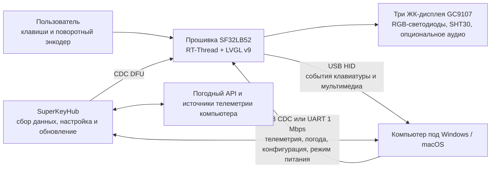

# Многофункциональная макроклавиатура SuperKey { #superkey-multifunction-macro-keyboard }

## Что такое SuperKey? { #what-is-superkey }

[SiFliSparks/SuperKey](https://github.com/SiFliSparks/SuperKey) — это эталонная разработка многофункциональной макроклавиатуры с дисплеями на базе SF32LB52. Прошивка с открытым исходным кодом работает под RT-Thread и LVGL v9, управляет тремя ЖК-дисплеями GC9107 с разрешением 128 × 128, тремя RGB-светодиодами, четырьмя физическими клавишами, поворотным энкодером и датчиком температуры и влажности SHT30. С компьютером устройство соединяется как составное USB-устройство HID/CDC.

SuperKey — это не просто клавиатура для горячих клавиш. В этом работающем примере объединены следующие функции устройства:

- передача событий клавиатуры и управления мультимедиа через USB HID;
- получение данных о производительности компьютера, погоде, конфигурации и состоянии питания через USB CDC или UART со скоростью 1 Mbps;
- страницы для мониторинга производительности, погоды, часов, утилит, музыки и пользовательских назначений клавиш на трёх дисплеях;
- приложение-компаньон [SuperKeyHub](https://github.com/SiFliSparks/SuperKeyHub), которое собирает данные с компьютера, настраивает функции и запускает обновление прошивки;
- воспроизводимая аппаратная часть на основе открытого проекта [sf32-keyboard](https://oshwhub.com/sifli/sf32-keyboard).


<div align="center"><em>Интерфейс SuperKey на трёх дисплеях</em></div>

## Зачем нужна реализация на SF32? { #why-the-sf32-implementation }

Для работы SuperKey нужны средства обработки графики, несколько дисплеев, составное USB-устройство, клавиши и энкодер, датчики, RGB-эффекты, файловая система и, при необходимости, аудио. SF32LB52 выполняет эти задачи в реальном времени на MCU, поэтому устройство может запустить интерфейс и обеспечить базовую работу HID, даже если приложение-компаньон не запущено. Приложение на компьютере отвечает за телеметрию ПК и данные из Интернета — задачи, которые удобнее выполнять средствами настольной ОС.

Такое разделение подходит для настольных контроллеров, клавиатур для рабочих процессов, панелей состояния и компактных HMI, но создаёт явные зависимости. Для расширенного отображения данных нужны приложение-компаньон, драйверы и внешние API; версии прошивки и приложения должны быть совместимы; отдельно необходимо проверять восстановление после потери USB-соединения, перехода компьютера в спящий режим и повреждения конфигурации.

## Результат, область применения и условия начала { #outcome-scope-and-entry-criteria }

**Результат:** воспроизвести SuperKey с зафиксированными версиями компонентов, проверить HID, CDC, интерфейс на трёх дисплеях, ввод, датчики и восстановление после сна, а затем менять только одну категорию поведения за раз. Для продуктовой оценки нужно сохранить подтверждения сборки, обмена данными и регрессионных проверок.

Эта статья не является подтверждением готовности открытой печатной платы к серийному производству и не гарантирует совместимость со всеми источниками телеметрии ПК, погодными сервисами, последовательными мостами, USB-хостами и версиями ОС. Котировки акций, погодные данные и данные о производительности могут зависеть от версии SuperKeyHub, сторонних API, системных разрешений и аппаратного обеспечения компьютера.

Перед началом подготовьте:

- собранное по открытому проекту устройство SuperKey: три ЖК-дисплея GC9107, клавиши, энкодер и USB-подключение для передачи данных;
- компьютер с Windows 10/11 для основного документированного сценария. В репозитории SuperKeyHub заявлена поддержка Windows и macOS, однако прошивку платы, обмен данными CDC и восстановление необходимо проверить на выбранной ОС;
- версию SuperKeyHub, совместимую с прошивкой;
- среду SiFli-SDK, подмодуль SDK, полученный рекурсивным клонированием, и работающее подключение для прошивки и восстановления;
- действительные API Key, API Host и настройки города для QWeather, если проверяется погода;
- журнал испытаний: перечисление USB, журналы последовательного порта, реакция клавиш, состояние дисплеев и восстановление после сна.

<div align="center"><em>Таблица: область проекта SuperKey и необходимые подтверждения</em></div>

<div align="center" markdown>

| Область | Известная базовая конфигурация | Что необходимо подтвердить до адаптации |
|:--------|:------------------------------|:---------------------------------------|
| Аппаратная часть | Открытая аппаратная разработка `sf32-keyboard` и цель платы `sf32lb52-superkey` | Ревизия платы и сборки, дисплеи и устройства ввода, питание и подключение USB |
| Прошивка | Репозиторий SuperKey, подмодуль SiFli-SDK, RT-Thread, LVGL v9 и CherryUSB | Коммиты прошивки и SDK, журнал сборки, образ и журнал прошивки устройства |
| Приложение-компаньон | SuperKeyHub с совместимым протоколом прошивки | Версия приложения, ОС, порт, настройки API и журнал соединения |
| Основные функции | HID, CDC, три дисплея, энкодер, клавиши, датчик и режимы питания | Записи о холодном запуске, обновлении данных, вводе, отключении и восстановлении после сна |
| Адаптация | За один раз меняется только один элемент интерфейса, клавиша, LED или поле данных | Проверенное изменение, образ для отката и полный результат регрессионных испытаний |

</div>

## Аппаратные и программные спецификации { #hardware-and-software-specifications }

### Аппаратная спецификация { #hardware-specification }

<div align="center"><em>Таблица: аппаратная спецификация SuperKey</em></div>

<div align="center" markdown>

| Компонент | Требуемые характеристики | Назначение | Статус | Где получить | Совместимость и замена |
|:----------|:-------------------------|:-----------|:-------|:-------------|:-----------------------|
| Комплект открытого оборудования SuperKey | Конфигурация SF32LB52, описанная в проекте: три LCD GC9107 с разрешением 128 × 128, три RGB-светодиода, четыре клавиши, поворотный энкодер, SHT30 и USB-подключение | Управление макроклавиатурой, отображение, ввод, датчики и USB HID/CDC | Обязательно | [Открытая схема `sf32-keyboard`](https://oshwhub.com/sifli/sf32-keyboard); [репозиторий SuperKey](https://github.com/SiFliSparks/SuperKey) | Файлы проекта не являются спецификацией готовой платы, доступной для покупки; зафиксируйте ревизии разводки и сборки |
| Хост-компьютер и USB-подключение для передачи данных | Основной документированный сценарий — Windows 10/11; USB-подключение с передачей данных | Запускает SuperKeyHub, предоставляет HID/CDC-хост и поддерживает прошивку и восстановление | Обязательно | [Документация SuperKey](https://sparks.sifli.com/projects/superkey/) | В репозитории SuperKeyHub заявлена поддержка Windows/macOS; проверьте CDC, DFU, прошивку и восстановление на выбранной ОС |
| Учётная запись/настройка API QWeather | API Key, API Host и настройка города | Необязательная функция отображения погоды | Необязательно | [QWeather](https://www.qweather.com/) | Не помещайте учётные данные в систему контроля версий; проверьте условия и доступность сервиса |

</div>

### Программная спецификация { #software-specification }

<div align="center"><em>Таблица: программная спецификация SuperKey</em></div>

<div align="center" markdown>

| Пакет или служба | Требуемая версия или ревизия | Назначение | Статус | Где получить | Совместимость и обновление |
|:-----------------|:----------------------------|:-----------|:-------|:-------------|:---------------------------|
| Прошивка SuperKey | Релиз v1.4.2; зафиксируйте точный используемый коммит репозитория | Прошивка SF32, интерфейс LVGL, USB, датчик и логика обновления | Обязательно | [Релиз v1.4.2](https://github.com/SiFliSparks/SuperKey/releases/tag/v1.4.2) | Зафиксируйте коммит прошивки; не определяйте совместимость с хостом только по номерам версий |
| SuperKeyHub | Версия или коммит, проверенные с прошивкой v1.4.2 | Телеметрия хоста, настройка и интерфейс обновления прошивки | Обязательно для функций хоста | [Репозиторий](https://github.com/SiFliSparks/SuperKeyHub) | Указанные материалы релиза не подтверждают фиксированную пару прошивки и приложения; проверьте телеметрию, настройку и DFU и запишите протестированную комбинацию |
| Подмодуль SiFli-SDK, RT-Thread, LVGL и CherryUSB | Ревизии, зафиксированные в выбранной версии исходного дерева прошивки | Сборка прошивки и USB-стек | Обязательно для сборки из исходного кода | [Репозиторий SuperKey](https://github.com/SiFliSparks/SuperKey) | Клонируйте рекурсивно и сохраните ревизии подмодулей; не обновляйте зависимости отдельно |

</div>

## Выбор поддерживаемой базовой конфигурации { #choose-a-supported-baseline }

В списке релизов исходного проекта указана прошивка [v1.4.2](https://github.com/SiFliSparks/SuperKey/releases/tag/v1.4.2), которую можно взять за фиксированную отправную точку. В цитируемых материалах не указана конкретная совместимая версия SuperKeyHub. Выберите и зафиксируйте релиз или коммит Hub, проверьте телеметрию, настройку и DFU с v1.4.2 и запишите протестированную пару, а не делайте вывод о совместимости только по номерам версий.

<div align="center"><em>Таблица: выбор базовой конфигурации SuperKey</em></div>

<div align="center" markdown>

| Элемент базовой конфигурации | Рекомендуемая отправная точка | Важное ограничение |
|:-----------------------------|:-----------------------------|:-------------------|
| Прошивка | SuperKey v1.4.2 или коммит, проверенный командой | Версии прошивки и протокола приложения должны совпадать |
| Приложение-компаньон | Релиз или коммит SuperKeyHub, проверенный с прошивкой v1.4.2 | В цитируемых материалах не указана фиксированная пара; проверьте данные CDC, настройку и DFU на выбранной ОС |
| Цель сборки для платы | `sf32lb52-superkey`; файлы платы находятся в `app/boards` | Это не универсальная цель для отладочных плат SF32LB52 |
| Связь | Сначала проверьте составное USB HID + CDC; при использовании UART 1 Mbps проверяйте его отдельно | Факт перечисления USB не доказывает работоспособность обоих интерфейсов HID и CDC |
| Обновление | Запускаемое приложением-компаньоном обновление CDC DFU при сохранении проводного пути прошивки и восстановления | Это нельзя считать решением для обновления устройств в эксплуатации, пока не проверены прерывание, несовпадение версий и восстановление |

</div>

В CI репозитория SuperKey используется следующая цель. Перед локальным запуском установите SiFli-SDK и настройте его окружение:

```bash
git clone --recursive https://github.com/SiFliSparks/SuperKey.git
cd SuperKey/SiFli-SDK
./install.sh
. ./export.sh
cd ../app/project
scons --board=sf32lb52-superkey --board_search_path="../boards" -j8
```

В Windows используйте соответствующие сценарии установки и настройки окружения SiFli-SDK для PowerShell. Степень параллелизма можно менять, но имя платы, путь поиска файлов платы и ревизии подмодулей необходимо записывать вместе с результатом сборки.

## Этапы проекта { #delivery-map }

<div align="center"><em>Таблица: этапы разработки SuperKey</em></div>

<div align="center" markdown>

| Этап | Какое решение помогает принять | Необходимый результат |
|:-----|:-------------------------------|:---------------------|
| 1. Базовая конфигурация без изменений | Работают ли открытая аппаратная часть, прошивка и приложение-компаньон совместно, как описано? | Запись проверенного сеанса с зафиксированными версиями |
| 2. Связь и восстановление | Можно ли диагностировать и устранить сбои USB, последовательного канала, сна, отключения и конфигурации? | Запись о внесении отказов и восстановлении |
| 3. Воспроизводимая сборка из исходного кода | Может ли команда собрать тот же образ из чистой копии репозитория? | Среда сборки, образ, запись прошивки и результат повторного воспроизведения |
| 4. Контролируемая адаптация | Можно ли изменить одно поведение устройства, не нарушив базовую конфигурацию? | Ограниченное изменение, путь отката и результаты регрессионных испытаний |
| 5. Оценка готовности изделия | Достаточно ли надёжна эта основа для собственной платы, корпуса или пилотной партии? | Реестр рисков с назначенными ответственными и решение продолжать, отложить или остановить работу |

</div>

## Архитектура системы и зависимости { #system-architecture-and-dependencies }

<div align="center"><em>Рисунок: пути данных и управления в SuperKey</em></div>



Рассматривайте сбои в пяти областях: аппаратная часть и дисплеи устройства, ввод HID, канал данных CDC/UART, приложение-компаньон и системные разрешения, внешние службы данных. Пустой экран погоды не обязательно указывает на ошибку прошивки: причиной могут быть API Key, API Host, настройки города или отсутствие передачи данных.

## Этап 1 — Зафиксируйте исходную конфигурацию без изменений { #stage-1-establish-the-untouched-reference-baseline }

**Цель:** подтвердить работоспособность всей исходной схемы до изменения кода.

1. Согласно инструкциям проекта по сборке устройства проверьте ориентацию шлейфов LCD, переключатели, энкодер, корпус и разъём USB; запишите ревизии платы и прошивки.
2. Установите совместимую версию SuperKeyHub. Убедитесь, что устройство определяется, затем отдельно проверьте HID и CDC.
3. Настройте учётные данные погодного сервиса, порт и последовательный канал 1 Mbps. Запишите поведение устройства без приложения-компаньона, затем подключите приложение и включите передачу данных.
4. Проверьте переключение страниц на трёх дисплеях, назначения клавиш, управление мультимедиа, энкодер, данные SHT30, эффекты LED и полный цикл обновления телеметрии.
5. Выполните холодный запуск и повторите проверки. Сохраните снимки интерфейса, журналы приложения и устройства, а также результат запроса версии.

**Сохраняемые подтверждения:** ревизия аппаратной части, тег/коммит прошивки, коммит SDK, версия приложения-компаньона, ОС, настройки порта и API, перечисление USB, журналы, состояние дисплеев и записи о вводе.

**Критерий выхода из контрольной точки 1:** после двух холодных запусков работают ввод HID, обновление данных CDC и взаимодействие со всеми тремя дисплеями; каждый домен отказа можно различить по журналам или наблюдаемому состоянию.

## Этап 2 — Проверьте границы отказов и восстановления { #stage-2-validate-fault-and-recovery-boundaries }

**Цель:** убедиться, что типичные прерывания при работе с настольным компьютером не превращают устройство в демонстрационный образец, который можно восстановить только перепрошивкой.

<div align="center"><em>Таблица: испытания отказов и восстановления SuperKey</em></div>

<div align="center" markdown>

| Проверка | Метод | Критерий успешного прохождения |
|:---------|:------|:------------------------------|
| Приложение-компаньон не запущено | Закройте SuperKeyHub и перезапустите устройство | Локальный интерфейс и HID продолжают работать; зависимые от приложения значения явно помечены как устаревшие или недоступные |
| Потеря CDC | Во время передачи данных отключите и подключите USB повторно либо смените порт | Устройство не зависает; после восстановления соединения снова работают запрос версии и передача данных |
| Переход компьютера в сон | Включите `power_mode sleep/normal` и выполните один цикл сна и пробуждения компьютера | LCD, LED, подсветка и датчики останавливаются и возобновляют работу согласно ожиданиям; данные снова обновляются |
| Несовпадение версий | В контролируемой среде проверьте несовместимую пару приложения и прошивки | Работа в такой паре отклоняется или выводится диагностируемая ошибка; несовместимое обновление не применяется |
| Сбой API | Укажите неверные настройки погоды или отключите сеть | Сбой погоды не влияет на HID, CDC, локальный интерфейс и восстановление |
| Прерывание DFU | Прервите обновление на тестовом устройстве, которое можно восстановить | Предусмотренный проводной способ прошивки позволяет восстановить проверенный образ |

</div>

**Критерий выхода из контрольной точки 2:** для каждого применимого отказа воспроизводимо проверены обнаружение и восстановление; недокументированное ручное исправление состояния не требуется.

## Этап 3 — Создайте воспроизводимую исходную конфигурацию { #stage-3-build-a-reproducible-source-baseline }

**Цель:** дать второму инженеру возможность собрать образ из чистой копии репозитория, прошить устройство и повторить испытания этапа 2.

1. Выполните рекурсивное клонирование и запишите коммиты SuperKey и SiFli-SDK.
2. Выполните чистую сборку для платы `sf32lb52-superkey`, указав путь поиска `../boards`.
3. Сохраните журнал сборки, данные о памяти и разделах, сценарий прошивки, созданные образы и журнал последовательного порта.
4. Повторите сборку на втором компьютере или после удаления каталога сборки, прошейте тот же экземпляр устройства и снова выполните основные регрессионные проверки.

**Критерий выхода из контрольной точки 3:** образ, проходящий проверки этапа 2, собирается без неотслеживаемых файлов, устаревших результатов сборки и ручной подмены бинарных файлов.

## Этап 4 — Меняйте по одной переменной изделия { #stage-4-adapt-one-product-variable-at-a-time }

**Цель:** проверить границы изменения, сохранив работоспособность прошедшей проверки базовой конфигурации.

<div align="center"><em>Таблица: порядок контролируемой адаптации SuperKey</em></div>

<div align="center" markdown>

| Категория изменений | Подходящее первое изменение | Необходимые регрессионные проверки |
|:--------------------|:---------------------------|:-----------------------------------|
| Фирменный стиль и интерфейс | Изменить значок, шрифт, макет страницы или одну настройку поворота | Обновление всех трёх дисплеев, поворот, шрифты, холодный запуск и использование памяти |
| Работа клавиш | Изменить одно назначение HID или сочетание клавиш | Нажатие и отпускание, несколько клавиш, неожиданное отключение и сохранение конфигурации |
| Поле данных | Изменить один показатель телеметрии или значение датчика | Совместимость протокола, проверка диапазона, тайм-аут обновления и поведение со старой версией приложения |
| Эффект LED | Изменить один цвет или анимацию | Границы яркости, сон, отклик на клавиши и длительная работа |
| Обновление | Изменить политику версий или интерфейс обновления | Источник образа, проверка версии, прерывание, откат и проводное восстановление |

</div>

**Критерий выхода из контрольной точки 4:** изменение проверено, исходный образ можно восстановить, а испытания HID, CDC, дисплея, ввода, сна и восстановления пройдены.

## Этап 5 — Оцените готовность к выпуску изделия { #stage-5-product-readiness-review }

Перед разработкой собственной аппаратной части или пилотной сборкой команда должна ответить на следующие вопросы:

- Будет ли изделие по-прежнему зависеть от SuperKeyHub, прав администратора и стороннего погодного сервиса? Кто отвечает за эти зависимости?
- Как управлять версиями прошивки, приложения-компаньона и протокола и как блокировать несовместимые сочетания?
- Какие комбинации целевых ПК, USB-концентраторов, кабелей, политик сна и средств защиты проверены?
- Каковы объём используемой памяти, температура и ток при одновременной работе трёх дисплеев, USB-передачи данных, LED, датчиков и опционального аудио?
- Как восстановить конфигурацию, назначения клавиш и состояние обновления после потери питания или повреждения накопителя?
- Допускают ли лицензии открытой платы, корпуса, шрифтов, значков, музыки и сторонних API предполагаемый способ распространения?

**Критерий выхода из контрольной точки 5:** для каждого оставшегося риска назначены ответственный, подтверждения и способ обработки; команда приняла решение продолжать, отложить или остановить работу.

## Передача материалов для проектирования изделия { #handoff-to-product-design }

Передайте в дальнейшую разработку выбранные модели SF32 и памяти, дескрипторы USB HID/CDC, схемы подключения трёх дисплеев и подсветки, интерфейсы ввода и датчиков, политику питания и сна, файловую систему и разделы обновления, протокол приложения-компаньона, производственные контрольные точки и проверенный путь восстановления. Для следующего этапа используйте материалы о [SF32LB52x](../sf32-products/chips/SF32LB52x.md), [руководство по проектированию аппаратуры SF32LB52x](../hardware/chip-guides/SF32LB52x_hardware_design_guide.md), [сборка, прошивка и мониторинг последовательного вывода в SiFli-SDK](../develop/platforms/sifli-sdk/build-flash-monitor.md) и [разработка для серийного производства](../hardware/design-for-production.md).

## Основные источники { #authoritative-sources }

- [Репозиторий прошивки SiFliSparks/SuperKey](https://github.com/SiFliSparks/SuperKey)
- [Выпуск SuperKey v1.4.2](https://github.com/SiFliSparks/SuperKey/releases/tag/v1.4.2)
- [Репозиторий приложения-компаньона SiFliSparks/SuperKeyHub](https://github.com/SiFliSparks/SuperKeyHub)
- [Документация проекта SuperKey](https://sparks.sifli.com/projects/superkey/)
- [Открытая аппаратная разработка sf32-keyboard](https://oshwhub.com/sifli/sf32-keyboard)
- [OpenSiFli/SiFli-SDK](https://github.com/OpenSiFli/SiFli-SDK)
