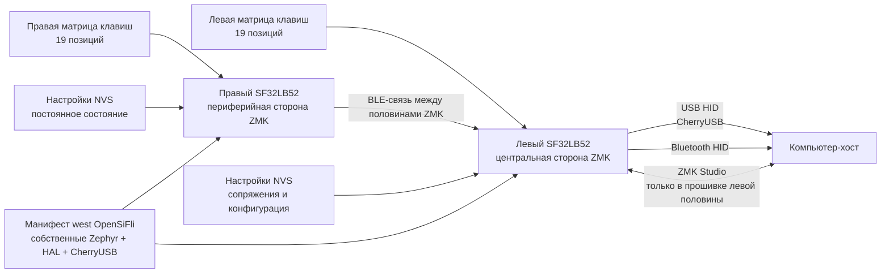

# Прошивка клавиатуры ZMK для SF32 { #zmk-keyboard-firmware-on-sf32 }

## Что такое ZMK для SF32? { #what-is-zmk-on-sf32 }

[ZMK Firmware](https://zmk.dev/) — прошивка клавиатуры с лицензией MIT на базе Zephyr. Основной проект ZMK задаёт модель приложения для многих проводных и беспроводных клавиатур, в том числе состоящих из двух половин: сканирование матрицы, раскладки и слои, поведения клавиш (behaviors), USB- и Bluetooth-HID, постоянное хранение настроек, а также расширяемые описания плат и конфигурации плат расширения Zephyr (shields).

[OpenSiFli/zmk](https://github.com/OpenSiFli/zmk) — производный репозиторий (fork) ZMK, который сопровождает OpenSiFli. В рассмотренной версии добавлены:

- вариант платы `sf32lb52_devkit_lcd/sf32lb525uc6/zmk`;
- интеграция SoC SF32LB52 в дерево приложения ZMK;
- конфигурации для одной платы, раздельной клавиатуры, ZMK Studio и платы расширения (shield) `urchin_sf32lb52`;
- адаптированный для SF32 бэкенд CherryUSB;
- раздел NVS размером 256 KB для настроек и поддержка настроек Bluetooth;
- раскладка раздельной клавиатуры Urchin с тремя слоями, управлением профилями Bluetooth и комбинациями разблокировки ZMK Studio.

Это разрабатываемый порт, а не релиз ZMK для продуктов на SF32, выпущенный под отдельным тегом версии. В корне производного репозитория по-прежнему находится общий README основного проекта ZMK, без краткого руководства для SF32. Используйте плату, конфигурацию платы расширения, манифест, исходный код и коммит как исполняемую эталонную конфигурацию. Прежде чем адаптировать её, самостоятельно подтвердите чистую сборку, загрузку прошивки, работоспособность и возможность восстановления.

## Зачем использовать реализацию на SF32? { #why-the-sf32-implementation }

Порт для SF32 демонстрирует, как запустить модель клавиатуры ZMK на SF32LB52, сохранив принятые в Zephyr соглашения для дерева устройств (devicetree), Kconfig, `west`, раскладок, плат расширения (shields) и клавиатур из двух половин. В конфигурации `urchin_sf32lb52` 38 клавиш распределены между обеими половинами. Левая конфигурация выполняет роль центральной: в ней включены CherryUSB и ZMK Studio, а хост может получать HID по USB. Правая конфигурация выполняет роль периферийной. ZMK BLE включён на обеих половинах.

Этот производный репозиторий подходит для оценки беспроводной клавиатуры из двух половин, настольного USB/Bluetooth-устройства ввода, программируемой макроклавиатуры или специализированного устройства человеко-машинного интерфейса на SF32. Обратная сторона — зрелость зависимостей: манифест `west` фиксирует отдельную ветку Zephyr (`v4.3+sf32-zmk_fixes`), конкретную ревизию SiFli HAL и отдельную ветку CherryUSB `zephyr-adapt`. Эти зависимости входят в границу совместимости порта; заменять их на самые новые версии основного проекта можно только после полной миграции и регрессионной проверки.

## Результат, область применения и условия начала { #outcome-scope-and-entry-criteria }

**Ожидаемый результат:** собрать и загрузить закреплённые по версиям образы левой и правой половин Urchin; проверить всю матрицу клавиш, слои, USB HID, BLE-связь между половинами и подключение к хосту, сохранение настроек, границы применения ZMK Studio и восстановление; затем внести одно контролируемое изменение раскладки или аппаратуры и сохранить воспроизводимые результаты.

Статья не гарантирует полного соответствия функциям основного проекта ZMK, совместимости с любыми платами расширения ZMK (shields), автономности на аккумуляторе, достаточной для серийного изделия, подтверждённых характеристик радиоканала или возможности перейти на другую ревизию Zephyr/ZMK с официальной поддержкой. Здесь также не описана готовая к производству печатная плата клавиатуры: конфигурация Urchin в репозитории сопоставляет эталонную матрицу с выводами SF32LB52-DevKit-LCD. Для собственной аппаратуры это соответствие необходимо осознанно перенести.

Перед началом подготовьте:

- две платы SF32LB52-DevKit-LCD, соответствующие варианту `sf32lb525uc6/zmk` из производного репозитория;
- испытательный стенд клавиатуры на 38 клавиш, точно подключённый по оверлеям Urchin `urchin_sf32lb52_left` и `urchin_sf32lb52_right`, либо небольшая документированная тестовая плата расширения для начальной проверки порта;
- хост с рабочим окружением Zephyr/ZMK `west` и достаточным объёмом хранилища для зафиксированных в производном репозитории модулей;
- проверенные средства загрузки прошивки, подключения к последовательной консоли и восстановления каждой половины до испытания режима раздельной клавиатуры;
- USB-кабель для передачи данных левой/центральной половины и независимый способ питать и восстанавливать правую/периферийную половину;
- Bluetooth-хост, хост с поддержкой ZMK Studio, если Studio входит в объём испытаний, и средство измерения тока каждой половины;
- журнал с коммитом производного репозитория, ревизиями манифеста, идентификаторами платы и платы расширения, результатами сборки и загрузки, проверки клавиш и Bluetooth-сопряжений, состоянием настроек и измерениями тока.

<div align="center"><em>Таблица: эталонная конфигурация ZMK на SF32 и необходимые подтверждения</em></div>

<div align="center" markdown>

| Область | Рассмотренная эталонная конфигурация | Что зафиксировать до адаптации |
|:--------|:------------------------------------|:-------------------------------|
| Производный репозиторий | OpenSiFli/zmk на зафиксированном коммите | Коммит репозитория, его связь с основным проектом, ревизии манифеста и список локальных изменений |
| Плата | `sf32lb52_devkit_lcd/sf32lb525uc6/zmk` | Точная ревизия платы, путь загрузки/восстановления и журнал консоли |
| Эталонная конфигурация клавиатуры из двух половин | `urchin_sf32lb52_left` как центральная сторона и `urchin_sf32lb52_right` как периферийная | Подключение, соответствие образов половинам, полная проверка матрицы и результат связи между половинами |
| Подключение к хосту | USB/CherryUSB и BLE HID от центральной половины | Перечисление USB, сопряжение/привязка, повторное подключение, профиль и восстановление после сбоев |
| Конфигурация | Трёхслойная раскладка, настройки NVS и ZMK Studio на левой стороне | Результаты для каждой клавиши, проверка сохранения, авторизация Studio и запись отката |
| Адаптация | По одному изменению раскладки, матрицы, транспорта, питания или зависимости | Проверенное изменение, исходные образы и полный результат регрессионной проверки |

</div>

## Аппаратные и программные спецификации { #hardware-and-software-specifications }

### Аппаратная спецификация { #hardware-specification }

<div align="center"><em>Таблица: аппаратная спецификация ZMK на SF32</em></div>

<div align="center" markdown>

| Компонент | Требуемые характеристики | Назначение | Статус | Где получить | Совместимость и замена |
|:----------|:-------------------------|:-----------|:-------|:-------------|:-----------------------|
| Две платы SF32LB52-DevKit-LCD | Целевой вариант платы `sf32lb52_devkit_lcd/sf32lb525uc6/zmk`; запишите ревизии обеих плат | Центральная и периферийная половины описанной конфигурации | Обязательно для проверок раздельной конфигурации | [Описание платы μForge](../sf32-products/devkits/SF32LB52-DevKit-LCD.md); [вариант платы OpenSiFli в проверенном коммите](https://github.com/OpenSiFli/zmk/tree/fd4d5843065f65ed5ed6198dc2e5d0520330bf8e/app/boards/sifli/sf32lb52_devkit_lcd) | Образы центральной и периферийной половин имеют разные роли и настройки; для каждой платы предусмотрите отдельный способ восстановления |
| Испытательный стенд клавиатуры Urchin и межплатное соединение | Матрица на 38 клавиш, подключённая по оверлеям `urchin_sf32lb52_left` и `urchin_sf32lb52_right` | Проверка матрицы, связи между половинами и функций каждой роли | Обязательно для полной проверки раздельной конфигурации | [Плата расширения Urchin (shield) в проверенном коммите](https://github.com/OpenSiFli/zmk/tree/fd4d5843065f65ed5ed6198dc2e5d0520330bf8e/app/boards/shields/urchin_sf32lb52) | Оверлеи задают схему подключения, но не гарантируют совместимость с другой PCB или произвольной конфигурацией платы расширения ZMK |
| USB/BLE-хост и кабели для передачи данных | USB-хост для центральной половины; Bluetooth HID-хост; отдельный доступ к питанию и прошивке периферийной половины | Подключение к хосту, проверка ввода, сбор журналов и восстановление | Обязательно | [Производный репозиторий ZMK от OpenSiFli](https://github.com/OpenSiFli/zmk) | Для каждой половины запишите ОС хоста, состояние сопряжения BLE, кабель/разъём и способ восстановления |

</div>

### Программная спецификация { #software-specification }

<div align="center"><em>Таблица: программная спецификация ZMK на SF32</em></div>

<div align="center" markdown>

| Пакет или служба | Требуемая версия или ревизия | Назначение | Статус | Где получить | Совместимость и обновление |
|:-----------------|:----------------------------|:-----------|:-------|:-------------|:---------------------------|
| OpenSiFli/zmk | Проверенный коммит [`fd4d5843065f`](https://github.com/OpenSiFli/zmk/tree/fd4d5843065f65ed5ed6198dc2e5d0520330bf8e) | Порт для плат SF32, приложение ZMK и конфигурация Urchin | Обязательно | [Репозиторий на проверенном коммите](https://github.com/OpenSiFli/zmk/tree/fd4d5843065f65ed5ed6198dc2e5d0520330bf8e) | Это не релиз ZMK для SF32 с отдельным тегом версии; не заменяйте порт на основной проект ZMK без переноса и проверки |
| Зависимости манифеста West | Точные ревизии, разрешённые файлом `app/west.yml` в закреплённом коммите производного репозитория | Zephyr, `hal_sifli`, CherryUSB и другие модули | Обязательно | [Закреплённый манифест West](https://github.com/OpenSiFli/zmk/blob/fd4d5843065f65ed5ed6198dc2e5d0520330bf8e/app/west.yml) | Выполните `west list` и сохраните результат; не обновляйте зависимости отдельно |
| Инструментарий Zephyr `west` и средства сборки | Версии, совместимые с закреплённым манифестом; запишите установленные версии и ОС хоста | Настройка, сборка и создание образов для левой/правой половин | Обязательно | [Документация ZMK](https://zmk.dev/docs); [документация Zephyr](https://docs.zephyrproject.org/) | Повторно соберите оба образа в чистом рабочем каталоге и сохраните отдельные каталоги сборки и хеши |
| Хост ZMK Studio | Совместимая версия хоста/приложения, если Studio включён в выбранной конфигурации | Необязательный путь настройки keymap/параметров | Необязательно | [Документация ZMK Studio](https://zmk.dev/docs/features/studio) | В проверенной конфигурации Studio доступен на левой/центральной половине; до применения в изделии проверьте авторизацию и откат |

</div>

## Выбор поддерживаемой базовой конфигурации { #choose-a-supported-baseline }

Рассмотренная базовая версия OpenSiFli — коммит `fd4d5843065f` от 27.05.2026. Он включает обновление платы расширения Urchin и конфигурации платы, доступное на тот момент, но не является релизом ZMK для SF32 с отдельным тегом версии. Для первоначального воспроизведения зафиксируйте этот коммит; если выбираете более новый, явно укажите и проверьте его.

<div align="center"><em>Таблица: выбор базовой конфигурации ZMK для SF32</em></div>

<div align="center" markdown>

| Элемент | Рекомендуемая отправная точка | Важное ограничение |
|:--------|:------------------------------|:-------------------|
| Производный репозиторий ZMK | OpenSiFli/zmk `fd4d5843065f` | Не заменяйте его основным проектом zmkfirmware/zmk: в нём нет этого порта для SF32. |
| Целевая плата | `sf32lb52_devkit_lcd/sf32lb525uc6/zmk` | Это вариант SF32LB52-DevKit-LCD, предназначенный для ZMK. |
| Платы расширения Urchin, близкие к конфигурации изделия | `urchin_sf32lb52_left` и `urchin_sf32lb52_right` | В оверлеях заданы разные назначения GPIO и роли; образы не взаимозаменяемы. |
| Диагностические платы расширения | `sf32lb52_test`, `sf32lb52_split_test_left/right` и `sf32lb52_zmkstudio_test` | Это эталоны для разработки порта, а не гарантия совместимости с продуктом. |
| Роли половин | Левая — центральная; правая — периферийная | USB и ZMK Studio включены в левой конфигурации; не считайте половины симметричными. |
| Манифест зависимостей | Собственная ветка Zephyr `v4.3+sf32-zmk_fixes`, зафиксированный `hal_sifli` и собственный CherryUSB `zephyr-adapt` | Обновление любой из этих зависимостей изменяет границу совместимости. |
| Лицензия | В производном репозитории ZMK и выявленных добавлениях для SF32 используются заголовки/лицензия MIT | Отдельно проверьте модули, аппаратуру, ресурсы раскладки и контент продукта. |

</div>

Следующие команды сочетают формат рабочего процесса `west` производного репозитория с точными идентификаторами платы SF32 и расширений Urchin. Сохраняйте два отдельных каталога сборки, чтобы не перепутать образы:

```bash
git clone https://github.com/OpenSiFli/zmk.git
cd zmk
git checkout fd4d5843065f

west init -l app
west update --fetch-opt=--filter=tree:0
west zephyr-export

west build -s app -p always -d build-left \
  -b sf32lb52_devkit_lcd/sf32lb525uc6/zmk -- \
  -DSHIELD=urchin_sf32lb52_left

west build -s app -p always -d build-right \
  -b sf32lb52_devkit_lcd/sf32lb525uc6/zmk -- \
  -DSHIELD=urchin_sf32lb52_right
```

Зафиксируйте итоговый `west list`, сгенерированные конфигурации Kconfig и devicetree, хеши артефактов, маркировку образов с указанием половины и фактическую процедуру загрузки. Не начинайте тесты раздельной конфигурации, пока не подтвердите независимое восстановление каждой платы.

## Этапы проекта { #delivery-map }

<div align="center"><em>Таблица: этапы проекта ZMK на SF32</em></div>

<div align="center" markdown>

| Этап | Какое решение он поддерживает | Требуемый результат |
|:-----|:-----------------------------|:-------------------|
| 1. Проверка исходной конфигурации | Совместно ли работают зафиксированный производный репозиторий, целевая плата, платы расширения, подключение и хост? | Образы левой и правой половин с зафиксированными версиями и заведомо рабочий сеанс набора текста |
| 2. Ввод, транспорт и восстановление | Можно ли диагностировать и устранять сбои матрицы, USB, BLE, связи между половинами, настроек и Studio? | Покрытие клавиш, внесение неисправностей и журнал восстановления |
| 3. Воспроизводимая сборка исходников | Может ли вторая среда пересобрать оба образа без скрытого состояния? | Манифест, чистые сборки, хеши артефактов, загрузка и повторный результат |
| 4. Контролируемая адаптация | Можно ли изменить одно поведение клавиатуры или одно аппаратное назначение, не нарушив базовую конфигурацию? | Ограниченное изменение, путь отката и результаты регрессионной проверки |
| 5. Оценка продукта | Достаточно ли зрелый порт для собственной печатной платы или аккумуляторного прототипа? | Назначенные ответственные за риски и решение продолжить, отложить или остановить |

</div>

## Архитектура системы и зависимости { #system-architecture-and-dependencies }

<div align="center"><em>Рисунок: пути раздельной клавиатуры ZMK на SF32LB52</em></div>



Рассматривайте сбои раздельно: физическая матрица и подключение, связь от правой половины к левой, USB левой стороны, Bluetooth хоста, сохранённые данные сопряжения и настройки, ZMK Studio, загрузка прошивки и восстановление платы, а также зафиксированный набор зависимостей. Если клавиша не доходит до хоста, сбой мог произойти до сканирования, при передаче данных между половинами, в центральной раскладке или на выбранном HID-канале. Проверяйте весь тракт именно в этом порядке.

## Этап 1 — Зафиксируйте исходную конфигурацию порта { #stage-1-establish-the-untouched-port-baseline }

**Цель:** подтвердить работу точной конфигурации OpenSiFli до изменения раскладки, оверлея платы или зависимости.

1. Запишите ревизии обеих плат и подключите оба испытательных стенда точно по оверлеям Urchin для левой и правой половин. Маркируйте платы и USB-кабели/кабели загрузки по назначению.
2. Соберите оба образа на зафиксированном коммите, сохраните `west list` и проверьте сгенерированную конфигурацию: целевую плату, конфигурацию платы расширения, роль в разделённой схеме, BLE, CherryUSB, ZMK Studio и настройки NVS.
3. Загрузите каждый образ через независимо проверенный путь восстановления. До сопряжения половин или подключения хоста запишите поведение при холодном запуске и вывод консоли.
4. Установите BLE-связь между половинами и проверьте все 38 позиций на слоях `default`, `lower` и `raise`. Отдельно проверьте выбор/сброс профиля Bluetooth и комбинации разблокировки Studio, чтобы случайно не активировать их при проверке набора текста.
5. Проверьте USB HID и ZMK Studio на левой половине, затем Bluetooth HID на выбранном хосте. Повторите проверки после холодного запуска.

**Сохраняемые подтверждения:** сведения о платах и подключении, ревизии производного репозитория и манифеста, сгенерированные конфигурации, хеши образов, журналы загрузки и запуска, полная матрица позиций клавиш, результаты по слоям, выбранный канал и версии хоста/Studio.

**Критерий выхода из контрольной точки 1:** после двух холодных запусков воспроизводятся все 38 позиций, все три слоя, связь от правой половины к левой и как минимум один выбранный канал хоста; обе половины можно восстанавливать независимо.

## Этап 2 — Проверьте ввод, транспорт, настройки и восстановление { #stage-2-validate-input-transport-settings-and-recovery }

**Цель:** подтвердить, что типичные отказы клавиатуры обнаруживаются и устраняются без пересборки из неизвестного состояния.

<div align="center"><em>Таблица: испытания отказов и восстановления ZMK на SF32</em></div>

<div align="center" markdown>

| Проверка | Метод | Признак успешного прохождения |
|:---------|:-------|:-----------------------------|
| Покрытие матрицы | Проверьте каждую позицию, сочетания одновременных нажатий (rollover), каждый слой и оба прямых входа | Нет пропущенных, дублированных, залипших или перепутанных по сторонам клавиш; порядок нажатия/отпускания зафиксирован |
| Потеря связи между половинами | Выключите правую половину или выведите её из зоны связи в режиме ожидания и во время набора | Левые клавиши и связь с хостом остаются в определённом рабочем состоянии; правая половина подключается снова без повторной прошивки и залипания клавиш |
| Прерывание USB | Отключите и подключите обратно USB-канал данных левой стороны во время набора и работы Studio | HID и Studio восстанавливаются независимо; модификаторы не остаются зажатыми, настройки не повреждаются |
| Потеря BLE-связи с хостом | Выключите Bluetooth на хосте, смените профиль и подключитесь снова | Состояние канала и профиля видно; повторное подключение и намеренное удаление данных сопряжения выполняются по зафиксированной процедуре |
| Сохранение настроек | Измените обратимую настройку, выключите и включите обе половины, затем восстановите исходную конфигурацию | Ожидаемое состояние NVS сохраняется; описан путь сброса/восстановления повреждённого или нежелательного состояния |
| Границы ZMK Studio | Выполните разрешённое изменение, прервите сессию в восстанавливаемой конфигурации и верните исходное состояние | Studio доступна только в центральном образе; недопустимые/незавершённые изменения не оставляют клавиатуру в неработоспособном состоянии |
| Цикл питания | Перезапустите каждую половину отдельно, а затем обе вместе; запишите ток и процесс пробуждения | Роли, связь между половинами, канал и состояние клавиш после отпускания восстанавливаются предсказуемо |

</div>

**Критерий выхода из контрольной точки 2:** для каждого применимого отказа получен воспроизводимый результат обнаружения и восстановления; ни один тест не оставляет HID в зажатом состоянии; настройки или сопряжения можно вернуть к зафиксированной конфигурации без замены файлов вне системы контроля версий.

## Этап 3 — Создайте воспроизводимую исходную конфигурацию { #stage-3-build-a-reproducible-source-baseline }

**Цель:** дать второму инженеру возможность собрать оба образа из чистых исходников и повторить этап 2.

1. Начните с чистой рабочей копии производного репозитория на записанном коммите и выполните `west init`, `west update` и `west zephyr-export`, не подменяя модули локально.
2. Сохраните `west list`, версии компилятора и инструментов, сгенерированные `.config` и devicetree, данные по памяти, журналы сборки и оба артефакта с хешами.
3. Загрузите помеченные образы левой и правой сторон в соответствующие половины и повторите все проверки этапа 2.
4. Сравните артефакты и конфигурацию с исходной записью; объясните любое невоспроизводимое отличие до продолжения.

**Критерий выхода из контрольной точки 3:** вторая среда создаёт правильно помеченные образы, проходящие этап 2, без неотслеживаемых оверлеев, устаревших результатов сборки или незакреплённых версий зависимостей.

## Этап 4 — Адаптируйте по одной границе клавиатуры за раз { #stage-4-adapt-one-keyboard-boundary-at-a-time }

**Цель:** внести одно изменение продукта, сохранив проверенный рабочий порт и независимые способы восстановления.

<div align="center"><em>Таблица: порядок контролируемой адаптации ZMK на SF32</em></div>

<div align="center" markdown>

| Категория изменения | Подходящее первое изменение | Обязательная регрессия |
|:--------------------|:--------------------------|:-----------------------|
| Раскладка | Одна привязка (binding), слой, hold-tap или комбинация | Все позиции/слои, порядок нажатия и отпускания, одновременные нажатия, потеря связи половин и оба канала хоста |
| Матрица/печатная плата | Изменение одной строки, столбца, прямого входа или ориентации диода | Электрическая проверка, сгенерированный devicetree, вся матрица, короткие замыкания и фантомные нажатия (ghosting), пробуждение и восстановление |
| Studio | Один редактируемый параметр или доступный для настройки элемент раскладки | Авторизация, допустимые/недопустимые изменения, сохранение, отключение, восстановление и совместимость версий |
| Транспорт | Один USB/BLE-канал или изменение политики связи половин | Перечисление USB, сопряжение, записи сопряжений, смена профиля, повторное соединение половин, предотвращение залипания клавиш и ток потребления |
| Управление энергопотреблением | Одна настройка сна, пробуждения, сканирования или радио | Ток каждой половины в активном режиме/ожидании/сне, задержка, все источники пробуждения, повторное соединение и сохранение настроек |
| Миграция зависимостей | Одно обновление ZMK, Zephyr, HAL или CherryUSB | Различия манифеста, чистые сборки, различия сгенерированной конфигурации, все проверки этапа 2, ток и откат |

</div>

**Критерий выхода из контрольной точки 4:** изменение проверено, исходные образы и настройки можно восстановить, а все применимые тесты матрицы, слоёв, связи половин, USB, BLE, Studio, питания и восстановления пройдены.

## Этап 5 — Оцените готовность продукта { #stage-5-product-readiness-review }

Перед разработкой собственной печатной платы клавиатуры или аккумуляторного прототипа ответьте на вопросы:

- Кто отвечает за производный репозиторий ZMK OpenSiFli, собственную ветку Zephyr, ревизию SiFli HAL, адаптацию CherryUSB и будущие обновления безопасности и совместимости?
- Какие функции основного проекта ZMK действительно проверены на SF32, а какие лишь присутствуют в унаследованном дереве исходников?
- Как при производстве и обслуживании будут контролироваться идентификаторы левого/правого образов, ревизия платы, раскладка, конфигурация, сопряжения и состояние сброса к заводским настройкам?
- Каков измеренный ток каждой половины в активном режиме, подключённом ожидании, отключённом состоянии и сне с учётом частоты сканирования, повторных подключений и защиты аккумулятора?
- Какие хосты, ОС, USB-контроллеры, стеки Bluetooth, сценарии пробуждения, сочетания одновременных нажатий и условия помех были проверены?
- Можно ли восстановить продукт без вскрытия или утилизации после сбоя обновления зависимости, изменения Studio, записи настройки или полевого обновления?
- Подходят ли лицензии ZMK/Zephyr, файлы печатной платы и корпуса, содержимое раскладки, логотипы, шрифты и включённые конфигурации для предполагаемого распространения?

**Критерий выхода из контрольной точки 5:** для каждого оставшегося риска назначены ответственный, подтверждающие данные и способ обработки; команда явно решила продолжить, отложить или остановить работу.

## Передача материалов для проектирования изделия { #handoff-to-product-design }

Передайте точную модель SF32 и сведения о памяти, роли половин и транспорт, карту строк/столбцов/прямых входов, ориентацию диодов, подключение USB, допущения об антенне и корпусе, политику NVS/настроек, интерфейсы загрузки и восстановления, бюджет питания каждой половины, испытательные стенды, идентификацию образов и зафиксированный манифест. Продолжите с материалов о [SF32LB52-DevKit-LCD](../sf32-products/devkits/SF32LB52-DevKit-LCD.md), [границах платформы Zephyr](../develop/platforms/zephyr/overview.md), [архитектуре Bluetooth](../learn/bluetooth/overview.md), [руководстве по проектированию аппаратуры SF32LB52x](../hardware/chip-guides/SF32LB52x_hardware_design_guide.md) и [подготовке к серийному производству](../hardware/design-for-production.md).

## Основные источники { #authoritative-sources }

- [Порт SF32 OpenSiFli/zmk](https://github.com/OpenSiFli/zmk)
- [Рассмотренный коммит OpenSiFli/zmk](https://github.com/OpenSiFli/zmk/tree/fd4d5843065f65ed5ed6198dc2e5d0520330bf8e)
- [Вариант платы ZMK для SF32LB52 в проверенном коммите](https://github.com/OpenSiFli/zmk/tree/fd4d5843065f65ed5ed6198dc2e5d0520330bf8e/app/boards/sifli/sf32lb52_devkit_lcd)
- [Конфигурация платы расширения Urchin из двух половин для SF32LB52 в проверенном коммите](https://github.com/OpenSiFli/zmk/tree/fd4d5843065f65ed5ed6198dc2e5d0520330bf8e/app/boards/shields/urchin_sf32lb52)
- [Манифест west для ZMK OpenSiFli в проверенном коммите](https://github.com/OpenSiFli/zmk/blob/fd4d5843065f65ed5ed6198dc2e5d0520330bf8e/app/west.yml)
- [Основной проект zmkfirmware/zmk](https://github.com/zmkfirmware/zmk)
- [Документация ZMK](https://zmk.dev/docs/)
- [Документация проекта Zephyr](https://docs.zephyrproject.org/)
