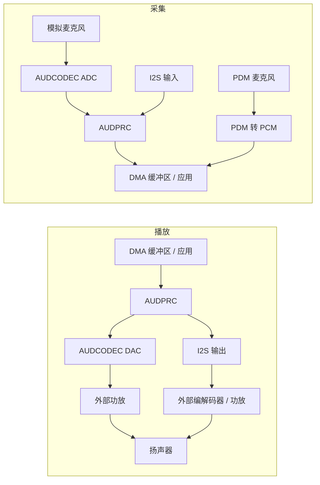

# 本地音频概览 { #audio-overview }

## 概述 { #overview }

本指南介绍 SF32 器件的**本地音频子系统**，包括用于麦克风输入、扬声器或线路输出，以及端侧播放和录音的编解码器、DMA 与中间件链路。内容聚焦工程实践中的关键决策：接口选择、缓冲策略、Audio Server 中间件、编解码格式和功耗。

蓝牙（Bluetooth）音频（A2DP、LE Audio）与本地音频相关，但属于独立主题，详见[蓝牙概览](../bluetooth/overview.md#bluetooth-audio-and-le-audio)。蓝牙概览重点介绍无线传输；本文则说明音频采样数据进入芯片后的处理，包括采集、混音、解码，以及驱动物理音频链路。

本文面向需要将音频功能用于实际产品的工程师，帮助你选择麦克风、编解码器、缓冲方案和功耗策略。目标不只是跑通一次演示，而是在蓝牙、显示、存储和电池预算的约束下，保证音频链路持续可靠地工作。

## 明确产品的音频需求 { #define-the-products-audio-requirements }

选择接口或缓冲区大小之前，应先明确产品需求：

- 仅播放、仅录音，还是需要同时播放和录音，即全双工？
- 需要多少个麦克风？使用模拟麦克风（AMIC）还是数字麦克风（DMIC）？
- 本地播放采用什么格式——原始 PCM、MP3、Opus，还是其他编解码格式？
- 是否还需要同时支持蓝牙音频，包括经典蓝牙或 LE Audio？
- 是否需要语音触发或持续监听？相应的功耗预算是多少？
- 扬声器或线路输出有什么驱动要求？音频是否送往外部功放或编解码器？
- 产品对延迟（latency）的容忍度有多大？语音通话和实时监听的要求远比通知提示音严格。

这些答案将决定接口选择（I2S、PDM 或 ADC/DAC）、编解码器配置，以及音频处理链路中哪些部分需要保持唤醒。

## SF32 音频信号链路 { #the-sf32-audio-signal-path }

采集和播放使用不同的信号链路。下图展示常见路径；具体可用接口及并发路由能力取决于器件型号、封装、开发板和 SDK 配置。

<div align="center"><em>图：SF32 典型本地音频信号链路</em></div>



**AUDCODEC** 负责模数和数模转换。**AUDPRC** 在支持的链路上完成混音、增益和采样率转换等数字处理。PDM 麦克风则由 PDM 模块转换为 PCM，不经过模拟 ADC。I2S 用于连接外部数字音频器件。一个 PDM 接口可通过左右声道选择连接最多两个兼容的麦克风；两个接口最多可连接四个麦克风，但仍须确认引脚是否引出、驱动是否支持。

**Audio Server** 是管理音频流和会话的软件，并不是串接在麦克风与扬声器之间的物理转换器。应用通常通过其 API 和相应驱动使用音频功能；启动调试时，也可以直接测试驱动或 HAL。应先确定实际的采集和播放路径，再核对时钟、采样格式、DMA 请求及输出端的驱动能力要求。不要默认片内 DAC 无需外部功放就能驱动所选扬声器。

上述路径可参阅 [AUDPRC/AUDCODEC 驱动指南](https://docs.sifli.com/projects/sdk/latest/en/sf32lb52x/drivers/audprc_audcodec.html)和 [PDM HAL 指南](https://docs.sifli.com/projects/sdk/latest/en/sf32lb52x/hal/pdm.html)。

## 麦克风与数字音频接口 { #choosing-interfaces-amic-dmic-and-i2s }

AMIC 和 DMIC 表示麦克风类型，PDM 和 I2S 表示数字接口。数字麦克风既可能采用 PDM，也可能采用 I2S。麦克风个数、声道数和接口数量不能混为一谈。

<div align="center"><em>表：麦克风与数字音频接口</em></div>

<div align="center" markdown>

| 麦克风 / 总线 | 典型用途 | 说明 |
|:-----|:---------|:-----|
| **AMIC（模拟麦克风输入）** | 通用麦克风采集 | 使用音频 ADC；须核对麦克风偏置、增益、输入范围，并控制板级噪声。 |
| **DMIC（数字麦克风）** | 语音采集、多麦克风阵列 | 先确定实际使用 PDM 还是 I2S。采用数字传输并不意味着可以忽略电源噪声、时钟和布线要求。 |
| **I2S** | 与外部编解码器或功放之间传输 PCM | 不使用片上 AUDCODEC，而采用外部音频编解码器或功放时很常见。 |
| **PDM** | 数字麦克风输入 | 许多 DMIC 的原生接口，与片上 PDM 至 PCM 转换配合使用。 |

</div>

模拟与数字麦克风混合组成阵列时，须确认各链路能够并发工作，且采样时序同步。波束成形还需要合适的麦克风布局、校准和算法，不能仅靠接入多个麦克风实现。

## 从已验证的音频示例开始 { #start-from-a-verified-audio-example }

在围绕产品需求设计应用行为之前，应先选择并验证最接近的 SiFli-SDK 示例。[音频 SDK 示例](audio-sdk-examples.md)按照工程任务梳理官方的 PDM、模拟采集、录音/回放、本地音乐、SD 卡、FLAC、Opus 和混音示例，并说明将示例改造成产品前需要重新核对的开发板、引脚复用、存储和配置边界。

## 选择合适的 SF32 器件 { #pick-the-right-sf32-device }

各系列的音频能力不同。最终应以具体型号的数据手册为准，以下信息可作为初步选型参考：

<div align="center"><em>表：SF32 音频器件选型方向</em></div>

<div align="center" markdown>

| 器件系列 | 片内音频 ADC/DAC | PDM 接口数（最大麦克风数） | I2S 接口数 | 应用方向 |
|:---|:---|:---|:---|:---|
| **SF32LB52x** | 1 ADC + 1 DAC | 1 (2) | 1 | 成本优化型蓝牙音频配件、支持语音的紧凑型 HMI。 |
| **SF32LB55x** | 无；模拟音频需要外接音频编解码器。 | SF32LB551/555：1（2）；SF32LB557：2（4） | SF32LB551/555：1；SF32LB557：2 | 音频为次要功能的 BLE 可穿戴设备和多传感器产品。 |
| **SF32LB56x** | 1 ADC + 1 DAC | 2 (4) | 1 | 同时需要丰富 HMI/显示功能和多麦克风语音采集的产品。 |
| **SF32LB57x** | 2 ADC + 1 DAC | 2 (4) | 2 | 多麦克风语音采集与本地播放。 |
| **SF32LB58x** | 2 ADC + 2 DAC | 2 (4) | 3 | 融合音频、图形、AI 和复杂连接功能的旗舰产品。 |

</div>

选型前，应核对具体型号、封装引脚、引脚复用及并发链路。一个 PDM 接口可连接两个兼容的麦克风；ADC 通道数、麦克风通道数与数字接口数量不能混为一谈。I2S 的收发能力因实例而异：SF32LB58x 的 I2S1 仅支持接收（RX），I2S2 和 I2S3 则支持收发（RX/TX）。使用 I2S2 接收时，还需使能其发送侧作为时钟源。实例限制请参阅 [思澈科技（SiFli）I2S HAL 指南](https://docs.sifli.com/projects/sdk/latest/en/sf32lb52x/hal/i2s.html)；其他选型因素可参阅 [SF32 系列概览](../../sf32-products/family/SF32_family.md)。

参考来源：[DS5201](https://downloads.sifli.com/user%20manual/DS5201-SF32LB52x-Datasheet%20V2p5.pdf)、[DS5501, Table 0-1](https://downloads.sifli.com/user%20manual/DS5501-SF32LB55x-Datasheet%20V1p7p2.pdf)、[DS5601](https://downloads.sifli.com/user%20manual/DS5601-SF32LB56x-Datasheet%20V1p9p2.pdf)、[DS5801](https://downloads.sifli.com/user%20manual/DS5801-SF32LB58x-Datasheet%20V1p8p3.pdf)、[SF32LB57x AUDCODEC 寄存器（ADC_CH0/1、DAC_CH0）](https://github.com/OpenSiFli/SiFli-SDK/blob/v2.5.1/drivers/cmsis/sf32lb57x/audcodec.h)、[SF32LB57x 的 PDM/I2S 外设实例](https://github.com/OpenSiFli/SiFli-SDK/blob/v2.5.1/drivers/cmsis/sf32lb57x/register.h)、[思澈科技（SiFli）SDK v2.5.1 发布说明（57x 四麦 PDM 配置）](https://github.com/OpenSiFli/SiFli-SDK/releases/tag/v2.5.1)、[思澈科技（SiFli）SDK PDM 示例（57x 开发板、PDM1、双声道）](https://docs.sifli.com/projects/sdk/latest/en/sf32lb52x/example/rt_device/pdm/README.html)。

## 音频会话模板 { #audio-session-templates }

多数产品的音频需求可以归纳为几种常见会话。应选择最接近的模板，并针对实际实现进行验证：

<div align="center"><em>表：常见音频会话模板</em></div>

<div align="center" markdown>

| 会话 | 典型链路 | 主要风险 |
|:-----|:-----------|:---------|
| 通知提示音 | Flash/PSRAM 资源 → 必要时解码 → Audio Server → DAC/功放 | 启动和停止时出现爆音或咔嗒声。 |
| 语音录制 | AMIC → ADC/AUDPRC，或 PDM 麦克风 → PDM 转 PCM，或 I2S 输入 → DMA 缓冲区 → 应用/存储/蓝牙 | 缓冲区溢出和时钟漂移。 |
| 蓝牙音箱 | 蓝牙音频 → 解码/混音 → Audio Server → DAC/功放 | 射频共存以及内存带宽竞争。 |
| 语音通话 | 同时进行麦克风采集与播放 | 全双工延迟、回声路径处理和缓冲区所有权。 |
| 唤醒或监听功能 | 低采样率采集 → 特征提取 → AI 触发 | 空闲状态功耗和误唤醒。 |

</div>

应分别定义每种会话的启动、稳态运行、缓冲区欠载或溢出时的恢复，以及关闭行为。音频问题常隐藏在状态切换过程中，而不是稳定播放循环中。

## 缓冲区与延迟预算 { #buffer-and-latency-budget }

缓冲区可容纳的音频时长应按**采样帧**计算：一帧包含每个声道各一个采样值。

```text
interleaved frames = buffer bytes / (channels * stored bytes per sample)
planar frames per channel = channel buffer bytes / stored bytes per sample
buffer duration (s) = frames / sample rate (Hz)
```

在 48 kHz 下，480 帧对应 10 ms。若采用交错存储的立体声，这相当于 960 个采样值；480 个采样值只对应 5 ms。将缓冲区字节数换算为帧数时，应使用实际存储的每采样字节数，包括填充字节。若左右声道分别存储，则按单个声道缓冲区计算帧数，不要将两者的长度相加。

这个结果是缓冲区的音频时长，并不直接等于端到端延迟。乒乓缓冲让 DMA 使用一个区域时，软件可以处理另一个区域；实际延迟取决于队列中等待处理的数据量，以及半传输或整块传输完成时的回调策略，而不只是是否使用两个缓冲区。应统一分配并实测采集、处理、传输、播放和任务调度带来的延迟。

## 播放与录音基础 { #playback-and-recording-basics }

无论是驱动扬声器还是采集麦克风信号，都应遵循以下原则：

- **缓冲区大小**——较小的数据块可降低与块处理有关的延迟，但会增加中断和 DMA 开销；较大的数据块可为调度留出更多余量，同时占用更多内存。延迟增加是因为更多音频在处理或播放前排队等待，而不是仅仅分配了更多缓冲区容量。
- **DMA 传输**——通过硬件定时的 DMA 搬运外设采样数据。软件仍可在内存中按块复制或处理数据；应避免依靠 CPU 轮询或逐采样循环实时服务外设。
- **采样率与格式规划**——应预先确定采样率（例如语音使用 16 kHz，音乐使用 44.1/48 kHz）和位深；运行时转换格式会消耗 CPU 和内存。
- **双缓冲**：DMA 传输一块区域时，软件填充或处理另一块。必须在该区域再次被使用前完成处理；两个缓冲区本身并不能保证不发生欠载或溢出。

对于与 DMA 共享的可缓存缓冲区，应明确所有权，并遵守 SDK 的缓存行对齐及维护要求。DMA 读取播放数据之前，先将 CPU 写入的数据所在的脏缓存行回写至内存（clean）。DMA 写入采集缓冲区之前，按目标平台缓存策略准备目标区域；传输完成后，CPU 读取之前再使相应区域的缓存失效。只有完成回调确认可以交接后，软件才能修改或复用 DMA 正在使用的区域。受影响的缓存行中不要混放无关数据。

## 编解码与压缩格式选择 { #codec-and-compression-choices }

应区分**硬件音频编解码器**（ADC/DAC 转换）和**压缩编解码器**（如 MP3、Opus）。原始 PCM 不需要压缩解码。对于等效音频信号，有损压缩通常能减少存储体积和读取带宽，但仍须实测解码的 CPU 开销、工作缓冲区和能耗；压缩文件更小，并不保证运行时内存占用也更小。

<div align="center"><em>表：音频编解码与压缩格式</em></div>

<div align="center" markdown>

| 格式 | 典型用途 | 说明 |
|:-----|:---------|:-----|
| **原始 PCM** | 短提示音、低延迟监听、语音流水线 | 无需压缩解码；体积取决于时长、采样率、声道数和实际存储的采样位宽。 |
| **MP3** | 本地音乐播放 | 兼容性广，解码开销成熟可控，常用于 SD 卡音乐播放器示例。 |
| **Opus** | 语音和通用压缩音频 | 适用于语音和通用音频的压缩格式。支持 Opus 并不代表兼容 A2DP、HFP 或 LE Audio；还须分别核对所选蓝牙应用规范（Profile）的编解码格式及 SDK 支持情况。 |

</div>

SDK 提供本地音乐、SD 卡 MP3、Opus、录音及双路 ADC/DAC 示例。双声道示例要求器件和开发板提供对应声道，不代表所有 SF32 都有两个 ADC/DAC。应从支持的示例配置开始，并在实际目标平台上测量解码开销。

## 本地音频与蓝牙音频 { #local-audio-vs-bluetooth-audio }

即使两条链路需要并发运行，也应在概念上区分：

- **本地音频**（本指南）——AUDCODEC/AUDPRC、麦克风、扬声器或线路输出，以及端侧播放和录音。
- **蓝牙音频**（[蓝牙概览](../bluetooth/overview.md#bluetooth-audio-and-le-audio)）——经典蓝牙的 A2DP/AVRCP/HFP，或在器件、协议栈和 SDK 支持相应角色时使用 LE Audio 单播/广播。具备 BLE 无线功能并不等于支持 LE Audio。

许多实际产品会让本地音频与蓝牙音频协同工作。例如，采集本地麦克风的声音并通过蓝牙传输，或接收蓝牙音频，再通过 Audio Server 与本地通知提示音混音。两条链路同时工作时，必须明确规划缓冲区所有权和混音行为。

## 板级音频检查清单 { #board-level-audio-checklist }

固件无法完全掩盖不良的模拟电路设计。在原理图和 PCB 设计阶段，应检查以下项目：

<div align="center"><em>表：板级音频设计检查</em></div>

<div align="center" markdown>

| 范围 | 设计建议 |
|:-----|:---------|
| 麦克风偏置与布线 | 模拟麦克风走线应尽量短，减少噪声耦合，并远离时钟、射频和大电流开关节点。 |
| 接地 | 避免噪声回流路径经过麦克风或扬声器参考地。 |
| 电源轨 | 按照参考设计和麦克风数据手册，对编解码器及麦克风电源进行滤波。 |
| 扬声器或功放链路 | 检查负载、增益、热特性、爆音抑制和关断引脚行为。 |
| I2S/PDM 时钟 | 在选定采样率下确认时序裕量、走线长度和时钟质量。 |
| 测试接入 | 为启动调试和生产测试保留实用的音频注入和采集方式。 |

</div>

对于同时包含射频和模拟音频的产品，应在蓝牙工作、显示刷新、充电器连接且最终外壳装配完成的条件下验证噪声表现。

## 音频功耗注意事项 { #power-considerations-for-audio }

分别测量麦克风供电、转换器、数字处理、存储访问与功放的功耗，再测量完整会话。各部分的占比取决于硬件、工作负载，以及监听和播放的占空比。

- 会话之间，按器件和驱动要求的顺序关闭不再使用的音频链路。检查功放静音与关闭控制、时钟、电源及 GPIO 状态，避免爆音、倒灌供电和接口漏电。
- 对于持续监听型语音触发功能，应保留必要的采集链路，并选择所支持的最低功耗处理方案；不能关闭触发功能依赖的链路。触发模型也应尽量轻量。参阅 [AI 概览](../ai/overview.md#audio-and-voice)。
- 批处理必须满足延迟预算和缓冲区处理时限。DMA 负责样本传输，但完成的块仍须及时处理；减少 CPU 唤醒不能以缓冲区溢出或欠载为代价。
- 协调音频、蓝牙和显示活动的时序。参阅[低功耗概览](../low-power/overview.md)和[蓝牙概览：与其他工作负载共存](../bluetooth/overview.md#coexistence-with-other-workloads)。

## 音频验证矩阵 { #audio-validation-matrix }

编解码器、蓝牙、显示、功耗或时钟发生变化后，应重复执行相同的音频测试：

<div align="center"><em>表：音频验证矩阵</em></div>

<div align="center" markdown>

| 测试 | 检查内容 |
|:-----|:---------|
| 静音采集和播放 | 噪声底、嗡声、爆音或咔嗒声、直流偏置。 |
| 正弦扫频或单音 | 采样率正确性、失真和削波。 |
| 长时间播放 | 缓冲区欠载、内存泄漏、热稳定性和功耗稳定性。 |
| 显示 UI 时录音 | DMA 和内存带宽的共存表现。 |
| 蓝牙音频与本地声音同时播放 | 混音、优先级和延迟。 |
| 音频前后的睡眠与唤醒 | 编解码器关闭和重启、爆音抑制，以及限制可进入电源状态的 PM 请求（PM vote）。 |

</div>

应保留已验证正常的 WAV/PCM 参考文件，以及从评估板采集的正常样本。与只依赖主观听感相比，这些参考数据更容易帮助识别回归问题。

## 音频问题排查 { #debugging-audio-issues }

<div align="center"><em>表：音频问题排查</em></div>

<div align="center" markdown>

| 现象 | 重点检查方向 |
|:-----|:-------------|
| 出现咔嗒声、爆音或断续故障 | 缓冲区欠载、缓冲区数量或容量不足、DMA 配置错误。 |
| 持续存在噪声或嗡声 | 模拟前端或 PCB 布局、AMIC 接地、电源轨噪声。 |
| 延迟超过应用要求 | 缓冲区过大、存在不必要的格式转换、DMA 启动前的调度延迟。 |
| 蓝牙或显示工作时音频卡顿 | 共存和内存带宽竞争，参阅[共存](../bluetooth/overview.md#coexistence-with-other-workloads)。 |
| 解码后音频的音高或速度错误 | 音源、解码器与 AUDCODEC 配置之间的采样率不匹配。 |
| 空闲播放状态下功耗仍然很高 | 会话之间没有关闭编解码器或 DMA，或仍在无谓轮询，而未采用事件驱动的会话关闭机制。 |

</div>

## 常见错误 { #common-mistakes }

- 通过 CPU 轮询逐个处理外设采样，而不使用硬件定时的 DMA。
- 缓冲区容量不足或管理不当，导致错过 DMA 处理期限；在支持且适用时应使用双缓冲。
- 只按麦克风类型和个数设计，没有核对 PDM/I2S 接口数量、引出的引脚和并发链路。
- 实际产品中本地音频和蓝牙音频需要并发运行，却把二者视为完全独立的系统。
- 忽略 DMA 与 CPU 共享缓冲区的缓存一致性和所有权规则。
- 会话之间仍保持未使用的音频链路工作，或错误关闭持续监听功能依赖的采集链路。
- 在确认解码开销符合功耗和 CPU 预算之前，就确定使用某种压缩格式。

## 启动调试检查清单 { #bring-up-checklist }

- [ ] 对照具体器件和开发板，确认麦克风类型与通道数、PDM/I2S 接口数量、引出的引脚，以及支持的并发链路。
- [ ] 确定采集和播放的采样率、样本存储位宽、通道排列方式与缓冲区大小。
- [ ] 启动调试所选的 ADC/AUDPRC、PDM 或 I2S 采集链路，以及 DAC 或 I2S 播放链路；先分别测试，再验证全双工。
- [ ] 基本硬件链路正常后，通过 Audio Server 和对应驱动集成所支持的会话；保留直接调用 HAL 的测试，便于定位问题。
- [ ] 选择音频格式（PCM/MP3/Opus）；需要解码时，实测 CPU 开销、内存占用与能耗是否符合预算。
- [ ] 验证 DMA 缓冲区所有权、对齐要求，以及缓存清理和失效操作。
- [ ] 如果产品同时使用本地音频和蓝牙音频，验证二者并发运行。
- [ ] 测量活动和空闲状态的功耗；验证关闭与重启顺序、接口引脚状态，以及持续监听功能所需的采集链路。

## 要点 { #key-takeaways }

- 明确物理链路：模拟音频使用 AUDCODEC，PDM 采集使用 PDM 模块，外部数字音频使用 I2S。通过 Audio Server 和驱动管理所支持的会话，不要将所有路径都理解为同一条编解码器链路。
- 应根据具体器件的能力和产品麦克风布局，选择麦克风类型及 PDM/I2S 链路，不能照搬其他芯片的设计假设。
- 使用由 DMA 按硬件节奏驱动的传输，并配置足够的缓冲深度；在驱动支持且适用时，双缓冲是常见方案，但仍须满足回调处理和缓冲区复用期限。
- 本地音频和蓝牙音频是独立子系统，但经常需要同时运行；必须明确规划混音和缓冲区所有权。
- 音频功耗优化与蓝牙和 AI 类似：缩短活动时间、避免无意义的 CPU 唤醒，并测量真实会话，而不只是稳态播放。
