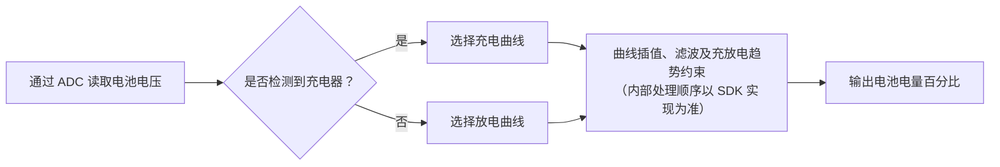

# 电池电量估算 { #battery-capacity-calculation }

SiFli-SDK 的电池计算器会根据测得的电池电压估算电池荷电状态（SoC）百分比。它不是库仑计，不会通过累计流入和流出电池的电量来估算；估算精度取决于所用电池曲线，以及充电器状态信息是否准确。

中间件会检测充电器状态，选择对应的充电或放电曲线，并通过插值估算电量百分比；同时使用主滤波器处理电压跳变，并可选用加权平均滤波器稳定结果。公开指南没有完整说明滤波器在内部的处理顺序，因此不要据此假定固定流程；如需确认，应检查项目所用 SDK 版本的实现。

## 计算器的工作内容 { #what-the-calculator-does }

<div align="center"><em>表：电池计算器的工作方式</em></div>
<div align="center" markdown>

| 功能 | 行为 |
| --- | --- |
| 充放电曲线 | 根据当前充电状态，选择对应的电压-电量曲线。 |
| 线性插值 | 在选定曲线的相邻点之间计算电量百分比。 |
| 主滤波器 | 根据配置的电压跳变阈值和连续越阈采样次数过滤突变。 |
| 加权平均滤波器（可选） | 启用后，对历史电压值和当前电压值进行加权平均。 |
| 充电器接入状态检测 | 根据开发板的充电器检测配置选择充电或放电曲线。 |

</div>

<div align="center"><em>图：电池电量百分比估算路径</em></div>



这张图用于概括处理过程，不代表已确认的内部调用顺序。公开指南没有说明插值、滤波和充放电趋势约束的具体先后关系；应以产品所用 SDK 版本的实现为准。指南明确说明：充电时报告的电量百分比不会下降，放电时不会上升。

## 先配置开发板 { #configure-the-board-first }

使用该中间件前，应在 menuconfig 中完成开发板配置：

1. 启用用于读取电池电压的 ADC 支持。
2. 启用电池计算器功能。
3. 启用充电支持。
4. 选择开发板使用的充电芯片；只有在没有适用的已列芯片时，才使用 Simple Charger（简易充电器）选项。
5. 配置开发板的充电器插入检测引脚。
6. 选择与硬件一致的检测引脚极性。

`BSP_CHARGER_INT_PIN_ACTIVE_HIGH` 用于定义充电器检测极性。定义该宏时，高电平表示充电器已插入；未定义时，低电平表示充电器已插入。极性设置错误会选错电池曲线，导致电量显示卡住或变化方向异常。

## 使用实际电芯的电池曲线 { #use-battery-curves-from-the-actual-cell }

开发板目录中的默认 `battery_table.c` 仅是参考示例，并不是通用电池模型。应从实际电芯厂商获取电压-电量曲线，再为产品配置匹配的查找表。

<div align="center"><em>表：电池曲线要求</em></div>
<div align="center" markdown>

| 表 | 定义要求 |
| --- | --- |
| `charging_curve_table` | 用于充电状态的 `const battery_lookup_point_t[]` 表。电压条目必须从高到低排列。 |
| `discharge_curve_table` | 用于放电状态的 `const battery_lookup_point_t[]` 表。电压条目必须从高到低排列。 |
| 表内容 | 百分比应从 100 对应到 0，并反映实际电池特性。 |
| 表位置 | 开发板专属的 `battery_table.c`。 |

</div>

同一荷电状态下，电芯充电和放电时的电压不同，因此必须使用两套曲线。不能仅因标称化学体系相同，就用任意 4.2 V 锂电池曲线替代实际电芯曲线。

!!! warning "先核对所用 SDK 和开发板的电压刻度"
    思澈科技（SiFli）公开文档存在单位不一致：参数名 `voltage_mv` 和滤波阈值均标为 mV，但示例把 `38000` 作为 `3.8 V` 传入，曲线示例也用 `41808` 表示 `4.18 V`。这些数值与 0.1 mV 刻度相符，但文档没有明确说明该刻度；这只是根据数值作出的推断，不能视为 API 保证。使用计算器前，应检查目标 SDK 版本和开发板配置中的 ADC 换算路径、电池曲线表及阈值比较逻辑。

    ADC 读数、所选曲线表和滤波阈值必须采用兼容的刻度。文档列出的阈值字面值为 `50` 和 `30`，并标注为 mV；不要只根据电压示例就换算这两个数值。应确认目标 SDK 如何解释和比较各字段，也不要只修改 ADC 读数而让曲线表或阈值仍使用其他刻度。

## 配置计算器 { #configure-the-calculator }

`battery_calculator_config_t` 提供两套曲线表和滤波参数。

<div align="center"><em>表：电池计算器配置</em></div>
<div align="center" markdown>

| 字段 | 用途 | 公开示例字面值（文档标注单位） |
| --- | --- | --- |
| `charging_table`、`charging_table_size` | 充电曲线及其点数 | 因开发板而异 |
| `discharging_table`、`discharging_table_size` | 放电曲线及其点数 | 因开发板而异 |
| `charge_filter_threshold` | 充电状态下的电压跳变阈值 | `50`（文档标为 mV；应核实目标 SDK 的刻度） |
| `discharge_filter_threshold` | 放电状态下的电压跳变阈值 | `30`（文档标为 mV；应核实目标 SDK 的刻度） |
| `filter_count` | 主滤波器确认电压跳变所需的、连续超出设定阈值的采样次数 | `3` |
| `secondary_filter_enabled` | 是否启用加权平均滤波器 | `true` |
| `secondary_filter_weight_pre` | 前一次电压的权重 | `90` |
| `secondary_filter_weight_cur` | 当前电压的权重 | `10` |

</div>

启用加权平均滤波器时，`secondary_filter_weight_pre + secondary_filter_weight_cur` 必须等于 `100`。阈值、次数和权重应根据实际电池、负载突变和产品体验调节，不能将 SDK 参考值直接当作标定结果。

## 初始化并计算电量 { #initialize-and-calculate }

请求电量百分比前，必须先初始化计算器。思澈科技公开指南将初始化函数声明为 `void`；编译时应以项目实际使用的 SDK 版本中的头文件为准。

```c
void battery_calculator_init(battery_calculator_t *calc,
                             const battery_calculator_config_t *config);
```

电量 API 返回 0–100 的百分比，表示荷电状态，不是以 mAh 表示的电池容量。集成前还应查看目标 SDK 版本的头文件和实现，确认是否存在额外的参数约束或初始化状态返回值。

传入的电池电压必须使用目标 SDK 版本所要求的刻度。公开 API 将参数命名为 `voltage_mv`，但使用前仍应按上文说明核对其实际刻度：

```c
uint8_t battery_calculator_get_percent(battery_calculator_t *calc,
                                       uint32_t voltage_mv);
```

<div align="center"><em>表：推荐集成顺序</em></div>
<div align="center" markdown>

| 步骤 | 操作 |
| --- | --- |
| 1 | 配置开发板的 ADC、充电器类型、充电器检测引脚及其极性。 |
| 2 | 在 `battery_table.c` 中定义已验证的充电和放电曲线。 |
| 3 | 使用 `battery_calculator_config_t` 初始化 `battery_calculator_t`。 |
| 4 | 通过已配置的 ADC 路径读取电池电压。 |
| 5 | 确认电压刻度与曲线表及阈值相符后，再传给 `battery_calculator_get_percent()`。 |
| 6 | 将滤波后的结果用于 UI、低电量策略和产品遥测。 |

</div>

## 在产品硬件上验证运行结果 { #verify-behavior-on-product-hardware }

电量显示应跟随产品的真实物理状态，而不是只在实验室中返回看似合理的数值。充电、放电、插入线缆和拔出线缆时，都应同时验证充电器检测状态、电压读数、所选曲线和显示百分比。

<div align="center"><em>表：电量百分比故障排查</em></div>
<div align="center" markdown>

| 现象 | 优先检查项 |
| --- | --- |
| 电量变化过于突兀 | 先确认 ADC 读数、曲线表和阈值采用相同刻度，再调整相应阈值或 `filter_count`；必要时启用或加强加权平均滤波器。 |
| 电量不准确 | 获取与实际电芯匹配的曲线，并重新标定查找点。 |
| 电量保持不变 | 检查报告的充电器接入状态和 `BSP_CHARGER_INT_PIN_ACTIVE_HIGH` 极性。公开指南说明，充电时报告的电量百分比不会下降，放电时不会上升。 |
| 电量变化方向错误 | 检查充电器检测引脚、电气极性，以及选中的充电或放电曲线。 |

</div>

中间件完整说明和当前配置截图请参见 [SiFli-SDK 电池电量计算](https://docs.sifli.com/projects/sdk/latest/sf32lb58x/middleware/battery_calculator.html)。如需进行系统级续航估算，请继续阅读[智能手表功耗分析](smartwatch-power-profiling.md)；如需进行实测验证，请参阅[功耗测量与验证](measurement-and-validation.md)。

思澈科技（SiFli）公开指南是查阅该功能的起点，但不能替代项目实际使用的 SDK 版本。尤其应针对目标版本检查 ADC 换算路径、电池曲线表、滤波阈值比较逻辑和 API 头文件，以解决文档中的电压刻度不一致问题。
