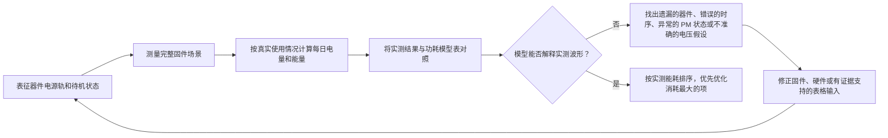

# 功耗测量与验证 { #power-measurement-and-validation }

只有当模型假设与硬件实测结果相符时，续航估算才可信。请结合[低功耗概览](overview.md)和[智能手表功耗建模与分析](smartwatch-power-profiling.md)使用本页。流程从单个器件开始，继而验证完整固件场景，再校核每日使用模型，最后把优化工作集中到已验证的最大能耗项上。

## 不只测电流，还要测能量 { #measure-energy-not-current-alone }

电流只是结果的一部分。应将被测设备（DUT）电压 `V_DUT` 与电流波形一并记录，以便计算瞬时功率、能量（Wh）和电量（mAh）：

```text
power_W(t) = voltage_V(t) x current_A(t)
energy_Wh = integral(power_W(t) dt) / 3600
energy_mWh = energy_Wh x 1000
charge_mAh = integral(current_mA(t) dt) / 3600
```

这里的 `t` 以秒为单位。除以 `3600` 是将秒换算为小时；计算功率时，电流用 A 表示；计算电量时用 mA 表示，积分结果的单位为 mAh。

能量积分的结果单位是 Wh；若模型使用 mWh，应先乘以 1000 再累加。mAh 表示电量，mWh 表示能量，两者不能互换。

如果供电稳定，应记录本次采集实际测得的 `V_DUT`，并与电流波形一起计算。如果测试期间电压会变化，应以与电流相同的时间基准采样，或记录足够多的同步电压点，以计算可信的平均功率。只比较 mAh 可能掩盖真实能量变化，例如供电电压、稳压器工作点或电池状态不同时就是如此。

## 建立测量基线 { #set-up-the-measurement-baseline }

推荐使用 Nordic 的 [Power Profiler Kit II（PPK2）](https://docs.nordicsemi.com/r/bundle/ug_ppk2/page/ug/ppk/ppk_user_guide_intro.html) 作为电流测量参考工具。PPK2 可在 Source Meter 模式下为 DUT 供电，也可在 Ampere Meter 模式下串接在 DUT 与外部电源之间测量电流。在 Source Meter 模式下，应将配置的输出电压作为受控测试条件；在 Ampere Meter 模式下，则应在 DUT 端测量并记录外部供电电压。无论使用哪种模式，都必须记录 DUT 实际得到的电压，而不只是电池或台式电源的标称设定值。

PPK2 可提供电流波形、累计电量和可导出的采集数据。其逻辑接口提供 D0–D7 数字输入以及 DUT 的 VCC/GND 接点。将 VCC 和 GND 分别接到 DUT 的逻辑电源和公共地，再把固件标记 GPIO 接到 D0–D7。逻辑接口 VCC 应处于 Nordic 规定的 1.65–5.5 V 范围内，并确认标记信号电平兼容。数字输入的采样率为 100 kHz，典型带宽为 50 kHz，因此过短的阶段可能无法可靠分辨。有关[连接器定义](https://docs.nordicsemi.com/r/bundle/ug_ppk2/page/ug/ppk/ppk_user_guide_connectors.html)、[供电规格](https://docs.nordicsemi.com/r/bundle/ug_ppk2/page/ug/ppk/ppk_power_supply_specs.html)和[数字输入分辨率](https://docs.nordicsemi.com/r/bundle/ug_ppk2/page/ug/ppk/digital_input_resolution.html)，请参阅 Nordic 官方资料。使用 GPIO 标记唤醒、显示更新、射频传输、传感器采样和返回睡眠等关键路径。PPK2 支持的工作模式和连接要求，请参阅[官方用户指南](https://docs.nordicsemi.com/r/bundle/ug_ppk2/)。

按照 Nordic 的要求，使用 PPK2 时必须始终连接其 USB 数据/供电接口。这与下一段针对较大 Source Meter 负载所建议的额外 USB 电源是两回事。

连接 DUT 前，应确认所选 PPK2 模式支持相应的电压和峰值电流。Nordic 规定的 DUT 电压范围为 0.8–5.0 V；Ampere Meter 模式下 DUT 的连续电流上限为 1 A，Source Meter 模式下的最大 DUT 电流为 600 mA。若 Source Meter 模式下 DUT 电流超过 400 mA，Nordic 建议另接额定电流至少为 1 A 的 USB 电源为 PPK2 供电。具体限制和供电要求见 Nordic 的 [PPK2 DUT 电流上限规范](https://docs.nordicsemi.com/r/bundle/ug_ppk2/page/ug/ppk/ppk_max_dut_current.html)和[供电说明](https://docs.nordicsemi.com/r/bundle/ug_ppk2/page/ug/ppk/ppk_power_supply.html)。这些都是仪器限制，并非产品的推荐工作条件。若测试超出支持范围，应使用额定值合适的测量设备。

<div align="center"><em>表：每次采集必须记录的信息</em></div>

<div align="center" markdown>

| 记录项 | 必要性 |
|:-------|:-------|
| 测试 ID、硬件版本、已装配器件和固件版本 | 使结果可重复、可比较。 |
| `V_DUT`：目标值、实测起止值及采集期间的变化 | 支持有效的功率和能量计算。 |
| 电流波形、平均电流、峰值电流、平均功率、累计电量（mAh）、累计能量（mWh）和采集时长 | 区分短时电流尖峰与持续消耗，并记录本次采集的功率和能量。 |
| 温度、电池状态或台式电源设定值，以及射频环境 | 防止把环境差异误判为固件优化。 |
| 已启用外设、时钟策略、电源管理（PM）状态和唤醒源 | 解释设备为何进入或未进入目标低功耗状态。 |
| 固件标记和触发条件 | 将能耗归因到具体路径，而不是模糊的波形区间。 |

</div>

## 先表征每个器件，再做整机测试 { #characterize-each-component-before-full-system-tests }

在依赖整板波形前，应先在可隔离的电源轨或夹具上测量每个器件。目标并不是得到一份静态参数表，而是找出实际产品中哪些工作模式、负载和固件设置主导该器件的能耗。

<div align="center"><em>表：器件级表征计划</em></div>

<div align="center" markdown>

| 器件 | 至少应测量 | 应回填到模型中的内容 |
|:-----|:-----------|:---------------------|
| MCU | 活动运行、空闲（Idle）、各目标睡眠模式、唤醒和时钟切换区间 | 各固件状态的电流和时长、意外唤醒，以及阻碍进入低功耗状态的 PM 约束。 |
| 外部 PSRAM | 待机（Standby）或数据保持、读取、写入、突发访问，以及适用时的刷新行为 | 各访问模式的电源轨电流及其持续时间。 |
| 外部 Flash | 深度掉电（Deep Power-Down）或待机（Standby）、读取、写入、擦除和唤醒延迟（latency） | 每次访问或操作的能耗，以及空闲状态电流。 |
| 每个外部传感器 | 每个已启用模式、输出数据速率、FIFO 或中断策略和占空比 | 每个样本或间隔的能耗；若在场景中测量，还应包含 MCU 服务开销。 |
| 触觉马达及其驱动器 | 启动、幅度、振动模式、时长，以及刹车或滑行行为 | 每种触觉反馈模式的能耗，而不只是马达峰值电流。 |
| 音频编解码器和功率放大器（PA） | 关闭、待机、播放或采集、输出电平，以及真实扬声器或负载阻抗 | 每段音频会话的能耗和完整音频链路的关断漏电。 |
| 显示屏、触控、射频、PMIC 和其他负载 | 对应的活动、空闲和保持状态 | 独立电流假设，或有明确边界的 `Other` 项。 |

</div>

评估整机能耗时，应在电池输入端测量。电源轨测量对于隔离问题同样重要，但在加入续航模型前，必须利用实测稳压器效率和静态电流换算回电池侧。不能把各电源轨电流简单相加后当作电池输入结果。

## 验证驱动程序对器件功耗状态的控制 { #verify-driver-controlled-power-states }

只有驱动程序按照文档要求应用相应设置并执行正确时序，器件才能进入其标称的低功耗状态。即使驱动程序的功能正确，也仍可能增加不必要的能耗，例如持续使能某个引脚、使用错误的待机命令、让时钟或总线保持活动，或以错误顺序切换电源、复位和接口信号。对于每个目标状态，都应在固件中复现数据手册规定的条件，并确认实测电流、电压、电量（mAh）和能量（mWh）符合相应规格，或符合产品已经验证的工作点。

<div align="center"><em>表：驱动程序功耗控制审查</em></div>

<div align="center" markdown>

| 控制范围 | 驱动程序要求 | 测量证据 |
|:---------|:-------------|:---------|
| 模式寄存器和低功耗命令 | 按文档设置待机、关断、数据保持、数据速率和中断；器件支持时还应核对状态。 | 电流和能量符合所选模式，测试记录中保存了实际配置。 |
| PM 锁和约束的归属 | 明确每项 PM 锁或约束由器件驱动程序还是上层服务负责；仅在受保护资源确实需要保持可用时申请，并在器件可安全进入空闲态后，于所有成功、出错和提前返回路径中释放。 | 测量记录确认锁的持有时间覆盖器件的实际需求；既不会过早释放，也不会在任务完成或失败后残留并阻止系统睡眠。 |
| 电源、使能、复位和时钟时序 | 在上电、工作和下电过程中满足器件要求的先后顺序和时间条件。 | GPIO 标记和功耗波形表明不存在额外的活动区间或残留电流尖峰。 |
| SPI、I2C、UART 等控制总线 | 停止非必要通信；将片选、时钟、数据和中断线置于文档规定的非活动状态。 | 两次事务之间，器件始终保持在目标低功耗状态。 |
| GPIO 上拉、下拉与高阻态（high-Z） | 每个控制引脚都应被明确配置为高电平输出、低电平输出、带正确上拉或下拉的输入，或仅在外部电路已定义电平时设为高阻态。 | 分别在对端上电、对端断电以及复位或默认状态下检查电流。 |
| 跨电源域接口 | 除非硬件明确支持，否则不要通过控制或数据信号驱动未上电的器件。 | 任一接口端断电时，不出现反向供电或漏电。 |
| 异常和恢复路径 | 超时、传输失败、唤醒和固件复位后，都应恢复到正确状态。 | 长时间采集确认不存在因异常处理中的清理工作不完整而持续或逐渐升高的额外电流。 |

</div>

逻辑电平看起来正常，并不代表没有漏电。内部上拉或下拉、相互冲突的上拉/下拉配置、复位默认状态、静电放电（ESD）路径和总线外部上拉，都可能形成漏电或反向供电路径。应分别在接口两端均上电、一端断电，以及两者切换的过程中测量接口相关电流。如果观测结果不符合预期，应先区分是驱动程序配置或时序错误，还是板级漏电路径，再修改功耗模型表。

## 验证固件场景 { #validate-firmware-scenarios }

理解器件行为后，应测量用户实际经历的完整固件场景。一个场景包含同时发生的器件活动、PM 状态、唤醒行为和时序。对于智能手表，应先验证与[智能手表功耗建模与分析](smartwatch-power-profiling.md)相同的场景：熄屏待机、消息通知、来电提示、抬腕亮屏、自动心率检测、手动血氧饱和度（SpO2）检测、运动记录、闹钟、睡眠监测和应用同步。启用 NFC、蓝牙（Bluetooth）通话或常亮显示（AOD）后，应分别将它们纳入独立场景。

<div align="center"><em>表：场景验证记录</em></div>

<div align="center" markdown>

| 每个场景都应验证 | 核实内容 | 回填到模型中的内容 |
|:-----------------|:---------|:-------------------|
| 起止标记 | 波形覆盖从唤醒到重新睡眠的完整路径。 | 场景边界和持续时间。 |
| 器件和电源轨活动 | 只有预期器件处于活动状态。 | 正确的器件假设和 `Other` 分配。 |
| 工作结束后的 PM 状态 | 系统进入目标睡眠状态。 | 空闲或待机电流及剩余时间假设。 |
| 每次场景执行时的电流、`V_DUT`、电量（mAh）和能量（mWh） | 采集结果反映电池侧的实际消耗。 | 单次事件的电量（mAh）和能量（mWh）。 |
| 产品行为 | 测量条件下仍满足延迟要求、射频可靠性、音频质量和用户体验。 | 可用的工作点，而不是无法使用的低功耗设置。 |

</div>

应使用固件 GPIO 标记，将一条波形划分为多个阶段。例如，抬腕亮屏的测量波形可以拆分为手势识别、MCU 唤醒、显示使能、渲染、亮屏持续时间、变暗或熄屏，以及返回睡眠。这能将一个平均电流数字转化为固件和硬件团队各自可负责的具体事项。

## 校核每日使用模型 { #reconcile-the-daily-use-profile }

最终验证不是收集一组相互独立的最佳情况波形，而是根据实测场景能耗及其真实频率，运行或重建代表性的一天。应以电量（mAh）和能量（mWh）两种指标，将实测结果与功耗模型表进行对照：

```text
daily_charge_mAh = sum(occurrences_per_day x charge_per_occurrence_mAh)
daily_energy_mWh = sum(occurrences_per_day x energy_per_occurrence_mWh)
```

<div align="center"><em>图：功耗模型收敛闭环</em></div>



当实测结果与模型不一致时，不能仅修改表格来强行对齐。应将差异追溯到可验证的原因，例如遗漏的负载、错误的占空比、稳压器损耗假设、意外唤醒、持续使能的器件，或与模型不一致的测量边界。只有来自修正后硬件或固件测量的证据，才能用于更新表格。发布前应设定明确、且符合产品需求的一致性标准；可接受的误差取决于续航宣称、工作范围和剩余不确定性。

<div align="center"><em>表：如何解读模型不一致</em></div>

<div align="center" markdown>

| 不一致现象 | 可能原因 | 下一步检查 |
|:-----------|:---------|:-----------|
| 器件实测高于预期 | 器件模式错误、电源轨漏电、稳压器损耗或测试夹具负载 | 隔离电源轨，核实模式引脚、电压和板级装配。 |
| 场景能耗高于器件之和 | 额外唤醒、显示或射频停留时间、服务代码，或负载重叠 | 增加固件标记，比较完整场景中的器件状态。 |
| 每日模型高于场景之和 | 使用频率、已连接空闲时间、禁用功能或后台任务假设错误 | 审计事件次数、定时器、射频时序和剩余待机时间定义。 |
| 模型与实测仅在一种配置下吻合 | 电压、温度、射频环境、电池状态或固件构建不同 | 在预期工作范围内重复相同场景。 |

</div>

## 优化已验证的最大能耗项 { #optimize-the-largest-verified-contributors }

使用已与实测结果校核的模型决定何处投入最有价值。需要分别回答两个问题：哪个器件消耗的能量最多？哪个产品场景消耗的能量最多？两者可能并不相同。显示屏可能是功耗最大的器件，而抬腕亮屏频率可能使该场景成为整机能耗的主要来源。

1. **当行为是主因时，优先改善固件。**移除意外唤醒，减少轮询，合并工作，缩短亮屏时间，避免不必要重绘，及时释放 PM 约束，并在不破坏产品需求的前提下降低传感器或射频占空比。
2. **当器件本身是限制时，改善硬件。**选择更低功耗的传感器、存储器、稳压器、编解码器、功率放大器、显示屏或振动方案前，应比较其在目标工作模式下的实测能耗，而不是比较无关状态下的数据手册标称电流。
3. **重新测量变更后的器件和场景。**替换器件可能转移瓶颈、改变唤醒时序，或带来不同的稳压器工作点。
4. **更新模型并重复全天对比。**只有场景波形和整机预算均得到改善，才算完成一次优化。

## 发布所需证据 { #release-evidence }

在进行续航宣称前，应保留器件级采集结果、场景级采集结果、每日使用模型、电压记录、固件标记，以及与这些记录对应、纳入版本管理的模型假设。每当固件调度、显示策略、射频参数、传感器采样频率、电源树器件或产品使用假设发生变化时，都应重新执行本流程中受影响的部分。

!!! note "自动生成内容"
    本页根据多份资料整理，未以专门的源文档为依据。使用前，请对照思澈科技（SiFli）的官方文档核实其中的技术信息。
