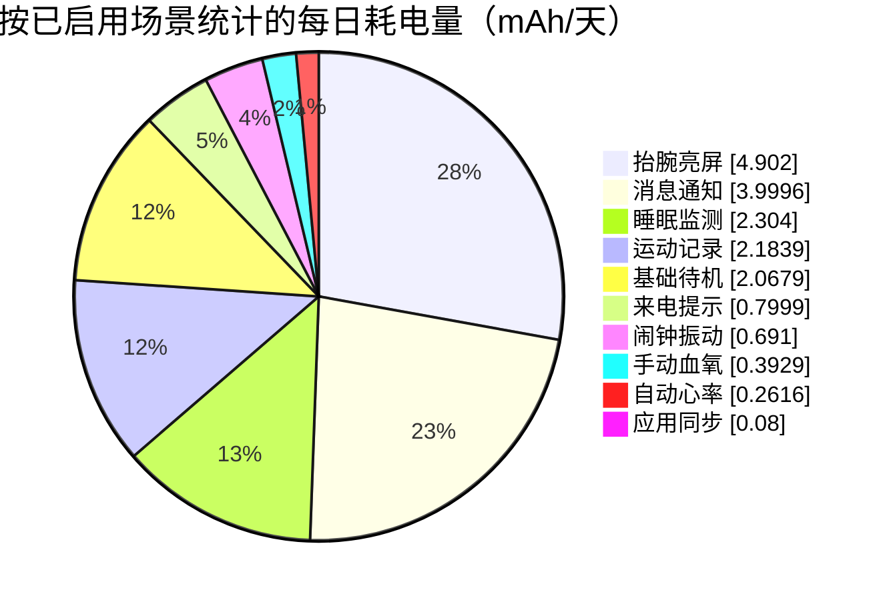
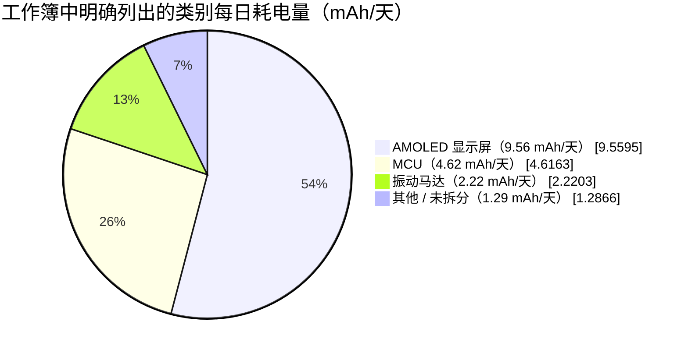
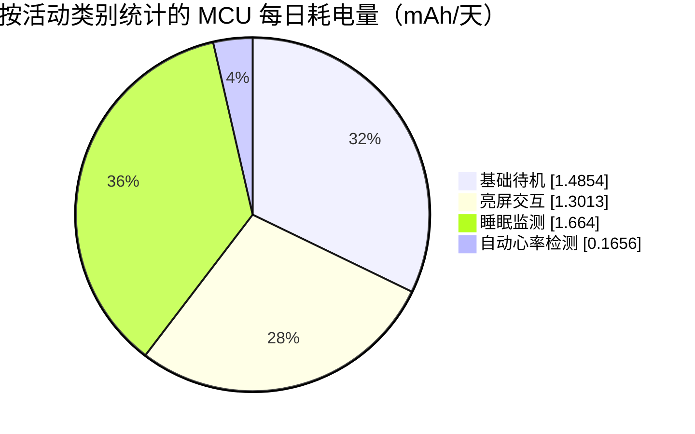

# 智能手表功耗建模与分析 { #power-profiling-a-smartwatch }

功耗分析可以根据预计的日常使用情况估算续航；更重要的是，它能按耗电贡献排出优先优化的负载。本页以提供的[智能手表功耗分析工作簿（英文版）](assets/smartwatch-power-profile-data.xlsx)为例，说明如何计算各使用场景的每日耗电量（mAh）、找出功耗预算中的主要负载，并将表格模型转化为可执行的测量计划。

!!! warning "这是模型，不是器件规格"
    本例中的电流和使用假设来自提供的工作簿，并不是任何特定 SF32 器件、显示屏、电池或手表设计的功耗表征数据。在将结果用于产品续航宣称前，必须用你的硬件实测值替换这些假设。
    工作簿没有提供测量记录，因此无法判断其中是否有输入值来自实测。13.15 天是模型计算出的估算结果，不是实机测得的续航时间。

关于系统架构和固件层面的低功耗设计，请结合[低功耗概览](overview.md)阅读；关于如何验证模型，请参阅[功耗测量与验证](measurement-and-validation.md)。

## 智能手表系统概览 { #smartwatch-system-overview }

先明确模型的系统边界。本工作簿对应一款由电池供电的智能手表，其中包括 MCU、AMOLED 显示屏、振动马达，以及一个未拆分的 `Other`（其他）负载类别。工作簿没有给出屏幕尺寸、分辨率、亮度设置、无线架构或各个传感器的具体信息。下表中的显示电流是工作簿输入值；工作簿没有提供对应的测量记录，因此应将其视为模型假设，而不是实测结果或特定面板的规格。`Other` 表示尚未单独归类的负载，不代表某一个具体器件。

<div align="center"><em>表：智能手表系统与模型输入</em></div>

<div align="center" markdown>

| 项目 | 工作簿中的数值 | 说明 |
|:-----|---------------:|:-----|
| AMOLED 亮屏电流 | 15 mA | 用于消息通知、来电提示和抬腕亮屏。 |
| AMOLED 常亮显示（AOD）电流 | 2 mA | 已在模型中定义，但本基线未启用 AOD 场景。 |
| 电池额定容量 | 250 mAh | 未扣除容量余量前的标称容量。 |
| 电池容量衰减预留 | 7% | 将可用容量降为 232.5 mAh。 |
| 电池标称电压 | 3.87 V | 用于工作簿中的电压归一化辅助计算。 |

</div>

## 按场景分析功耗 { #power-consumption-by-scenario }

场景是完整的用户行为或系统事件，并非单个器件独立工作。例如，一次消息通知可能唤醒 MCU、点亮 AMOLED 显示屏、驱动振动马达，并使后台负载保持活动。源模型中每个标记为 `Display`（显示屏）的行均指 AMOLED 显示屏。源模型将同一场景下的器件负载归在一起，并保留按每日使用量计算出的结果；这些结果所依据的每日发生次数和时长列在本文后面的每日使用模型中。

<div align="center"><em>表：完整的器件级功耗模型</em></div>

<div align="center" markdown>

| 场景 | 器件 | 电压 | 电流 | 电压换算系数* | 每日耗电量 | 占每日耗电量的比例 |
|:-----|:-----|-----:|-----:|---------------:|---------:|-------------:|
| 基础待机 | MCU | 3.3 V | 0.102 mA | 85.27% | 1.4854 mAh | 8.40% |
| 基础待机 | 显示屏 | 3.3 V | 0 mA | 85.27% | 0 mAh | 0.00% |
| 基础待机 | 振动马达 | 3.3 V | 0 mA | 85.27% | 0 mAh | 0.00% |
| 基础待机 | Other（其他） | 3.87 V | 0.04 mA | 100.00% | 0.5825 mAh | 3.29% |
| 消息通知 | MCU | 3.3 V | 2.507 mA | 85.27% | 0.3482 mAh | 1.97% |
| 消息通知 | 显示屏 | 3.3 V | 15 mA | 85.27% | 2.0833 mAh | 11.78% |
| 消息通知 | 振动马达 | 3.3 V | 11.25 mA | 85.27% | 1.5625 mAh | 8.84% |
| 消息通知 | Other（其他） | 3.87 V | 0.04 mA | 100.00% | 0.0056 mAh | 0.03% |
| 来电提示 | MCU | 3.3 V | 2.507 mA | 85.27% | 0.0696 mAh | 0.39% |
| 来电提示 | 显示屏 | 3.3 V | 15 mA | 85.27% | 0.4167 mAh | 2.36% |
| 来电提示 | 振动马达 | 3.3 V | 11.25 mA | 85.27% | 0.3125 mAh | 1.77% |
| 来电提示 | Other（其他） | 3.87 V | 0.04 mA | 100.00% | 0.0011 mAh | 0.01% |
| 抬腕亮屏 | MCU | 3.3 V | 2.607 mA | 85.27% | 0.7242 mAh | 4.10% |
| 抬腕亮屏 | 显示屏 | 3.3 V | 15 mA | 85.27% | 4.1667 mAh | 23.56% |
| 抬腕亮屏 | 振动马达 | 3.3 V | 0 mA | 85.27% | 0 mAh | 0.00% |
| 抬腕亮屏 | Other（其他） | 3.87 V | 0.04 mA | 100.00% | 0.0111 mAh | 0.06% |
| 自动心率检测 | MCU | 3.3 V | 0.207 mA | 85.27% | 0.1656 mAh | 0.94% |
| 自动心率检测 | 显示屏 | 3.3 V | 0 mA | 85.27% | 0 mAh | 0.00% |
| 自动心率检测 | 振动马达 | 3.3 V | 0.08 mA | 85.27% | 0.0640 mAh | 0.36% |
| 自动心率检测 | Other（其他） | 3.87 V | 0.04 mA | 100.00% | 0.0320 mAh | 0.18% |
| 手动血氧饱和度（SpO2）检测 | MCU | 3.3 V | 2.6 mA | 85.27% | 0.0578 mAh | 0.33% |
| 手动血氧饱和度（SpO2）检测 | 显示屏 | 3.3 V | 15 mA | 85.27% | 0.3333 mAh | 1.89% |
| 手动血氧饱和度（SpO2）检测 | 振动马达 | 3.3 V | 0 mA | 85.27% | 0 mAh | 0.00% |
| 手动血氧饱和度（SpO2）检测 | Other（其他） | 3.87 V | 0.08 mA | 100.00% | 0.0018 mAh | 0.01% |
| 运动记录 | MCU | 3.3 V | 0.207 mA | 85.27% | 0.0296 mAh | 0.17% |
| 运动记录 | 显示屏 | 3.3 V | 15 mA | 85.27% | 2.1429 mAh | 12.12% |
| 运动记录 | 振动马达 | 3.3 V | 0 mA | 85.27% | 0 mAh | 0.00% |
| 运动记录 | Other（其他） | 3.87 V | 0.08 mA | 100.00% | 0.0114 mAh | 0.06% |
| 闹钟振动 | MCU | 3.3 V | 2.6 mA | 85.27% | 0.0650 mAh | 0.37% |
| 闹钟振动 | 显示屏 | 3.3 V | 15 mA | 85.27% | 0.3750 mAh | 2.12% |
| 闹钟振动 | 振动马达 | 3.3 V | 10 mA | 85.27% | 0.2500 mAh | 1.41% |
| 闹钟振动 | Other（其他） | 3.87 V | 0.04 mA | 100.00% | 0.0010 mAh | 0.01% |
| 睡眠监测 | MCU | 3.3 V | 0.208 mA | 85.27% | 1.6640 mAh | 9.41% |
| 睡眠监测 | 显示屏 | 3.3 V | 0 mA | 85.27% | 0 mAh | 0.00% |
| 睡眠监测 | 振动马达 | 3.3 V | 0 mA | 85.27% | 0 mAh | 0.00% |
| 睡眠监测 | Other（其他） | 3.87 V | 0.08 mA | 100.00% | 0.6400 mAh | 3.62% |
| 应用数据同步 | MCU | 3.3 V | 2.5 mA | 85.27% | 0.0069 mAh | 0.04% |
| 应用数据同步 | 显示屏 | 3.3 V | 15 mA | 85.27% | 0.0417 mAh | 0.24% |
| 应用数据同步 | 振动马达 | 3.3 V | 11.25 mA | 85.27% | 0.0313 mAh | 0.18% |
| 应用数据同步 | Other（其他） | 3.87 V | 0.04 mA | 100.00% | 0.0001 mAh | 0.0006% |
| NFC 刷卡 | MCU | 3.3 V | 2.5 mA | 85.27% | 0 mAh | 0.00% |
| NFC 刷卡 | 显示屏 | 3.3 V | 15 mA | 85.27% | 0 mAh | 0.00% |
| NFC 刷卡 | 振动马达 | 3.3 V | 11.25 mA | 85.27% | 0 mAh | 0.00% |
| NFC 刷卡 | Other（其他） | 3.87 V | 0.04 mA | 100.00% | 0 mAh | 0.00% |
| 蓝牙通话 | MCU | 3.3 V | 10 mA | 85.27% | 0 mAh | 0.00% |
| 蓝牙通话 | 显示屏 | 3.3 V | 15 mA | 85.27% | 0 mAh | 0.00% |
| 蓝牙通话 | 振动马达 | 3.3 V | 11.25 mA | 85.27% | 0 mAh | 0.00% |
| 蓝牙通话 | Other（其他） | 3.87 V | 0.04 mA | 100.00% | 0 mAh | 0.00% |
| AOD：MCU 每分钟更新一次 | MCU | 3.3 V | 2.5 mA | 85.27% | 0 mAh | 0.00% |
| AOD：MCU 每分钟更新一次 | 显示屏 | 3.3 V | 0 mA | 85.27% | 0 mAh | 0.00% |
| AOD：MCU 每分钟更新一次 | 振动马达 | 3.3 V | 0 mA | 85.27% | 0 mAh | 0.00% |
| AOD：MCU 每分钟更新一次 | Other（其他） | 3.87 V | 0.08 mA | 100.00% | 0 mAh | 0.00% |
| AOD：屏幕常亮 | MCU | 3.3 V | 0 mA | 85.27% | 0 mAh | 0.00% |
| AOD：屏幕常亮 | 显示屏 | 3.3 V | 2 mA | 85.27% | 0 mAh | 0.00% |
| AOD：屏幕常亮 | 振动马达 | 3.3 V | 0 mA | 85.27% | 0 mAh | 0.00% |
| AOD：屏幕常亮 | Other（其他） | 3.87 V | 0.08 mA | 100.00% | 0 mAh | 0.00% |

</div>

\*工作簿将该列标记为 `Power-Conversion Efficiency (%)`，但其公式计算的只是电压比，并非实测的稳压器效率。后文“检查工作簿中的换算假设”一节会说明这对续航估算的影响。表中每日耗电量和占比均按工作簿结果四舍五入；精确公式和数值请使用可下载的工作簿。应先根据下文的排序表确定优化优先级，需要核对某一项的电流或电压假设时，再回到本矩阵查看。

<div align="center"><em>图：智能手表功耗分析闭环</em></div>


### 将场景换算为每日耗电量 { #convert-a-scenario-into-daily-charge }

如果负载电流已按电池侧电流给出，每日耗电量可直接计算：

```text
daily_charge_mAh = current_mA x active_time_seconds_per_day / 3600
```

如果负载通过稳压器供电，应先计算电池侧电流，再乘以活动时间：

```text
battery_current_mA = (load_voltage_V x load_current_mA) /
                     (battery_voltage_V x regulator_efficiency)
```

应使用目标负载电流下实测的稳压器效率。对于大部分时间处于轻载状态的手表，稳压器标称峰值效率通常没有直接参考价值。

### 检查工作簿中的换算假设 { #check-the-workbooks-conversion-assumption }

工作簿中的 `Power-Conversion Efficiency (%)` 列按 `load voltage / battery voltage`（负载电压 / 电池电压）计算。后续耗电量公式先除以该辅助值，再除以电池电压，电压项恰好抵消。因此，每日耗电量实际上就是负载电流乘以时间：它将电池电流视为与负载电流相等，并不是按理想电源转换计算。这种处理类似于忽略静态电流的线性稳压器模型，不能通用于开关稳压器。

例如，3.3 V 电源轨上的 1 mA 负载由 3.87 V 电池通过理想变换器供电时，电池电流约为 0.853 mA，而工作簿计入的是 1 mA。实际变换器的结果取决于效率和静态电流。因此，仅凭工作簿的换算假设，不能判断续航估算偏乐观还是偏保守。排序仍可用于初步检查电流和时长假设，但不能直接当作最终续航预算。用于量产功耗预算时，应以各电源轨、各负载区间的实测效率替换该辅助值，并计入静态电流；若效率测量已包含静态电流，则不要重复计入。此外，还应考虑电池保护和充电路径的损耗。

## 根据实际使用情况计算每日耗电量 { #calculate-daily-consumption-from-product-usage }

同一个场景在不同的使用频率下，可能对每日耗电量的贡献很小，也可能成为主要负载。工作簿中启用了一组场景，用于模拟一天的代表性使用情况，包括基础待机、消息通知、来电提示、抬腕亮屏、心率和血氧饱和度检测、运动记录、闹钟、睡眠监测和应用同步。NFC、蓝牙（Bluetooth）通话以及两个 AOD 场景均设为零，因此 13.15 天的结果不包含这些功能。

<div align="center"><em>表：产品每日使用情况与功耗贡献</em></div>

<div align="center" markdown>

| 场景 | 每天次数 | 每次时长 | 每日总时长 | 占每日耗电量的比例 | 建模状态 |
|:-----|---------:|---------:|-----------:|-------------:|:---------|
| 基础待机 | 1 | 当天剩余秒数（`=G7`） | 52,425.7 s | 11.69% | 已启用 |
| 消息通知 | 100 | 5 s | 500 s | 22.62% | 已启用 |
| 来电提示 | 10 | 10 s | 100 s | 4.52% | 已启用 |
| 抬腕亮屏 | 200 | 5 s | 1,000 s | 27.72% | 已启用 |
| 自动心率检测 | 48 | 60 s | 2,880 s | 1.48% | 已启用 |
| 手动血氧检测 | 2 | 40 s | 80 s | 2.22% | 已启用 |
| 运动记录 | 1 | `3600 / 7` s | 514.3 s | 12.35% | 已启用；每周 1 h，按每日平均计算 |
| 闹钟振动 | 3 | 30 s | 90 s | 3.91% | 已启用 |
| 睡眠监测 | 1 | `8 x 3600` s | 28,800 s | 13.03% | 已启用 |
| 应用数据同步 | 20 | 0.5 s | 10 s | 0.45% | 已启用 |
| NFC 刷卡 | 0 | 5 s | 0 s | 0.00% | 未启用 |
| 蓝牙通话 | 0 | `2 x 60` s | 0 s | 0.00% | 未启用 |
| AOD：MCU 每分钟更新一次 | 0 | 0.05 s | 0 s | 0.00% | 未启用 |
| AOD：屏幕常亮 | 0 | `(24 - 8) x 3600` s | 0 s | 0.00% | 未启用 |

</div>

源数据矩阵中场景列的空白并非遗漏。每个具名场景行之后，都依次列出显示屏、振动马达和 `Other` 负载行；这些负载沿用上方场景行的每天次数和每次时长，因此源数据只在场景行中填写一次。

<div align="center"><em>表：根据每日使用情况计算出的结果</em></div>

<div align="center" markdown>

| 结果 | 计算方式 | 数值 |
|:-----|:---------|-----:|
| 可用电池容量 | `250 mAh x (1 - 7%)` | 232.5 mAh |
| 模型每日耗电量 | 所有已启用场景负载之和 | 17.68 mAh/天 |
| 平均电池电流 | `17.68 mAh/day / 24 h` | 0.74 mA |
| 预计续航 | `232.5 mAh / 17.68 mAh/day` | 13.15 天 |

</div>

场景排序比最终续航天数更能指导行动。对每日耗电量贡献最大的场景，最值得优先验证优化假设。

<div align="center"><em>表：智能手表模型中已启用场景的贡献</em></div>

<div align="center" markdown>

| 场景 | 每日耗电量 | 占每日耗电量的比例 | 假设的每日行为 |
|:-----|---------:|-------------:|:---------------|
| 抬腕亮屏 | 4.90 mAh | 27.72% | 200 次，每次 5 s。 |
| 消息通知 | 4.00 mAh | 22.62% | 100 次，每次 5 s。 |
| 睡眠监测 | 2.30 mAh | 13.03% | 8 h。 |
| 运动记录 | 2.18 mAh | 12.35% | 每周 1 h，折算为每日平均值。 |
| 基础待机 | 2.07 mAh | 11.69% | 扣除已启用活动后的剩余时间。 |
| 来电提示 | 0.80 mAh | 4.52% | 10 次，每次 10 s。 |
| 闹钟振动 | 0.69 mAh | 3.91% | 3 次，每次 30 s。 |
| 手动血氧检测 | 0.39 mAh | 2.22% | 2 次，每次 40 s。 |
| 自动心率检测 | 0.26 mAh | 1.48% | 48 次，每次 60 s。 |
| 应用数据同步 | 0.08 mAh | 0.45% | 20 次，每次 0.5 s。 |

</div>

<div align="center"><em>图：智能手表模型中已启用场景的耗电量贡献</em></div>



耗电贡献最大的两个亮屏交互场景合计约占模型每日耗电量的一半。这是可通过测量验证的结论，而不只是笼统地说“显示屏耗电”。在投入精力处理更小的负载前，应先确认真实的抬腕次数、亮屏时长、亮度、刷新方式和通知策略。

<div align="center"><em>表：按器件类别汇总的每日耗电量</em></div>

<div align="center" markdown>

| 器件类别 | 每日耗电量 | 占每日耗电量的比例 | 应重点核实的问题 |
|:---------|---------:|-------------:|:-----------------|
| AMOLED 显示屏 | 9.56 mAh | 54.06% | 亮度、亮屏时长和刷新次数是否符合真实使用行为？ |
| MCU | 4.62 mAh | 26.11% | 每次短时工作结束后，固件是否回到目标睡眠状态？ |
| 振动马达 | 2.22 mAh | 12.56% | 每类事件所用的振动强度、模式和时长是否确有必要？ |
| 其他 / 未拆分 | 1.29 mAh | 7.28% | 传感器、电源管理 IC（PMIC）、射频和漏电假设是否已分别实测？ |

</div>

<div align="center"><em>图：智能手表模型中已知类别的每日耗电量拆分</em></div>



图中最后一项特意保留为 `Other / unallocated`（未拆分）。工作簿没有给出蓝牙、加速度计或陀螺仪各自独立的电池侧耗电量。蓝牙通话场景被禁用，并不表示蓝牙耗电为零：应用同步场景也可能使用无线链路，但工作簿没有将这部分能耗拆出。同样，传感器能耗可能包含在 `Other` 中，但无法根据提供的数据继续拆分为加速度计和陀螺仪。

要将图表拆分为五类——MCU、显示屏、振动马达、蓝牙，以及合并统计的加速度计与陀螺仪——应分别为蓝牙空闲和传输状态、加速度计模式与占空比、陀螺仪模式与占空比增加数据行。每项负载都应在电池输入端测量，或先按实测稳压器效率折算，再计入电池侧 mAh 总量。随后用这些测量结果替换 `Other / unallocated`（其他/未拆分），不要再叠加可能已计入其中的传感器或蓝牙耗电。

### 区分 MCU 基础负载、场景相关 MCU 工作与传感器负载 { #separate-standby-mcu-active-mcu-and-sensors }

工作簿单独列出了 `MCU` 类负载，但没有单独记录图形渲染这条代码路径。因此，更稳妥的分析方式是区分基础待机 MCU 项与各使用场景中归入 MCU 的负载；工作簿并未单独列出传感器耗电。

<div align="center"><em>表：工作簿中 MCU 类负载的拆分</em></div>

<div align="center" markdown>

| MCU 活动类别 | 每日耗电量 | 占每日总耗电量 | 占 MCU 耗电量 | 说明 |
|:-------------|---------:|-------------:|------------:|:-----|
| 基础待机 | 1.49 mAh | 8.40% | 32.18% | 在模型剩余的 14.56 h 内按 0.102 mA 计算。这是系统级 MCU 类负载假设，并非经过验证的 MCU 晶粒本身的漏电流。 |
| 亮屏交互 | 1.30 mAh | 7.36% | 28.19% | 包含消息、来电、抬腕亮屏、血氧检测、运动、闹钟和应用同步。既包括事件处理，也包括可能的图形工作。 |
| 睡眠监测 | 1.66 mAh | 9.41% | 36.04% | 在 8 h 内按 0.208 mA 计算，是模型中最大的单项 MCU 负载。 |
| 自动心率检测 | 0.17 mAh | 0.94% | 3.59% | 定时传感器采样及相应的 MCU 处理。 |
| **MCU 合计** | **4.62 mAh** | **26.11%** | **100%** | 工作簿中所有明确列出的 MCU 项。 |

</div>

<div align="center"><em>图：工作簿中 MCU 类负载的每日耗电量拆分</em></div>



下面两个比较可以避免得出片面的结论：

- **基础待机 MCU 项与亮屏场景中的 MCU 项：**基础待机为 1.49 mAh/天，略高于所有亮屏交互场景合计的 1.30 mAh/天 MCU 耗电量。按这组模型数据，降低假设的基础待机电流，与减少这些亮屏场景关联的 MCU 工作至少同等重要。工作簿没有把图形突发工作单独作为一项测量。
- **基础待机 MCU 项与其他明确列出的 MCU 项：**其余 MCU 项合计为 3.13 mAh/天，是基础待机 MCU 项的 2.11 倍。睡眠监测是最大的非基础待机单项，耗电量为 1.66 mAh/天；这是按场景归类的 MCU 负载，并非 CPU 单独处于活动状态时的测量值。

工作簿没有单独的传感器类别。`Other` 是唯一可能包含传感器耗电的类别，但其中也可能混有 PMIC、射频、漏电或其他后台负载。该类别合计为 1.29 mAh/天（7.28%）。即使把全部 `Other` 都归入传感器，工作簿中明确列出的 MCU 类负载仍更高：4.62 mAh/天，而 `Other` 为 1.29 mAh/天，前者约为后者的 3.59 倍。这只是工作簿类别之间的比较，并非 MCU 晶粒与传感器的直接实测对比。只有将传感器电源轨从通用的 `Other` 项中拆出，才能计算传感器自身的实际耗电量占比。

<div align="center"><em>表：继续拆分剩余负载所需的测量</em></div>

<div align="center" markdown>

| 问题 | 当前工作簿的边界 | 所需测量 |
|:-----|:-----------------|:---------|
| MCU 漏电是多少？ | 基础待机 `MCU` 电流并不只代表 MCU 晶粒本身的漏电流。 | 测量目标睡眠状态下的 MCU 电源轨，再单独测量整板漏电。 |
| 图形渲染耗电是多少？ | 亮屏场景中的 MCU 时间还包括唤醒、事件处理和显示驱动工作。 | 在固件中标记渲染区间，并对该时间窗口内的电流积分。 |
| 哪部分属于传感器？ | 传感器没有单独类别，可能包含在 `Other`（其他）中。 | 测量每个传感器电源轨，或按传感器模式和占空比分别新增工作簿行。 |
| `Other`（其他）中还包含什么？ | PMIC、射频、漏电和传感器混在一起。 | 逐一关闭或隔离电源轨/子系统，再与电池侧总耗电核对。 |

</div>

## 根据排序安排设计工作 { #turn-the-ranking-into-design-work }

应从模型中贡献最大的负载开始处理，再用实测结果验证排序。对于本模型，建议按以下顺序推进：

1. **显示策略：**测量抬腕亮屏全过程的电流曲线。先减少误触发，缩短亮屏时间，降低亮度，减少全屏重绘和不必要的动画，再考虑是否有必要把 MCU 电流降低几 µA。
2. **通知策略：**在产品体验允许时合并非紧急通知，并评审每个事件是否都需要同时点亮显示屏和振动提醒。
3. **已连接待机：**确认每次事件结束后 MCU 都能进入目标睡眠状态。检查周期定时器、轮询循环、蓝牙回调，以及各驱动提出的电源管理（PM）状态请求。
4. **振动模式：**通过主观感知测试调整幅度和时长。更短或更柔和的振动，可能在不降低提醒效果的前提下减少能耗。
5. **长时间运行的传感器任务：**分析睡眠监测和运动记录的完整场景，覆盖传感器占空比、数据处理、存储器访问和无线活动。

不要孤立地优化表格中的某一个数字。看似省电的改动，可能增加唤醒次数、损害体验，或延长活动时间，从而抵消预期收益。

## 在硬件上验证模型 { #validate-the-model-on-hardware }

模型经过实测结果的持续校准后才有用。对于每个主要贡献项，都应记录电池或电源电压、温度、硬件版本、固件版本、启用的无线功能、显示模式和测量量程。

<div align="center"><em>表：本智能手表模型的基础验证计划</em></div>

<div align="center" markdown>

| 场景 | 应测量的内容 | 应回填到模型中的内容 |
|:-----|:-------------|:---------------------|
| 熄屏待机 | 长时间采样的平均电流和异常唤醒 | 基础 MCU、传感器、PMIC 及其他后台负载的电流。 |
| 抬腕亮屏 | 手势识别、唤醒延迟（latency）、显示电流和亮屏时长 | 真实事件次数、显示时长和用户界面能耗。 |
| 消息通知 | 单次提醒期间的 MCU、显示、振动马达和蓝牙活动 | 单次通知能耗和正确的每日次数。 |
| 睡眠监测 | 整晚的电流曲线，或可重复测量的代表性时间窗口 | 传感器占空比和周期处理能耗。 |
| 运动记录 | 一次目标运动过程中的传感器、显示、存储和无线活动 | 每次运动的能耗和真实的每周次数。 |
| AOD、NFC 和蓝牙通话 | 在纳入续航预测前分别测量 | 各自独立的场景，而不是对待机值做微小修正。 |

</div>

## 让模型保持可信 { #keep-the-profile-honest }

- 场景设为零表示尚未纳入预算，不表示该功能不耗电。当前工作簿为 NFC、蓝牙通话和 AOD 场景分配的耗电量均为零。
- 将用户可见功能和后台工作拆分为独立场景，这样产品评审时才能看清取舍。
- 尽量在电池输入端测量。电源轨测量同样有价值，但在变成续航数据前，必须补入稳压器损耗和静态电流。
- 每次只改变一个假设，并比较每日耗电量（mAh），而不是只看瞬时电流。
- 显示策略、蓝牙参数、传感器采样频率、PM 策略或重大固件功能发生变化后，都应重新运行模型。

## 要点 { #key-takeaways }

- 续航等于有效电池容量除以每日耗电量；该模型以 232.5 mAh 可用容量和 17.68 mAh/天的已启用负载，得到 13.15 天的预计续航。
- 在提供的基线中，显示行为主导功耗预算。仅抬腕亮屏和消息通知就约占每日耗电量的一半。
- 场景排序决定优先测什么、优化什么，比单一平均电流数值更有价值。
- 在把表格预测当作量产续航结论前，必须加入真实的电源转换效率和静态电流。
- 重复这一闭环：建立真实使用模型、测量主要场景、更新假设，再进行优化。
