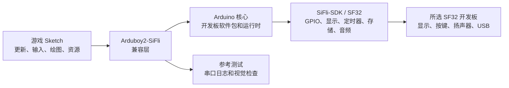

# Arduboy2 的 SF32LB52 移植版 { #arduboy2-on-sifli }

## 什么是 Arduboy2-SiFli？ { #what-is-arduboy2-sifli }

[OpenSiFli/Arduboy2-SiFli](https://github.com/OpenSiFli/Arduboy2-SiFli) 是 OpenSiFli 面向思澈科技（SiFli）开发环境移植的 [Arduboy2 库](https://github.com/MLXXXp/Arduboy2)。Arduboy2 为小型游戏设备提供面向应用的模型：帧循环、显示缓冲区、按键、精灵、文本和可选的声音控制。因此，思澈科技（SiFli）移植很适合作为兼容性实验：在底层开发板、显示、输入、音频和构建路径迁移到 SF32 后，仍有多少 Arduboy 风格的游戏逻辑可以保留？

该仓库是软件参考实现，不是完整的游戏机，也不是可直接量产的硬件设计。确切的开发板目标、受支持 API 范围、构建流程和再分发条件，应以上游仓库的 README、源代码、示例、问题记录和许可证文件为准。本文负责围绕该参考实现组织工程决策，不替代仓库中的可执行说明。

## 这一 SF32 移植版有何价值？ { #why-the-sifli-implementation }

Arduboy 风格的应用可以一次性验证多项嵌入式产品决策：可预测的渲染循环、小型单色或低分辨率资源、按键输入、音频时序以及严格的内存预算。将这一模型移植到 SF32，可以为掌上游戏、UI 演示、教育设备，以及其他本地交互、行为确定的产品提供早期参考。

价值不在于每个 Arduboy Sketch 都能原样运行，而在于这次移植暴露出的边界：

- 如果游戏停留在受支持的 Arduboy2 API 范围内，可以保留较高层的更新、输入、绘图和资源逻辑。
- 移植必须转换原始硬件中隐含的显示、按键、音频、时序和存储假设。
- 直接控制 AVR 寄存器、Arduboy 专用引脚、显示事务、定时器或 EEPROM 布局的 Sketch，都需要有意改造并单独提供回归证据。

以上是工程预期，而不是经过测量的兼容性声明。应根据当前 OpenSiFli 仓库，针对所选开发板和提交版本确认实际结果，并记录证据。

## 成果、范围与进入条件 { #outcome-scope-and-entry-criteria }

本文定义一条从 OpenSiFli 参考实现出发，得到一个可复现的 SF32 游戏或交互式演示的分阶段路径。本文**不能**证明移植支持所有 Arduboy2 功能、所有 Arduboy 游戏、所有 SF32 开发板，也不能证明显示和音频时序已经达到量产质量。本文也不为从第三方仓库复制的游戏、字体、图像或其他资源建立许可证权利。

**成果：**得到一个受源代码管理的 Arduboy2-SiFli 构建：能在开发板上运行仓库示例或小型测试 Sketch，展示选定的显示 / 输入 / 音频路径，并保留判断是否值得投入更大游戏或产品适配所需的证据。

**目标读者：**能够使用 Arduino 工具、阅读 C/C++ 代码、向 SF32 开发板烧录固件、读取串口输出，并完成基本显示、输入和功耗测量的固件、硬件和产品工程师。

开始前准备好以下内容：

- 使用 ArduinoCore-Zephyr 变体 `sf32lb52_devkit_lcd_sf32lb525uc6` 的 SF32LB52 开发板，以及下文所列的外接外设。README 说明显示、按键、外接 EEPROM 和音频路径已在 SF32LB52 硬件上进行过验证；README 也记录了 RGB LED 路径，但未说明该路径经过了测试。README 没有固定实体开发板的硬件版本，也未注明 OLED 模组的具体型号。
- 已验证可用的 Arduino 环境和匹配的 OpenSiFli 开发板软件包。上述变体名称只确定软件目标和引脚映射，并不能证明所有 SF32LB52-DevKit-LCD 实物版本都符合项目的外接接线要求；连接外设前应核对实际开发板原理图。
- Arduboy2-SiFli 的准确提交版本、Arduino 核心 / 软件包版本、主机操作系统和烧录工具。
- USB 数据连接，以及记录串口日志、观察显示、按键和音频输出的方法。
- 对下游适配中包含的每个游戏、图像、字体和声音资源进行使用和再分发的许可。

<em>表：项目约定</em>

| 范围 | 项目基线 | 适配前的证据 |
|:-----|:---------|:-------------|
| 源代码 | 已记录的 OpenSiFli/Arduboy2-SiFli 提交版本及其依赖版本。 | 干净检出和可复现的构建记录。 |
| 开发板 | SF32LB52、ArduinoCore-Zephyr 变体 `sf32lb52_devkit_lcd_sf32lb525uc6`，以及下文所列的外接外设。 | 记录实体开发板版本、接线、供电和成功烧录结果；仓库未固定开发板版本或 OLED 型号。 |
| 工具链 | Arduino IDE 或 CLI、OpenSiFli 开发板软件包和有文档说明的烧录路径。 | 软件包版本、开发板选择、编译输出、烧录日志和串口日志。 |
| 参考行为 | 能验证该移植的一个上游示例或最小测试 Sketch。 | 观察并重复验证显示刷新、输入响应和受支持的音频行为。 |
| 产品改动 | 一项有边界的游戏或 UI 适配。 | 改动后参考测试仍然通过，并保留资源和许可证记录。 |

## 硬件与软件规格 { #hardware-and-software-specifications }
### 硬件规格 { #hardware-specification }

<em>表：Arduboy2-SiFli 硬件规格</em>

| 器件或设备 | 必要规格 | 用途 | 状态 | 获取方式或来源 | 兼容性与替换说明 |
|:-----------|:---------|:-----|:-----|:---------------|:-----------------|
| SF32LB52 开发板 | ArduinoCore-Zephyr 变体 `sf32lb52_devkit_lcd_sf32lb525uc6`；仓库未固定实体开发板版本 | 运行移植版本并提供已映射的 MCU 引脚 | 必需 | [Arduboy2-SiFli 源码](https://github.com/OpenSiFli/Arduboy2-SiFli)；[ArduinoCore-zephyr 变体](https://github.com/OpenSiFli/ArduinoCore-zephyr) | 该信息确定的是软件开发板变体和引脚映射，并非已验证的实体装配；接线前请核对实际开发板版本和原理图 |
| 单色 OLED | 128 × 64 像素，通过 SPI1 连接；仓库未注明具体模组或控制器 | 显示游戏帧缓冲区 | 必需 | [Arduboy2-SiFli 源码](https://github.com/OpenSiFli/Arduboy2-SiFli) | OLED 为外接器件；使用前应根据模组和开发板核对控制器、电压、连接器、方向及时序 |
| 六个游戏按键 | 兼容 Arduboy 的输入；低电平有效并启用上拉，具体引脚映射见仓库 | 读取方向键及 A/B 键输入 | 必需 | [Arduboy2-SiFli 源码](https://github.com/OpenSiFli/Arduboy2-SiFli) | 按键需外接；请对照实体开发板核实 Arduino IO 映射，并记录接线和消抖行为 |
| 外接 EEPROM | AT24C02 或 AT24C32，通过 I2C1 连接，地址为 `0x50` | 支持使用 EEPROM 的库功能 | 可选；仅使用 EEPROM 功能时必需 | [Arduboy2-SiFli 源码](https://github.com/OpenSiFli/Arduboy2-SiFli) | 请确认所选器件、电压、上拉电阻和总线接线；仓库未指定已装配的 EEPROM 组合 |
| 音频输出和 RGB 指示灯 | 仓库支持的音频后端使用映射的扬声器输出；外接共阴 RGB LED 由软件 PWM 驱动 | 提供可选音效和颜色指示 | 可选；按待测 Sketch 选择 | [Arduboy2-SiFli 源码](https://github.com/OpenSiFli/Arduboy2-SiFli) | 源码未给出完整的扬声器 / LED 物料清单；请验证外部电路、引脚映射、电流和音频表现 |
| 主机与 USB 数据连接 | 使用所选 Arduino 工具链支持的主机；准备支持数据传输的线缆并能够读取串口日志 | 构建、下载并观察参考程序 | 必需 | [ArduinoCore-zephyr](https://github.com/OpenSiFli/ArduinoCore-zephyr) | 记录主机操作系统、线缆与端口、软件包版本和恢复方式；仅支持充电的线缆不适用 |

### 软件规格 { #software-specification }

<em>表：Arduboy2-SiFli 软件规格</em>

| 软件包或服务 | 所需版本或修订版 | 用途 | 状态 | 获取方式或来源 | 兼容性与更新说明 |
|:-------------|:-----------------|:-----|:-----|:---------------|:-----------------|
| OpenSiFli/Arduboy2-SiFli | 固定并记录一个提交版本；本文未锁定具体修订版 | SF32 兼容层和示例 | 必需 | [代码仓库](https://github.com/OpenSiFli/Arduboy2-SiFli) | 根据选定提交重新核对开发板目标、依赖项和受支持的 API |
| OpenSiFli/ArduinoCore-zephyr 与开发板软件包 | 从移植项目中确认兼容的提交版本和软件包版本，并记录下来 | Arduino 运行时、开发板定义、编译器及下载集成 | 必需 | [代码仓库](https://github.com/OpenSiFli/ArduinoCore-zephyr) | 未经干净构建和外设回归验证，不要替换为更新的核心或其他开发板软件包 |
| 测试草图与游戏资源 | 选择一个仓库示例或单独取得许可的测试草图；记录资源版本和许可 | 验证所选 API 和产品功能链路 | 二选一 | [Arduboy2-SiFli 示例](https://github.com/OpenSiFli/Arduboy2-SiFli) | 本文不授予再分发第三方游戏、字体、图像或音效的权利 |

## 选择受支持的基线 { #choose-a-supported-baseline }
从 OpenSiFli 仓库明确列出的开发板和软件组合开始，不要因为某块开发板看起来相似，就从产品目录中自行选择。开发板软件包、显示接线、按键映射、烧录方法和库的假设共同构成基线。

Arduboy2-SiFli 仓库没有单独的开发板引脚映射文件；具体映射表发布在 README 的 [SiFli I/O mapping 表](https://github.com/OpenSiFli/Arduboy2-SiFli#sifli-io-mapping) 中。库内部的逻辑引脚定义见 [`pins_sifli.h`](https://github.com/OpenSiFli/Arduboy2-SiFli/blob/master/src/platforms/sifli/pins_sifli.h)，开发板侧的引脚路由则由 ArduinoCore-Zephyr 中对应的[设备树叠加文件（devicetree overlay）](https://github.com/OpenSiFli/ArduinoCore-zephyr/blob/main/variants/sf32lb52_devkit_lcd_sf32lb525uc6/sf32lb52_devkit_lcd_sf32lb525uc6.overlay)定义。这些资料描述的是软件基线，并不代表某个实体装配已通过验证；接线前仍须核对实际开发板版本及其原理图。

<em>表：基线选择</em>

| 基线要素 | 从哪里选择 | 不要假设 |
|:---------|:-----------|:---------|
| 目标开发板 | Arduboy2-SiFli README 中指定的 ArduinoCore-Zephyr 变体 `sf32lb52_devkit_lcd_sf32lb525uc6`，并核对实体开发板原理图。 | 软件变体足以证明任意硬件版本或外设组合都兼容。 |
| Arduino 核心 | 仓库为目标开发板记录的 OpenSiFli 软件包和版本。 | 最新软件包一定能替代仓库所用的版本。 |
| 显示和输入 | 仓库中的引脚 / 配置定义以及实际开发板原理图。 | 原始 Arduboy 的显示几何、按键电平或引脚名称与 SF32 开发板一致。 |
| 音频 | 仓库支持的输出路径和开发板专用配置。 | 能调用音调 API 就代表扬声器时序、音量和供电行为已经达到产品要求。 |
| 烧录和恢复 | 所选开发板对应的 Arduino 或 `sftool` 文档流程。 | 在一台主机上烧录成功就代表已经具备可用于现场升级的恢复路径。 |

仓库给出了软件开发板变体和外设引脚映射，并说明显示、按键、外接 EEPROM 和音频路径已在 SF32LB52 硬件上进行过验证。仓库还记录了外接 RGB LED 的支持路径，但未说明经过了测试。仓库没有注明实体开发板版本、OLED 模组 / 控制器的具体型号，也没有给出完整的配件装配方案。接线或声明硬件基线可复现之前，应将该变体的引脚映射与实际开发板原理图逐项核对，并记录所用器件及版本。不得用其他 SF32 项目的引脚映射或地址填补剩余信息空缺。

## 项目阶段与决策要点 { #delivery-map }

将以下阶段视为决策门槛，而不是功能清单。

<em>表：项目阶段与决策要点</em>

| 阶段 | 支持的决策 | 必需产物 |
|:-----|:-----------|:---------|
| 1. 未修改的参考实现 | 有文档的移植能否在所选基线上构建、烧录并运行？ | 已知正常的 Sketch、提交 / 软件包记录、烧录日志和观察结果。 |
| 2. 外设验证 | 显示、输入、音频、复位和时序是否在真实开发板上表现可预测？ | 包含故障和恢复行为的外设测试记录。 |
| 3. 可复现的源码基线 | 另一名工程师能否从干净检出构建出相同镜像？ | 干净构建产物、环境记录和重复结果。 |
| 4. 受控的游戏适配 | 引入一项有边界的游戏或 UI 改动后，移植是否仍然正常？ | 经过评审的改动、资源 / 许可证记录和回归结果。 |
| 5. 产品就绪评审 | 是否有足够强的参考实现，可以投入自定义硬件或更大规模的软件工作？ | 包含责任人、证据、缓解措施和继续 / 延期 / 停止决定的风险记录。 |

## 系统架构与依赖 { #system-architecture-and-dependencies }

<em>图：Arduboy2-SiFli 应用路径</em>

这是用于决策的模型，不代表仓库内部一定使用这些模块名称。修改移植前，应确认实际源代码边界。对产品最重要的路径包括：

- **帧和时序：**游戏循环必须以可重复的节奏更新和渲染；任何对时序敏感的音频或输入行为，都必须在目标开发板上测量。
- **显示：**兼容层必须将游戏缓冲区和几何参数映射到所选显示控制器、像素格式、方向和刷新路径。
- **输入：**必须针对开发板接线检查按键名称、电平、去抖、同时按键以及唤醒 / 复位行为。
- **音频：**在验证之前，应将音调生成、定时器占用、扬声器连接、音量和静音行为视为开发板专用问题。
- **资源和存储：**必须在链接所选游戏后测量字体、精灵、声音数据、闪存布局和 RAM 使用量。
- **恢复：**在尝试时序、内存或低功耗改动前，保留已知可用的烧录和恢复路径。

主要故障域包括应用 / API 兼容性、显示配置、输入接线、音频 / 定时器行为、内存和资源放置，以及烧录 / 恢复。某一故障域出错时，不应笼统地报告为“移植不可用”。

## 阶段 1——建立未修改的参考基线 { #stage-1-establish-the-untouched-reference }

**目标：**在修改库或游戏前，证明仓库文档中的基线确实可用。

1. 阅读仓库说明，记录默认分支或发布版本，并检查示例、开发板配置、依赖和许可证文件。
2. 安装仓库要求的准确 Arduino 核心 / 软件包和工具。记录主机操作系统和工具版本。
3. 构建并烧录文档中最小的示例或测试 Sketch。
4. 捕获串口输出，记录显示内容、响应按键，以及示例是否使用音频。

**应保留的证据：**仓库提交版本、依赖 / 软件包版本、开发板版本、接线或原理图依据、构建输出、烧录日志、串口日志和简短功能记录。

**阶段 1 退出门槛：**未修改的参考实现能在所选开发板上构建和烧录，且复位或断电重启后仍能重复观察到文档描述的行为。

## 阶段 2——验证外设与时序边界 { #stage-2-validate-peripheral-and-timing-boundaries }

**目标：**将“成功编译”与“可用的游戏设备基线”区分开来。

1. 验证示例使用的显示清屏、整帧更新、精灵或位图绘制、文本路径以及几何 / 方向假设。
2. 验证项目使用的全部输入，包括释放、同时按键、快速按键，以及适用时的复位或唤醒行为。
3. 如果包含音频，验证音调启动 / 停止、定时器交互、静音行为，以及显示和输入活动对音频路径的影响。
4. 通过复位、拔插电源以及无效或不完整的输入序列中断正常流程，记录开发板是否能恢复到可烧录、可运行状态。

**应保留的证据：**视觉或捕获的显示结果、输入矩阵、时序观察、音频观察、复位 / 恢复日志，以及会影响产品决策的电流或延迟测量。

**阶段 2 退出门槛：**已经充分理解所选外设路径，能够区分应用错误、开发板配置问题、时序问题和供电问题。

## 阶段 3——建立可复现的源码基线 { #stage-3-build-a-reproducible-source-baseline }

**目标：**让移植可以复现，而不是依赖某一台开发机或现成二进制文件。

1. 从干净检出开始，并初始化仓库要求的全部依赖。
2. 记录开发板软件包、Arduino IDE / CLI 版本、编译器 / 工具版本、配置文件和生成的资源。
3. 在干净目录中构建，保存生成的镜像以及可用的 map / 大小信息，并记录烧录命令或工具输出。
4. 在第二台机器上，或删除构建目录后重复构建。

**应保留的证据：**源代码版本、依赖版本、主机 / 工具清单、构建日志、二进制或其他产物、大小报告、烧录日志和串口日志。

**阶段 3 退出门槛：**干净检出能构建出通过阶段 2 外设检查的镜像，且不依赖未记录的本地文件或手工改动。

## 阶段 4——有意地适配一个游戏 { #stage-4-adapt-one-game-deliberately }

**目标：**通过一项受控的产品改动证明兼容边界。

从一个显示、输入、音频和资源需求都清晰的小型 Sketch 或游戏开始。保留未修改的参考镜像，每次只改动一类行为：

<em>表：受控适配顺序</em>

| 改动类别 | 从哪里开始 | 必需回归 |
|:---------|:-----------|:---------|
| 标识和 UI | 标题画面、字体、精灵、调色板或屏幕布局。 | 构建、烧录、帧更新、输入和资源完整性检查。 |
| 游戏逻辑 | 一项有边界的规则、关卡或状态转换。 | 可重复的输入序列、复位、分数 / 状态持久化（如使用）和帧时序。 |
| 音频 | 使用受支持路径生成一个音调或短音效。 | 启动 / 停止、静音、定时器交互，以及显示 / 输入负载下的行为。 |
| 存储 | 一项小范围的存档或资源加载改动。 | 大小报告、断电行为、损坏处理和干净恢复。 |
| 开发板适配 | 一项有依据的显示、按键或扬声器映射改动。 | 原理图 / 引脚证据、完整外设回归以及回退到参考镜像的能力。 |

没有来源支持时，不要将 AVR 寄存器访问、原始 Arduboy 引脚假设或存储地址直接复制到 SF32 项目中。将第三方游戏和资源许可证随适配后的源码一同保存；再分发条件不清楚的内容应当移除。

**应保留的证据：**经过评审的差异、资源来源、前后镜像、构建和烧录日志、回归结果以及回滚镜像。

**阶段 4 退出门槛：**适配后的游戏通过参考外设检查，并且已经记录其内存、时序、恢复和许可证边界。

## 阶段 5——产品就绪评审 { #stage-5-product-readiness-review }

在从移植演示进入自定义硬件或现场试用前，团队必须回答：

- 哪一块 SF32 开发板、显示、按键、扬声器和供电是受支持的，哪些仍只是工程假设？
- 在目标产品基线上测得的帧率、输入延迟、音频行为、启动时间和电流特征是什么？
- 游戏、资源、字体和运行时合计消耗多少闪存和 RAM，最坏内容规模下又是多少？
- 复位、欠压、保存过程中断电、资源损坏、烧录失败或升级中断后会发生什么？
- 移植中哪些部分由产品团队、OpenSiFli、思澈科技（SiFli）或原始 Arduboy2 社区维护？
- 每个游戏、字体、图像、声音和库的许可证是否适合预期的发布模式？

**阶段 5 退出门槛：**剩余风险已经指定责任人并有证据支持；每一项都有缓解措施、明确延期或停止决定。

## 产品设计阶段交接 { #handoff-to-product-design }

将选定的 SF32 器件、显示和输入架构、音频 / 定时器方案、闪存和资源布局、功耗测量、恢复方法以及量产测试假设带入[硬件](../hardware/index.md)栏目。如果游戏的显示、内存、封装、功耗或连接能力要求改变了器件候选范围，请使用 [SF32 产品选型工具](../sf32-products/product-selector.md)。软件基线应从[Arduino 入门指南](../getting-started/arduino/getting-started-arduino.md)开始，再阅读 [Arduino 平台概览](../develop/platforms/arduino/overview.md)。

当另一名工程师能够重建移植、重复外设结果、解释每一项开发板专用适配，并在批准自定义开发板或扩展游戏库前审查相关证据时，该参考实现才完成了产品开发层面的使命。

## 权威来源 { #authoritative-sources }
- [OpenSiFli/Arduboy2-SiFli](https://github.com/OpenSiFli/Arduboy2-SiFli)
- [MLXXXp/Arduboy2](https://github.com/MLXXXp/Arduboy2)
- [OpenSiFli/ArduinoCore-zephyr](https://github.com/OpenSiFli/ArduinoCore-zephyr)
- [SF32 Arduino 入门指南](../getting-started/arduino/getting-started-arduino.md)
- [Arduino 平台概览](../develop/platforms/arduino/overview.md)
- [SF32 产品选型工具](../sf32-products/product-selector.md)
