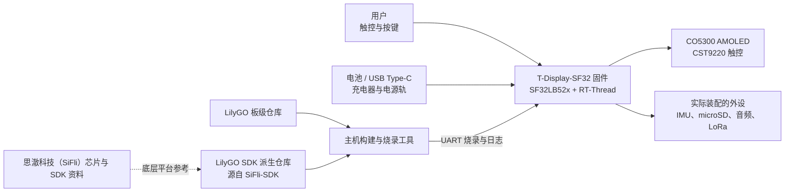

# LilyGO T-Display-SF32 { #lilygo-t-display-sf32 }

!!! warning "第三方项目——并非思澈科技（SiFli）项目"
    T-Display-SF32 由 Xinyuan-LilyGO/LilyGO 发布和维护，并非由思澈科技（SiFli）或 OpenSiFli 发布和维护。板级硬件、固件和支持决策应以 LilyGO 仓库为准；底层 SF32 芯片与 SiFli-SDK 信息仍应以思澈科技（SiFli）资料为准，但这并不表示思澈科技（SiFli）已经验证或支持这款 LilyGO 开发板。

## T-Display-SF32 是什么？ { #what-is-t-display-sf32 }

[Xinyuan-LilyGO/T-Display-SF32](https://github.com/Xinyuan-LilyGO/T-Display-SF32) 是一套围绕 SF32LB52x MCU 和 2.16 英寸 CO5300 AMOLED、CST9220 触控构建的开发平台。仓库记录了 16 MB Flash、8 MB PSRAM、BHI260AP IMU、SX1262 LoRa、microSD 接口、音频、USB Type-C、充电支持、板级引脚分配、示例应用、硬件文件、出厂固件目录，以及板级功耗测试报告。

这种组合适合用来评估以显示为核心的可穿戴设备、手持控制器、便携式传感终端或联网 HMI。它属于平台参考，而不是成品：仓库提供了多种硬件路径，但产品团队仍需选定真正需要的路径，复现已知基线，在确切板卡版本上进行测量，并验证功耗、射频（RF）、安全性、软件维护和故障恢复。

仓库的功能支持表区分独立的 T-SF32-Display 与可选的 T-SF32-Keyboard 扩展板。Wi-Fi（ESP32-C6）、GPS（L76K）、矩阵键盘及键盘灯（TCA8418、AW21009、XL9555）、BME280、红外发射器和振动马达（AW86224）都需要配备该扩展板；这些器件不属于独立主板的基线配置。

## 为什么选择 SF32 实现？ { #why-the-sf32-implementation }

T-Display-SF32 把 SF32LB52x 的图形、蓝牙（Bluetooth）、音频和低功耗能力，与外部显示、触控、运动感知、存储和 LoRa 器件集成到一块板上。LilyGO 还提供板级配置、专用设备驱动、示例，以及独立维护的 [LilyGO SDK 派生仓库（fork）](https://github.com/Xinyuan-LilyGO/SlFli-SDK-Lilygo)；该仓库说明其基于 SiFli-SDK 2.4.0。与从未经修改的通用 SDK 目标起步相比，这些资源有助于缩短板卡初期调试时间。

代价在于维护归属。板级支持、驱动修改、硬件版本、随附固件，以及 LilyGO SDK 派生仓库与上游 SiFli-SDK 的关系均不由思澈科技（SiFli）控制。因此，要建立可复现项目，必须按 commit 锁定两个仓库，保留可用的出厂/恢复镜像，并把迁移到新版上游 SDK 作为一项明确的工程改动进行验证。

## 成果、范围与进入条件 { #outcome-scope-and-entry-criteria }

**目标成果：**建立版本锁定的 T-Display-SF32 基线；验证显示/触控、选定外设、供电行为和恢复路径；复现源码构建；然后完成一项边界明确的应用改动，并保留足以支持产品评审的回归证据。

本页不证明所有板卡变体都装有全部外设，也不证明厂商固件已达到量产要求、功耗报告适用于其他硬件版本或工作负载，或 LoRa 可在所有地区合法使用。本页同样不会把思澈科技（SiFli）的支持范围扩展到 LilyGO 专用硬件或驱动。

开始前应准备：

- 明确型号和硬件版本的 T-Display-SF32 开发板，以及对应原理图或引脚表；
- 可监测电压和状态的受保护电池，或带限流功能的台式电源；
- 已知可用的 USB 数据线、文档指定的 Type-C 烧录连接，以及保留的恢复镜像；
- T-Display-SF32 仓库和 LilyGO SDK 派生仓库的固定 commit；
- 首次复现构建时使用 LilyGO SDK 派生仓库所记录的 Windows/PowerShell 环境；其他主机环境应单独验证；
- 只为纳入范围的接口准备测试附件，例如 microSD 卡、耳机或音频负载，以及工作在合法频段的 LoRa 对端；
- 用于保存固件版本、构建日志、串口输出、照片、电流测量和故障/恢复结果的记录载体。

<div align="center"><em>表：T-Display-SF32 项目基线与适配前证据</em></div>

<div align="center" markdown>

| 范围 | 起始基线 | 进入适配前必须保留的证据 |
|:-----|:---------|:-------------------------|
| 归属 | LilyGO 开发板、仓库与 SDK 派生仓库 | 仓库维护方、commit、板卡版本和支持边界 |
| 硬件 | SF32LB52x、2.16 英寸 AMOLED/触控、外部存储器和实际装配的外设组合 | 原理图/引脚表检查、装配记录和实装器件清单 |
| 固件 | 随附出厂镜像或未经修改的仓库示例 | 镜像标识、烧录日志、启动日志和功能记录 |
| 供电 | LilyGO 记录的 USB/充电器/电池路径 | 供电限制、启动结果、关机行为和选定负载的实测电流 |
| 适配 | 每次只改一个示例、UI、传感器、存储、音频或无线电路径 | 已评审改动、回滚镜像和完整回归结果 |

</div>

## 硬件与软件规格 { #hardware-and-software-specifications }
### 硬件规格 { #hardware-specification }

<div align="center"><em>表：T-Display-SF32 硬件规格</em></div>

<div align="center" markdown>

| 器件或设备 | 必要规格 | 用途 | 状态 | 获取方式或来源 | 兼容性与替换说明 |
|:-----------|:---------|:-----|:-----|:---------------|:-----------------|
| T-Display-SF32 开发板 | SF32LB52x；文档所述配置包括 2.16 英寸 CO5300 AMOLED、CST9220 触控、16 MB Flash、8 MB PSRAM、BHI260AP IMU、SX1262 LoRa、microSD、板载麦克风、扬声器功放与 3.5 mm 音频接口，以及三个用户按键 | 集成计算、显示、传感、无线、存储和音频参考平台 | 必需 | [LilyGO 代码仓库](https://github.com/Xinyuan-LilyGO/T-Display-SF32)；[硬件文件](https://github.com/Xinyuan-LilyGO/T-Display-SF32/tree/master/hardware) | 记录具体板卡修订版和实际装配的器件；不要假定不同版本的器件配置完全相同 |
| T-SF32-Keyboard 扩展板 | 可选扩展，包含 ESP32-C6 Wi-Fi、L76K GPS、TCA8418/AW21009/XL9555 键盘子系统、BME280、红外发射器和 AW86224 振动马达 | 增加上述无线、定位、键盘、环境感知、红外和触觉功能 | 可选；仅在使用这些功能时必需 | [LilyGO 代码仓库](https://github.com/Xinyuan-LilyGO/T-Display-SF32)；[硬件文件](https://github.com/Xinyuan-LilyGO/T-Display-SF32/tree/master/hardware) | 这些器件不在独立的 T-SF32-Display 主板上；Wi-Fi 与 GPS 共用 UART2，需验证扩展板的组合配置 |
| USB Type-C 数据连接及受控电源 | 支持数据传输的线缆；带限流的电源或可监测电压的受保护电池 | 下载固件并安全验证供电 | 必需 | [LilyGO 代码仓库](https://github.com/Xinyuan-LilyGO/T-Display-SF32) | Type-C 的 D+/D- 连接到 CH343P USB 转 UART 桥；该接口用于 UART 烧录和日志，不提供 SF32 原生 USB 设备/主机数据通路。还应遵循板卡大于 3.5 V 的启动条件 |
| 按接口选择的测试配件 | 仅在测试相应接口时使用 microSD 卡、音频负载/耳机或符合当地频段要求的 LoRa 对端 | 验证可选板载接口 | 可选；按测试选择 | [示例](https://github.com/Xinyuan-LilyGO/T-Display-SF32/tree/master/examples) | 连接前根据硬件文件确认具体连接器、电压、地区要求和板卡修订版 |

</div>

### 软件规格 { #software-specification }

<div align="center"><em>表：T-Display-SF32 软件规格</em></div>

<div align="center" markdown>

| 软件包或服务 | 所需版本或修订版 | 用途 | 状态 | 获取方式或来源 | 兼容性与更新说明 |
|:-------------|:-----------------|:-----|:-----|:---------------|:-----------------|
| T-Display-SF32 固件/源码 | 固定并记录代码仓库提交版本；上游未指定通用的标签版本 | 板级示例、配置和固件 | 必需 | [代码仓库](https://github.com/Xinyuan-LilyGO/T-Display-SF32) | 保存原厂固件，并同时记录板卡修订版和源码提交版本 |
| LilyGO SiFli-SDK 分支 | 固定一个分支提交版本；该分支说明其基于 SiFli-SDK 2.4.0 | 板级支持、驱动、构建和下载环境 | 必需 | [LilyGO SDK 分支](https://github.com/Xinyuan-LilyGO/SlFli-SDK-Lilygo) | 基于 2.4.0 的说明不等于具体分支提交版本；不要静默改用上游 SDK |
| SCons 和主机下载工具 | 使用所选 SDK 分支提供的版本，并记录主机操作系统及实际版本 | 构建并下载 `t-display-sf32_hcpu` 目标 | 必需 | [LilyGO SDK 分支](https://github.com/Xinyuan-LilyGO/SlFli-SDK-Lilygo) | 初始构建流程以 Windows/PowerShell 为准；其他主机环境需单独验证 |
| V1.2 原厂固件 | 与对应板卡和仓库修订版匹配的固件镜像 | 未修改行为基线及恢复参考 | 可选，但修改前应留存 | [原厂固件目录](https://github.com/Xinyuan-LilyGO/T-Display-SF32/tree/master/firmware/T-SF32-Factory-V1.2) | 目录名称本身不能证明镜像与板卡兼容；下载前须确认 |

</div>

## 选择受支持的基线 { #choose-a-supported-baseline }
上游仓库目前使用 `master` 分支，并没有把某个带 tag 的发布版列为通用软件基线。应记录准确 commit，而不是只写“最新版”。仓库包含 `firmware/T-SF32-Factory-V1.2` 目录，但目录名不能替代配套板卡版本、仓库 commit 和烧录流程记录。

<div align="center"><em>表：T-Display-SF32 基线选择</em></div>

<div align="center" markdown>

| 基线元素 | 推荐起点 | 关键限制 |
|:---------|:---------|:---------|
| 板卡 | 一块已拍照并明确版本的 T-Display-SF32 | 不要假设另一硬件版本或键盘相关变体使用相同引脚表和外设装配 |
| 出厂行为 | 与实物相符的随附出厂 V1.2 目录，或未经修改的 `menu_app` 构建 | 烧录前验证来源与兼容性，并保留原始镜像 |
| 源码 | 固定的 T-Display-SF32 commit | 仓库演进独立于 SiFli-SDK |
| SDK | 固定的 LilyGO SDK 派生仓库 commit；仓库说明其源自 SiFli-SDK 2.4.0 | 不要静默替换为其他 SDK 版本；板级驱动与配置可能不同 |
| 构建目标 | `t-display-sf32_hcpu` | 这是 LilyGO 板级目标，不是通用 SF32LB52x 目标 |
| 供电入口 | 遵守 LilyGO 所述“大于 3.5 V 才能启动”的条件，并在自定义固件中实现电压检测和低电关机 | 应将其视为待验证的厂商板级要求，不能替代芯片数据手册、电池限制或实测欠压行为 |

</div>

完成所需环境配置后，T-Display-SF32 README 给出的 Windows 构建和固件烧录流程如下：

```powershell
cd T-Display-SF32\examples\rt_os\rt_driver\project
scons --board=t-display-sf32_hcpu -j8
build_t-display-sf32_hcpu\uart_download.bat
```

应保存实际仓库和 SDK commit、环境导出结果、完整构建日志、生成镜像、烧录日志和启动日志。并行任务数可以调整，但目标名称和源码版本不能随意变化。

## 项目阶段与决策要点 { #delivery-map }

<div align="center"><em>表：T-Display-SF32 项目阶段</em></div>

<div align="center" markdown>

| 阶段 | 所支持的决定 | 必须输出 |
|:-----|:-------------|:---------|
| 1. 厂商基线 | 未经修改的板卡/固件组合能否按记录工作？ | 版本锁定、带照片的已知可用会话 |
| 2. 外设与恢复验证 | 选定接口、电源状态和故障是否可观察并恢复？ | 故障注入、测量和恢复记录 |
| 3. 源码复现 | 团队能否从干净源码重建并烧录相同行为？ | 环境、镜像、烧录日志和重复结果 |
| 4. 可控适配 | 能否修改一项产品行为而不破坏原基线？ | 受控改动、回滚路径和回归证据 |
| 5. 产品评审 | 这套第三方平台是否适合继续用于原型或定制硬件？ | 风险负责人和继续/延期/停止决定 |

</div>

## 系统架构与依赖 { #system-architecture-and-dependencies }

<div align="center"><em>图：T-Display-SF32 产品与开发边界</em></div>



应把故障分成相互独立的范围：板级供电/充电、启动和烧录、显示/触控、每项选定外设、LilyGO 板级支持，以及底层 SDK。例如，显示示例失败可能来自供电、板卡版本、屏幕/触控配置、应用或 SDK/驱动不匹配；只写“SDK 失败”不足以完成诊断。

## 阶段 1 — 建立未经修改的厂商基线 { #stage-1-establish-the-untouched-vendor-baseline }

**目标：**在修改源码前，证明收到的板卡和厂商基线实际能够完成哪些行为。

1. 拍摄板卡正反面，记录丝印、实装外设、显示/触控器件、存储器、开关、连接器和仓库 commit。
2. 核对电源类型和极性。LilyGO 警告启动电压需高于 3.5 V；应使用受监控电源，不得通过深度放电电芯来测试此条件。
3. 只烧录确认与板卡匹配的基线；若现有固件来源明确，也可先直接运行。工具支持时，应保留原始镜像。
4. 通过设备上的菜单界面或未经修改的示例验证显示/触控，以及产品所选的每项外设。对于未装配或不可用的功能，应如实记录，不要把它们当成故障。
5. 完成两次冷启动，保存启动日志、UI 照片、触控/输入结果，以及一个定义清楚的空闲/活动工作负载电流波形。

**应保留证据：**板卡版本和照片、仓库/镜像标识、电源与电池信息、烧录和启动日志、实装器件清单、功能结果和电流测试条件。

**关口 1 退出条件：**两次冷启动均能复现已识别的显示/触控基线，所有纳入范围且实际装配的外设都有记录结果，并且原始镜像或已知可用镜像可以恢复。

## 阶段 2 — 验证外设、供电和恢复边界 { #stage-2-validate-peripheral-power-and-recovery-boundaries }

**目标：**确认故障能够检测并恢复，且不需要采取不安全的电池操作或未记录的重新烧录步骤。

<div align="center"><em>表：T-Display-SF32 故障与恢复测试</em></div>

<div align="center" markdown>

| 测试 | 方法 | 通过证据 |
|:-----|:-----|:---------|
| 启动裕量 | 使用带限流的台式电源，在不超过文档限制的前提下扫描预期工作区间 | 已测得启动/关机阈值与行为；不会掩盖反复复位或不确定状态 |
| 低电策略 | 使用受控电源触发警告和关机阈值 | 自定义固件会在所选电池的安全放电下限前发出警告并关机 |
| 关机充电 | 出厂固件关机后接入 USB 供电，再使用文档所述按键唤醒路径 | 充电状态和“只能按键唤醒”的行为符合厂商说明；不会错误地把插入 USB 当作开机路径 |
| 显示/触控中断 | UI 活动期间复位或断电重启，并重复屏幕边缘/角落触控测试 | 显示和触控恢复到已知状态，不出现持续画面损坏或误触 |
| 可移除存储 | 只在受控时间点移除、破坏或更换测试卡 | 缺卡/错误状态可诊断；应用不会破坏无关状态或死机 |
| LoRa 路径 | 使用合法频段的对端和受控 RF 环境 | 已记录频率/配置；超时和重连行为可见；无测量时不作距离声明 |
| 烧录恢复 | 只在确认可恢复的测试件上中断烧录操作，然后使用文档规定的 Type-C/UART 路径 | 能够使用有记录的工具与步骤恢复保留的已知可用镜像 |

</div>

**关口 2 退出条件：**每项适用测试都有可重复结果和恢复路径；所有自定义固件均实现低电保护；不存在可能损坏电池或让板卡陷入无文档恢复路径的未解决故障。

## 阶段 3 — 建立可复现源码基线 { #stage-3-build-a-reproducible-source-baseline }

**目标：**让第二位工程师能够从干净且版本锁定的源码生成并烧录同一基线。

1. 检出板级仓库和 LilyGO SDK 派生仓库的固定 commit，并记录其所述的上游 SDK 基础版本。
2. 配置文档所述 PowerShell 环境，在干净目录中构建 `t-display-sf32_hcpu`。
3. 保存环境、依赖、配置、内存/分区、镜像、烧录和串口日志证据。
4. 在另一台电脑上或删除全部构建产物后重复构建，再执行完整的阶段 2 回归。

**关口 3 退出条件：**不依赖旧镜像、未跟踪板级文件或未记录 SDK 替换，即可生成通过阶段 2 的固件。

## 阶段 4 — 每次只适配一条产品功能链路 { #stage-4-adapt-one-product-path-at-a-time }

**目标：**在保留可用厂商基线和恢复基线的同时，完成一项有价值的改动。

<div align="center"><em>表：T-Display-SF32 可控适配顺序</em></div>

<div align="center" markdown>

| 改动类别 | 合理起点 | 必须回归 |
|:---------|:---------|:---------|
| UI | 一个页面、图标、字体或触控动作 | 冷启动、全屏刷新、触控边界、内存占用和恢复 |
| 传感器 | 一个 IMU 数值或事件 | 器件标识、量程、采样率、错误处理、空闲电流和唤醒行为 |
| 存储/音频 | 一项文件操作或播放路径 | 介质缺失、异常数据、音量/输出限制、供电中断和文件系统恢复 |
| LoRa | 合法频段内的一项有限数据包交换 | 配置记录、超时、重试、电流、共存和法规评审 |
| 电源 | 一项睡眠/唤醒或电源轨控制改动 | 所有唤醒源、显示/外设状态、低电关机、充电和重复循环 |
| SDK 迁移 | 一个 LilyGO 分支或上游 SDK 候选版本 | 板级配置差异、干净构建、全部外设回归、电流测量和回滚 |

</div>

**关口 4 退出条件：**改动已经评审，原始镜像仍可恢复，并且所有适用的显示、触控、外设、供电、烧录和恢复测试均通过。

## 阶段 5 — 产品就绪评审 { #stage-5-product-readiness-review }

进入现场试验或定制 PCB 前，应回答：

- 板级文件、LilyGO SDK 派生仓库、驱动修复、安全更新和后续 SiFli-SDK 迁移分别由谁负责？
- 产品基线包含哪些板卡版本和实装外设？来料如何识别和测试？
- 在目标显示亮度、无线电占空比、存储和传感器配置下，实测活动、空闲、睡眠、启动和关机电流分别是多少？
- 如何验证电池保护、充电、温升、外壳、连接器可达性和关机恢复？
- 采用哪个 LoRa 区域、天线、频率规划和发射参数？需要承担哪些法规义务？
- 硬件文件、固件、SDK 派生仓库、示例、素材和第三方组件的许可是否符合预期分发方式？
- 团队是否接受第三方原型依赖，还是已经验证了受控分支和支持计划？

**关口 5 退出条件：**每项剩余风险都有负责人、证据和处置结论，团队已明确决定继续、延期或停止。

## 产品设计阶段交接 { #handoff-to-product-design }

交接资料应包含确切 SF32 型号与存储器、显示/触控时序、实际装配的外设和总线、电源树、充电器与电池策略、天线/RF 策略、启动/烧录连接、分区规划、生产测试接口、软件派生仓库的维护责任和已验证恢复路径。后续可参阅 [SF32LB52x 集成路径](../sf32-products/chips/SF32LB52x.md#integration-path)、[SF32LB52x 硬件设计指南](../hardware/chip-guides/SF32LB52x_hardware_design_guide.md)、[SiFli-SDK 构建、烧录与监视](../develop/platforms/sifli-sdk/build-flash-monitor.md)和[面向量产的设计](../hardware/design-for-production.md)。

## 权威来源 { #authoritative-sources }
- [Xinyuan-LilyGO/T-Display-SF32 仓库](https://github.com/Xinyuan-LilyGO/T-Display-SF32)
- [T-Display-SF32 中文 README](https://github.com/Xinyuan-LilyGO/T-Display-SF32/blob/master/readme_cn.md)
- [T-Display-SF32 示例](https://github.com/Xinyuan-LilyGO/T-Display-SF32/tree/master/examples)
- [T-Display-SF32 硬件文件](https://github.com/Xinyuan-LilyGO/T-Display-SF32/tree/master/hardware)
- [T-Display-SF32 功耗测试资料](https://github.com/Xinyuan-LilyGO/T-Display-SF32/tree/master/lowpowertest)
- [Xinyuan-LilyGO/SlFli-SDK-Lilygo 仓库](https://github.com/Xinyuan-LilyGO/SlFli-SDK-Lilygo)
- [OpenSiFli/SiFli-SDK](https://github.com/OpenSiFli/SiFli-SDK)
