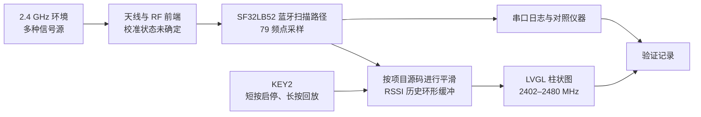

# Radiation Monitor 便携式信号强度检测器 { #radiation-monitor-portable-signal-strength-detector }

## Radiation Monitor 是什么？ { #what-is-radiation-monitor }

[SiFliSparks/RadiationMonitor](https://github.com/SiFliSparks/RadiationMonitor) 是基于 SF32LB52 和 SiFli-SDK 开发的便携式蓝牙（Bluetooth）频段信号强度显示器。固件在 2402–2480 MHz 范围内依次读取 79 个频点的接收强度，并使用 LVGL 柱状图显示结果；KEY2 用于启动/停止扫描和浏览历史数据。

该项目可用于研究蓝牙频段扫描、实时数据处理、按频点可视化和单键交互。不过，它不是经过校准的频谱分析仪，也不会识别接收信号的来源。附近的 2.4 GHz 发射和测量条件都可能影响柱状图；未经校准和受控对照测试，显示值不能用于法规符合性判定、认证或精密射频测量。

<em>Radiation Monitor 的 79 频点柱状图界面</em>

## 为什么选择 SF32 实现？ { #why-the-sf32-implementation }

SF32LB52 集成双模蓝牙 5.3、双核 MCU 和显示能力；该项目使用 SiFli-SDK 与 LVGL，在设备本地完成频点采样、平滑处理、历史缓冲和屏幕刷新。因此，它可作为 RF 可视化界面、现场干扰指示器或产品诊断界面的早期验证项目，但该参考设计本身并不能证明这些方案已达到量产要求。

项目仓库没有给出校准流程、不确定度预算或可追溯的测量条件，因此结果需要结合具体芯片、SDK 与固件版本、板卡、天线、外壳、板级噪声和时序重新验证。移植到另一块 SF32LB52 板或产品 PCB 时，不能只凭编译通过就认为测量等效。

## 成果、范围与进入条件 { #outcome-scope-and-entry-criteria }

**目标成果：**在版本锁定的 SF32LB52 硬件上复现 79 频点柱状图，验证启停是否可重复；对照固定提交确认实际平滑算法和采样深度；测试文档所述的 10 条历史记录回放与故障恢复；再据此判断是否值得投入校准或定制硬件。

本页不把 RSSI 柱高解释为占空比、吞吐量、发射功率、协议身份或法规意义上的频谱功率。它也不声称仓库已提供完整的量产硬件、校准流程或明确的软件许可。

开始前应准备：

- SF32LB52 显示开发板。项目 README 写明 SF32LB52x 和 `build_sf32lb52-lchspi-ulp_hcpu` 构建输出目录；思澈科技（SiFli）的支持板卡列表将黄山派列为 `sf32lb52-lchspi-ulp`。请记录实际板卡修订版并核实项目构建配置；
- SiFli-SDK、SCons 构建环境、下载与串口日志工具；
- 一个可控的 2.4 GHz 信号源或至少两种可重复场景，例如关闭/开启指定 BLE 广播器；
- 如需判断数值准确度，准备已校准频谱分析仪或功率测量设备及固定的天线/距离/屏蔽条件；
- 用于记录屏幕、串口、板卡姿态、距离、供电和环境的测试表。

<em>表：Radiation Monitor 项目基线与验证要求</em>

| 范围 | 固定源码基线 | 进入适配前必须保留的证据 |
|:-----|:-------------|:-------------------------|
| 频点扫描 | 2402–2480 MHz，共 79 点 | 固件 commit、SDK/板卡版本、完整扫描日志 |
| 数值处理 | 上游 README 的模块说明称对最近 10 次扫描求均值，功能概述则称平均 30 次扫描；README 未说明是在功率线性值还是 dBm 上求均值 | 固定提交中的源码版本、实际平均方式（线性功率或 dBm）与采样深度、原始/平滑结果和稳定信号对照 |
| 历史回放 | 10 条记录的环形缓冲区 | 停止、翻页、回绕和重新启动记录 |
| UI | LVGL 柱状图，Y 轴标称 -110 至 -20 dBm | 屏幕照片、标签与数据数组对应检查 |
| 测量边界 | 未提供可追溯校准或不确定度 | 对照仪器、测试夹具与误差记录，或明确标注为相对趋势显示 |

## 硬件与软件规格 { #hardware-and-software-specifications }
### 硬件规格 { #hardware-specification }

<em>表：Radiation Monitor 硬件规格</em>

| 器件或设备 | 必要规格 | 用途 | 状态 | 获取方式或来源 | 兼容性与替换说明 |
|:-----------|:---------|:-----|:-----|:---------------|:-----------------|
| SF32LB52-LCHSPI-ULP / 黄山派 | 从思澈科技（SiFli）SDK 的 SCons 板卡参数 `sf32lb52-lchspi-ulp` 开始；记录具体板卡修订版、天线和显示装配 | 执行蓝牙扫描，运行图表、控制和历史记录界面 | 必需；具体装配需确认 | [相关 μForge DevKit-ULP 资料](../sf32-products/devkits/SF32LB52-DevKit-ULP.md)；[SiFli-SDK 支持板卡列表](https://docs.sifli.com/projects/sdk/latest/en/sf32lb52x/supported_boards/index.html)；[LCKFB 开发板页面](https://lckfb.com/project/detail/lckfb-hspi-sf32lb52-ulp?param=baseInfo)；[项目源码](https://github.com/SiFliSparks/RadiationMonitor) | README 的输出目录 `build_sf32lb52-lchspi-ulp_hcpu` 不能确定 PCB、天线或显示屏的具体修订版 |
| 主机、USB 数据线和受控电源 | 配有对应 SiFli-SDK 工具的主机、支持数据传输的线缆、串口日志以及可监测的电源 | 构建、下载、观察并重复测量 | 必需 | [SiFli-SDK 快速入门](https://docs.sifli.com/projects/sdk/latest/sf32lb52x/quickstart/index.html) | 记录端口、电压、主机和工具版本以及恢复方式 |

### 软件规格 { #software-specification }

<em>表：Radiation Monitor 软件规格</em>

| 软件包或服务 | 所需版本或修订版 | 用途 | 状态 | 获取方式或来源 | 兼容性与更新说明 |
|:-------------|:-----------------|:-----|:-----|:---------------|:-----------------|
| SiFliSparks/RadiationMonitor | 锁定提交版本 [`670cf20`](https://github.com/SiFliSparks/RadiationMonitor/commit/670cf20b931e82b7ff1cd14fa6727e460c4f677a) | RF 扫描逻辑、79 点图表、平滑处理和历史记录 | 必需 | [代码仓库](https://github.com/SiFliSparks/RadiationMonitor) | README 对平滑次数的说明互相矛盾；确定测量基线前须核对该提交中的实际实现 |
| OpenSiFli/SiFli-SDK | 项目文章未锁定具体提交版本；须选择并记录一个兼容版本 | RTOS、蓝牙扫描路径、显示驱动和构建/下载环境 | 必需 | [代码仓库](https://github.com/OpenSiFli/SiFli-SDK) | 构建成功并不代表 RF 测量已校准，也不代表其他板卡的结果等效 |
| SCons 和 SDK 主机工具 | 来自所选 SiFli-SDK 环境的工具版本 | 构建并下载 SF32LB52 目标 | 必需 | [SiFli-SDK 快速入门](https://docs.sifli.com/projects/sdk/latest/sf32lb52x/quickstart/index.html) | 记录具体构建目标、主机操作系统、工具版本和生成的镜像 |

## 选择受支持的基线 { #choose-a-supported-baseline }
使用固定的项目提交 [`670cf20`](https://github.com/SiFliSparks/RadiationMonitor/commit/670cf20b931e82b7ff1cd14fa6727e460c4f677a)，不要依赖会变化的 `main` 分支。项目 README 将 `build_sf32lb52-lchspi-ulp_hcpu` 列为构建输出目录；思澈科技（SiFli）的支持板卡列表将黄山派 / LCHSPI-ULP 的 SCons 板卡参数列为 `sf32lb52-lchspi-ulp`。这只能确认 SDK 的板卡名称，不能证明项目命令或具体板卡装配已经验证。README 未注明板卡修订版或完整 SCons 命令，首次复现时应核实项目构建配置，不要据此假设所有 SF32LB52x 开发板均受支持。

<em>表：Radiation Monitor 基线选择</em>

| 元素 | 采用方式 | 不应假设 |
|:-----|:---------|:---------|
| 板卡 | 先使用思澈科技（SiFli）SDK 的 SCons 板卡参数 `sf32lb52-lchspi-ulp`，记录实际 PCB 并核实项目配置 | README 输出目录 `build_sf32lb52-lchspi-ulp_hcpu` 能证明所有 SF32LB52x 板卡的天线和显示路径都等效 |
| SDK | 记录可成功构建的 SiFli-SDK commit | 不应假设最新 SDK 保持项目原有的蓝牙扫描行为 |
| 平滑 | 对照固定提交核实 README 中“平均 30 次扫描”与“平均最近 10 次扫描”的冲突，并确认实际是对线性功率值还是 dBm 求均值，以及采样深度 | 模块说明称平均最近 10 次扫描；功能概述称平均 30 次扫描，二者均未说明平均方式 |
| 周期 | README 报告数据更新间隔为 30 ms；应实测完整 79 点扫描周期 | 30 ms 等于完整 79 点数据的固定更新周期 |
| 许可 | 在复用或发布前确认仓库及引入代码的许可 | 公开可见的源码自动允许产品分发 |

!!! warning "上游文档存在平滑次数冲突"
    README 的功能概述写“对 30 次扫描结果求平均”，模块说明则写“对最近 10 次扫描求平均”，并将扫描模块指向 `src/BT/bt_repeat.c`。README 未说明是在功率线性值还是 dBm 上求均值，这两处说明也不能证明固定提交中的代码究竟采用哪种行为。把任一次数作为测量基线前，应检查该提交中的源码，确认平均方式、缓冲区深度和设备端行为。README 还给出 30 ms 的数据更新间隔；这不一定等于完成 79 个频点全量扫描所需的时间。

## 项目阶段与决策要点 { #delivery-map }

<em>表：Radiation Monitor 项目阶段</em>

| 阶段 | 所支持的决定 | 必须输出 |
|:-----|:-------------|:---------|
| 1. 原版基线 | 目标板能否稳定扫描并显示 79 点？ | 版本、板卡、日志、屏幕和受控信号记录 |
| 2. 数据与恢复 | 平滑、停止、历史回放和复位行为是否可信？ | 确定性功能测试与恢复结果 |
| 3. 源码复现 | 第二位工程师能否重建相同图像？ | 干净构建、镜像、下载和重复结果 |
| 4. 测量适配 | 能否加入一种显示或校准改动而不掩盖原始行为？ | 改动、对照数据、误差和回归记录 |
| 5. 产品评审 | 应继续作为趋势指示器，还是转向测量仪器开发？ | 精度目标、许可、硬件和风险决定 |

## 系统架构与依赖 { #system-architecture-and-dependencies }

<em>图：Radiation Monitor 数据路径</em>

主要故障域包括 RF 输入与天线、扫描行为与校准、数据处理、历史缓冲、按键状态机、LVGL 映射和供电。屏幕出现一根高柱，只能说明该实现观察到相对较强的接收值；没有受控对照测试时，不能据此判断发射设备、调制方式或合规状态。

## 阶段 1 — 建立未经修改的扫描基线 { #stage-1-establish-the-untouched-scan-baseline }

**目标：**证明选定硬件和源码可以产生可重复的 79 点显示。

1. 锁定仓库 commit、SiFli-SDK commit、板卡版本、天线和显示连接，执行干净构建与下载。
2. 在信号场景尽量稳定时启动设备，记录上电后初始柱状图、串口输出和 KEY2 状态。
3. 短按 KEY2 启动扫描，确认频点覆盖和 X 轴标签对应 2402、2441、2480 MHz。
4. 使用一个可控 BLE 广播器或其他可重复信号源，分别记录关闭、开启、改变距离和改变板卡姿态时的结果。
5. 复位并重复，确认 79 点数组与显示没有错位或残留。

**应保留证据：**源码/SDK/板卡版本、构建与下载日志、环境描述、信号源设置、距离与姿态、串口日志、屏幕照片和复位结果。

**关口 1 退出条件：**两次独立上电均能扫描并显示 79 点，受控信号场景的变化方向可重复，且显示索引与频率标签经过核对。

## 阶段 2 — 验证数据处理、历史与恢复 { #stage-2-validate-processing-history-and-recovery }

**目标：**确认 UI 展示的是可解释的数据流，而不是偶然刷新出来的图形。

<em>表：Radiation Monitor 功能验证</em>

| 测试 | 方法 | 通过证据 |
|:-----|:-----|:---------|
| 平滑算法与采样深度 | 记录单一频点的原始值与 `rssi_res`，对照固定提交并解决 README 的描述冲突 | 平均所采用的数值尺度（线性功率或 dBm）和样本深度与固定版本源码一致，并在设备上验证 |
| 启停 | 扫描中短按 KEY2 停止，再恢复 | 停止时保留历史显示；恢复后继续采样且不死机 |
| 历史回放 | 停止后长按 KEY2 超过一次 | 最多 10 组数据按预期倒序浏览并正确回绕 |
| 空历史 | 尚未积累有效数据时停止或长按 | 不越界、不崩溃，显示保持可识别的无数据状态 |
| 复位 | 扫描、停止和回放状态下分别复位 | 返回已知初始状态，不保留不可解释的旧数据 |
| 干扰变化 | 改变信号源、距离或屏蔽条件 | 变化可重复，并记录响应延迟（latency）与峰值保持特性 |

**关口 2 退出条件：**数据平滑、历史深度、按键状态和复位行为均与源码一致，所有异常状态都有可观察结果而不是静默错误。

## 阶段 3 — 建立可复现源码基线 { #stage-3-build-a-reproducible-source-baseline }

**目标：**从干净环境重现通过阶段 2 的镜像。

1. 记录工程 commit、SDK commit、主机操作系统、SCons/编译器版本和实际板参数。
2. 删除构建输出后重新配置和构建，保存镜像、分区/内存输出和完整日志。
3. 使用仓库生成的下载脚本烧录，并保存端口、波特率和下载结果。
4. 在第二台电脑或第二个干净目录中重复构建与阶段 2 核心测试。

**关口 3 退出条件：**工程不依赖未跟踪的板文件、生成文件或旧产物，即可得到行为一致的镜像。

## 阶段 4 — 做一次可控的测量或 UI 适配 { #stage-4-make-one-controlled-measurement-or-ui-adaptation }

**目标：**在不丢失原始基线的前提下验证一个产品方向。

可选改动包括：增加原始值记录、标注 1 MHz 频点、加入峰值保持、改变历史选择方式、增加校准偏移或将相对趋势导出到主机。一次只改一类，并保留原版镜像。

如果增加“校准”功能，应至少定义参考信号、频率点、输入功率、天线/线缆、距离、板卡姿态、温度和不确定度。单个全局偏移通常不足以补偿全频段、不同板卡和不同外壳的响应差异。

**关口 4 退出条件：**改动经过原始 79 点、启停、历史、复位和受控信号回归；任何精度声明都附有对照仪器和测试条件。

## 阶段 5 — 产品就绪评审 { #stage-5-product-readiness-review }

团队应明确回答：

- 产品只需要相对干扰趋势，还是需要可追溯的绝对功率与测量不确定度？
- 项目的蓝牙扫描实现是否有针对目标芯片和 SDK 的支持说明？与产品其他无线功能并行运行时有哪些限制？
- 天线、外壳、显示噪声、DC/DC、电池电量和温度会带来多少变化？
- 扫描期间能否同时承担产品所需的蓝牙通信，还是两者必须互斥？
- 79 点扫描与源码确认后的平滑处理，其实测延迟是否满足用户界面目标？
- RadiationMonitor 仓库和所含第三方代码没有顶层明确许可证时，分发与商用许可如何解决？

**关口 5 退出条件：**测量目标、校准计划、无线并发策略、许可、硬件和软件维护责任均有负责人和继续/延期/停止决定。

## 产品设计阶段交接 { #handoff-to-product-design }

交接资料应包含目标 SF32 型号、板卡/天线、经固定提交确认的蓝牙扫描实现及其模式/API 限制、频率与数据定义、原始和平滑记录、显示刷新预算、校准夹具、供电噪声测试、恢复路径和生产测试边界。硬件适配从 [SF32LB52x](../sf32-products/chips/SF32LB52x.md)、[SF32LB52-DevKit-ULP](../sf32-products/devkits/SF32LB52-DevKit-ULP.md) 与 [SF32LB52x 硬件设计指南](../hardware/chip-guides/SF32LB52x_hardware_design_guide.md)继续；RF 产品验证可参考 [SiFli-SDK RF 性能测试](../develop/platforms/sifli-sdk/application-notes/rf-performance-tests.md)。

## 权威来源 { #authoritative-sources }
- [SiFliSparks/RadiationMonitor](https://github.com/SiFliSparks/RadiationMonitor)
- [上游 `main` 分支 README](https://github.com/SiFliSparks/RadiationMonitor/blob/main/README.md)
- [锁定的参考 commit `670cf20`](https://github.com/SiFliSparks/RadiationMonitor/commit/670cf20b931e82b7ff1cd14fa6727e460c4f677a)
- [思澈科技（SiFli）Sparks 项目目录](https://sparks.sifli.com/#projects)
- [OpenSiFli/SiFli-SDK](https://github.com/OpenSiFli/SiFli-SDK)
- [SiFli-SDK 支持板卡列表](https://docs.sifli.com/projects/sdk/latest/en/sf32lb52x/supported_boards/index.html)
- [SiFli-SDK RF 测试指南](https://docs.sifli.com/projects/sdk/latest/en/sf32lb52x/app_note/rf_test_guide.html)
- [SF32LB52x 硬件概述](https://wiki.sifli.com/en/hardware/SF32LB52/SF32LB52-Overview-B3.html)
- [SF32LB52x SiFli-SDK 快速入门](https://docs.sifli.com/projects/sdk/latest/sf32lb52x/quickstart/index.html)
