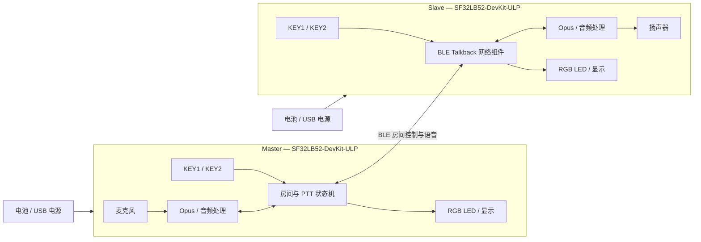

# SF32 BLE 对讲机 { #sf32-ble-talkback-intercom }

## 什么是 Talkback？ { #what-is-talkback }

[OpenSiFli Talkback](https://github.com/OpenSiFli/sifli-sdk-demo/tree/main/talkback) 是运行在 `SF32LB52-DevKit-ULP`（黄山派）上的多人 BLE 按键通话（PTT）示例。Master 模式用于创建房间，Slave 模式用于扫描并加入房间；加入完成后，用户按住通话键发送语音、松开结束发送。官方基线最多容纳 8 台设备，并允许最多 3 台设备同时发言。

项目使用 Opus 编码处理语音，并以 RGB LED、按键和屏幕构成最小本地交互。它还实现了 Slave 一键重连、电池电压/电量显示、60 秒无输入休眠，以及长按电源键关机与开机，因而比单纯的点对点音频示例更适合用来评估便携式对讲产品。

## 为什么选择 SF32？ { #why-the-sf32-implementation }

这条路径把 SF32LB52 的 BLE、音频、显示、按键、电池监测和低功耗能力放进同一个可操作基线。开发者可以先在现成开发板上验证组网和声学行为，再决定是否投入定制 RF、音频和电源硬件。

这里的“最多 8 台、最多 3 台同时发言”是上游实现边界，不是已经覆盖所有距离、干扰、丢包率和并发组合的产品指标。上游资料也没有说明房间鉴权、链路加密策略、语音隐私保证、射频法规状态或 `talk_back` 二进制组件的完整许可边界；进入产品开发前必须分别评审。

**开发板来源说明：** 思澈科技（SiFli）Wiki 的 ULP 开发板中文页标注为“暂无”，仅说明其面向低功耗传感器和智能穿戴应用、可配置三轴或六轴传感器，并预留低功耗测试点，并非完整硬件规格。外围器件应以实际板卡版本和原理图为准；下文的 Talkback 行为描述依据已固定版本的上游应用源码。

## 成果、范围与进入条件 { #outcome-scope-and-entry-criteria }

**成果：** 使用至少两台固定版本的开发板，完成可重复的建房、入房、PTT 通话、离房/重连、休眠/唤醒和电量状态验证，并形成是否值得转向定制硬件的证据包。

**不在范围内：** 本文不证明远距离覆盖、弱网语音质量、端到端加密、认证、量产功耗、天线一致性、法规合规或任意 BLE 设备兼容性。

**进入条件：** 团队应能安装 SiFli-SDK 构建环境、通过串口下载固件、查看日志，并能安全地连接扬声器和电池。完整通话基线至少需要两台相同版本的开发板。

<div align="center"><em>表：项目约定</em></div>

<div align="center" markdown>

| 项目 | 基线要求 | 进入下一阶段前保留的证据 |
|:-----|:---------|:-------------------------|
| 复现边界 | 先保持上游目标、依赖和默认交互不变 | 板卡版本、应用提交、SDK 版本、依赖解析记录和固件校验值 |
| 功能边界 | 建房、入房、PTT、离房、Slave 重连、休眠/唤醒和电量显示 | 操作记录、串口日志、LED 状态和异常恢复结果 |
| 产品边界 | 声学、RF、安全、隐私、许可、功耗与法规仍需单独验证 | 风险、负责人、处置计划和继续/停止决定 |

</div>

## 硬件与软件规格 { #hardware-and-software-specifications }
### 硬件规格 { #hardware-specification }

<div align="center"><em>表：硬件规格</em></div>

<div align="center" markdown>

| 组件 | 所需规格 | 作用 | 状态 | 获取方式 | 兼容性与替代说明 |
|:-----|:---------|:-----|:-----|:---------|:-----------------|
| SF32LB52-DevKit-ULP / LCKFB-HSPI-SF32LB52-ULP | `sf32lb52-lchspi-ulp` 目标；至少 2 台，最多 8 台 | 运行 Talkback、提供 BLE、麦克风、显示、按键、RGB LED、电源和音频路径 | 必需 | [μForge 板卡资料](../sf32-products/devkits/SF32LB52-DevKit-ULP.md)；[立创开发板页面](https://lckfb.com/project/detail/lckfb-hspi-sf32lb52-ulp?param=baseInfo)；[思澈科技（SiFli）样片/套件商店](https://sifli.taobao.com/) | 所有证据必须记录硬件版本；未经验证的 SF32LB52 板卡不能视为等价替代 |
| 扬声器 | 每台板卡使用 3 W/4 Ω 或 2 W/8 Ω 外接扬声器，接入 GH-1.25 mm 接口 | 播放接收语音 | 必需 | 开发板套件通常包含；购买前按[板卡资料](../sf32-products/devkits/SF32LB52-DevKit-ULP.md)核对套件内容 | 不得接入超出板载 Class-D 功放和连接器能力的负载 |
| USB 数据线与主机 | 每台板卡一条可传输数据的 USB-C 线；主机可运行 SiFli-SDK 工具 | 供电、串口下载与日志 | 必需 | 标准 USB-C 数据线；工具入口见[SiFli-SDK](https://github.com/OpenSiFli/SiFli-SDK) | 只支持充电的线缆无法完成下载；记录串口号和主机环境 |
| 单节锂电池 | 与板卡连接器、极性和充电路径匹配 | 移动使用、休眠/唤醒和电量验证 | 产品验证必需；台架功能验证可选 | 供应渠道未由 Talkback 仓库单独发布；按[板卡资料](../sf32-products/devkits/SF32LB52-DevKit-ULP.md)核对接口后采购 | 接入前必须确认极性、电压范围、容量和保护电路；不得根据插头外观推断兼容性 |
| 集成麦克风、按键、RGB LED 和显示屏 | 使用开发板原装器件 | 采集语音并呈现角色、配对、通话、接收和休眠状态 | 随板集成 | 随开发板提供，不单独采购 | 更换音频或人机界面硬件属于适配工作，必须重新验证增益、时序、键值和状态映射 |

</div>

### 软件规格 { #software-specification }

<div align="center"><em>表：软件规格</em></div>

<div align="center" markdown>

| 软件包或服务 | 所需版本或修订 | 作用 | 状态 | 获取方式 | 兼容性与更新说明 |
|:-------------|:---------------|:-----|:-----|:---------|:-----------------|
| OpenSiFli `sifli-sdk-demo/talkback` | 本文审核提交 [`6fa55ac`](https://github.com/OpenSiFli/sifli-sdk-demo/commit/6fa55ac65b51fca5eac6660a7e481a30e07388ee) | 应用、板级配置和构建入口 | 必需 | [Talkback 源码目录](https://github.com/OpenSiFli/sifli-sdk-demo/tree/main/talkback) | 上游 `main` 会移动；建立证据前固定提交。当前真实路径是 `talkback/project`，README 中的 `example/ble/talkback/project` 是过期路径 |
| SiFli-SDK | `conanfile.py` 声明兼容 `^2.4`；项目未固定具体 SDK 提交 | RT-Thread、BLE、音频、电源、构建和下载基础 | 必需 | [OpenSiFli/SiFli-SDK](https://github.com/OpenSiFli/SiFli-SDK) | 团队必须选定一个满足 `^2.4` 的具体提交并记录；不得用移动的 `main` 代替基线版本 |
| `talk_back/1.2@sifli` | `1.2` | BLE Talkback 网络/音频组件 | 必需 | 由项目的 [Conan 清单](https://github.com/OpenSiFli/sifli-sdk-demo/blob/6fa55ac65b51fca5eac6660a7e481a30e07388ee/talkback/project/conanfile.py)解析 | 上游未在该页面公开独立源码、包校验值、获取服务器和完整许可说明；缓存包和解析记录必须归档，并在产品评审中关闭此风险 |
| Opus 与 WebRTC AECM/AGC 配置 | 由固定应用提交、SDK 提交和 Conan 依赖共同确定 | 语音编码、回声处理和增益控制 | 必需 | [项目配置](https://github.com/OpenSiFli/sifli-sdk-demo/blob/6fa55ac65b51fca5eac6660a7e481a30e07388ee/talkback/project/proj.conf)及固定 SDK 依赖 | 不得只记录功能宏；还要保存实际解析到的库版本和许可材料 |
| SCons、编译器与 UART 下载工具 | 使用所选 SiFli-SDK 对应版本 | 配置、构建和下载镜像 | 必需 | 随[所选 SiFli-SDK](https://github.com/OpenSiFli/SiFli-SDK)环境提供 | 记录主机系统、工具链版本、构建命令和生成脚本校验值 |

</div>

## 选择受支持的基线 { #choose-a-supported-baseline }
从两台相同版本的 `SF32LB52-DevKit-ULP` 开始。先将仓库固定到 `6fa55ac`，再选定并记录一个满足 `^2.4` 的 SiFli-SDK 提交，保存 Conan 解析出的 `talk_back/1.2@sifli` 包信息。不要在第一次复现时修改音频参数、角色逻辑或低功耗计时。

在仓库根目录进入实际存在的项目路径：

```bash
cd talkback/project
scons --board=sf32lb52-lchspi-ulp -j8
```

Windows 下载脚本位于 `build_sf32lb52-lchspi-ulp_hcpu\uart_download.bat`。运行后按提示输入对应串口号。每台设备都使用同一基线镜像，并分别记录板卡身份和固件校验值。

### 默认控制与状态提示 { #default-controls-and-state-indication }

<div align="center"><em>表：默认按键与 LED 状态</em></div>

<div align="center" markdown>

| 状态 | KEY1 | KEY2 | LED |
|:-----|:-----|:-----|:----|
| 待机 | 有成功入房记录的 Slave 短按可重连；否则短按重置休眠倒计时 | 短按切换 Master/Slave；长按进入配对 | Master 蓝色常亮；Slave 红色常亮 |
| 配对 | — | Master 建房；Slave 扫描 | Master 蓝色闪烁；Slave 红色闪烁 |
| 等待开始 | — | Master 长按确认开始 | Master 蓝色闪烁；Slave 红色闪烁 |
| 已进入通话 | 释放 KEY2 后短按离房 | 按住发言，松开停止 | 发言绿色常亮；接收橙色常亮 |
| 休眠 | 任意按键唤醒 | 任意按键唤醒 | 熄灭 |

</div>

## 项目阶段与决策要点 { #delivery-map }

<div align="center"><em>表：项目阶段与决策要点</em></div>

<div align="center" markdown>

| 阶段 | 支持的决策 | 最低证据 |
|:-----|:-----------|:---------|
| 建立原始基线 | 固定版本能否稳定构建、下载和启动？ | 版本清单、干净构建日志、固件校验值和启动记录 |
| 验证双机通话 | 默认建房、入房和 PTT 是否成立？ | 两台设备的角色、LED、按键和双向语音记录 |
| 验证组网与恢复 | 离房、超时、重连和并发边界是否可接受？ | 故障注入矩阵、恢复时间、日志和失败状态 |
| 验证音频与功耗 | 声学和电池行为是否支持目标外形？ | 音质、延迟、距离、电流、休眠和唤醒测量 |
| 评审产品就绪度 | 是否有足够证据投入定制硬件？ | 风险登记、负责人和继续/延期/停止决定 |

</div>

## 系统架构与依赖 { #system-architecture-and-dependencies }

<div align="center"><em>图：Talkback 设备角色、音频和控制路径</em></div>



主要失效域包括：BLE 扫描/建房、房间状态同步、并发发言调度、Opus/声学链路、按键事件、低电量与休眠、电源键恢复，以及未公开组件/许可。诊断时要先区分角色和状态，再区分无线、音频或本地电源问题。

## 阶段 1 — 建立未修改的源码基线 { #stage-1-establish-the-untouched-source-baseline }

**目标：** 证明固定源码、固定 SDK 和实际解析依赖能产生可重复镜像。

1. 固定应用提交和具体 SDK 提交，保存依赖解析输出。
2. 在干净目录中为 `sf32lb52-lchspi-ulp` 构建并下载两台设备。
3. 确认设备待机默认为 Slave/红灯，并核对按键、屏幕、电量和扬声器路径。

**保留证据：** 完整版本清单、构建/下载日志、固件校验值、两块板的硬件版本和启动记录。

**阶段 1 退出条件：** 两台设备可由相同输入重复生成并下载相同基线镜像，启动状态与上游说明一致。

## 阶段 2 — 验证房间与双向 PTT { #stage-2-validate-room-setup-and-bidirectional-ptt }

**目标：** 证明用户能够无调试介入地建立和使用最小房间。

1. 待机时短按 KEY2，将一台设为 Master（蓝色常亮），另一台保持 Slave（红色常亮）。
2. 两台设备长按 KEY2：Master 建房、Slave 扫描；配对窗口为 30 秒。
3. 等待状态下由 Master 长按 KEY2 确认开始；通话状态下分别按住 KEY2 发言并松开停止。
4. 核对发送时绿色常亮、接收时橙色常亮，并验证两个方向的可懂语音。

**保留证据：** 角色、操作时间线、LED 状态、串口日志、双向语音样本和失败重试记录。

**阶段 2 退出条件：** 至少两台设备连续完成多轮双向 PTT，状态显示与实际音频方向一致，且 30 秒超时能回到可解释状态。

## 阶段 3 — 验证离房、重连和容量边界 { #stage-3-validate-leave-reconnect-and-capacity-boundaries }

**目标：** 确认上游声明的恢复路径和容量边界不会把用户留在不可恢复状态。

1. 先释放 KEY2，再在通话状态短按 KEY1 离房；发言期间不能直接离房。
2. 对曾成功加入的 Slave，在待机状态短按 KEY1 执行一键重连；Master 没有同等重连路径。
3. 分别注入超出范围、配对超时、Master 消失和供电重启。
4. 若要依赖多人能力，逐级扩展到目标参与者数量，并覆盖最多 8 台和最多 3 台同时发言的边界组合。

**保留证据：** 每个故障的初始状态、触发步骤、恢复步骤、恢复时间、日志和最终房间成员状态。

**阶段 3 退出条件：** 所有目标故障都有明确、可重复且用户可理解的恢复路径；容量/并发要求在目标 RF 环境中经过实测，而不是只引用声明值。

## 阶段 4 — 评估音频、RF 与功耗表现 { #stage-4-qualify-acoustics-rf-and-low-power }

**目标：** 判断开发板表现能否支持目标外形、距离和使用时间。

1. 在安静、近端双讲、背景噪声和不同扬声器音量下记录可懂度、削波、回声和 PTT 首尾截断。
2. 在目标距离、遮挡和 2.4 GHz 干扰条件下记录连接、丢音和恢复行为。
3. 验证 60 秒无输入进入休眠、角色复位为 Slave、任意按键唤醒、长按电源键关机/开机，以及低于 20% 时的 LED 提示。
4. 测量待机、发言、接收、休眠和唤醒电流；不要把开发板测量直接当作量产产品续航。

**保留证据：** 测试环境、板卡/天线姿态、音频文件、距离和干扰条件、电流轨迹、电池参数和恢复结果。

**阶段 4 退出条件：** 产品团队已为目标环境定义并验证声学、RF、功耗和唤醒阈值，所有未达标项都有负责人和处置决定。

## 阶段 5 — 产品就绪度评审 { #stage-5-product-readiness-review }

定制硬件前至少回答：

- 房间如何识别可信设备，语音和控制数据采用什么鉴权、加密和重放防护？
- `talk_back/1.2@sifli`、Opus、WebRTC 组件和仓库源文件的许可、源代码提供和漏洞响应由谁负责？
- 目标天线、外壳、人体遮挡和并发条件下的覆盖、延迟、丢包与恢复是否已测量？
- 麦克风、功放、扬声器腔体和音量限制怎样满足声学与安全要求？
- 低电量、异常关机、固件损坏和现场升级失败时，设备如何恢复？
- 产品需要开展哪些蓝牙（Bluetooth）、EMC、无线电和电池合规工作？

**阶段 5 退出条件：** 风险登记表具有证据、负责人、缓解措施和明确的继续、延期或停止决定；安全、许可和法规问题不能以“后续处理”代替所有权。

## 产品设计阶段交接 { #handoff-to-product-design }

交接包应包含：固定源码/SDK/依赖、角色与状态机、容量和恢复矩阵、音频/RF/功耗测量、天线与声学假设、电池和充电边界、安全/隐私模型、许可材料、生产测试需求和恢复方案。使用 [SF32LB52x 集成路径](../sf32-products/chips/SF32LB52x.md#integration-path)选择芯片、模块、开发板、硬件设计指南和检查清单，并将验证过的行为映射到定制原理图和布局，而不是照搬开发板结论。

## 权威来源 { #authoritative-sources }
- [思澈科技（SiFli）SF32LB52-DevKit-ULP 中文 Wiki 源文件](https://github.com/OpenSiFli/SiFli-Wiki/blob/main/source/zh_CN/board/sf32lb52x/SF32LB52-DevKit-ULP.md)

- [OpenSiFli Talkback 目录](https://github.com/OpenSiFli/sifli-sdk-demo/tree/main/talkback)
- [本文审核的应用提交 `6fa55ac`](https://github.com/OpenSiFli/sifli-sdk-demo/commit/6fa55ac65b51fca5eac6660a7e481a30e07388ee)
- [Talkback 官方 README](https://github.com/OpenSiFli/sifli-sdk-demo/blob/6fa55ac65b51fca5eac6660a7e481a30e07388ee/talkback/README.md)
- [Talkback Conan 清单](https://github.com/OpenSiFli/sifli-sdk-demo/blob/6fa55ac65b51fca5eac6660a7e481a30e07388ee/talkback/project/conanfile.py)
- [Talkback 项目配置](https://github.com/OpenSiFli/sifli-sdk-demo/blob/6fa55ac65b51fca5eac6660a7e481a30e07388ee/talkback/project/proj.conf)
- [OpenSiFli/SiFli-SDK](https://github.com/OpenSiFli/SiFli-SDK)
- [SF32LB52-DevKit-ULP 官方 Wiki 源文件](https://github.com/OpenSiFli/SiFli-Wiki/blob/main/source/en/board/sf32lb52x/SF32LB52-DevKit-ULP.md)
