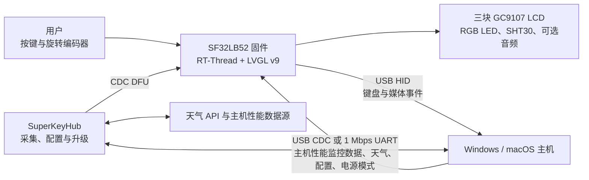

# SuperKey 多功能宏键盘 { #superkey-multifunction-macro-keyboard }

## SuperKey 是什么？ { #what-is-superkey }

[SiFliSparks/SuperKey](https://github.com/SiFliSparks/SuperKey) 是一套基于 SF32LB52 的带屏多功能宏键盘参考实现。其开源固件运行于 RT-Thread 和 LVGL v9，驱动三块 128 × 128 GC9107 LCD、三颗 RGB LED、四个物理按键、旋转编码器和 SHT30 温湿度传感器，并以 USB HID/CDC 复合设备连接电脑。

SuperKey 的价值不只在于“多几个快捷键”。这套可运行的参考实现集成了以下功能：

- 通过 USB HID 输出键盘和媒体控制事件；
- 通过 USB CDC 或 1 Mbps UART 接收电脑性能监控、天气、配置和电源状态数据；
- 在三联屏上组织性能监控、天气、时钟、小工具、音乐和自定义按键界面；
- 使用配套的 [SuperKeyHub](https://github.com/SiFliSparks/SuperKeyHub) 上位机采集电脑数据、配置功能并触发固件升级；
- 通过开源的 [sf32-keyboard 硬件](https://oshwhub.com/sifli/sf32-keyboard)复现完整设备。


<div align="center"><em>SuperKey 三联屏用户界面</em></div>

## 为什么选择 SF32 实现？ { #why-the-sf32-implementation }

SuperKey 同时需要图形界面、多个显示器、USB 复合设备、按键和编码器输入、传感器、RGB 灯效、文件系统以及可选音频。SF32LB52 将这些实时任务保留在 MCU 侧，让设备即使没有运行上位机，也能启动界面并提供基本 HID 功能；上位机则负责电脑性能监控和网络数据采集等更适合桌面操作系统完成的工作。

这种分工很适合桌面控制器、工作流键盘、状态面板和小型 HMI，但也带来明确代价：高级数据显示依赖上位机、驱动和外部 API，固件与上位机版本必须配套，USB 断连、电脑休眠和配置损坏都需要单独验证。

## 成果、范围与进入条件 { #outcome-scope-and-entry-criteria }

**目标成果：**复现一套版本锁定的 SuperKey，验证 HID、CDC、三联屏、输入、传感器和休眠恢复；随后只修改一类功能，并保留足以支持产品评审的构建、通信和回归证据。

本页不证明开源 PCB 已达到量产要求，也不保证所有电脑遥测数据源、天气服务、串口桥接器、USB 主机或操作系统版本都兼容。股票行情、天气和性能数据的可用性受上位机版本、第三方 API、系统权限和电脑硬件影响。

开始前应准备：

- 按开源工程装配的 SuperKey 硬件，包括三块 GC9107 LCD、按键、编码器和 USB 数据连接；
- 按文档复现主要流程时使用的 Windows 10/11 电脑；SuperKeyHub 仓库声明支持 Windows 和 macOS，但仍需在选定的主机系统上验证板卡烧录、CDC 通信和恢复流程；
- 与固件匹配的 SuperKeyHub 版本；
- SiFli-SDK 环境、通过递归克隆检出的 SDK 子模块，以及可用的烧录/恢复连接；
- 若验证天气功能，还需有效的和风天气 API Key、API Host 与城市配置；
- 用于记录 USB 枚举、串口日志、按键行为、显示状态和休眠恢复的测试记录。

<div align="center"><em>表：SuperKey 项目基线与验证证据</em></div>

<div align="center" markdown>

| 范围 | 已知基线 | 进入适配前必须保留的证据 |
|:-----|:---------|:-------------------------|
| 硬件 | `sf32-keyboard` 开源硬件与 `sf32lb52-superkey` 板级目标 | PCB/装配版本、LCD 和输入器件、供电与 USB 连接记录 |
| 固件 | SuperKey 仓库、SiFli-SDK 子模组、RT-Thread、LVGL v9、CherryUSB | 固件 commit、SDK commit、构建日志、镜像和下载日志 |
| 上位机 | SuperKeyHub 与匹配的固件协议 | 上位机版本、操作系统、端口、API 配置和连接日志 |
| 核心行为 | HID、CDC、三联屏、编码器、按键、传感器和电源模式 | 冷启动、数据刷新、输入、断连与休眠恢复记录 |
| 定制 | 一次只修改一种 UI、按键、灯效或数据字段 | 评审后的改动、回滚镜像和完整回归结果 |

</div>

## 硬件与软件规格 { #hardware-and-software-specifications }
### 硬件规格 { #hardware-specification }

<div align="center"><em>表：SuperKey 硬件规格</em></div>

<div align="center" markdown>

| 器件或设备 | 必要规格 | 用途 | 状态 | 获取方式或来源 | 兼容性与替换说明 |
|:-----------|:---------|:-----|:-----|:---------------|:-----------------|
| SuperKey 开源硬件组件 | SF32LB52 目标配置，包含项目所述的三块 128 × 128 GC9107 LCD、三个 RGB LED、四个按键、旋转编码器、SHT30 和 USB 连接 | 宏键盘控制、显示、输入、传感和 USB HID/CDC | 必需 | [开放的 `sf32-keyboard` 设计](https://oshwhub.com/sifli/sf32-keyboard)；[SuperKey 代码仓库](https://github.com/SiFliSparks/SuperKey) | 设计文件不等于可购买的组装板规格；须记录 PCB 和装配版本 |
| 主机电脑与 USB 数据连接 | Windows 10/11 是主要文档化的完整路径；使用 USB 数据连接 | 运行 SuperKeyHub、提供 HID/CDC 主机并支持下载和恢复 | 必需 | [SuperKey 文档](https://sparks.sifli.com/projects/superkey/) | SuperKeyHub 仓库声明支持 Windows/macOS；应按所选主机验证 CDC、DFU、下载和恢复流程 |
| QWeather 账户/API 配置 | API Key、API Host 和城市配置 | 可选的天气显示功能 | 可选 | [QWeather](https://www.qweather.com/) | 不要将凭证提交到源码仓库；确认服务条款和可用性 |

</div>

### 软件规格 { #software-specification }

<div align="center"><em>表：SuperKey 软件规格</em></div>

<div align="center" markdown>

| 软件包或服务 | 所需版本或修订版 | 用途 | 状态 | 获取方式或来源 | 兼容性与更新说明 |
|:-------------|:-----------------|:-----|:-----|:---------------|:-----------------|
| SuperKey 固件 | v1.4.2；记录实际使用的 commit | SF32 固件、LVGL UI、USB、传感器和更新行为 | 必需 | [v1.4.2 发布版本](https://github.com/SiFliSparks/SuperKey/releases/tag/v1.4.2) | 固定固件 commit；不要仅凭版本号推断与上位机的兼容性 |
| SuperKeyHub | 经与固件 v1.4.2 验证的特定发布版或 commit | 主机遥测、配置和固件更新界面 | 使用主机功能时必需 | [代码仓库](https://github.com/SiFliSparks/SuperKeyHub) | 引用的上游发布材料未确认固定的固件/上位机配对；应针对 v1.4.2 测试遥测、配置和 DFU，并记录实际组合 |
| SiFli-SDK 子模块、RT-Thread、LVGL 和 CherryUSB | 以所选固件检出的依赖修订版为准 | 固件构建和 USB 协议栈 | 源码构建时必需 | [SuperKey 代码仓库](https://github.com/SiFliSparks/SuperKey) | 递归克隆并保留子模块修订版；不要独立升级依赖项 |

</div>

## 选择受支持的基线 { #choose-a-supported-baseline }
上游发布页列出了固件 [v1.4.2](https://github.com/SiFliSparks/SuperKey/releases/tag/v1.4.2)，可作为固定起点。引用的材料未确认与之匹配的 SuperKeyHub 版本；应选定并固定 Hub 发布版或 commit，与 v1.4.2 一起验证遥测、配置和 DFU，记录实际测试组合，不要按版本号推断兼容性。

<div align="center"><em>表：SuperKey 基线选择</em></div>

<div align="center" markdown>

| 基线元素 | 推荐起点 | 关键限制 |
|:---------|:---------|:---------|
| 固件 | SuperKey v1.4.2，或经团队验证的 commit | 固件与上位机协议必须配套 |
| 上位机 | 经与固件 v1.4.2 验证的 SuperKeyHub 发布版或 commit | 引用的发布材料未确认固定配对；应在所选主机上验证 CDC 数据、配置和 DFU |
| 构建目标 | `sf32lb52-superkey`，板目录由 `app/boards` 提供 | 不是通用 SF32LB52 开发板目标 |
| 通信 | 优先验证 USB HID + CDC；如使用外置串口，再验证 1 Mbps UART | “USB 已枚举”不等于 HID 与 CDC 两个接口都可用 |
| 升级 | 上位机触发的 CDC DFU，并保留有线烧录/恢复路径 | 未完成中断、版本不匹配和恢复测试前，不应视为现场固件升级方案 |

</div>

上游 CI 使用以下构建目标；在本地执行前先按 SiFli-SDK 文档安装并导出环境：

```bash
git clone --recursive https://github.com/SiFliSparks/SuperKey.git
cd SuperKey/SiFli-SDK
./install.sh
. ./export.sh
cd ../app/project
scons --board=sf32lb52-superkey --board_search_path="../boards" -j8
```

Windows 应使用 SiFli-SDK 对应的 PowerShell 安装和环境脚本。并行度可以调整，但板名、板搜索路径和子模组版本必须进入构建记录。

## 项目阶段与决策要点 { #delivery-map }

<div align="center"><em>表：SuperKey 项目阶段</em></div>

<div align="center" markdown>

| 阶段 | 所支持的决定 | 必须输出 |
|:-----|:-------------|:---------|
| 1. 未修改基线 | 开源硬件、固件和上位机能否按记录协同工作？ | 版本锁定且已验证可正常工作的配置与测试记录 |
| 2. 通信与恢复 | USB、串口、休眠、断连和配置故障是否可诊断并恢复？ | 故障注入与恢复记录 |
| 3. 源码构建复现 | 团队能否从干净检出重建相同镜像？ | 构建环境、镜像、烧录记录和复现结果 |
| 4. 可控适配 | 能否修改一项产品行为而不破坏原基线？ | 受控改动、回滚路径和回归证据 |
| 5. 产品评审 | 是否值得进入定制 PCB、外壳或小批试产？ | 风险负责人和继续/延期/停止决定 |

</div>

## 系统架构与依赖 { #system-architecture-and-dependencies }

<div align="center"><em>图：SuperKey 产品数据与控制路径</em></div>



应把故障分为五个域：设备硬件与显示、HID 输入、CDC/UART 数据通道、上位机与系统权限、外部数据服务。比如天气空白不能直接归因于固件；它也可能来自 API Key、API Host、城市配置或上位机没有下发数据。

## 阶段 1 — 建立未经修改的参考基线 { #stage-1-establish-the-untouched-reference-baseline }

**目标：**在改代码前证明完整参考链路可重复运行。

1. 按上游装配说明核对 LCD 排线方向、按键开关、编码器、外壳和 USB 接口，记录 PCB 与固件版本。
2. 安装匹配的 SuperKeyHub，先验证设备枚举，再分别验证 HID 和 CDC 接口。
3. 配置天气 API、端口和 1 Mbps 波特率；记录未运行上位机时的设备行为，再连接并启动数据下发。
4. 验证三屏页面切换、按键映射、媒体控制、编码器、SHT30 数据、灯效和一个完整的数据刷新周期。
5. 冷启动并重复一次，保存界面照片、上位机日志、设备日志和版本查询结果。

**应保留证据：**硬件版本、固件 tag/commit、SDK commit、上位机版本、操作系统、端口与 API 配置、USB 枚举、日志、显示和输入记录。

**阶段 1 退出条件：**两次冷启动均能完成 HID 输入、CDC 数据刷新和三屏交互；每个失败域都能通过日志或可观察状态区分。

## 阶段 2 — 验证故障与恢复边界 { #stage-2-validate-fault-and-recovery-boundaries }

**目标：**确认设备在桌面系统的常见中断下不会变成只能重新烧录的演示品。

<div align="center"><em>表：SuperKey 故障与恢复测试</em></div>

<div align="center" markdown>

| 测试 | 方法 | 通过证据 |
|:-----|:-----|:---------|
| 上位机缺失 | 关闭 SuperKeyHub 后重启设备 | 本地 UI 和 HID 仍可用；依赖上位机的数据保持为可识别的未更新状态 |
| CDC 断连 | 数据下发时拔插 USB 或切换端口 | 设备不死机；重新连接后版本查询和数据下发恢复 |
| 电脑休眠 | 启用 `power_mode sleep/normal`，执行一次主机休眠与唤醒 | LCD、LED、背光和传感器按预期关闭/恢复，后续数据可继续刷新 |
| 版本不匹配 | 使用受控环境验证错误的上位机/固件组合 | 明确拒绝或显示可诊断错误，不执行不兼容升级 |
| API 故障 | 使用无效天气配置或断网 | 天气故障不影响 HID、CDC、本地 UI 和恢复路径 |
| DFU 中断 | 在可恢复测试件上中断升级 | 保留的有线下载路径能够恢复已知镜像 |

</div>

**阶段 2 退出条件：**所有适用故障均有可重复的检测和恢复结果，且恢复不依赖未记录的手工状态修复。

## 阶段 3 — 建立可复现源码基线 { #stage-3-build-a-reproducible-source-baseline }

**目标：**让第二位工程师可以从干净检出构建、下载并重现阶段 2 结果。

1. 递归检出仓库，并分别记录 SuperKey 与 SiFli-SDK commit。
2. 使用 `sf32lb52-superkey` 与 `../boards` 板搜索路径执行干净构建。
3. 保存构建日志、内存/分区输出、下载脚本、生成镜像和串口日志。
4. 在第二台电脑或删除构建目录后重建，下载到同一硬件并重复核心回归。

**阶段 3 退出条件：**不依赖未提交文件、旧构建产物或人工二进制替换，即可产生通过阶段 2 的镜像。

## 阶段 4 — 一次只适配一个产品变量 { #stage-4-adapt-one-product-variable-at-a-time }

**目标：**验证改动边界，同时保护已通过的参考路径。

<div align="center"><em>表：SuperKey 可控适配顺序</em></div>

<div align="center" markdown>

| 改动类别 | 合理起点 | 必须回归 |
|:---------|:---------|:---------|
| 品牌与 UI | 图标、字体、页面布局或一种屏幕旋转配置 | 三屏刷新、旋转、字体、冷启动和内存占用 |
| 按键工作流 | 一个 HID 映射或组合键 | 按下/释放、多个按键、异常断连和配置持久化 |
| 数据字段 | 一个性能字段或传感器读数 | 协议兼容、范围检查、刷新超时和旧版上位机行为 |
| 灯效 | 一种颜色或动画 | 亮度边界、休眠、按键反馈和长时间运行 |
| 升级 | 版本策略或升级 UI | 镜像来源、版本校验、中断、回滚和有线恢复 |

</div>

**阶段 4 退出条件：**改动已评审，原版镜像可回滚，且 HID、CDC、显示、输入、休眠和恢复测试均通过。

## 阶段 5 — 产品就绪评审 { #stage-5-product-readiness-review }

进入定制硬件或小批量试制前，团队必须回答：

- 产品是否继续依赖 SuperKeyHub、系统管理员权限和第三方天气服务？这些依赖由谁维护？
- 固件、上位机和通信协议如何版本化，错误组合如何阻止？
- 目标电脑、USB 集线器、线缆、睡眠策略和安全软件组合是否经过覆盖测试？
- 三屏刷新、USB 数据、灯效、传感器和可选音频同时运行时的内存、温升和电流是多少？
- 配置、按键映射和升级状态在断电或存储损坏后如何恢复？
- 开源 PCB、外壳、字体、图标、音乐和第三方 API 的许可是否符合产品分发方式？

**阶段 5 退出条件：**每项剩余风险都有负责人、证据和处置决定；团队已明确继续、延期或停止。

## 产品设计阶段交接 { #handoff-to-product-design }

交接资料应包含 SF32 型号与存储需求、USB HID/CDC 描述符、三屏与背光连接、输入和传感器接口、电源/休眠策略、文件系统与升级分区、上位机协议、生产测试点以及已验证恢复路径。芯片和硬件选择可从 [SF32LB52x](../sf32-products/chips/SF32LB52x.md) 与 [SF32LB52x 硬件设计指南](../hardware/chip-guides/SF32LB52x_hardware_design_guide.md)继续；构建和下载流程参见 [SiFli-SDK 构建、烧录与监视](../develop/platforms/sifli-sdk/build-flash-monitor.md)，量产评审参见[面向量产的设计](../hardware/design-for-production.md)。

## 权威来源 { #authoritative-sources }
- [SiFliSparks/SuperKey 固件仓库](https://github.com/SiFliSparks/SuperKey)
- [SuperKey v1.4.2 发布](https://github.com/SiFliSparks/SuperKey/releases/tag/v1.4.2)
- [SiFliSparks/SuperKeyHub 上位机仓库](https://github.com/SiFliSparks/SuperKeyHub)
- [SuperKey 项目文档](https://sparks.sifli.com/projects/superkey/)
- [sf32-keyboard 开源硬件](https://oshwhub.com/sifli/sf32-keyboard)
- [OpenSiFli/SiFli-SDK](https://github.com/OpenSiFli/SiFli-SDK)
