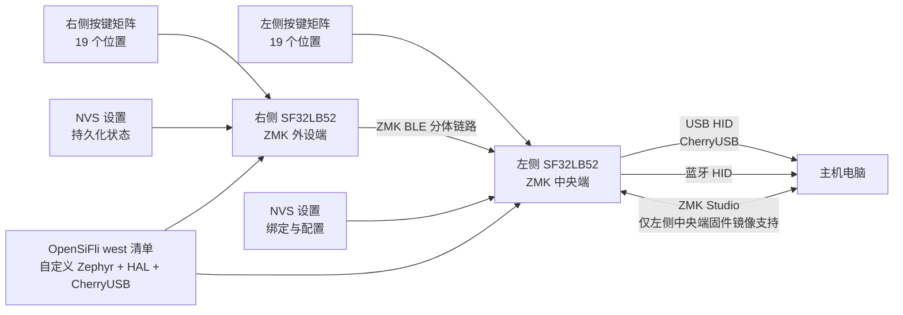

# SF32 上的 ZMK 键盘固件 { #zmk-keyboard-firmware-on-sf32 }

## SF32 上的 ZMK 是什么？ { #what-is-zmk-on-sf32 }

[ZMK Firmware](https://zmk.dev/) 是构建在 Zephyr 上、采用 MIT 许可证的键盘固件。上游 ZMK 提供许多有线、无线和分体键盘所需的应用模型，包括矩阵扫描、键位映射（keymap）与层、按键行为、USB 和蓝牙（Bluetooth）HID、持久化设置，以及可扩展的开发板与扩展板配置（shield）定义。

[OpenSiFli/zmk](https://github.com/OpenSiFli/zmk) 是 OpenSiFli 维护的派生仓库（fork）。经审查的版本新增了：

- `sf32lb52_devkit_lcd/sf32lb525uc6/zmk` 开发板变体；
- ZMK 应用代码树内的 SF32LB52 SoC 集成；
- 单板、分体、ZMK Studio 和 `urchin_sf32lb52` 扩展板配置；
- 面向 SF32 的 CherryUSB 后端；
- 256 KB NVS 设置分区和蓝牙设置支持；
- 带三层键位、蓝牙连接配置控制和 ZMK Studio 解锁绑定的 Urchin 分体键盘键位映射（keymap）。

这是一项正在开发的移植，而不是带 tag 发布的 SF32 ZMK 产品版本。该派生仓库根目录中的 README 仍是上游 ZMK 通用 README，并未提供 SF32 专用快速开始。应以开发板、扩展板配置、清单、源码和 commit 构成的可运行参考为准；在适配前，必须自行取得干净构建、下载、功能和恢复证据。

## 为什么选择 SF32 实现？ { #why-the-sf32-implementation }

SF32 移植展示了如何在 SF32LB52 上运行 ZMK 键盘模型，同时保留 Zephyr 的设备树（devicetree）、Kconfig、`west`、键位映射、扩展板配置和分体键盘约定。`urchin_sf32lb52` 参考把 38 键布局分到左右两半；左侧配置承担 ZMK 分体中央端（central）角色，启用 CherryUSB 与 ZMK Studio，并可向主机提供 USB HID；右侧配置承担外设端（peripheral）角色。两侧均启用 ZMK BLE。

因此，该派生仓库适合评估基于 SF32 的无线分体键盘、USB/蓝牙桌面输入设备、可编程宏键盘或定制人机输入产品。代价在于依赖成熟度：该仓库的 `west` 清单固定了自定义 Zephyr 分支（`v4.3+sf32-zmk_fixes`）、指定的 SiFli HAL 修订版，以及自定义 CherryUSB `zephyr-adapt` 分支。这些依赖共同构成移植兼容边界；未经完整迁移和回归，不能替换为上游“最新版”修订。

## 成果、范围与进入条件 { #outcome-scope-and-entry-criteria }

**目标成果：**构建并下载版本锁定的 Urchin 左右侧镜像；验证完整按键矩阵、层、USB HID、BLE 分体与主机路径、设置持久化、ZMK Studio 边界和恢复；然后完成一项受控键位映射或硬件改动，并保留可复现证据。

本页不声称已经实现全部上游 ZMK 功能、兼容任意 ZMK 扩展板配置、达到量产电池续航、完成无线电性能验证，或支持迁移到其他 Zephyr/ZMK 版本。本页也不定义量产键盘 PCB：仓库中的 Urchin 配置只是把参考按键矩阵映射到 SF32LB52-DevKit-LCD 引脚，必须经过有意的转换，才能用于任何定制硬件。

开始前应准备：

- 两块与该仓库 `sf32lb525uc6/zmk` 变体匹配的 SF32LB52-DevKit-LCD；
- 严格按照 `urchin_sf32lb52_left` 和 `urchin_sf32lb52_right` overlay 接线的 38 键分体测试夹具，或用于初期移植检查且已有记录的小型测试扩展板配置；
- 已配置 Zephyr/ZMK `west` 环境、并有足够空间获取该仓库固定版本模块的主机；
- 在测试分体行为前，已经分别验证两侧的下载、串口控制台和恢复连接；
- 左侧/中央端使用的 USB 数据线，以及可独立供电和恢复右侧/外设端的方法；
- 蓝牙主机；若测试 Studio，还需支持 ZMK Studio 的主机；同时应具备分侧测量电流的条件；
- 用于记录派生仓库 commit、清单版本、开发板/扩展板标识、构建与下载日志、按键结果、绑定、设置状态和电流测量的测试记录。

<div align="center"><em>表：SF32 ZMK 项目基线与验证要求</em></div>

<div align="center" markdown>

| 范围 | 经审查的基线 | 进入适配前必须保留的证据 |
|:-----|:---------------|:-------------------------|
| 派生仓库 | 固定 commit 的 OpenSiFli/zmk | 仓库 commit、与上游项目的关系、清单版本和本地差异记录 |
| 开发板 | `sf32lb52_devkit_lcd/sf32lb525uc6/zmk` | 确切板卡版本、下载/恢复路径和控制台日志 |
| 分体参考 | `urchin_sf32lb52_left` 中央端与 `urchin_sf32lb52_right` 外设端 | 接线、镜像与半侧对应关系、完整矩阵测试和分体链路结果 |
| 主机路径 | 中央端输出的 USB/CherryUSB 与 BLE HID | 枚举、配对/绑定、重连、连接配置和故障恢复证据 |
| 配置 | 三层键位映射（keymap）、NVS 设置和仅左侧启用的 ZMK Studio | 逐键结果、持久化测试、Studio 授权和回滚记录 |
| 适配 | 每次只修改一项键位映射、矩阵、传输、电源或依赖 | 已评审改动、原始镜像和完整回归结果 |

</div>

## 硬件与软件规格 { #hardware-and-software-specifications }

### 硬件规格 { #hardware-specification }

<div align="center"><em>表：SF32 上的 ZMK 硬件规格</em></div>

<div align="center" markdown>

| 器件或设备 | 必要规格 | 用途 | 状态 | 获取方式或来源 | 兼容性与替换说明 |
|:-----------|:---------|:-----|:-----|:---------------|:-----------------|
| 两块 SF32LB52-DevKit-LCD 开发板 | 开发板目标为 `sf32lb52_devkit_lcd/sf32lb525uc6/zmk`；记录两块板卡各自的修订版 | 作为文档所述分体键盘基线的中央端（central）与外设端（peripheral） | 完整分体测试必需 | [μForge 开发板说明](../sf32-products/devkits/SF32LB52-DevKit-LCD.md)；[经审查提交版本中的 OpenSiFli 开发板变体](https://github.com/OpenSiFli/zmk/tree/fd4d5843065f65ed5ed6198dc2e5d0520330bf8e/app/boards/sifli/sf32lb52_devkit_lcd) | 中央端与外设端镜像的角色及配置不同；须为两块板分别保留恢复方式 |
| Urchin 分体键盘测试夹具及互连 | 38 键矩阵，按 `urchin_sf32lb52_left` 和 `urchin_sf32lb52_right` overlay 接线 | 验证按键矩阵、分体传输和两侧角色 | 完整分体验证必需 | [经审查提交版本中的 Urchin 扩展板配置](https://github.com/OpenSiFli/zmk/tree/fd4d5843065f65ed5ed6198dc2e5d0520330bf8e/app/boards/shields/urchin_sf32lb52) | overlay 是接线依据，并不保证适用于其他 PCB 或任意 ZMK 扩展板配置 |
| USB/BLE 主机和数据线 | 中央端需要 USB 主机及线缆；还需要蓝牙 HID 主机；外设端须能独立供电和下载恢复 | 主机连接、输入验证、日志和恢复 | 必需 | [OpenSiFli ZMK 派生仓库](https://github.com/OpenSiFli/zmk) | 记录主机操作系统、BLE 配对状态、线缆/端口，以及两侧各自的恢复连接 |

</div>

### 软件规格 { #software-specification }

<div align="center"><em>表：SF32 上的 ZMK 软件规格</em></div>

<div align="center" markdown>

| 软件包或服务 | 所需版本或修订版 | 用途 | 状态 | 获取方式或来源 | 兼容性与更新说明 |
|:-------------|:-----------------|:-----|:-----|:---------------|:-----------------|
| OpenSiFli/zmk | 经审查提交版本 [`fd4d5843065f`](https://github.com/OpenSiFli/zmk/tree/fd4d5843065f65ed5ed6198dc2e5d0520330bf8e) | SF32 开发板移植、ZMK 应用和 Urchin 配置 | 必需 | [固定提交版本的代码仓库](https://github.com/OpenSiFli/zmk/tree/fd4d5843065f65ed5ed6198dc2e5d0520330bf8e) | 这不是带标签的 SF32 ZMK 发布版本；未经移植和验证，不要改用上游 ZMK |
| West manifest 依赖项 | 固定仓库提交中 `app/west.yml` 解析出的精确修订版 | Zephyr、`hal_sifli`、CherryUSB 和其他模块 | 必需 | [固定提交中的 west manifest](https://github.com/OpenSiFli/zmk/blob/fd4d5843065f65ed5ed6198dc2e5d0520330bf8e/app/west.yml) | 执行并留存 `west list` 结果；不要独立更新依赖项 |
| Zephyr `west` 工具链和构建工具 | 与固定 manifest 兼容的版本；记录已安装版本和主机操作系统 | 配置、构建并生成左右两侧镜像 | 必需 | [ZMK 文档](https://zmk.dev/docs)；[Zephyr 文档](https://docs.zephyrproject.org/) | 在干净工作区分别重新构建两侧镜像，并保留独立构建目录和哈希 |
| ZMK Studio 主机 | 若所选配置启用 Studio，则使用兼容的主机/应用版本 | 可选的键位映射和配置路径 | 可选 | [ZMK Studio 文档](https://zmk.dev/docs/features/studio) | 经审查配置仅在左侧中央端启用 Studio；投入产品前验证授权和回滚 |

</div>

## 选择受支持的基线 { #choose-a-supported-baseline }

经审查的 OpenSiFli 基线提交为 2026-05-27 的 `fd4d5843065f`，其中包含当时 Urchin 扩展板配置与开发板配置的更新，但它并不是带正式发布标签的 SF32 ZMK 版本。初次复现应固定该 commit；如选择更新的 commit，必须明确记录并重新评审。

<div align="center"><em>表：SF32 ZMK 基线选择</em></div>

<div align="center" markdown>

| 基线元素 | 推荐起点 | 关键限制 |
|:---------|:---------|:---------|
| ZMK 派生仓库 | OpenSiFli/zmk `fd4d5843065f` | 不得替换为上游 zmkfirmware/zmk；上游不包含这项 SF32 移植 |
| 开发板目标 | `sf32lb52_devkit_lcd/sf32lb525uc6/zmk` | 这是 SF32LB52-DevKit-LCD 的 ZMK 专用变体 |
| 接近产品的扩展板配置 | `urchin_sf32lb52_left` 和 `urchin_sf32lb52_right` | 两个 overlay 配置定义不同 GPIO 映射和角色；镜像不能互换 |
| 诊断扩展板配置 | `sf32lb52_test`、`sf32lb52_split_test_left/right` 和 `sf32lb52_zmkstudio_test` | 它们是移植开发参考，不代表产品兼容承诺 |
| 分体角色 | 左侧 = central；右侧 = peripheral | USB 与 ZMK Studio 只在左侧配置中启用；不得假定左右对称 |
| 依赖清单 | 自定义 Zephyr `v4.3+sf32-zmk_fixes`、固定 `hal_sifli` 和自定义 CherryUSB `zephyr-adapt` | 更新任何一项依赖都会改变兼容边界 |
| 许可证 | ZMK 派生仓库和已识别 SF32 新增文件采用 MIT 许可证头/许可证 | 模块、硬件、键位映射素材和产品内容仍需分别评审 |

</div>

以下命令沿用该仓库的 `west` 工作流，并使用准确的 SF32 开发板和 Urchin 扩展板配置标识。两个构建目录必须分别保留，避免混淆镜像：

```bash
git clone https://github.com/OpenSiFli/zmk.git
cd zmk
git checkout fd4d5843065f

west init -l app
west update --fetch-opt=--filter=tree:0
west zephyr-export

west build -s app -p always -d build-left \
  -b sf32lb52_devkit_lcd/sf32lb525uc6/zmk -- \
  -DSHIELD=urchin_sf32lb52_left

west build -s app -p always -d build-right \
  -b sf32lb52_devkit_lcd/sf32lb525uc6/zmk -- \
  -DSHIELD=urchin_sf32lb52_right
```

应记录最终 `west list`、生成的 Kconfig 与 devicetree、产物哈希、镜像与半侧标签，以及实际下载流程。在两块开发板均可独立恢复前，不要进入分体测试。

## 交付路径 { #delivery-map }

<div align="center"><em>表：SF32 上 ZMK 交付路径</em></div>

<div align="center" markdown>

| 阶段 | 所支持的决定 | 必须输出 |
|:-----|:-------------|:---------|
| 1. 未修改的移植基线 | 固定版本的派生仓库、开发板目标、扩展板配置、接线和主机能否协同工作？ | 版本锁定的左右镜像和已知可用输入会话 |
| 2. 输入、传输与恢复 | 矩阵、USB、BLE、分体、设置和 Studio 故障是否可诊断并恢复？ | 按键覆盖、故障注入和恢复记录 |
| 3. 源码复现 | 第二套环境能否在没有隐藏状态的前提下重建两个镜像？ | 清单、干净构建、产物哈希、下载和重复结果 |
| 4. 可控适配 | 能否修改一项键盘行为或硬件映射而不破坏原基线？ | 受控改动、回滚路径和回归证据 |
| 5. 产品评审 | 移植成熟度是否足以进入定制 PCB 或电池原型？ | 已指定责任人的风险，以及继续/延期/停止决定 |

</div>

## 系统架构与依赖 { #system-architecture-and-dependencies }

<div align="center"><em>图：SF32LB52 上的 ZMK 分体键盘路径</em></div>



应把故障分为独立范围：物理矩阵/接线、右到左分体链路、左侧 USB、主机蓝牙、已保存的绑定/设置、ZMK Studio、开发板下载/恢复，以及固定依赖栈。按键没有到达主机，可能在扫描前、分体传输期间、中央端键位映射或所选 HID 端点处失败；应按这一路径依次诊断。

## 阶段 1 — 建立未经修改的移植基线 { #stage-1-establish-the-untouched-port-baseline }

**目标：**在修改键位映射（keymap）、overlay 或依赖前，证明 OpenSiFli 的固定参考配置能够复现。

1. 记录两块开发板的版本，严格按左右 Urchin overlay 为两个夹具接线，并按角色标记开发板和 USB/下载线。
2. 在固定 commit 上构建两个镜像，保存 `west list`，检查生成配置中是否包含预期开发板、扩展板配置、分体角色、BLE、CherryUSB、ZMK Studio 和 NVS 设置。
3. 通过各自已验证的恢复路径下载镜像。在配对左右两侧或主机前，先记录冷启动和控制台行为。
4. 建立 BLE 分体连接，然后按照 `default`、`lower` 和 `raise` 三层逐一验证全部 38 个位置。蓝牙连接配置（profile）的选择/清除和 Studio 解锁绑定应单独验证，避免在打字测试中误触发。
5. 验证左侧的 USB HID 与 ZMK Studio，再验证连接到所选主机的蓝牙 HID；冷启动后重复一次。

**应保留证据：**开发板和接线记录、派生仓库 commit 与清单版本、生成配置、镜像哈希、下载与启动日志、完整按键位置矩阵、分层结果、端点选择，以及主机/Studio 版本。

**关口 1 退出条件：**两次冷启动均能复现全部 38 个位置、三层键位映射、右到左分体链路和至少一个所选主机端点；两侧均可独立恢复。

## 阶段 2 — 验证输入、传输、设置与恢复 { #stage-2-validate-input-transport-settings-and-recovery }

**目标：**证明真实键盘故障可观察并恢复，且不需要从未知状态重新构建。

<div align="center"><em>表：SF32 ZMK 故障与恢复测试</em></div>

<div align="center" markdown>

| 测试 | 方法 | 通过证据 |
|:-----|:-----|:---------|
| 矩阵覆盖 | 验证每个位置、多键同时按下（rollover）组合、各层和两侧直接输入 | 不缺键、不重复、不粘键、不交换角色；按下/释放顺序已有记录 |
| 分体链路丢失 | 空闲和输入期间关闭右侧电源或移出连接范围 | 左侧按键和主机链路行为明确；右侧无需重新烧录即可重连，且不会残留陈旧的按键状态 |
| USB 中断 | 输入和使用 Studio 期间断开/重连左侧 USB 数据路径 | HID 与 Studio 能够独立恢复；不留下粘滞修饰键或损坏设置 |
| 主机 BLE 丢失 | 关闭主机蓝牙、切换连接配置并重新连接 | 端点/连接配置状态可见；重连与主动清除绑定均有记录路径 |
| 设置持久化 | 修改一项可逆设置，重启两侧，再恢复基线 | 预期 NVS 状态能够持久化；已有记录的复位/恢复路径可移除损坏或非预期状态 |
| ZMK Studio 边界 | 在可恢复环境中执行一次授权改动，中途断开，再恢复 | 只有中央端镜像暴露 Studio；无效或未完成改动不会让键盘失去恢复路径 |
| 电源循环 | 在记录电流和唤醒的同时，分别及同时重启两侧 | 角色、分体、端点和按键释放状态能够按预期恢复 |

</div>

**关口 2 退出条件：**每项适用故障都有可重复的检测与恢复结果；测试不会留下粘滞 HID 状态；无需替换未纳入版本控制的文件，即可把设置或绑定恢复到记录基线。

## 阶段 3 — 建立可复现源码基线 { #stage-3-build-a-reproducible-source-baseline }

**目标：**让第二位工程师可以从干净源码重建两个镜像并重复阶段 2。

1. 从已记录 commit 检出的干净派生仓库开始，在不替换本地模块的情况下执行 `west init`、`west update` 和 `west zephyr-export`。
2. 保存 `west list`、编译器/工具版本、生成的 `.config`、生成的 devicetree、内存输出、构建日志，以及带哈希的两个产物。
3. 将已标记的左右镜像分别下载到正确半侧，然后重复完整阶段 2 测试。
4. 将产物和配置与原始记录比较；任何不可复现差异都必须在继续前得到解释。

**关口 3 退出条件：**第二套环境不依赖未跟踪 overlay、旧构建产物或浮动依赖版本，即可生成通过阶段 2 且左右标记正确的镜像。

## 阶段 4 — 每次只适配一个键盘边界 { #stage-4-adapt-one-keyboard-boundary-at-a-time }

**目标：**在保留已知可用移植和独立恢复路径的同时，完成一项产品改动。

<div align="center"><em>表：SF32 ZMK 可控适配顺序</em></div>

<div align="center" markdown>

| 改动类别 | 合理起点 | 必须回归 |
|:---------|:---------|:---------|
| 键位映射 | 一个按键绑定、层、hold-tap 或组合键 | 全部位置/层、按下-释放顺序、多键输入、分体中断和两个主机端点 |
| 矩阵/PCB | 一项行、列、直接输入或二极管方向改动 | 电气评审、生成的 devicetree、完整矩阵、短路/鬼键、唤醒和恢复 |
| Studio | 一个可编辑参数或布局暴露项 | 授权、有效/无效改动、持久化、断连、恢复和版本兼容性 |
| 传输 | 一项 USB/BLE 端点或分体策略改动 | 枚举、配对、绑定、连接配置切换、分体重连、防粘键和电流 |
| 功耗管理 | 一项睡眠、唤醒、扫描或射频设置 | 分侧活动/空闲/睡眠电流、延迟（latency）、所有唤醒源、分体重连和设置保留 |
| 依赖迁移 | 一项 ZMK、Zephyr、HAL 或 CherryUSB 更新 | 清单差异、干净构建、生成配置差异、全部阶段 2 测试、电流和回滚 |

</div>

**关口 4 退出条件：**改动已经评审，原始镜像和设置可以恢复，并且所有适用矩阵、层、分体、USB、BLE、Studio、功耗和恢复测试均通过。

## 阶段 5 — 产品就绪评审 { #stage-5-product-readiness-review }

进入定制键盘 PCB 或电池原型设计前，应回答：

- OpenSiFli ZMK 派生仓库、自定义 Zephyr 分支、SiFli HAL 版本、CherryUSB 适配，以及后续安全或兼容更新分别由谁负责？
- 哪些上游 ZMK 功能已经在 SF32 上实际验证？哪些只是继承代码树中存在？
- 量产和售后如何管理左右镜像标识、板卡版本、键位映射、配置、绑定和恢复出厂状态？
- 两侧在活动、连接空闲、断连和睡眠状态下的实测电流分别是多少（包括扫描速率、重连行为和电池保护）？
- 已覆盖哪些主机、操作系统、USB 控制器、蓝牙协议栈、唤醒路径、多键输入情况和干扰环境？
- 依赖更新、Studio 改动、设置写入或现场升级失败后，能否在不拆机或报废产品的情况下恢复？
- ZMK/Zephyr 许可证、PCB 和外壳文件、键位映射内容、Logo、字体和所有随附配置是否允许预期分发？

**关口 5 退出条件：**每项剩余风险都有负责人、证据和处置结论，团队已明确决定继续、延期或停止。

## 交接给产品设计 { #handoff-to-product-design }

交接资料应包含确切 SF32 型号与存储器、分体角色与传输方式、行/列/直接输入映射、二极管方向、USB 连接、天线和外壳假设、NVS/设置策略、下载和恢复接口、分侧功耗预算、测试夹具、镜像标识和固定依赖清单。后续可参阅 [SF32LB52-DevKit-LCD](../sf32-products/devkits/SF32LB52-DevKit-LCD.md)、[Zephyr 平台边界](../develop/platforms/zephyr/overview.md)、[蓝牙架构](../learn/bluetooth/overview.md)、[SF32LB52x 硬件设计指南](../hardware/chip-guides/SF32LB52x_hardware_design_guide.md)和[面向量产的设计](../hardware/design-for-production.md)。

## 权威来源 { #authoritative-sources }

- [OpenSiFli/zmk SF32 派生仓库](https://github.com/OpenSiFli/zmk)
- [经审查的 OpenSiFli/zmk commit](https://github.com/OpenSiFli/zmk/tree/fd4d5843065f65ed5ed6198dc2e5d0520330bf8e)
- [SF32LB52 ZMK 开发板变体（经审查提交版本）](https://github.com/OpenSiFli/zmk/tree/fd4d5843065f65ed5ed6198dc2e5d0520330bf8e/app/boards/sifli/sf32lb52_devkit_lcd)
- [Urchin SF32LB52 分体扩展板配置（经审查提交版本）](https://github.com/OpenSiFli/zmk/tree/fd4d5843065f65ed5ed6198dc2e5d0520330bf8e/app/boards/shields/urchin_sf32lb52)
- [OpenSiFli ZMK west 清单（经审查提交版本）](https://github.com/OpenSiFli/zmk/blob/fd4d5843065f65ed5ed6198dc2e5d0520330bf8e/app/west.yml)
- [上游 zmkfirmware/zmk](https://github.com/zmkfirmware/zmk)
- [ZMK 文档](https://zmk.dev/docs/)
- [Zephyr 项目文档](https://docs.zephyrproject.org/)
